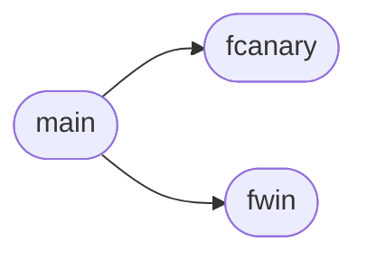

# `progs/asm/cvmfmt.s`

> Source: [progs/asm/cvmfmt.s:1](../../progs/asm/cvmfmt.s#L1) | language `s` | coverage 0.0% | [API index](../index.md)

## Contents

- **Functions:** [`fwin`](#fwin), [`fcanary`](#fcanary), [`main`](#main), [`_start`](#_start)

## Call Graph

Solid arrows stay in this module, dashed arrows leave it.



## Functions

<a id="fwin"></a>

### `fwin`

`function` | [progs/asm/cvmfmt.s:3](../../progs/asm/cvmfmt.s#L3)

```asm
fwin:
```

*Called by:* [`main`](#main)

---

<a id="fcanary"></a>

### `fcanary`

`function` | [progs/asm/cvmfmt.s:7](../../progs/asm/cvmfmt.s#L7)

```asm
fcanary:
```

*Called by:* [`main`](#main)

---

<a id="main"></a>

### `main`

`function` | [progs/asm/cvmfmt.s:11](../../progs/asm/cvmfmt.s#L11)

```asm
main:
```

*Calls:* [`fcanary`](#fcanary), [`fwin`](#fwin)

---

<a id="_start"></a>

### `_start`

`function` | [progs/asm/cvmfmt.s:245](../../progs/asm/cvmfmt.s#L245)

```asm
_start:
```

---
