# `progs/asm/freedom.s`

> Source: [progs/asm/freedom.s:1](../../progs/asm/freedom.s#L1) | language `s` | coverage 0.0% | [API index](../index.md)

## Contents

- **Functions:** [`tls_close`](#tls_close), [`f_host`](#f_host), [`f_path`](#f_path), [`f_port`](#f_port), [`f_secure`](#f_secure), [`f_loc`](#f_loc), [`f_redir`](#f_redir), [`f_status`](#f_status), [`f_clen`](#f_clen), [`f_has_clen`](#f_has_clen), [`f_chunked`](#f_chunked), [`f_hdr`](#f_hdr), [`f_hlen`](#f_hlen), [`f_tag`](#f_tag), [`f_suppress`](#f_suppress), [`f_comment`](#f_comment), [`f_cmdash`](#f_cmdash), [`f_tagn`](#f_tagn), [`f_tagnlen`](#f_tagnlen), [`f_ent`](#f_ent), [`f_entlen`](#f_entlen), [`f_ws`](#f_ws), [`f_utbuf`](#f_utbuf), [`f_utlen`](#f_utlen), [`f_utrem`](#f_utrem), [`f_attr_on`](#f_attr_on), [`f_waitq`](#f_waitq), [`f_inval`](#f_inval), [`f_inval2`](#f_inval2), [`f_attr`](#f_attr), [`f_attrlen`](#f_attrlen), [`f_val`](#f_val), [`f_vallen`](#f_vallen), [`f_id`](#f_id), [`f_idlen`](#f_idlen), [`f_cls`](#f_cls), [`f_clslen`](#f_clslen), [`f_href`](#f_href), [`f_hreflen`](#f_hreflen), [`f_rel_ss`](#f_rel_ss), [`f_styleattr`](#f_styleattr), [`f_stylelen`](#f_stylelen), [`f_dump_css`](#f_dump_css), [`f_dump_dom`](#f_dump_dom), [`f_mode`](#f_mode), [`f_rawcap`](#f_rawcap), [`f_depth`](#f_depth), [`f_dom`](#f_dom), [`f_domlen`](#f_domlen), [`f_css`](#f_css), [`f_csslen`](#f_csslen), [`f_linkhost`](#f_linkhost), [`f_linkpath`](#f_linkpath), [`f_linkn`](#f_linkn), [`f_cstage`](#f_cstage), [`f_csize`](#f_csize), [`f_crem`](#f_crem), [`f_bdone`](#f_bdone), [`atoi`](#atoi), [`append`](#append), [`ci_lower`](#ci_lower), [`ci_starts`](#ci_starts), [`ci_eq`](#ci_eq), [`ci_index`](#ci_index), [`looks_like_url`](#looks_like_url), [`has_scheme`](#has_scheme), [`make_search`](#make_search), [`split_url`](#split_url), [`resolve_redirect`](#resolve_redirect), [`put_ws`](#put_ws), [`put_utf`](#put_utf), [`put_text`](#put_text), [`put_entity`](#put_entity), [`css_append`](#css_append), [`css_line`](#css_line), [`dom_append`](#dom_append), [`dom_space`](#dom_space), [`dom_nl`](#dom_nl), [`record_attr`](#record_attr), [`is_void_tag`](#is_void_tag), [`classify_tag`](#classify_tag), [`body_byte`](#body_byte), [`head_line`](#head_line), [`parse_head`](#parse_head), [`recv_body`](#recv_body), [`send_all`](#send_all), [`fetch`](#fetch), [`fetch_css`](#fetch_css), [`print_css_dump`](#print_css_dump), [`print_dom_dump`](#print_dom_dump), [`main`](#main), [`_start`](#_start)

## Call Graph

Solid arrows stay in this module, dashed arrows leave it.

```mermaid
flowchart LR
    n_progs_asm_freedom_s__split_url(["split_url"])
    n_progs_asm_freedom_s__f_secure(["f_secure"])
    n_progs_asm_freedom_s__resolve_redirect(["resolve_redirect"])
    n_progs_asm_freedom_s__f_loc(["f_loc"])
    n_progs_asm_freedom_s__put_ws(["put_ws"])
    n_progs_asm_freedom_s__f_mode(["f_mode"])
    n_progs_asm_freedom_s__f_ws(["f_ws"])
    n_progs_asm_freedom_s__put_text(["put_text"])
    n_progs_asm_freedom_s__css_line(["css_line"])
    n_progs_asm_freedom_s__f_css(["f_css"])
    n_progs_asm_freedom_s__f_csslen(["f_csslen"])
    n_progs_asm_freedom_s__dom_space(["dom_space"])
    n_progs_asm_freedom_s__f_dom(["f_dom"])
    n_progs_asm_freedom_s__f_domlen(["f_domlen"])
    n_progs_asm_freedom_s__dom_nl(["dom_nl"])
    n_progs_asm_freedom_s__record_attr(["record_attr"])
    n_progs_asm_freedom_s__f_attrlen(["f_attrlen"])
    n_progs_asm_freedom_s__f_vallen(["f_vallen"])
    n_progs_asm_freedom_s__is_void_tag(["is_void_tag"])
    n_progs_asm_freedom_s__f_tagn(["f_tagn"])
    n_progs_asm_freedom_s__classify_tag(["classify_tag"])
    n_progs_asm_freedom_s__f_tagnlen(["f_tagnlen"])
    n_progs_asm_freedom_s__body_byte(["body_byte"])
    n_progs_asm_freedom_s__f_cmdash(["f_cmdash"])
    n_progs_asm_freedom_s__f_comment(["f_comment"])
    n_progs_asm_freedom_s__recv_body(["recv_body"])
    n_progs_asm_freedom_s__send_all(["send_all"])
    n_progs_asm_freedom_s__main(["main"])
    n_progs_asm_freedom_s__f_dump_css(["f_dump_css"])
    n_progs_asm_freedom_s__f_dump_dom(["f_dump_dom"])
    n_progs_asm_freedom_s__split_url --> n_progs_asm_freedom_s__f_secure
    n_progs_asm_freedom_s__resolve_redirect --> n_progs_asm_freedom_s__f_loc
    n_progs_asm_freedom_s__put_ws --> n_progs_asm_freedom_s__f_mode
    n_progs_asm_freedom_s__put_ws --> n_progs_asm_freedom_s__f_ws
    n_progs_asm_freedom_s__put_text --> n_progs_asm_freedom_s__f_mode
    n_progs_asm_freedom_s__css_line --> n_progs_asm_freedom_s__f_css
    n_progs_asm_freedom_s__css_line --> n_progs_asm_freedom_s__f_csslen
    n_progs_asm_freedom_s__dom_space --> n_progs_asm_freedom_s__f_dom
    n_progs_asm_freedom_s__dom_space --> n_progs_asm_freedom_s__f_domlen
    n_progs_asm_freedom_s__dom_nl --> n_progs_asm_freedom_s__f_dom
    n_progs_asm_freedom_s__dom_nl --> n_progs_asm_freedom_s__f_domlen
    n_progs_asm_freedom_s__record_attr --> n_progs_asm_freedom_s__f_attrlen
    n_progs_asm_freedom_s__record_attr --> n_progs_asm_freedom_s__f_vallen
    n_progs_asm_freedom_s__is_void_tag --> n_progs_asm_freedom_s__f_tagn
    n_progs_asm_freedom_s__classify_tag --> n_progs_asm_freedom_s__f_tagn
    n_progs_asm_freedom_s__classify_tag --> n_progs_asm_freedom_s__f_tagnlen
    n_progs_asm_freedom_s__body_byte --> n_progs_asm_freedom_s__f_cmdash
    n_progs_asm_freedom_s__body_byte --> n_progs_asm_freedom_s__f_comment
    n_progs_asm_freedom_s__recv_body --> n_progs_asm_freedom_s__f_secure
    n_progs_asm_freedom_s__send_all --> n_progs_asm_freedom_s__f_secure
    n_progs_asm_freedom_s__main --> n_progs_asm_freedom_s__f_csslen
    n_progs_asm_freedom_s__main --> n_progs_asm_freedom_s__f_domlen
    n_progs_asm_freedom_s__main --> n_progs_asm_freedom_s__f_dump_css
    n_progs_asm_freedom_s__main --> n_progs_asm_freedom_s__f_dump_dom
```



## Functions

<a id="tls_close"></a>

### `tls_close`

`function` | [progs/asm/freedom.s:3](../../progs/asm/freedom.s#L3)

```asm
tls_close:
```

---

<a id="f_host"></a>

### `f_host`

`function` | [progs/asm/freedom.s:24](../../progs/asm/freedom.s#L24)

```asm
f_host:
```

---

<a id="f_path"></a>

### `f_path`

`function` | [progs/asm/freedom.s:28](../../progs/asm/freedom.s#L28)

```asm
f_path:
```

---

<a id="f_port"></a>

### `f_port`

`function` | [progs/asm/freedom.s:32](../../progs/asm/freedom.s#L32)

```asm
f_port:
```

---

<a id="f_secure"></a>

### `f_secure`

`function` | [progs/asm/freedom.s:36](../../progs/asm/freedom.s#L36)

```asm
f_secure:
```

*Called by:* [`recv_body`](#recv_body), [`send_all`](#send_all), [`split_url`](#split_url)

---

<a id="f_loc"></a>

### `f_loc`

`function` | [progs/asm/freedom.s:40](../../progs/asm/freedom.s#L40)

```asm
f_loc:
```

*Called by:* [`resolve_redirect`](#resolve_redirect)

---

<a id="f_redir"></a>

### `f_redir`

`function` | [progs/asm/freedom.s:44](../../progs/asm/freedom.s#L44)

```asm
f_redir:
```

---

<a id="f_status"></a>

### `f_status`

`function` | [progs/asm/freedom.s:48](../../progs/asm/freedom.s#L48)

```asm
f_status:
```

---

<a id="f_clen"></a>

### `f_clen`

`function` | [progs/asm/freedom.s:52](../../progs/asm/freedom.s#L52)

```asm
f_clen:
```

---

<a id="f_has_clen"></a>

### `f_has_clen`

`function` | [progs/asm/freedom.s:56](../../progs/asm/freedom.s#L56)

```asm
f_has_clen:
```

---

<a id="f_chunked"></a>

### `f_chunked`

`function` | [progs/asm/freedom.s:60](../../progs/asm/freedom.s#L60)

```asm
f_chunked:
```

---

<a id="f_hdr"></a>

### `f_hdr`

`function` | [progs/asm/freedom.s:64](../../progs/asm/freedom.s#L64)

```asm
f_hdr:
```

---

<a id="f_hlen"></a>

### `f_hlen`

`function` | [progs/asm/freedom.s:68](../../progs/asm/freedom.s#L68)

```asm
f_hlen:
```

---

<a id="f_tag"></a>

### `f_tag`

`function` | [progs/asm/freedom.s:72](../../progs/asm/freedom.s#L72)

```asm
f_tag:
```

---

<a id="f_suppress"></a>

### `f_suppress`

`function` | [progs/asm/freedom.s:76](../../progs/asm/freedom.s#L76)

```asm
f_suppress:
```

---

<a id="f_comment"></a>

### `f_comment`

`function` | [progs/asm/freedom.s:80](../../progs/asm/freedom.s#L80)

```asm
f_comment:
```

*Called by:* [`body_byte`](#body_byte)

---

<a id="f_cmdash"></a>

### `f_cmdash`

`function` | [progs/asm/freedom.s:84](../../progs/asm/freedom.s#L84)

```asm
f_cmdash:
```

*Called by:* [`body_byte`](#body_byte)

---

<a id="f_tagn"></a>

### `f_tagn`

`function` | [progs/asm/freedom.s:88](../../progs/asm/freedom.s#L88)

```asm
f_tagn:
```

*Called by:* [`classify_tag`](#classify_tag), [`is_void_tag`](#is_void_tag)

---

<a id="f_tagnlen"></a>

### `f_tagnlen`

`function` | [progs/asm/freedom.s:92](../../progs/asm/freedom.s#L92)

```asm
f_tagnlen:
```

*Called by:* [`classify_tag`](#classify_tag)

---

<a id="f_ent"></a>

### `f_ent`

`function` | [progs/asm/freedom.s:96](../../progs/asm/freedom.s#L96)

```asm
f_ent:
```

---

<a id="f_entlen"></a>

### `f_entlen`

`function` | [progs/asm/freedom.s:100](../../progs/asm/freedom.s#L100)

```asm
f_entlen:
```

---

<a id="f_ws"></a>

### `f_ws`

`function` | [progs/asm/freedom.s:104](../../progs/asm/freedom.s#L104)

```asm
f_ws:
```

*Called by:* [`put_ws`](#put_ws)

---

<a id="f_utbuf"></a>

### `f_utbuf`

`function` | [progs/asm/freedom.s:108](../../progs/asm/freedom.s#L108)

```asm
f_utbuf:
```

---

<a id="f_utlen"></a>

### `f_utlen`

`function` | [progs/asm/freedom.s:112](../../progs/asm/freedom.s#L112)

```asm
f_utlen:
```

---

<a id="f_utrem"></a>

### `f_utrem`

`function` | [progs/asm/freedom.s:116](../../progs/asm/freedom.s#L116)

```asm
f_utrem:
```

---

<a id="f_attr_on"></a>

### `f_attr_on`

`function` | [progs/asm/freedom.s:120](../../progs/asm/freedom.s#L120)

```asm
f_attr_on:
```

---

<a id="f_waitq"></a>

### `f_waitq`

`function` | [progs/asm/freedom.s:124](../../progs/asm/freedom.s#L124)

```asm
f_waitq:
```

---

<a id="f_inval"></a>

### `f_inval`

`function` | [progs/asm/freedom.s:128](../../progs/asm/freedom.s#L128)

```asm
f_inval:
```

---

<a id="f_inval2"></a>

### `f_inval2`

`function` | [progs/asm/freedom.s:132](../../progs/asm/freedom.s#L132)

```asm
f_inval2:
```

---

<a id="f_attr"></a>

### `f_attr`

`function` | [progs/asm/freedom.s:136](../../progs/asm/freedom.s#L136)

```asm
f_attr:
```

---

<a id="f_attrlen"></a>

### `f_attrlen`

`function` | [progs/asm/freedom.s:140](../../progs/asm/freedom.s#L140)

```asm
f_attrlen:
```

*Called by:* [`record_attr`](#record_attr)

---

<a id="f_val"></a>

### `f_val`

`function` | [progs/asm/freedom.s:144](../../progs/asm/freedom.s#L144)

```asm
f_val:
```

---

<a id="f_vallen"></a>

### `f_vallen`

`function` | [progs/asm/freedom.s:148](../../progs/asm/freedom.s#L148)

```asm
f_vallen:
```

*Called by:* [`record_attr`](#record_attr)

---

<a id="f_id"></a>

### `f_id`

`function` | [progs/asm/freedom.s:152](../../progs/asm/freedom.s#L152)

```asm
f_id:
```

---

<a id="f_idlen"></a>

### `f_idlen`

`function` | [progs/asm/freedom.s:156](../../progs/asm/freedom.s#L156)

```asm
f_idlen:
```

---

<a id="f_cls"></a>

### `f_cls`

`function` | [progs/asm/freedom.s:160](../../progs/asm/freedom.s#L160)

```asm
f_cls:
```

---

<a id="f_clslen"></a>

### `f_clslen`

`function` | [progs/asm/freedom.s:164](../../progs/asm/freedom.s#L164)

```asm
f_clslen:
```

---

<a id="f_href"></a>

### `f_href`

`function` | [progs/asm/freedom.s:168](../../progs/asm/freedom.s#L168)

```asm
f_href:
```

---

<a id="f_hreflen"></a>

### `f_hreflen`

`function` | [progs/asm/freedom.s:172](../../progs/asm/freedom.s#L172)

```asm
f_hreflen:
```

---

<a id="f_rel_ss"></a>

### `f_rel_ss`

`function` | [progs/asm/freedom.s:176](../../progs/asm/freedom.s#L176)

```asm
f_rel_ss:
```

---

<a id="f_styleattr"></a>

### `f_styleattr`

`function` | [progs/asm/freedom.s:180](../../progs/asm/freedom.s#L180)

```asm
f_styleattr:
```

---

<a id="f_stylelen"></a>

### `f_stylelen`

`function` | [progs/asm/freedom.s:184](../../progs/asm/freedom.s#L184)

```asm
f_stylelen:
```

---

<a id="f_dump_css"></a>

### `f_dump_css`

`function` | [progs/asm/freedom.s:188](../../progs/asm/freedom.s#L188)

```asm
f_dump_css:
```

*Called by:* [`main`](#main)

---

<a id="f_dump_dom"></a>

### `f_dump_dom`

`function` | [progs/asm/freedom.s:192](../../progs/asm/freedom.s#L192)

```asm
f_dump_dom:
```

*Called by:* [`main`](#main)

---

<a id="f_mode"></a>

### `f_mode`

`function` | [progs/asm/freedom.s:196](../../progs/asm/freedom.s#L196)

```asm
f_mode:
```

*Called by:* [`main`](#main), [`put_text`](#put_text), [`put_ws`](#put_ws)

---

<a id="f_rawcap"></a>

### `f_rawcap`

`function` | [progs/asm/freedom.s:200](../../progs/asm/freedom.s#L200)

```asm
f_rawcap:
```

---

<a id="f_depth"></a>

### `f_depth`

`function` | [progs/asm/freedom.s:204](../../progs/asm/freedom.s#L204)

```asm
f_depth:
```

---

<a id="f_dom"></a>

### `f_dom`

`function` | [progs/asm/freedom.s:208](../../progs/asm/freedom.s#L208)

```asm
f_dom:
```

*Called by:* [`dom_nl`](#dom_nl), [`dom_space`](#dom_space)

---

<a id="f_domlen"></a>

### `f_domlen`

`function` | [progs/asm/freedom.s:212](../../progs/asm/freedom.s#L212)

```asm
f_domlen:
```

*Called by:* [`dom_nl`](#dom_nl), [`dom_space`](#dom_space), [`main`](#main)

---

<a id="f_css"></a>

### `f_css`

`function` | [progs/asm/freedom.s:216](../../progs/asm/freedom.s#L216)

```asm
f_css:
```

*Called by:* [`css_line`](#css_line)

---

<a id="f_csslen"></a>

### `f_csslen`

`function` | [progs/asm/freedom.s:220](../../progs/asm/freedom.s#L220)

```asm
f_csslen:
```

*Called by:* [`css_line`](#css_line), [`main`](#main)

---

<a id="f_linkhost"></a>

### `f_linkhost`

`function` | [progs/asm/freedom.s:224](../../progs/asm/freedom.s#L224)

```asm
f_linkhost:
```

---

<a id="f_linkpath"></a>

### `f_linkpath`

`function` | [progs/asm/freedom.s:228](../../progs/asm/freedom.s#L228)

```asm
f_linkpath:
```

---

<a id="f_linkn"></a>

### `f_linkn`

`function` | [progs/asm/freedom.s:232](../../progs/asm/freedom.s#L232)

```asm
f_linkn:
```

*Called by:* [`main`](#main)

---

<a id="f_cstage"></a>

### `f_cstage`

`function` | [progs/asm/freedom.s:236](../../progs/asm/freedom.s#L236)

```asm
f_cstage:
```

---

<a id="f_csize"></a>

### `f_csize`

`function` | [progs/asm/freedom.s:240](../../progs/asm/freedom.s#L240)

```asm
f_csize:
```

---

<a id="f_crem"></a>

### `f_crem`

`function` | [progs/asm/freedom.s:244](../../progs/asm/freedom.s#L244)

```asm
f_crem:
```

---

<a id="f_bdone"></a>

### `f_bdone`

`function` | [progs/asm/freedom.s:248](../../progs/asm/freedom.s#L248)

```asm
f_bdone:
```

---

<a id="atoi"></a>

### `atoi`

`function` | [progs/asm/freedom.s:252](../../progs/asm/freedom.s#L252)

```asm
atoi:
```

---

<a id="append"></a>

### `append`

`function` | [progs/asm/freedom.s:338](../../progs/asm/freedom.s#L338)

```asm
append:
```

---

<a id="ci_lower"></a>

### `ci_lower`

`function` | [progs/asm/freedom.s:437](../../progs/asm/freedom.s#L437)

```asm
ci_lower:
```

---

<a id="ci_starts"></a>

### `ci_starts`

`function` | [progs/asm/freedom.s:486](../../progs/asm/freedom.s#L486)

```asm
ci_starts:
```

---

<a id="ci_eq"></a>

### `ci_eq`

`function` | [progs/asm/freedom.s:559](../../progs/asm/freedom.s#L559)

```asm
ci_eq:
```

---

<a id="ci_index"></a>

### `ci_index`

`function` | [progs/asm/freedom.s:656](../../progs/asm/freedom.s#L656)

```asm
ci_index:
```

---

<a id="looks_like_url"></a>

### `looks_like_url`

`function` | [progs/asm/freedom.s:715](../../progs/asm/freedom.s#L715)

```asm
looks_like_url:
```

*Called by:* [`main`](progs.src.freedom.c.md#main)

---

<a id="has_scheme"></a>

### `has_scheme`

`function` | [progs/asm/freedom.s:789](../../progs/asm/freedom.s#L789)

```asm
has_scheme:
```

*Called by:* [`main`](progs.src.freedom.c.md#main)

---

<a id="make_search"></a>

### `make_search`

`function` | [progs/asm/freedom.s:1064](../../progs/asm/freedom.s#L1064)

```asm
make_search:
```

*Called by:* [`main`](progs.src.freedom.c.md#main)

---

<a id="split_url"></a>

### `split_url`

`function` | [progs/asm/freedom.s:1295](../../progs/asm/freedom.s#L1295)

```asm
split_url:
```

*Calls:* [`f_secure`](#f_secure)

*Called by:* [`main`](progs.src.freedom.c.md#main)

---

<a id="resolve_redirect"></a>

### `resolve_redirect`

`function` | [progs/asm/freedom.s:1810](../../progs/asm/freedom.s#L1810)

```asm
resolve_redirect:
```

*Calls:* [`f_loc`](#f_loc)

*Called by:* [`main`](progs.src.freedom.c.md#main)

---

<a id="put_ws"></a>

### `put_ws`

`function` | [progs/asm/freedom.s:2333](../../progs/asm/freedom.s#L2333)

```asm
put_ws:
```

*Calls:* [`f_mode`](#f_mode), [`f_ws`](#f_ws)

---

<a id="put_utf"></a>

### `put_utf`

`function` | [progs/asm/freedom.s:2379](../../progs/asm/freedom.s#L2379)

```asm
put_utf:
```

---

<a id="put_text"></a>

### `put_text`

`function` | [progs/asm/freedom.s:2915](../../progs/asm/freedom.s#L2915)

```asm
put_text:
```

*Calls:* [`f_mode`](#f_mode)

---

<a id="put_entity"></a>

### `put_entity`

`function` | [progs/asm/freedom.s:3018](../../progs/asm/freedom.s#L3018)

```asm
put_entity:
```

---

<a id="css_append"></a>

### `css_append`

`function` | [progs/asm/freedom.s:3849](../../progs/asm/freedom.s#L3849)

```asm
css_append:
```

---

<a id="css_line"></a>

### `css_line`

`function` | [progs/asm/freedom.s:3920](../../progs/asm/freedom.s#L3920)

```asm
css_line:
```

*Calls:* [`f_css`](#f_css), [`f_csslen`](#f_csslen)

---

<a id="dom_append"></a>

### `dom_append`

`function` | [progs/asm/freedom.s:3978](../../progs/asm/freedom.s#L3978)

```asm
dom_append:
```

---

<a id="dom_space"></a>

### `dom_space`

`function` | [progs/asm/freedom.s:4049](../../progs/asm/freedom.s#L4049)

```asm
dom_space:
```

*Calls:* [`f_dom`](#f_dom), [`f_domlen`](#f_domlen)

---

<a id="dom_nl"></a>

### `dom_nl`

`function` | [progs/asm/freedom.s:4083](../../progs/asm/freedom.s#L4083)

```asm
dom_nl:
```

*Calls:* [`f_dom`](#f_dom), [`f_domlen`](#f_domlen)

---

<a id="record_attr"></a>

### `record_attr`

`function` | [progs/asm/freedom.s:4117](../../progs/asm/freedom.s#L4117)

```asm
record_attr:
```

*Calls:* [`f_attrlen`](#f_attrlen), [`f_vallen`](#f_vallen)

---

<a id="is_void_tag"></a>

### `is_void_tag`

`function` | [progs/asm/freedom.s:4449](../../progs/asm/freedom.s#L4449)

```asm
is_void_tag:
```

*Calls:* [`f_tagn`](#f_tagn)

---

<a id="classify_tag"></a>

### `classify_tag`

`function` | [progs/asm/freedom.s:4757](../../progs/asm/freedom.s#L4757)

```asm
classify_tag:
```

*Calls:* [`f_tagn`](#f_tagn), [`f_tagnlen`](#f_tagnlen)

---

<a id="body_byte"></a>

### `body_byte`

`function` | [progs/asm/freedom.s:5961](../../progs/asm/freedom.s#L5961)

```asm
body_byte:
```

*Calls:* [`f_cmdash`](#f_cmdash), [`f_comment`](#f_comment)

---

<a id="head_line"></a>

### `head_line`

`function` | [progs/asm/freedom.s:7203](../../progs/asm/freedom.s#L7203)

```asm
head_line:
```

---

<a id="parse_head"></a>

### `parse_head`

`function` | [progs/asm/freedom.s:7460](../../progs/asm/freedom.s#L7460)

```asm
parse_head:
```

---

<a id="recv_body"></a>

### `recv_body`

`function` | [progs/asm/freedom.s:7676](../../progs/asm/freedom.s#L7676)

```asm
recv_body:
```

*Calls:* [`f_secure`](#f_secure)

---

<a id="send_all"></a>

### `send_all`

`function` | [progs/asm/freedom.s:7736](../../progs/asm/freedom.s#L7736)

```asm
send_all:
```

*Calls:* [`f_secure`](#f_secure)

---

<a id="fetch"></a>

### `fetch`

`function` | [progs/asm/freedom.s:7810](../../progs/asm/freedom.s#L7810)

```asm
fetch:
```

---

<a id="fetch_css"></a>

### `fetch_css`

`function` | [progs/asm/freedom.s:9293](../../progs/asm/freedom.s#L9293)

```asm
fetch_css:
```

*Called by:* [`main`](progs.src.freedom.c.md#main)

---

<a id="print_css_dump"></a>

### `print_css_dump`

`function` | [progs/asm/freedom.s:10112](../../progs/asm/freedom.s#L10112)

```asm
print_css_dump:
```

*Called by:* [`main`](progs.src.freedom.c.md#main)

---

<a id="print_dom_dump"></a>

### `print_dom_dump`

`function` | [progs/asm/freedom.s:10212](../../progs/asm/freedom.s#L10212)

```asm
print_dom_dump:
```

*Called by:* [`main`](progs.src.freedom.c.md#main)

---

<a id="main"></a>

### `main`

`function` | [progs/asm/freedom.s:10291](../../progs/asm/freedom.s#L10291)

```asm
main:
```

*Calls:* [`f_csslen`](#f_csslen), [`f_domlen`](#f_domlen), [`f_dump_css`](#f_dump_css), [`f_dump_dom`](#f_dump_dom), [`f_linkn`](#f_linkn), [`f_mode`](#f_mode)

---

<a id="_start"></a>

### `_start`

`function` | [progs/asm/freedom.s:11761](../../progs/asm/freedom.s#L11761)

```asm
_start:
```

---
