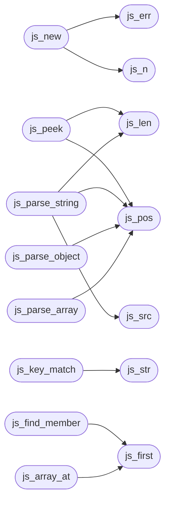

# `progs/asm/json.s`

> Source: [progs/asm/json.s:1](../../progs/asm/json.s#L1) | language `s` | coverage 0.0% | [API index](../index.md)

## Contents

- **Functions:** [`js_key`](#js_key), [`js_str`](#js_str), [`js_type`](#js_type), [`js_num`](#js_num), [`js_first`](#js_first), [`js_count`](#js_count), [`js_next`](#js_next), [`js_n`](#js_n), [`js_pool`](#js_pool), [`js_plen`](#js_plen), [`js_src`](#js_src), [`js_pos`](#js_pos), [`js_len`](#js_len), [`js_err`](#js_err), [`js_read_all`](#js_read_all), [`js_new`](#js_new), [`js_skip_ws`](#js_skip_ws), [`js_peek`](#js_peek), [`js_parse_string`](#js_parse_string), [`js_parse_number`](#js_parse_number), [`js_key_match`](#js_key_match), [`js_parse_object`](#js_parse_object), [`js_parse_array`](#js_parse_array), [`js_parse_value`](#js_parse_value), [`js_indent`](#js_indent), [`js_print_str`](#js_print_str), [`js_print_value`](#js_print_value), [`js_find_member`](#js_find_member), [`js_array_at`](#js_array_at), [`js_query`](#js_query), [`main`](#main), [`_start`](#_start)

## Call Graph

Solid arrows stay in this module, dashed arrows leave it.



## Functions

<a id="js_key"></a>

### `js_key`

`function` | [progs/asm/json.s:3](../../progs/asm/json.s#L3)

```asm
js_key:
```

---

<a id="js_str"></a>

### `js_str`

`function` | [progs/asm/json.s:7](../../progs/asm/json.s#L7)

```asm
js_str:
```

*Called by:* [`js_key_match`](#js_key_match)

---

<a id="js_type"></a>

### `js_type`

`function` | [progs/asm/json.s:11](../../progs/asm/json.s#L11)

```asm
js_type:
```

---

<a id="js_num"></a>

### `js_num`

`function` | [progs/asm/json.s:15](../../progs/asm/json.s#L15)

```asm
js_num:
```

---

<a id="js_first"></a>

### `js_first`

`function` | [progs/asm/json.s:19](../../progs/asm/json.s#L19)

```asm
js_first:
```

*Called by:* [`js_array_at`](#js_array_at), [`js_find_member`](#js_find_member)

---

<a id="js_count"></a>

### `js_count`

`function` | [progs/asm/json.s:23](../../progs/asm/json.s#L23)

```asm
js_count:
```

---

<a id="js_next"></a>

### `js_next`

`function` | [progs/asm/json.s:27](../../progs/asm/json.s#L27)

```asm
js_next:
```

---

<a id="js_n"></a>

### `js_n`

`function` | [progs/asm/json.s:31](../../progs/asm/json.s#L31)

```asm
js_n:
```

*Called by:* [`js_new`](#js_new)

---

<a id="js_pool"></a>

### `js_pool`

`function` | [progs/asm/json.s:35](../../progs/asm/json.s#L35)

```asm
js_pool:
```

---

<a id="js_plen"></a>

### `js_plen`

`function` | [progs/asm/json.s:39](../../progs/asm/json.s#L39)

```asm
js_plen:
```

---

<a id="js_src"></a>

### `js_src`

`function` | [progs/asm/json.s:43](../../progs/asm/json.s#L43)

```asm
js_src:
```

*Called by:* [`js_parse_string`](#js_parse_string)

---

<a id="js_pos"></a>

### `js_pos`

`function` | [progs/asm/json.s:47](../../progs/asm/json.s#L47)

```asm
js_pos:
```

*Called by:* [`js_parse_array`](#js_parse_array), [`js_parse_object`](#js_parse_object), [`js_parse_string`](#js_parse_string), [`js_peek`](#js_peek)

---

<a id="js_len"></a>

### `js_len`

`function` | [progs/asm/json.s:51](../../progs/asm/json.s#L51)

```asm
js_len:
```

*Called by:* [`js_parse_string`](#js_parse_string), [`js_peek`](#js_peek)

---

<a id="js_err"></a>

### `js_err`

`function` | [progs/asm/json.s:55](../../progs/asm/json.s#L55)

```asm
js_err:
```

*Called by:* [`js_new`](#js_new)

---

<a id="js_read_all"></a>

### `js_read_all`

`function` | [progs/asm/json.s:59](../../progs/asm/json.s#L59)

```asm
js_read_all:
```

*Called by:* [`main`](progs.src.json.c.md#main)

---

<a id="js_new"></a>

### `js_new`

`function` | [progs/asm/json.s:274](../../progs/asm/json.s#L274)

```asm
js_new:
```

*Calls:* [`js_err`](#js_err), [`js_n`](#js_n)

---

<a id="js_skip_ws"></a>

### `js_skip_ws`

`function` | [progs/asm/json.s:306](../../progs/asm/json.s#L306)

```asm
js_skip_ws:
```

---

<a id="js_peek"></a>

### `js_peek`

`function` | [progs/asm/json.s:397](../../progs/asm/json.s#L397)

```asm
js_peek:
```

*Calls:* [`js_len`](#js_len), [`js_pos`](#js_pos)

*Called by:* [`main`](progs.src.json.c.md#main)

---

<a id="js_parse_string"></a>

### `js_parse_string`

`function` | [progs/asm/json.s:437](../../progs/asm/json.s#L437)

```asm
js_parse_string:
```

*Calls:* [`js_len`](#js_len), [`js_pos`](#js_pos), [`js_src`](#js_src)

---

<a id="js_parse_number"></a>

### `js_parse_number`

`function` | [progs/asm/json.s:851](../../progs/asm/json.s#L851)

```asm
js_parse_number:
```

---

<a id="js_key_match"></a>

### `js_key_match`

`function` | [progs/asm/json.s:947](../../progs/asm/json.s#L947)

```asm
js_key_match:
```

*Calls:* [`js_str`](#js_str)

---

<a id="js_parse_object"></a>

### `js_parse_object`

`function` | [progs/asm/json.s:983](../../progs/asm/json.s#L983)

```asm
js_parse_object:
```

*Calls:* [`js_pos`](#js_pos)

---

<a id="js_parse_array"></a>

### `js_parse_array`

`function` | [progs/asm/json.s:1335](../../progs/asm/json.s#L1335)

```asm
js_parse_array:
```

*Calls:* [`js_pos`](#js_pos)

---

<a id="js_parse_value"></a>

### `js_parse_value`

`function` | [progs/asm/json.s:1594](../../progs/asm/json.s#L1594)

```asm
js_parse_value:
```

*Called by:* [`main`](progs.src.json.c.md#main)

---

<a id="js_indent"></a>

### `js_indent`

`function` | [progs/asm/json.s:2481](../../progs/asm/json.s#L2481)

```asm
js_indent:
```

---

<a id="js_print_str"></a>

### `js_print_str`

`function` | [progs/asm/json.s:2524](../../progs/asm/json.s#L2524)

```asm
js_print_str:
```

---

<a id="js_print_value"></a>

### `js_print_value`

`function` | [progs/asm/json.s:2747](../../progs/asm/json.s#L2747)

```asm
js_print_value:
```

*Called by:* [`main`](progs.src.json.c.md#main)

---

<a id="js_find_member"></a>

### `js_find_member`

`function` | [progs/asm/json.s:3313](../../progs/asm/json.s#L3313)

```asm
js_find_member:
```

*Calls:* [`js_first`](#js_first)

---

<a id="js_array_at"></a>

### `js_array_at`

`function` | [progs/asm/json.s:3391](../../progs/asm/json.s#L3391)

```asm
js_array_at:
```

*Calls:* [`js_first`](#js_first)

---

<a id="js_query"></a>

### `js_query`

`function` | [progs/asm/json.s:3460](../../progs/asm/json.s#L3460)

```asm
js_query:
```

*Called by:* [`main`](progs.src.json.c.md#main)

---

<a id="main"></a>

### `main`

`function` | [progs/asm/json.s:3772](../../progs/asm/json.s#L3772)

```asm
main:
```

---

<a id="_start"></a>

### `_start`

`function` | [progs/asm/json.s:4169](../../progs/asm/json.s#L4169)

```asm
_start:
```

---
