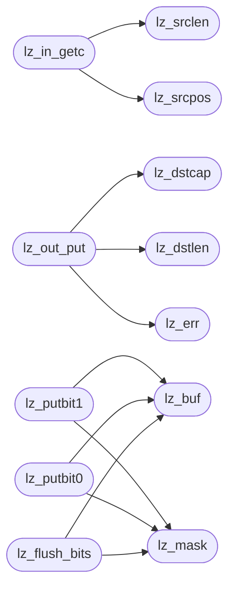

# `progs/asm/lzss.s`

> Source: [progs/asm/lzss.s:1](../../progs/asm/lzss.s#L1) | language `s` | coverage 0.0% | [API index](../index.md)

## Contents

- **Functions:** [`lz_win`](#lz_win), [`lz_src`](#lz_src), [`lz_srclen`](#lz_srclen), [`lz_srcpos`](#lz_srcpos), [`lz_dst`](#lz_dst), [`lz_dstcap`](#lz_dstcap), [`lz_dstlen`](#lz_dstlen), [`lz_err`](#lz_err), [`lz_buf`](#lz_buf), [`lz_mask`](#lz_mask), [`lz_in_getc`](#lz_in_getc), [`lz_out_put`](#lz_out_put), [`lz_putbit1`](#lz_putbit1), [`lz_putbit0`](#lz_putbit0), [`lz_flush_bits`](#lz_flush_bits), [`lz_out_literal`](#lz_out_literal), [`lz_out_pair`](#lz_out_pair), [`lz_next_mb`](#lz_next_mb), [`lz_encode`](#lz_encode), [`lz_getbit`](#lz_getbit), [`lz_decode`](#lz_decode), [`lz_hdr_put`](#lz_hdr_put), [`lz_hdr_get`](#lz_hdr_get), [`lz_has`](#lz_has), [`lz_read_all`](#lz_read_all), [`lz_write_all`](#lz_write_all), [`lz_compress`](#lz_compress), [`lz_decompress`](#lz_decompress), [`main`](#main), [`_start`](#_start)

## Call Graph

Solid arrows stay in this module, dashed arrows leave it.



## Functions

<a id="lz_win"></a>

### `lz_win`

`function` | [progs/asm/lzss.s:3](../../progs/asm/lzss.s#L3)

```asm
lz_win:
```

---

<a id="lz_src"></a>

### `lz_src`

`function` | [progs/asm/lzss.s:7](../../progs/asm/lzss.s#L7)

```asm
lz_src:
```

---

<a id="lz_srclen"></a>

### `lz_srclen`

`function` | [progs/asm/lzss.s:11](../../progs/asm/lzss.s#L11)

```asm
lz_srclen:
```

*Called by:* [`lz_in_getc`](#lz_in_getc)

---

<a id="lz_srcpos"></a>

### `lz_srcpos`

`function` | [progs/asm/lzss.s:15](../../progs/asm/lzss.s#L15)

```asm
lz_srcpos:
```

*Called by:* [`lz_in_getc`](#lz_in_getc)

---

<a id="lz_dst"></a>

### `lz_dst`

`function` | [progs/asm/lzss.s:19](../../progs/asm/lzss.s#L19)

```asm
lz_dst:
```

---

<a id="lz_dstcap"></a>

### `lz_dstcap`

`function` | [progs/asm/lzss.s:23](../../progs/asm/lzss.s#L23)

```asm
lz_dstcap:
```

*Called by:* [`lz_out_put`](#lz_out_put)

---

<a id="lz_dstlen"></a>

### `lz_dstlen`

`function` | [progs/asm/lzss.s:27](../../progs/asm/lzss.s#L27)

```asm
lz_dstlen:
```

*Called by:* [`lz_out_put`](#lz_out_put)

---

<a id="lz_err"></a>

### `lz_err`

`function` | [progs/asm/lzss.s:31](../../progs/asm/lzss.s#L31)

```asm
lz_err:
```

*Called by:* [`lz_out_put`](#lz_out_put)

---

<a id="lz_buf"></a>

### `lz_buf`

`function` | [progs/asm/lzss.s:35](../../progs/asm/lzss.s#L35)

```asm
lz_buf:
```

*Called by:* [`lz_flush_bits`](#lz_flush_bits), [`lz_putbit0`](#lz_putbit0), [`lz_putbit1`](#lz_putbit1)

---

<a id="lz_mask"></a>

### `lz_mask`

`function` | [progs/asm/lzss.s:39](../../progs/asm/lzss.s#L39)

```asm
lz_mask:
```

*Called by:* [`lz_flush_bits`](#lz_flush_bits), [`lz_putbit0`](#lz_putbit0), [`lz_putbit1`](#lz_putbit1)

---

<a id="lz_in_getc"></a>

### `lz_in_getc`

`function` | [progs/asm/lzss.s:43](../../progs/asm/lzss.s#L43)

```asm
lz_in_getc:
```

*Calls:* [`lz_srclen`](#lz_srclen), [`lz_srcpos`](#lz_srcpos)

---

<a id="lz_out_put"></a>

### `lz_out_put`

`function` | [progs/asm/lzss.s:79](../../progs/asm/lzss.s#L79)

```asm
lz_out_put:
```

*Calls:* [`lz_dstcap`](#lz_dstcap), [`lz_dstlen`](#lz_dstlen), [`lz_err`](#lz_err)

---

<a id="lz_putbit1"></a>

### `lz_putbit1`

`function` | [progs/asm/lzss.s:116](../../progs/asm/lzss.s#L116)

```asm
lz_putbit1:
```

*Calls:* [`lz_buf`](#lz_buf), [`lz_mask`](#lz_mask)

---

<a id="lz_putbit0"></a>

### `lz_putbit0`

`function` | [progs/asm/lzss.s:174](../../progs/asm/lzss.s#L174)

```asm
lz_putbit0:
```

*Calls:* [`lz_buf`](#lz_buf), [`lz_mask`](#lz_mask)

---

<a id="lz_flush_bits"></a>

### `lz_flush_bits`

`function` | [progs/asm/lzss.s:223](../../progs/asm/lzss.s#L223)

```asm
lz_flush_bits:
```

*Calls:* [`lz_buf`](#lz_buf), [`lz_mask`](#lz_mask)

---

<a id="lz_out_literal"></a>

### `lz_out_literal`

`function` | [progs/asm/lzss.s:251](../../progs/asm/lzss.s#L251)

```asm
lz_out_literal:
```

---

<a id="lz_out_pair"></a>

### `lz_out_pair`

`function` | [progs/asm/lzss.s:321](../../progs/asm/lzss.s#L321)

```asm
lz_out_pair:
```

---

<a id="lz_next_mb"></a>

### `lz_next_mb`

`function` | [progs/asm/lzss.s:447](../../progs/asm/lzss.s#L447)

```asm
lz_next_mb:
```

---

<a id="lz_encode"></a>

### `lz_encode`

`function` | [progs/asm/lzss.s:451](../../progs/asm/lzss.s#L451)

```asm
lz_encode:
```

---

<a id="lz_getbit"></a>

### `lz_getbit`

`function` | [progs/asm/lzss.s:1051](../../progs/asm/lzss.s#L1051)

```asm
lz_getbit:
```

---

<a id="lz_decode"></a>

### `lz_decode`

`function` | [progs/asm/lzss.s:1171](../../progs/asm/lzss.s#L1171)

```asm
lz_decode:
```

---

<a id="lz_hdr_put"></a>

### `lz_hdr_put`

`function` | [progs/asm/lzss.s:1514](../../progs/asm/lzss.s#L1514)

```asm
lz_hdr_put:
```

---

<a id="lz_hdr_get"></a>

### `lz_hdr_get`

`function` | [progs/asm/lzss.s:1629](../../progs/asm/lzss.s#L1629)

```asm
lz_hdr_get:
```

---

<a id="lz_has"></a>

### `lz_has`

`function` | [progs/asm/lzss.s:1782](../../progs/asm/lzss.s#L1782)

```asm
lz_has:
```

*Called by:* [`main`](progs.src.lzss.c.md#main)

---

<a id="lz_read_all"></a>

### `lz_read_all`

`function` | [progs/asm/lzss.s:1935](../../progs/asm/lzss.s#L1935)

```asm
lz_read_all:
```

---

<a id="lz_write_all"></a>

### `lz_write_all`

`function` | [progs/asm/lzss.s:2150](../../progs/asm/lzss.s#L2150)

```asm
lz_write_all:
```

---

<a id="lz_compress"></a>

### `lz_compress`

`function` | [progs/asm/lzss.s:2257](../../progs/asm/lzss.s#L2257)

```asm
lz_compress:
```

*Called by:* [`main`](progs.src.lzss.c.md#main)

---

<a id="lz_decompress"></a>

### `lz_decompress`

`function` | [progs/asm/lzss.s:2628](../../progs/asm/lzss.s#L2628)

```asm
lz_decompress:
```

*Called by:* [`main`](progs.src.lzss.c.md#main)

---

<a id="main"></a>

### `main`

`function` | [progs/asm/lzss.s:3178](../../progs/asm/lzss.s#L3178)

```asm
main:
```

---

<a id="_start"></a>

### `_start`

`function` | [progs/asm/lzss.s:3497](../../progs/asm/lzss.s#L3497)

```asm
_start:
```

---
