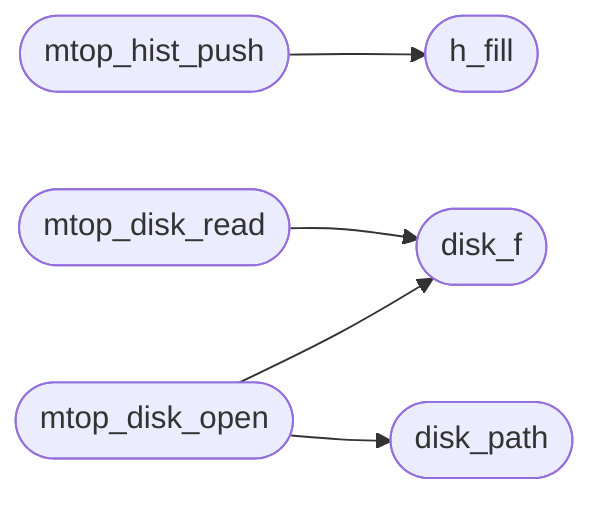

# `progs/asm/mtop.s`

> Source: [progs/asm/mtop.s:1](../../progs/asm/mtop.s#L1) | language `s` | coverage 0.0% | [API index](../index.md)

## Contents

- **Functions:** [`h_cpu`](#h_cpu), [`h_mem`](#h_mem), [`h_fill`](#h_fill), [`last_dns`](#last_dns), [`last_dns_ms`](#last_dns_ms), [`last_sock`](#last_sock), [`prev_total`](#prev_total), [`prev_idle`](#prev_idle), [`have_prev`](#have_prev), [`disk_f`](#disk_f), [`disk_path`](#disk_path), [`sc3`](#sc3), [`mtop_time`](#mtop_time), [`mtop_rtc`](#mtop_rtc), [`mtop_key`](#mtop_key), [`mtop_minfo`](#mtop_minfo), [`emit`](#emit), [`mtop_quit_key`](#mtop_quit_key), [`mtop_clear_ansi`](#mtop_clear_ansi), [`mtop_clear`](#mtop_clear), [`mtop_atoi`](#mtop_atoi), [`mtop_putu`](#mtop_putu), [`mtop_put2`](#mtop_put2), [`mtop_put_kb`](#mtop_put_kb), [`mtop_bar`](#mtop_bar), [`mtop_hist_max`](#mtop_hist_max), [`mtop_hist_push`](#mtop_hist_push), [`mtop_spark`](#mtop_spark), [`mtop_mem`](#mtop_mem), [`mtop_cpu`](#mtop_cpu), [`mtop_disk_open`](#mtop_disk_open), [`mtop_disk_read`](#mtop_disk_read), [`mtop_net_probe`](#mtop_net_probe), [`mtop_frame`](#mtop_frame), [`main`](#main), [`_start`](#_start)

## Call Graph

Solid arrows stay in this module, dashed arrows leave it.



## Functions

<a id="h_cpu"></a>

### `h_cpu`

`function` | [progs/asm/mtop.s:3](../../progs/asm/mtop.s#L3)

```asm
h_cpu:
```

---

<a id="h_mem"></a>

### `h_mem`

`function` | [progs/asm/mtop.s:7](../../progs/asm/mtop.s#L7)

```asm
h_mem:
```

---

<a id="h_fill"></a>

### `h_fill`

`function` | [progs/asm/mtop.s:11](../../progs/asm/mtop.s#L11)

```asm
h_fill:
```

*Called by:* [`mtop_hist_push`](#mtop_hist_push)

---

<a id="last_dns"></a>

### `last_dns`

`function` | [progs/asm/mtop.s:15](../../progs/asm/mtop.s#L15)

```asm
last_dns:
```

---

<a id="last_dns_ms"></a>

### `last_dns_ms`

`function` | [progs/asm/mtop.s:19](../../progs/asm/mtop.s#L19)

```asm
last_dns_ms:
```

---

<a id="last_sock"></a>

### `last_sock`

`function` | [progs/asm/mtop.s:23](../../progs/asm/mtop.s#L23)

```asm
last_sock:
```

---

<a id="prev_total"></a>

### `prev_total`

`function` | [progs/asm/mtop.s:27](../../progs/asm/mtop.s#L27)

```asm
prev_total:
```

---

<a id="prev_idle"></a>

### `prev_idle`

`function` | [progs/asm/mtop.s:31](../../progs/asm/mtop.s#L31)

```asm
prev_idle:
```

---

<a id="have_prev"></a>

### `have_prev`

`function` | [progs/asm/mtop.s:35](../../progs/asm/mtop.s#L35)

```asm
have_prev:
```

---

<a id="disk_f"></a>

### `disk_f`

`function` | [progs/asm/mtop.s:39](../../progs/asm/mtop.s#L39)

```asm
disk_f:
```

*Called by:* [`mtop_disk_open`](#mtop_disk_open), [`mtop_disk_read`](#mtop_disk_read)

---

<a id="disk_path"></a>

### `disk_path`

`function` | [progs/asm/mtop.s:43](../../progs/asm/mtop.s#L43)

```asm
disk_path:
```

*Called by:* [`mtop_disk_open`](#mtop_disk_open)

---

<a id="sc3"></a>

### `sc3`

`function` | [progs/asm/mtop.s:47](../../progs/asm/mtop.s#L47)

```asm
sc3:
```

*Called by:* [`main`](progs.src.mtop.c.md#main)

---

<a id="mtop_time"></a>

### `mtop_time`

`function` | [progs/asm/mtop.s:78](../../progs/asm/mtop.s#L78)

```asm
mtop_time:
```

*Called by:* [`main`](progs.src.mtop.c.md#main)

---

<a id="mtop_rtc"></a>

### `mtop_rtc`

`function` | [progs/asm/mtop.s:106](../../progs/asm/mtop.s#L106)

```asm
mtop_rtc:
```

---

<a id="mtop_key"></a>

### `mtop_key`

`function` | [progs/asm/mtop.s:137](../../progs/asm/mtop.s#L137)

```asm
mtop_key:
```

*Called by:* [`main`](progs.src.mtop.c.md#main)

---

<a id="mtop_minfo"></a>

### `mtop_minfo`

`function` | [progs/asm/mtop.s:165](../../progs/asm/mtop.s#L165)

```asm
mtop_minfo:
```

---

<a id="emit"></a>

### `emit`

`function` | [progs/asm/mtop.s:206](../../progs/asm/mtop.s#L206)

```asm
emit:
```

*Called by:* [`main`](progs.src.mtop.c.md#main)

---

<a id="mtop_quit_key"></a>

### `mtop_quit_key`

`function` | [progs/asm/mtop.s:241](../../progs/asm/mtop.s#L241)

```asm
mtop_quit_key:
```

*Called by:* [`main`](progs.src.mtop.c.md#main)

---

<a id="mtop_clear_ansi"></a>

### `mtop_clear_ansi`

`function` | [progs/asm/mtop.s:317](../../progs/asm/mtop.s#L317)

```asm
mtop_clear_ansi:
```

---

<a id="mtop_clear"></a>

### `mtop_clear`

`function` | [progs/asm/mtop.s:401](../../progs/asm/mtop.s#L401)

```asm
mtop_clear:
```

*Called by:* [`main`](progs.src.mtop.c.md#main)

---

<a id="mtop_atoi"></a>

### `mtop_atoi`

`function` | [progs/asm/mtop.s:443](../../progs/asm/mtop.s#L443)

```asm
mtop_atoi:
```

*Called by:* [`main`](progs.src.mtop.c.md#main)

---

<a id="mtop_putu"></a>

### `mtop_putu`

`function` | [progs/asm/mtop.s:569](../../progs/asm/mtop.s#L569)

```asm
mtop_putu:
```

---

<a id="mtop_put2"></a>

### `mtop_put2`

`function` | [progs/asm/mtop.s:725](../../progs/asm/mtop.s#L725)

```asm
mtop_put2:
```

---

<a id="mtop_put_kb"></a>

### `mtop_put_kb`

`function` | [progs/asm/mtop.s:765](../../progs/asm/mtop.s#L765)

```asm
mtop_put_kb:
```

---

<a id="mtop_bar"></a>

### `mtop_bar`

`function` | [progs/asm/mtop.s:887](../../progs/asm/mtop.s#L887)

```asm
mtop_bar:
```

---

<a id="mtop_hist_max"></a>

### `mtop_hist_max`

`function` | [progs/asm/mtop.s:1038](../../progs/asm/mtop.s#L1038)

```asm
mtop_hist_max:
```

---

<a id="mtop_hist_push"></a>

### `mtop_hist_push`

`function` | [progs/asm/mtop.s:1106](../../progs/asm/mtop.s#L1106)

```asm
mtop_hist_push:
```

*Calls:* [`h_fill`](#h_fill)

---

<a id="mtop_spark"></a>

### `mtop_spark`

`function` | [progs/asm/mtop.s:1201](../../progs/asm/mtop.s#L1201)

```asm
mtop_spark:
```

---

<a id="mtop_mem"></a>

### `mtop_mem`

`function` | [progs/asm/mtop.s:1452](../../progs/asm/mtop.s#L1452)

```asm
mtop_mem:
```

---

<a id="mtop_cpu"></a>

### `mtop_cpu`

`function` | [progs/asm/mtop.s:1556](../../progs/asm/mtop.s#L1556)

```asm
mtop_cpu:
```

---

<a id="mtop_disk_open"></a>

### `mtop_disk_open`

`function` | [progs/asm/mtop.s:1842](../../progs/asm/mtop.s#L1842)

```asm
mtop_disk_open:
```

*Calls:* [`disk_f`](#disk_f), [`disk_path`](#disk_path)

*Called by:* [`main`](progs.src.mtop.c.md#main)

---

<a id="mtop_disk_read"></a>

### `mtop_disk_read`

`function` | [progs/asm/mtop.s:1966](../../progs/asm/mtop.s#L1966)

```asm
mtop_disk_read:
```

*Calls:* [`disk_f`](#disk_f)

---

<a id="mtop_net_probe"></a>

### `mtop_net_probe`

`function` | [progs/asm/mtop.s:2128](../../progs/asm/mtop.s#L2128)

```asm
mtop_net_probe:
```

---

<a id="mtop_frame"></a>

### `mtop_frame`

`function` | [progs/asm/mtop.s:2275](../../progs/asm/mtop.s#L2275)

```asm
mtop_frame:
```

*Called by:* [`main`](progs.src.mtop.c.md#main)

---

<a id="main"></a>

### `main`

`function` | [progs/asm/mtop.s:3831](../../progs/asm/mtop.s#L3831)

```asm
main:
```

---

<a id="_start"></a>

### `_start`

`function` | [progs/asm/mtop.s:4781](../../progs/asm/mtop.s#L4781)

```asm
_start:
```

---
