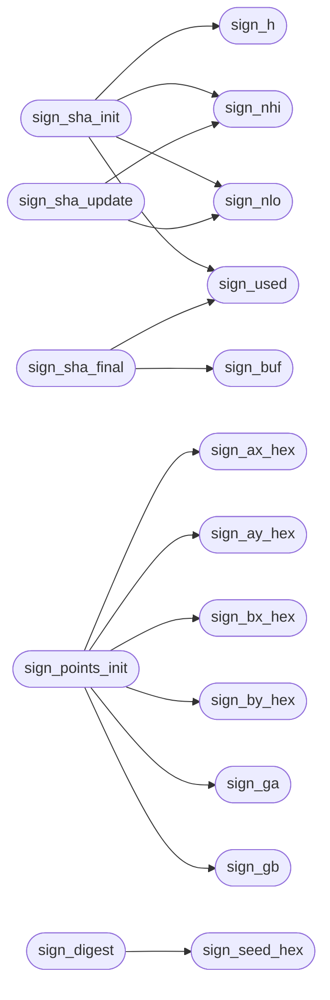

# `progs/asm/sign.s`

> Source: [progs/asm/sign.s:1](../../progs/asm/sign.s#L1) | language `s` | coverage 0.0% | [API index](../index.md)

## Contents

- **Functions:** [`sign_k0`](#sign_k0), [`sign_k1`](#sign_k1), [`sign_k2`](#sign_k2), [`sign_k3`](#sign_k3), [`sign_k4`](#sign_k4), [`sign_k5`](#sign_k5), [`sign_k6`](#sign_k6), [`sign_k7`](#sign_k7), [`sign_seed_hex`](#sign_seed_hex), [`sign_bx_hex`](#sign_bx_hex), [`sign_by_hex`](#sign_by_hex), [`sign_ax_hex`](#sign_ax_hex), [`sign_ay_hex`](#sign_ay_hex), [`sign_pub_hex`](#sign_pub_hex), [`sign_note_name`](#sign_note_name), [`sign_section_name`](#sign_section_name), [`sign_k`](#sign_k), [`sign_h`](#sign_h), [`sign_w`](#sign_w), [`sign_buf`](#sign_buf), [`sign_used`](#sign_used), [`sign_nlo`](#sign_nlo), [`sign_nhi`](#sign_nhi), [`sign_q4`](#sign_q4), [`sign_l8`](#sign_l8), [`sign_gb`](#sign_gb), [`sign_ga`](#sign_ga), [`sign_hexval`](#sign_hexval), [`sign_unhex`](#sign_unhex), [`sign_byte`](#sign_byte), [`sign_copy`](#sign_copy), [`sign_strlen`](#sign_strlen), [`sign_le16`](#sign_le16), [`sign_le32`](#sign_le32), [`sign_put32`](#sign_put32), [`sign_hexout`](#sign_hexout), [`sign_offok`](#sign_offok), [`sign_rotr`](#sign_rotr), [`sign_carry2`](#sign_carry2), [`sign_borrow2`](#sign_borrow2), [`sign_add3`](#sign_add3), [`sign_be32`](#sign_be32), [`sign_block`](#sign_block), [`sign_sha_init`](#sign_sha_init), [`sign_sha_update`](#sign_sha_update), [`sign_sha_final`](#sign_sha_final), [`sign_feed32`](#sign_feed32), [`sign_key_init`](#sign_key_init), [`fe_copy`](#fe_copy), [`fe_zero`](#fe_zero), [`fe_one`](#fe_one), [`fe_cmov`](#fe_cmov), [`fe_ge`](#fe_ge), [`fe_rawsub`](#fe_rawsub), [`fe_add`](#fe_add), [`fe_sub`](#fe_sub), [`fe_rowadd`](#fe_rowadd), [`fe_foldadd`](#fe_foldadd), [`fe_mul`](#fe_mul), [`fe_sq`](#fe_sq), [`fe_inv`](#fe_inv), [`fe_frombytes`](#fe_frombytes), [`fe_tobytes`](#fe_tobytes), [`fe_curved`](#fe_curved), [`ge_copy`](#ge_copy), [`fe_off`](#fe_off), [`ge_cmov`](#ge_cmov), [`ge_add`](#ge_add), [`ge_double`](#ge_double), [`ge_scalarmult`](#ge_scalarmult), [`sc_mod_l`](#sc_mod_l), [`sc_mul_add`](#sc_mul_add), [`sign_rev32`](#sign_rev32), [`sign_points_init`](#sign_points_init), [`sign_digest`](#sign_digest), [`sign_read`](#sign_read), [`sign_write`](#sign_write), [`sign_note_span`](#sign_note_span), [`sign_digest_of`](#sign_digest_of), [`sign_patch_notes`](#sign_patch_notes), [`sign_append`](#sign_append), [`sign_file`](#sign_file), [`sign_selftest`](#sign_selftest), [`main`](#main), [`_start`](#_start)

## Call Graph

Solid arrows stay in this module, dashed arrows leave it.



## Functions

<a id="sign_k0"></a>

### `sign_k0`

`function` | [progs/asm/sign.s:3](../../progs/asm/sign.s#L3)

```asm
sign_k0:
```

---

<a id="sign_k1"></a>

### `sign_k1`

`function` | [progs/asm/sign.s:7](../../progs/asm/sign.s#L7)

```asm
sign_k1:
```

---

<a id="sign_k2"></a>

### `sign_k2`

`function` | [progs/asm/sign.s:11](../../progs/asm/sign.s#L11)

```asm
sign_k2:
```

---

<a id="sign_k3"></a>

### `sign_k3`

`function` | [progs/asm/sign.s:15](../../progs/asm/sign.s#L15)

```asm
sign_k3:
```

---

<a id="sign_k4"></a>

### `sign_k4`

`function` | [progs/asm/sign.s:19](../../progs/asm/sign.s#L19)

```asm
sign_k4:
```

---

<a id="sign_k5"></a>

### `sign_k5`

`function` | [progs/asm/sign.s:23](../../progs/asm/sign.s#L23)

```asm
sign_k5:
```

---

<a id="sign_k6"></a>

### `sign_k6`

`function` | [progs/asm/sign.s:27](../../progs/asm/sign.s#L27)

```asm
sign_k6:
```

---

<a id="sign_k7"></a>

### `sign_k7`

`function` | [progs/asm/sign.s:31](../../progs/asm/sign.s#L31)

```asm
sign_k7:
```

---

<a id="sign_seed_hex"></a>

### `sign_seed_hex`

`function` | [progs/asm/sign.s:35](../../progs/asm/sign.s#L35)

```asm
sign_seed_hex:
```

*Called by:* [`sign_digest`](#sign_digest)

---

<a id="sign_bx_hex"></a>

### `sign_bx_hex`

`function` | [progs/asm/sign.s:39](../../progs/asm/sign.s#L39)

```asm
sign_bx_hex:
```

*Called by:* [`sign_points_init`](#sign_points_init)

---

<a id="sign_by_hex"></a>

### `sign_by_hex`

`function` | [progs/asm/sign.s:43](../../progs/asm/sign.s#L43)

```asm
sign_by_hex:
```

*Called by:* [`sign_points_init`](#sign_points_init)

---

<a id="sign_ax_hex"></a>

### `sign_ax_hex`

`function` | [progs/asm/sign.s:47](../../progs/asm/sign.s#L47)

```asm
sign_ax_hex:
```

*Called by:* [`sign_points_init`](#sign_points_init)

---

<a id="sign_ay_hex"></a>

### `sign_ay_hex`

`function` | [progs/asm/sign.s:51](../../progs/asm/sign.s#L51)

```asm
sign_ay_hex:
```

*Called by:* [`sign_points_init`](#sign_points_init)

---

<a id="sign_pub_hex"></a>

### `sign_pub_hex`

`function` | [progs/asm/sign.s:55](../../progs/asm/sign.s#L55)

```asm
sign_pub_hex:
```

---

<a id="sign_note_name"></a>

### `sign_note_name`

`function` | [progs/asm/sign.s:59](../../progs/asm/sign.s#L59)

```asm
sign_note_name:
```

---

<a id="sign_section_name"></a>

### `sign_section_name`

`function` | [progs/asm/sign.s:63](../../progs/asm/sign.s#L63)

```asm
sign_section_name:
```

---

<a id="sign_k"></a>

### `sign_k`

`function` | [progs/asm/sign.s:67](../../progs/asm/sign.s#L67)

```asm
sign_k:
```

---

<a id="sign_h"></a>

### `sign_h`

`function` | [progs/asm/sign.s:71](../../progs/asm/sign.s#L71)

```asm
sign_h:
```

*Called by:* [`sign_sha_init`](#sign_sha_init)

---

<a id="sign_w"></a>

### `sign_w`

`function` | [progs/asm/sign.s:75](../../progs/asm/sign.s#L75)

```asm
sign_w:
```

---

<a id="sign_buf"></a>

### `sign_buf`

`function` | [progs/asm/sign.s:79](../../progs/asm/sign.s#L79)

```asm
sign_buf:
```

*Called by:* [`sign_sha_final`](#sign_sha_final)

---

<a id="sign_used"></a>

### `sign_used`

`function` | [progs/asm/sign.s:83](../../progs/asm/sign.s#L83)

```asm
sign_used:
```

*Called by:* [`sign_sha_final`](#sign_sha_final), [`sign_sha_init`](#sign_sha_init)

---

<a id="sign_nlo"></a>

### `sign_nlo`

`function` | [progs/asm/sign.s:87](../../progs/asm/sign.s#L87)

```asm
sign_nlo:
```

*Called by:* [`sign_sha_init`](#sign_sha_init), [`sign_sha_update`](#sign_sha_update)

---

<a id="sign_nhi"></a>

### `sign_nhi`

`function` | [progs/asm/sign.s:91](../../progs/asm/sign.s#L91)

```asm
sign_nhi:
```

*Called by:* [`sign_sha_init`](#sign_sha_init), [`sign_sha_update`](#sign_sha_update)

---

<a id="sign_q4"></a>

### `sign_q4`

`function` | [progs/asm/sign.s:95](../../progs/asm/sign.s#L95)

```asm
sign_q4:
```

---

<a id="sign_l8"></a>

### `sign_l8`

`function` | [progs/asm/sign.s:99](../../progs/asm/sign.s#L99)

```asm
sign_l8:
```

---

<a id="sign_gb"></a>

### `sign_gb`

`function` | [progs/asm/sign.s:103](../../progs/asm/sign.s#L103)

```asm
sign_gb:
```

*Called by:* [`sign_points_init`](#sign_points_init)

---

<a id="sign_ga"></a>

### `sign_ga`

`function` | [progs/asm/sign.s:107](../../progs/asm/sign.s#L107)

```asm
sign_ga:
```

*Called by:* [`sign_points_init`](#sign_points_init)

---

<a id="sign_hexval"></a>

### `sign_hexval`

`function` | [progs/asm/sign.s:111](../../progs/asm/sign.s#L111)

```asm
sign_hexval:
```

---

<a id="sign_unhex"></a>

### `sign_unhex`

`function` | [progs/asm/sign.s:232](../../progs/asm/sign.s#L232)

```asm
sign_unhex:
```

---

<a id="sign_byte"></a>

### `sign_byte`

`function` | [progs/asm/sign.s:325](../../progs/asm/sign.s#L325)

```asm
sign_byte:
```

---

<a id="sign_copy"></a>

### `sign_copy`

`function` | [progs/asm/sign.s:363](../../progs/asm/sign.s#L363)

```asm
sign_copy:
```

---

<a id="sign_strlen"></a>

### `sign_strlen`

`function` | [progs/asm/sign.s:405](../../progs/asm/sign.s#L405)

```asm
sign_strlen:
```

---

<a id="sign_le16"></a>

### `sign_le16`

`function` | [progs/asm/sign.s:444](../../progs/asm/sign.s#L444)

```asm
sign_le16:
```

---

<a id="sign_le32"></a>

### `sign_le32`

`function` | [progs/asm/sign.s:494](../../progs/asm/sign.s#L494)

```asm
sign_le32:
```

---

<a id="sign_put32"></a>

### `sign_put32`

`function` | [progs/asm/sign.s:596](../../progs/asm/sign.s#L596)

```asm
sign_put32:
```

---

<a id="sign_hexout"></a>

### `sign_hexout`

`function` | [progs/asm/sign.s:688](../../progs/asm/sign.s#L688)

```asm
sign_hexout:
```

---

<a id="sign_offok"></a>

### `sign_offok`

`function` | [progs/asm/sign.s:866](../../progs/asm/sign.s#L866)

```asm
sign_offok:
```

---

<a id="sign_rotr"></a>

### `sign_rotr`

`function` | [progs/asm/sign.s:927](../../progs/asm/sign.s#L927)

```asm
sign_rotr:
```

*Called by:* [`below`](progs.src.sign.c.md#below)

---

<a id="sign_carry2"></a>

### `sign_carry2`

`function` | [progs/asm/sign.s:1099](../../progs/asm/sign.s#L1099)

```asm
sign_carry2:
```

---

<a id="sign_borrow2"></a>

### `sign_borrow2`

`function` | [progs/asm/sign.s:1158](../../progs/asm/sign.s#L1158)

```asm
sign_borrow2:
```

---

<a id="sign_add3"></a>

### `sign_add3`

`function` | [progs/asm/sign.s:1218](../../progs/asm/sign.s#L1218)

```asm
sign_add3:
```

---

<a id="sign_be32"></a>

### `sign_be32`

`function` | [progs/asm/sign.s:1292](../../progs/asm/sign.s#L1292)

```asm
sign_be32:
```

---

<a id="sign_block"></a>

### `sign_block`

`function` | [progs/asm/sign.s:1394](../../progs/asm/sign.s#L1394)

```asm
sign_block:
```

---

<a id="sign_sha_init"></a>

### `sign_sha_init`

`function` | [progs/asm/sign.s:3105](../../progs/asm/sign.s#L3105)

```asm
sign_sha_init:
```

*Calls:* [`sign_h`](#sign_h), [`sign_nhi`](#sign_nhi), [`sign_nlo`](#sign_nlo), [`sign_used`](#sign_used)

---

<a id="sign_sha_update"></a>

### `sign_sha_update`

`function` | [progs/asm/sign.s:3287](../../progs/asm/sign.s#L3287)

```asm
sign_sha_update:
```

*Calls:* [`sign_nhi`](#sign_nhi), [`sign_nlo`](#sign_nlo)

---

<a id="sign_sha_final"></a>

### `sign_sha_final`

`function` | [progs/asm/sign.s:3477](../../progs/asm/sign.s#L3477)

```asm
sign_sha_final:
```

*Calls:* [`sign_buf`](#sign_buf), [`sign_used`](#sign_used)

---

<a id="sign_feed32"></a>

### `sign_feed32`

`function` | [progs/asm/sign.s:3871](../../progs/asm/sign.s#L3871)

```asm
sign_feed32:
```

---

<a id="sign_key_init"></a>

### `sign_key_init`

`function` | [progs/asm/sign.s:3962](../../progs/asm/sign.s#L3962)

```asm
sign_key_init:
```

*Called by:* [`main`](progs.src.sign.c.md#main)

---

<a id="fe_copy"></a>

### `fe_copy`

`function` | [progs/asm/sign.s:4387](../../progs/asm/sign.s#L4387)

```asm
fe_copy:
```

---

<a id="fe_zero"></a>

### `fe_zero`

`function` | [progs/asm/sign.s:4435](../../progs/asm/sign.s#L4435)

```asm
fe_zero:
```

---

<a id="fe_one"></a>

### `fe_one`

`function` | [progs/asm/sign.s:4476](../../progs/asm/sign.s#L4476)

```asm
fe_one:
```

---

<a id="fe_cmov"></a>

### `fe_cmov`

`function` | [progs/asm/sign.s:4505](../../progs/asm/sign.s#L4505)

```asm
fe_cmov:
```

---

<a id="fe_ge"></a>

### `fe_ge`

`function` | [progs/asm/sign.s:4589](../../progs/asm/sign.s#L4589)

```asm
fe_ge:
```

---

<a id="fe_rawsub"></a>

### `fe_rawsub`

`function` | [progs/asm/sign.s:4713](../../progs/asm/sign.s#L4713)

```asm
fe_rawsub:
```

---

<a id="fe_add"></a>

### `fe_add`

`function` | [progs/asm/sign.s:4837](../../progs/asm/sign.s#L4837)

```asm
fe_add:
```

---

<a id="fe_sub"></a>

### `fe_sub`

`function` | [progs/asm/sign.s:5031](../../progs/asm/sign.s#L5031)

```asm
fe_sub:
```

---

<a id="fe_rowadd"></a>

### `fe_rowadd`

`function` | [progs/asm/sign.s:5297](../../progs/asm/sign.s#L5297)

```asm
fe_rowadd:
```

*Called by:* [`bits`](progs.src.sign.c.md#bits)

---

<a id="fe_foldadd"></a>

### `fe_foldadd`

`function` | [progs/asm/sign.s:5426](../../progs/asm/sign.s#L5426)

```asm
fe_foldadd:
```

---

<a id="fe_mul"></a>

### `fe_mul`

`function` | [progs/asm/sign.s:5481](../../progs/asm/sign.s#L5481)

```asm
fe_mul:
```

---

<a id="fe_sq"></a>

### `fe_sq`

`function` | [progs/asm/sign.s:6109](../../progs/asm/sign.s#L6109)

```asm
fe_sq:
```

---

<a id="fe_inv"></a>

### `fe_inv`

`function` | [progs/asm/sign.s:6135](../../progs/asm/sign.s#L6135)

```asm
fe_inv:
```

---

<a id="fe_frombytes"></a>

### `fe_frombytes`

`function` | [progs/asm/sign.s:6284](../../progs/asm/sign.s#L6284)

```asm
fe_frombytes:
```

---

<a id="fe_tobytes"></a>

### `fe_tobytes`

`function` | [progs/asm/sign.s:6432](../../progs/asm/sign.s#L6432)

```asm
fe_tobytes:
```

---

<a id="fe_curved"></a>

### `fe_curved`

`function` | [progs/asm/sign.s:6586](../../progs/asm/sign.s#L6586)

```asm
fe_curved:
```

---

<a id="ge_copy"></a>

### `ge_copy`

`function` | [progs/asm/sign.s:6712](../../progs/asm/sign.s#L6712)

```asm
ge_copy:
```

---

<a id="fe_off"></a>

### `fe_off`

`function` | [progs/asm/sign.s:6760](../../progs/asm/sign.s#L6760)

```asm
fe_off:
```

---

<a id="ge_cmov"></a>

### `ge_cmov`

`function` | [progs/asm/sign.s:6780](../../progs/asm/sign.s#L6780)

```asm
ge_cmov:
```

---

<a id="ge_add"></a>

### `ge_add`

`function` | [progs/asm/sign.s:6864](../../progs/asm/sign.s#L6864)

```asm
ge_add:
```

---

<a id="ge_double"></a>

### `ge_double`

`function` | [progs/asm/sign.s:7325](../../progs/asm/sign.s#L7325)

```asm
ge_double:
```

---

<a id="ge_scalarmult"></a>

### `ge_scalarmult`

`function` | [progs/asm/sign.s:7701](../../progs/asm/sign.s#L7701)

```asm
ge_scalarmult:
```

---

<a id="sc_mod_l"></a>

### `sc_mod_l`

`function` | [progs/asm/sign.s:7916](../../progs/asm/sign.s#L7916)

```asm
sc_mod_l:
```

---

<a id="sc_mul_add"></a>

### `sc_mul_add`

`function` | [progs/asm/sign.s:8461](../../progs/asm/sign.s#L8461)

```asm
sc_mul_add:
```

---

<a id="sign_rev32"></a>

### `sign_rev32`

`function` | [progs/asm/sign.s:9013](../../progs/asm/sign.s#L9013)

```asm
sign_rev32:
```

---

<a id="sign_points_init"></a>

### `sign_points_init`

`function` | [progs/asm/sign.s:9084](../../progs/asm/sign.s#L9084)

```asm
sign_points_init:
```

*Calls:* [`sign_ax_hex`](#sign_ax_hex), [`sign_ay_hex`](#sign_ay_hex), [`sign_bx_hex`](#sign_bx_hex), [`sign_by_hex`](#sign_by_hex), [`sign_ga`](#sign_ga), [`sign_gb`](#sign_gb)

*Called by:* [`main`](progs.src.sign.c.md#main)

---

<a id="sign_digest"></a>

### `sign_digest`

`function` | [progs/asm/sign.s:9485](../../progs/asm/sign.s#L9485)

```asm
sign_digest:
```

*Calls:* [`sign_seed_hex`](#sign_seed_hex)

---

<a id="sign_read"></a>

### `sign_read`

`function` | [progs/asm/sign.s:10733](../../progs/asm/sign.s#L10733)

```asm
sign_read:
```

---

<a id="sign_write"></a>

### `sign_write`

`function` | [progs/asm/sign.s:10972](../../progs/asm/sign.s#L10972)

```asm
sign_write:
```

---

<a id="sign_note_span"></a>

### `sign_note_span`

`function` | [progs/asm/sign.s:11061](../../progs/asm/sign.s#L11061)

```asm
sign_note_span:
```

---

<a id="sign_digest_of"></a>

### `sign_digest_of`

`function` | [progs/asm/sign.s:11374](../../progs/asm/sign.s#L11374)

```asm
sign_digest_of:
```

---

<a id="sign_patch_notes"></a>

### `sign_patch_notes`

`function` | [progs/asm/sign.s:11834](../../progs/asm/sign.s#L11834)

```asm
sign_patch_notes:
```

---

<a id="sign_append"></a>

### `sign_append`

`function` | [progs/asm/sign.s:12154](../../progs/asm/sign.s#L12154)

```asm
sign_append:
```

---

<a id="sign_file"></a>

### `sign_file`

`function` | [progs/asm/sign.s:13433](../../progs/asm/sign.s#L13433)

```asm
sign_file:
```

*Called by:* [`main`](progs.src.sign.c.md#main)

---

<a id="sign_selftest"></a>

### `sign_selftest`

`function` | [progs/asm/sign.s:14501](../../progs/asm/sign.s#L14501)

```asm
sign_selftest:
```

*Called by:* [`main`](progs.src.sign.c.md#main)

---

<a id="main"></a>

### `main`

`function` | [progs/asm/sign.s:14647](../../progs/asm/sign.s#L14647)

```asm
main:
```

---

<a id="_start"></a>

### `_start`

`function` | [progs/asm/sign.s:14926](../../progs/asm/sign.s#L14926)

```asm
_start:
```

---
