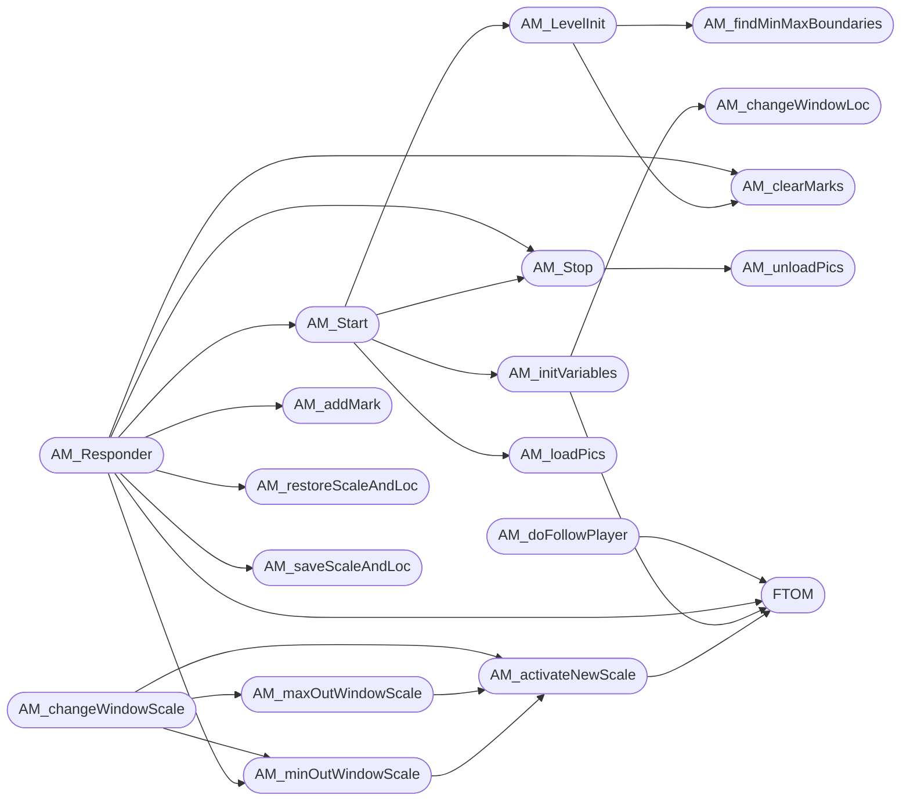

# `progs/doomgeneric/am_map.c`

> Source: [progs/doomgeneric/am_map.c:1](../../progs/doomgeneric/am_map.c#L1) | language `c` | coverage 26.1% | [API index](../index.md)

Copyright(C) 1993-1996 Id Software, Inc.

Copyright(C) 2005-2014 Simon Howard  This program is free software; you can redistribute it and/or modify it under the terms of the GNU General Public License as published by the Free Software Foundation; either version 2 of the License, or (at your option) any later version.  This program is distributed in the hope that it will be useful, but WITHOUT ANY WARRANTY; without even the implied warranty of MERCHANTABILITY or FITNESS FOR A PARTICULAR PURPOSE.  See the GNU General Public License for more details.   DESCRIPTION:  the automap code

## Contents

- **Structs:** [`fpoint_t`](#fpoint_t), [`fline_t`](#fline_t), [`mpoint_t`](#mpoint_t), [`mline_t`](#mline_t), [`islope_t`](#islope_t)
- **Functions:** [`AM_getIslope`](#am_getislope), [`AM_activateNewScale`](#am_activatenewscale), [`AM_saveScaleAndLoc`](#am_savescaleandloc), [`AM_restoreScaleAndLoc`](#am_restorescaleandloc), [`AM_addMark`](#am_addmark), [`AM_findMinMaxBoundaries`](#am_findminmaxboundaries), [`AM_changeWindowLoc`](#am_changewindowloc), [`AM_initVariables`](#am_initvariables), [`AM_loadPics`](#am_loadpics), [`AM_unloadPics`](#am_unloadpics), [`AM_clearMarks`](#am_clearmarks), [`AM_LevelInit`](#am_levelinit), [`AM_Stop`](#am_stop), [`AM_Start`](#am_start), [`AM_minOutWindowScale`](#am_minoutwindowscale), [`AM_maxOutWindowScale`](#am_maxoutwindowscale), [`AM_Responder`](#am_responder), [`AM_changeWindowScale`](#am_changewindowscale), [`AM_doFollowPlayer`](#am_dofollowplayer), [`AM_updateLightLev`](#am_updatelightlev), [`AM_Ticker`](#am_ticker), [`AM_clearFB`](#am_clearfb), [`AM_clipMline`](#am_clipmline), [`AM_drawFline`](#am_drawfline), [`AM_drawMline`](#am_drawmline), [`AM_drawGrid`](#am_drawgrid), [`AM_drawWalls`](#am_drawwalls), [`AM_rotate`](#am_rotate), [`AM_drawLineCharacter`](#am_drawlinecharacter), [`AM_drawPlayers`](#am_drawplayers), [`AM_drawThings`](#am_drawthings), [`AM_drawMarks`](#am_drawmarks), [`AM_drawCrosshair`](#am_drawcrosshair), [`AM_Drawer`](#am_drawer)
- **Macros:** [`REDS`](#reds), [`REDRANGE`](#redrange), [`BLUES`](#blues), [`BLUERANGE`](#bluerange), [`GREENS`](#greens), [`GREENRANGE`](#greenrange), [`GRAYS`](#grays), [`GRAYSRANGE`](#graysrange), [`BROWNS`](#browns), [`BROWNRANGE`](#brownrange), [`YELLOWS`](#yellows), [`YELLOWRANGE`](#yellowrange), [`BLACK`](#black), [`WHITE`](#white), [`BACKGROUND`](#background), [`YOURCOLORS`](#yourcolors), [`YOURRANGE`](#yourrange), [`WALLCOLORS`](#wallcolors), [`WALLRANGE`](#wallrange), [`TSWALLCOLORS`](#tswallcolors), [`TSWALLRANGE`](#tswallrange), [`FDWALLCOLORS`](#fdwallcolors), [`FDWALLRANGE`](#fdwallrange), [`CDWALLCOLORS`](#cdwallcolors), [`CDWALLRANGE`](#cdwallrange), [`THINGCOLORS`](#thingcolors), [`THINGRANGE`](#thingrange), [`SECRETWALLCOLORS`](#secretwallcolors), [`SECRETWALLRANGE`](#secretwallrange), [`GRIDCOLORS`](#gridcolors), [`GRIDRANGE`](#gridrange), [`XHAIRCOLORS`](#xhaircolors), [`AM_NUMMARKPOINTS`](#am_nummarkpoints), [`INITSCALEMTOF`](#initscalemtof), [`F_PANINC`](#f_paninc), [`M_ZOOMIN`](#m_zoomin), [`M_ZOOMOUT`](#m_zoomout), [`FTOM`](#ftom), [`MTOF`](#mtof), [`CXMTOF`](#cxmtof), [`CYMTOF`](#cymtof), [`LINE_NEVERSEE`](#line_neversee), [`R`](#r), [`R`](#r), [`R`](#r), [`R`](#r), [`DOOUTCODE`](#dooutcode), [`PUTDOT`](#putdot)

## Type Diagram


## Call Graph

Solid arrows stay in this module, dashed arrows leave it.



## Structs

<a id="fpoint_t"></a>

### `fpoint_t`

`struct` | [progs/doomgeneric/am_map.c:111](../../progs/doomgeneric/am_map.c#L111)

```c
typedef struct
```

---

<a id="fline_t"></a>

### `fline_t`

`struct` | [progs/doomgeneric/am_map.c:116](../../progs/doomgeneric/am_map.c#L116)

```c
typedef struct
```

---

<a id="mpoint_t"></a>

### `mpoint_t`

`struct` | [progs/doomgeneric/am_map.c:121](../../progs/doomgeneric/am_map.c#L121)

```c
typedef struct
```

---

<a id="mline_t"></a>

### `mline_t`

`struct` | [progs/doomgeneric/am_map.c:126](../../progs/doomgeneric/am_map.c#L126)

```c
typedef struct
```

---

<a id="islope_t"></a>

### `islope_t`

`struct` | [progs/doomgeneric/am_map.c:131](../../progs/doomgeneric/am_map.c#L131)

```c
typedef struct
```

---

## Functions

<a id="am_getislope"></a>

### `AM_getIslope`

`function` | [progs/doomgeneric/am_map.c:275](../../progs/doomgeneric/am_map.c#L275)

```c
void AM_getIslope ( mline_t* ml, islope_t* is )
```

**Parameters**

| Name | Type | Default | Description |
|---|---|---|---|
| `ml` | `mline_t*` |  |  |
| `is` | `islope_t*` |  |  |

---

<a id="am_activatenewscale"></a>

### `AM_activateNewScale`

`function` | [progs/doomgeneric/am_map.c:293](../../progs/doomgeneric/am_map.c#L293)

```c
void AM_activateNewScale(void)
```

*Calls:* [`FTOM`](#ftom)

*Called by:* [`AM_changeWindowScale`](#am_changewindowscale), [`AM_maxOutWindowScale`](#am_maxoutwindowscale), [`AM_minOutWindowScale`](#am_minoutwindowscale)

---

<a id="am_savescaleandloc"></a>

### `AM_saveScaleAndLoc`

`function` | [progs/doomgeneric/am_map.c:308](../../progs/doomgeneric/am_map.c#L308)

```c
void AM_saveScaleAndLoc(void)
```

*Called by:* [`AM_Responder`](#am_responder)

---

<a id="am_restorescaleandloc"></a>

### `AM_restoreScaleAndLoc`

`function` | [progs/doomgeneric/am_map.c:319](../../progs/doomgeneric/am_map.c#L319)

```c
void AM_restoreScaleAndLoc(void)
```

*Called by:* [`AM_Responder`](#am_responder)

---

<a id="am_addmark"></a>

### `AM_addMark`

`function` | [progs/doomgeneric/am_map.c:343](../../progs/doomgeneric/am_map.c#L343)

```c
void AM_addMark(void)
```

adds a marker at the current location

*Called by:* [`AM_Responder`](#am_responder)

---

<a id="am_findminmaxboundaries"></a>

### `AM_findMinMaxBoundaries`

`function` | [progs/doomgeneric/am_map.c:355](../../progs/doomgeneric/am_map.c#L355)

```c
void AM_findMinMaxBoundaries(void)
```

Determines bounding box of all vertices, sets global variables controlling zoom range.

*Called by:* [`AM_LevelInit`](#am_levelinit)

---

<a id="am_changewindowloc"></a>

### `AM_changeWindowLoc`

`function` | [progs/doomgeneric/am_map.c:395](../../progs/doomgeneric/am_map.c#L395)

```c
void AM_changeWindowLoc(void)
```

*Called by:* [`AM_Ticker`](#am_ticker), [`AM_initVariables`](#am_initvariables)

---

<a id="am_initvariables"></a>

### `AM_initVariables`

`function` | [progs/doomgeneric/am_map.c:424](../../progs/doomgeneric/am_map.c#L424)

```c
void AM_initVariables(void)
```

*Calls:* [`AM_changeWindowLoc`](#am_changewindowloc), [`FTOM`](#ftom), [`ST_Responder`](progs.doomgeneric.st_stuff.c.md#st_responder)

*Called by:* [`AM_Start`](#am_start)

---

<a id="am_loadpics"></a>

### `AM_loadPics`

`function` | [progs/doomgeneric/am_map.c:480](../../progs/doomgeneric/am_map.c#L480)

```c
void AM_loadPics(void)
```

*Calls:* [`DEH_snprintf`](progs.doomgeneric.deh_str.h.md#deh_snprintf), [`W_CacheLumpName`](progs.doomgeneric.w_wad.h.md#w_cachelumpname)

*Called by:* [`AM_Start`](#am_start)

---

<a id="am_unloadpics"></a>

### `AM_unloadPics`

`function` | [progs/doomgeneric/am_map.c:493](../../progs/doomgeneric/am_map.c#L493)

```c
void AM_unloadPics(void)
```

*Calls:* [`DEH_snprintf`](progs.doomgeneric.deh_str.h.md#deh_snprintf), [`W_ReleaseLumpName`](progs.doomgeneric.w_wad.h.md#w_releaselumpname)

*Called by:* [`AM_Stop`](#am_stop)

---

<a id="am_clearmarks"></a>

### `AM_clearMarks`

`function` | [progs/doomgeneric/am_map.c:505](../../progs/doomgeneric/am_map.c#L505)

```c
void AM_clearMarks(void)
```

*Called by:* [`AM_LevelInit`](#am_levelinit), [`AM_Responder`](#am_responder)

---

<a id="am_levelinit"></a>

### `AM_LevelInit`

`function` | [progs/doomgeneric/am_map.c:518](../../progs/doomgeneric/am_map.c#L518)

```c
void AM_LevelInit(void)
```

should be called at the start of every level right now, i figure it out myself

*Calls:* [`AM_clearMarks`](#am_clearmarks), [`AM_findMinMaxBoundaries`](#am_findminmaxboundaries)

*Called by:* [`AM_Start`](#am_start)

---

<a id="am_stop"></a>

### `AM_Stop`

`function` | [progs/doomgeneric/am_map.c:541](../../progs/doomgeneric/am_map.c#L541)

```c
void AM_Stop (void)
```

Called to force the automap to quit if the level is completed while it is up.

> **Inherited:** Documentation from [`AM_Stop`](#am_stop) (progs/doomgeneric/am_map.h:43).

*Calls:* [`AM_unloadPics`](#am_unloadpics), [`ST_Responder`](progs.doomgeneric.st_stuff.c.md#st_responder)

*Called by:* [`AM_Responder`](#am_responder), [`AM_Start`](#am_start)

---

<a id="am_start"></a>

### `AM_Start`

`function` | [progs/doomgeneric/am_map.c:554](../../progs/doomgeneric/am_map.c#L554)

```c
void AM_Start (void)
```

*Calls:* [`AM_LevelInit`](#am_levelinit), [`AM_Stop`](#am_stop), [`AM_initVariables`](#am_initvariables), [`AM_loadPics`](#am_loadpics)

*Called by:* [`AM_Responder`](#am_responder)

---

<a id="am_minoutwindowscale"></a>

### `AM_minOutWindowScale`

`function` | [progs/doomgeneric/am_map.c:573](../../progs/doomgeneric/am_map.c#L573)

```c
void AM_minOutWindowScale(void)
```

set the window scale to the maximum size

*Calls:* [`AM_activateNewScale`](#am_activatenewscale)

*Called by:* [`AM_Responder`](#am_responder), [`AM_changeWindowScale`](#am_changewindowscale)

---

<a id="am_maxoutwindowscale"></a>

### `AM_maxOutWindowScale`

`function` | [progs/doomgeneric/am_map.c:583](../../progs/doomgeneric/am_map.c#L583)

```c
void AM_maxOutWindowScale(void)
```

set the window scale to the minimum size

*Calls:* [`AM_activateNewScale`](#am_activatenewscale)

*Called by:* [`AM_changeWindowScale`](#am_changewindowscale)

---

<a id="am_responder"></a>

### `AM_Responder`

`function` | [progs/doomgeneric/am_map.c:595](../../progs/doomgeneric/am_map.c#L595)

```c
boolean AM_Responder ( event_t* ev )
```

**Parameters**

| Name | Type | Default | Description |
|---|---|---|---|
| `ev` | `event_t*` |  |  |

**Returns:** `boolean`

*Calls:* [`AM_Start`](#am_start), [`AM_Stop`](#am_stop), [`AM_addMark`](#am_addmark), [`AM_clearMarks`](#am_clearmarks), [`AM_minOutWindowScale`](#am_minoutwindowscale), [`AM_restoreScaleAndLoc`](#am_restorescaleandloc), [`AM_saveScaleAndLoc`](#am_savescaleandloc), [`FTOM`](#ftom), [`DEH_String`](progs.doomgeneric.deh_str.h.md#deh_string), [`cht_CheckCheat`](progs.doomgeneric.m_cheat.h.md#cht_checkcheat), [`M_snprintf`](progs.doomgeneric.m_misc.h.md#m_snprintf)

*Called by:* [`G_Responder`](progs.doomgeneric.g_game.c.md#g_responder)

---

<a id="am_changewindowscale"></a>

### `AM_changeWindowScale`

`function` | [progs/doomgeneric/am_map.c:742](../../progs/doomgeneric/am_map.c#L742)

```c
void AM_changeWindowScale(void)
```

Zooming

*Calls:* [`AM_activateNewScale`](#am_activatenewscale), [`AM_maxOutWindowScale`](#am_maxoutwindowscale), [`AM_minOutWindowScale`](#am_minoutwindowscale)

*Called by:* [`AM_Ticker`](#am_ticker)

---

<a id="am_dofollowplayer"></a>

### `AM_doFollowPlayer`

`function` | [progs/doomgeneric/am_map.c:761](../../progs/doomgeneric/am_map.c#L761)

```c
void AM_doFollowPlayer(void)
```

*Calls:* [`FTOM`](#ftom), [`MTOF`](#mtof)

*Called by:* [`AM_Ticker`](#am_ticker)

---

<a id="am_updatelightlev"></a>

### `AM_updateLightLev`

`function` | [progs/doomgeneric/am_map.c:785](../../progs/doomgeneric/am_map.c#L785)

```c
void AM_updateLightLev(void)
```

*Calls:* [`arrlen`](progs.doomgeneric.doomtype.h.md#arrlen)

---

<a id="am_ticker"></a>

### `AM_Ticker`

`function` | [progs/doomgeneric/am_map.c:806](../../progs/doomgeneric/am_map.c#L806)

```c
void AM_Ticker (void)
```

Updates on Game Tick

*Calls:* [`AM_changeWindowLoc`](#am_changewindowloc), [`AM_changeWindowScale`](#am_changewindowscale), [`AM_doFollowPlayer`](#am_dofollowplayer)

---

<a id="am_clearfb"></a>

### `AM_clearFB`

`function` | [progs/doomgeneric/am_map.c:834](../../progs/doomgeneric/am_map.c#L834)

```c
void AM_clearFB(int color)
```

Clear automap frame buffer.

**Parameters**

| Name | Type | Default | Description |
|---|---|---|---|
| `color` | `int` |  |  |

*Called by:* [`AM_Drawer`](#am_drawer)

---

<a id="am_clipmline"></a>

### `AM_clipMline`

`function` | [progs/doomgeneric/am_map.c:848](../../progs/doomgeneric/am_map.c#L848)

```c
boolean AM_clipMline ( mline_t* ml, fline_t* fl )
```

**Parameters**

| Name | Type | Default | Description |
|---|---|---|---|
| `ml` | `mline_t*` |  |  |
| `fl` | `fline_t*` |  |  |

**Returns:** `boolean`

*Calls:* [`CXMTOF`](#cxmtof), [`CYMTOF`](#cymtof), [`DOOUTCODE`](#dooutcode)

*Called by:* [`AM_drawMline`](#am_drawmline)

---

<a id="am_drawfline"></a>

### `AM_drawFline`

`function` | [progs/doomgeneric/am_map.c:984](../../progs/doomgeneric/am_map.c#L984)

```c
void AM_drawFline ( fline_t* fl, int color )
```

**Parameters**

| Name | Type | Default | Description |
|---|---|---|---|
| `fl` | `fline_t*` |  |  |
| `color` | `int` |  |  |

*Calls:* [`PUTDOT`](#putdot), [`DEH_fprintf`](progs.doomgeneric.deh_str.h.md#deh_fprintf)

*Called by:* [`AM_drawMline`](#am_drawmline)

---

<a id="am_drawmline"></a>

### `AM_drawMline`

`function` | [progs/doomgeneric/am_map.c:1062](../../progs/doomgeneric/am_map.c#L1062)

```c
void AM_drawMline ( mline_t* ml, int color )
```

**Parameters**

| Name | Type | Default | Description |
|---|---|---|---|
| `ml` | `mline_t*` |  |  |
| `color` | `int` |  |  |

*Calls:* [`AM_clipMline`](#am_clipmline), [`AM_drawFline`](#am_drawfline)

*Called by:* [`AM_drawGrid`](#am_drawgrid), [`AM_drawLineCharacter`](#am_drawlinecharacter), [`AM_drawWalls`](#am_drawwalls)

---

<a id="am_drawgrid"></a>

### `AM_drawGrid`

`function` | [progs/doomgeneric/am_map.c:1077](../../progs/doomgeneric/am_map.c#L1077)

```c
void AM_drawGrid(int color)
```

Draws flat (floor/ceiling tile) aligned grid lines.

**Parameters**

| Name | Type | Default | Description |
|---|---|---|---|
| `color` | `int` |  |  |

*Calls:* [`AM_drawMline`](#am_drawmline)

*Called by:* [`AM_Drawer`](#am_drawer)

---

<a id="am_drawwalls"></a>

### `AM_drawWalls`

`function` | [progs/doomgeneric/am_map.c:1123](../../progs/doomgeneric/am_map.c#L1123)

```c
void AM_drawWalls(void)
```

Determines visible lines, draws them.

This is LineDef based, not LineSeg based.

*Calls:* [`AM_drawMline`](#am_drawmline)

*Called by:* [`AM_Drawer`](#am_drawer)

---

<a id="am_rotate"></a>

### `AM_rotate`

`function` | [progs/doomgeneric/am_map.c:1179](../../progs/doomgeneric/am_map.c#L1179)

```c
void AM_rotate ( fixed_t* x, fixed_t* y, angle_t a )
```

**Parameters**

| Name | Type | Default | Description |
|---|---|---|---|
| `x` | `fixed_t*` |  |  |
| `y` | `fixed_t*` |  |  |
| `a` | `angle_t` |  |  |

*Called by:* [`AM_drawLineCharacter`](#am_drawlinecharacter)

---

<a id="am_drawlinecharacter"></a>

### `AM_drawLineCharacter`

`function` | [progs/doomgeneric/am_map.c:1198](../../progs/doomgeneric/am_map.c#L1198)

```c
AM_drawLineCharacter ( mline_t* lineguy, int lineguylines, fixed_t scale, angle_t angle, int color, fixed_t x, fixed_t y )
```

**Parameters**

| Name | Type | Default | Description |
|---|---|---|---|
| `lineguy` | `mline_t*` |  |  |
| `lineguylines` | `int` |  |  |
| `scale` | `fixed_t` |  |  |
| `angle` | `angle_t` |  |  |
| `color` | `int` |  |  |
| `x` | `fixed_t` |  |  |
| `y` | `fixed_t` |  |  |

*Calls:* [`AM_drawMline`](#am_drawmline), [`AM_rotate`](#am_rotate)

---

<a id="am_drawplayers"></a>

### `AM_drawPlayers`

`function` | [progs/doomgeneric/am_map.c:1246](../../progs/doomgeneric/am_map.c#L1246)

```c
void AM_drawPlayers(void)
```

*Calls:* [`arrlen`](progs.doomgeneric.doomtype.h.md#arrlen)

*Called by:* [`AM_Drawer`](#am_drawer)

---

<a id="am_drawthings"></a>

### `AM_drawThings`

`function` | [progs/doomgeneric/am_map.c:1291](../../progs/doomgeneric/am_map.c#L1291)

```c
void AM_drawThings ( int colors, int colorrange)
```

**Parameters**

| Name | Type | Default | Description |
|---|---|---|---|
| `colors` | `int` |  |  |
| `colorrange` | `int` |  |  |

*Calls:* [`arrlen`](progs.doomgeneric.doomtype.h.md#arrlen)

*Called by:* [`AM_Drawer`](#am_drawer)

---

<a id="am_drawmarks"></a>

### `AM_drawMarks`

`function` | [progs/doomgeneric/am_map.c:1311](../../progs/doomgeneric/am_map.c#L1311)

```c
void AM_drawMarks(void)
```

*Calls:* [`CXMTOF`](#cxmtof), [`CYMTOF`](#cymtof), [`V_DrawPatch`](progs.doomgeneric.v_video.h.md#v_drawpatch)

*Called by:* [`AM_Drawer`](#am_drawer)

---

<a id="am_drawcrosshair"></a>

### `AM_drawCrosshair`

`function` | [progs/doomgeneric/am_map.c:1332](../../progs/doomgeneric/am_map.c#L1332)

```c
void AM_drawCrosshair(int color)
```

**Parameters**

| Name | Type | Default | Description |
|---|---|---|---|
| `color` | `int` |  |  |

*Called by:* [`AM_Drawer`](#am_drawer)

---

<a id="am_drawer"></a>

### `AM_Drawer`

`function` | [progs/doomgeneric/am_map.c:1338](../../progs/doomgeneric/am_map.c#L1338)

```c
void AM_Drawer (void)
```

Called by main loop, called instead of view drawer if automap active.

> **Inherited:** Documentation from [`AM_Drawer`](#am_drawer) (progs/doomgeneric/am_map.h:39).

*Calls:* [`AM_clearFB`](#am_clearfb), [`AM_drawCrosshair`](#am_drawcrosshair), [`AM_drawGrid`](#am_drawgrid), [`AM_drawMarks`](#am_drawmarks), [`AM_drawPlayers`](#am_drawplayers), [`AM_drawThings`](#am_drawthings), [`AM_drawWalls`](#am_drawwalls), [`V_MarkRect`](progs.doomgeneric.v_video.h.md#v_markrect)

---

## Macros

<a id="reds"></a>

### `REDS`

`macro` | [progs/doomgeneric/am_map.c:50](../../progs/doomgeneric/am_map.c#L50)

```c
#define REDS
```

For use if I do walls with outsides/insides

---

<a id="redrange"></a>

### `REDRANGE`

`macro` | [progs/doomgeneric/am_map.c:51](../../progs/doomgeneric/am_map.c#L51)

```c
#define REDRANGE
```

---

<a id="blues"></a>

### `BLUES`

`macro` | [progs/doomgeneric/am_map.c:52](../../progs/doomgeneric/am_map.c#L52)

```c
#define BLUES
```

---

<a id="bluerange"></a>

### `BLUERANGE`

`macro` | [progs/doomgeneric/am_map.c:53](../../progs/doomgeneric/am_map.c#L53)

```c
#define BLUERANGE
```

---

<a id="greens"></a>

### `GREENS`

`macro` | [progs/doomgeneric/am_map.c:54](../../progs/doomgeneric/am_map.c#L54)

```c
#define GREENS
```

---

<a id="greenrange"></a>

### `GREENRANGE`

`macro` | [progs/doomgeneric/am_map.c:55](../../progs/doomgeneric/am_map.c#L55)

```c
#define GREENRANGE
```

---

<a id="grays"></a>

### `GRAYS`

`macro` | [progs/doomgeneric/am_map.c:56](../../progs/doomgeneric/am_map.c#L56)

```c
#define GRAYS
```

---

<a id="graysrange"></a>

### `GRAYSRANGE`

`macro` | [progs/doomgeneric/am_map.c:57](../../progs/doomgeneric/am_map.c#L57)

```c
#define GRAYSRANGE
```

---

<a id="browns"></a>

### `BROWNS`

`macro` | [progs/doomgeneric/am_map.c:58](../../progs/doomgeneric/am_map.c#L58)

```c
#define BROWNS
```

---

<a id="brownrange"></a>

### `BROWNRANGE`

`macro` | [progs/doomgeneric/am_map.c:59](../../progs/doomgeneric/am_map.c#L59)

```c
#define BROWNRANGE
```

---

<a id="yellows"></a>

### `YELLOWS`

`macro` | [progs/doomgeneric/am_map.c:60](../../progs/doomgeneric/am_map.c#L60)

```c
#define YELLOWS
```

---

<a id="yellowrange"></a>

### `YELLOWRANGE`

`macro` | [progs/doomgeneric/am_map.c:61](../../progs/doomgeneric/am_map.c#L61)

```c
#define YELLOWRANGE
```

---

<a id="black"></a>

### `BLACK`

`macro` | [progs/doomgeneric/am_map.c:62](../../progs/doomgeneric/am_map.c#L62)

```c
#define BLACK
```

---

<a id="white"></a>

### `WHITE`

`macro` | [progs/doomgeneric/am_map.c:63](../../progs/doomgeneric/am_map.c#L63)

```c
#define WHITE
```

---

<a id="background"></a>

### `BACKGROUND`

`macro` | [progs/doomgeneric/am_map.c:66](../../progs/doomgeneric/am_map.c#L66)

```c
#define BACKGROUND
```

Automap colors

---

<a id="yourcolors"></a>

### `YOURCOLORS`

`macro` | [progs/doomgeneric/am_map.c:67](../../progs/doomgeneric/am_map.c#L67)

```c
#define YOURCOLORS
```

---

<a id="yourrange"></a>

### `YOURRANGE`

`macro` | [progs/doomgeneric/am_map.c:68](../../progs/doomgeneric/am_map.c#L68)

```c
#define YOURRANGE
```

---

<a id="wallcolors"></a>

### `WALLCOLORS`

`macro` | [progs/doomgeneric/am_map.c:69](../../progs/doomgeneric/am_map.c#L69)

```c
#define WALLCOLORS
```

---

<a id="wallrange"></a>

### `WALLRANGE`

`macro` | [progs/doomgeneric/am_map.c:70](../../progs/doomgeneric/am_map.c#L70)

```c
#define WALLRANGE
```

---

<a id="tswallcolors"></a>

### `TSWALLCOLORS`

`macro` | [progs/doomgeneric/am_map.c:71](../../progs/doomgeneric/am_map.c#L71)

```c
#define TSWALLCOLORS
```

---

<a id="tswallrange"></a>

### `TSWALLRANGE`

`macro` | [progs/doomgeneric/am_map.c:72](../../progs/doomgeneric/am_map.c#L72)

```c
#define TSWALLRANGE
```

---

<a id="fdwallcolors"></a>

### `FDWALLCOLORS`

`macro` | [progs/doomgeneric/am_map.c:73](../../progs/doomgeneric/am_map.c#L73)

```c
#define FDWALLCOLORS
```

---

<a id="fdwallrange"></a>

### `FDWALLRANGE`

`macro` | [progs/doomgeneric/am_map.c:74](../../progs/doomgeneric/am_map.c#L74)

```c
#define FDWALLRANGE
```

---

<a id="cdwallcolors"></a>

### `CDWALLCOLORS`

`macro` | [progs/doomgeneric/am_map.c:75](../../progs/doomgeneric/am_map.c#L75)

```c
#define CDWALLCOLORS
```

---

<a id="cdwallrange"></a>

### `CDWALLRANGE`

`macro` | [progs/doomgeneric/am_map.c:76](../../progs/doomgeneric/am_map.c#L76)

```c
#define CDWALLRANGE
```

---

<a id="thingcolors"></a>

### `THINGCOLORS`

`macro` | [progs/doomgeneric/am_map.c:77](../../progs/doomgeneric/am_map.c#L77)

```c
#define THINGCOLORS
```

---

<a id="thingrange"></a>

### `THINGRANGE`

`macro` | [progs/doomgeneric/am_map.c:78](../../progs/doomgeneric/am_map.c#L78)

```c
#define THINGRANGE
```

---

<a id="secretwallcolors"></a>

### `SECRETWALLCOLORS`

`macro` | [progs/doomgeneric/am_map.c:79](../../progs/doomgeneric/am_map.c#L79)

```c
#define SECRETWALLCOLORS
```

---

<a id="secretwallrange"></a>

### `SECRETWALLRANGE`

`macro` | [progs/doomgeneric/am_map.c:80](../../progs/doomgeneric/am_map.c#L80)

```c
#define SECRETWALLRANGE
```

---

<a id="gridcolors"></a>

### `GRIDCOLORS`

`macro` | [progs/doomgeneric/am_map.c:81](../../progs/doomgeneric/am_map.c#L81)

```c
#define GRIDCOLORS
```

---

<a id="gridrange"></a>

### `GRIDRANGE`

`macro` | [progs/doomgeneric/am_map.c:82](../../progs/doomgeneric/am_map.c#L82)

```c
#define GRIDRANGE
```

---

<a id="xhaircolors"></a>

### `XHAIRCOLORS`

`macro` | [progs/doomgeneric/am_map.c:83](../../progs/doomgeneric/am_map.c#L83)

```c
#define XHAIRCOLORS
```

---

<a id="am_nummarkpoints"></a>

### `AM_NUMMARKPOINTS`

`macro` | [progs/doomgeneric/am_map.c:87](../../progs/doomgeneric/am_map.c#L87)

```c
#define AM_NUMMARKPOINTS
```

---

<a id="initscalemtof"></a>

### `INITSCALEMTOF`

`macro` | [progs/doomgeneric/am_map.c:90](../../progs/doomgeneric/am_map.c#L90)

```c
#define INITSCALEMTOF
```

scale on entry

---

<a id="f_paninc"></a>

### `F_PANINC`

`macro` | [progs/doomgeneric/am_map.c:93](../../progs/doomgeneric/am_map.c#L93)

```c
#define F_PANINC
```

how much the automap moves window per tic in frame-buffer coordinates moves 140 pixels in 1 second

---

<a id="m_zoomin"></a>

### `M_ZOOMIN`

`macro` | [progs/doomgeneric/am_map.c:96](../../progs/doomgeneric/am_map.c#L96)

```c
#define M_ZOOMIN
```

how much zoom-in per tic goes to 2x in 1 second

---

<a id="m_zoomout"></a>

### `M_ZOOMOUT`

`macro` | [progs/doomgeneric/am_map.c:99](../../progs/doomgeneric/am_map.c#L99)

```c
#define M_ZOOMOUT
```

how much zoom-out per tic pulls out to 0.5x in 1 second

---

<a id="ftom"></a>

### `FTOM`

`macro` | [progs/doomgeneric/am_map.c:102](../../progs/doomgeneric/am_map.c#L102)

```c
#define FTOM(x)
```

translates between frame-buffer and map distances

*Called by:* [`AM_Responder`](#am_responder), [`AM_activateNewScale`](#am_activatenewscale), [`AM_doFollowPlayer`](#am_dofollowplayer), [`AM_initVariables`](#am_initvariables)

---

<a id="mtof"></a>

### `MTOF`

`macro` | [progs/doomgeneric/am_map.c:103](../../progs/doomgeneric/am_map.c#L103)

```c
#define MTOF(x)
```

*Called by:* [`AM_doFollowPlayer`](#am_dofollowplayer)

---

<a id="cxmtof"></a>

### `CXMTOF`

`macro` | [progs/doomgeneric/am_map.c:105](../../progs/doomgeneric/am_map.c#L105)

```c
#define CXMTOF(x)
```

translates between frame-buffer and map coordinates

*Called by:* [`AM_clipMline`](#am_clipmline), [`AM_drawMarks`](#am_drawmarks)

---

<a id="cymtof"></a>

### `CYMTOF`

`macro` | [progs/doomgeneric/am_map.c:106](../../progs/doomgeneric/am_map.c#L106)

```c
#define CYMTOF(y)
```

*Called by:* [`AM_clipMline`](#am_clipmline), [`AM_drawMarks`](#am_drawmarks)

---

<a id="line_neversee"></a>

### `LINE_NEVERSEE`

`macro` | [progs/doomgeneric/am_map.c:109](../../progs/doomgeneric/am_map.c#L109)

```c
#define LINE_NEVERSEE
```

the following is crap

---

<a id="r"></a>

### `R`

`macro` | [progs/doomgeneric/am_map.c:143](../../progs/doomgeneric/am_map.c#L143)

```c
#define R
```

The vector graphics for the automap.

A line drawing of the player pointing right, starting from the middle.

---

<a id="r"></a>

### `R`

`macro` | [progs/doomgeneric/am_map.c:155](../../progs/doomgeneric/am_map.c#L155)

```c
#define R
```

---

<a id="r"></a>

### `R`

`macro` | [progs/doomgeneric/am_map.c:176](../../progs/doomgeneric/am_map.c#L176)

```c
#define R
```

---

<a id="r"></a>

### `R`

`macro` | [progs/doomgeneric/am_map.c:184](../../progs/doomgeneric/am_map.c#L184)

```c
#define R
```

---

<a id="dooutcode"></a>

### `DOOUTCODE`

`macro` | [progs/doomgeneric/am_map.c:869](../../progs/doomgeneric/am_map.c#L869)

```c
#define DOOUTCODE(oc, mx, my)
```

*Called by:* [`AM_clipMline`](#am_clipmline)

---

<a id="putdot"></a>

### `PUTDOT`

`macro` | [progs/doomgeneric/am_map.c:1010](../../progs/doomgeneric/am_map.c#L1010)

```c
#define PUTDOT(xx,yy,cc)
```

*Called by:* [`AM_drawFline`](#am_drawfline)

---
