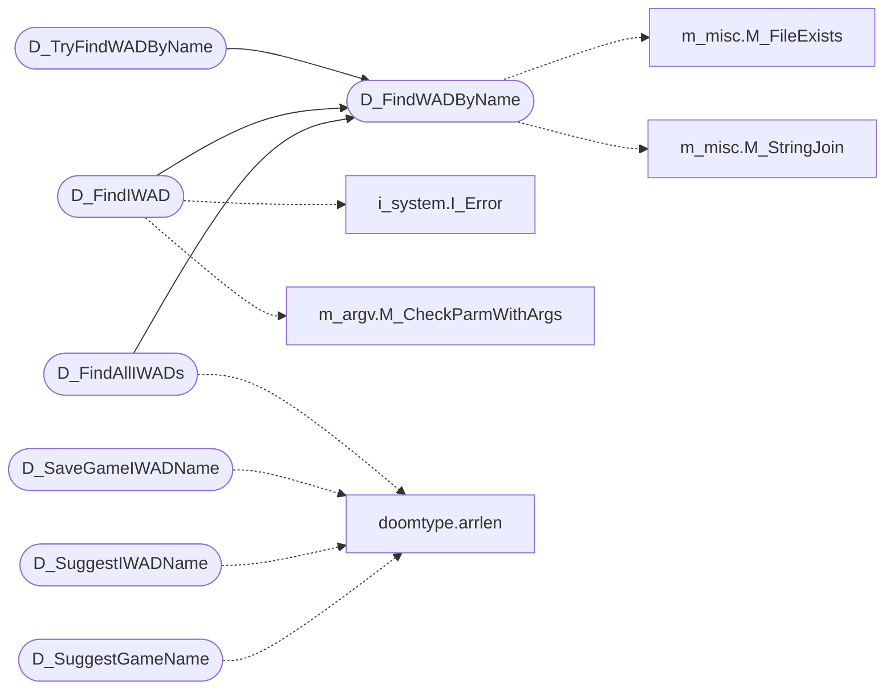

# `progs/doomgeneric/d_iwad.c`

> Source: [progs/doomgeneric/d_iwad.c:1](../../progs/doomgeneric/d_iwad.c#L1) | language `c` | coverage 6.7% | [API index](../index.md)

Copyright(C) 2005-2014 Simon Howard  This program is free software; you can redistribute it and/or modify it under the terms of the GNU General Public License as published by the Free Software Foundation; either version 2 of the License, or (at your option) any later version.

This program is distributed in the hope that it will be useful, but WITHOUT ANY WARRANTY; without even the implied warranty of MERCHANTABILITY or FITNESS FOR A PARTICULAR PURPOSE.  See the GNU General Public License for more details.  DESCRIPTION: Search for and locate an IWAD file, and initialize according to the IWAD type.

## Contents

- **Structs:** [`registry_value_t`](#registry_value_t)
- **Functions:** [`D_FindWADByName`](#d_findwadbyname), [`D_TryFindWADByName`](#d_tryfindwadbyname), [`D_FindIWAD`](#d_findiwad), [`D_FindAllIWADs`](#d_findalliwads), [`D_SaveGameIWADName`](#d_savegameiwadname), [`D_SuggestIWADName`](#d_suggestiwadname), [`D_SuggestGameName`](#d_suggestgamename)
- **Macros:** [`MAX_IWAD_DIRS`](#max_iwad_dirs), [`WIN32_LEAN_AND_MEAN`](#win32_lean_and_mean), [`UNINSTALLER_STRING`](#uninstaller_string), [`SOFTWARE_KEY`](#software_key), [`SOFTWARE_KEY`](#software_key), [`STEAM_BFG_GUS_PATCHES`](#steam_bfg_gus_patches)

## Call Graph

Solid arrows stay in this module, dashed arrows leave it.



## Structs

<a id="registry_value_t"></a>

### `registry_value_t`

`struct` | [progs/doomgeneric/d_iwad.c:83](../../progs/doomgeneric/d_iwad.c#L83)

```c
typedef struct
```

---

## Functions

<a id="d_findwadbyname"></a>

### `D_FindWADByName`

`function` | [progs/doomgeneric/d_iwad.c:630](../../progs/doomgeneric/d_iwad.c#L630)

```c
char *D_FindWADByName(char *name)
```

**Parameters**

| Name | Type | Default | Description |
|---|---|---|---|
| `name` | `char *` |  |  |

**Returns:** `char *`

*Calls:* [`M_FileExists`](progs.doomgeneric.m_misc.c.md#m_fileexists), [`M_StringJoin`](progs.doomgeneric.m_misc.h.md#m_stringjoin)

*Called by:* [`D_FindAllIWADs`](#d_findalliwads), [`D_FindIWAD`](#d_findiwad), [`D_TryFindWADByName`](#d_tryfindwadbyname)

---

<a id="d_tryfindwadbyname"></a>

### `D_TryFindWADByName`

`function` | [progs/doomgeneric/d_iwad.c:681](../../progs/doomgeneric/d_iwad.c#L681)

```c
char *D_TryFindWADByName(char *filename)
```

**Parameters**

| Name | Type | Default | Description |
|---|---|---|---|
| `filename` | `char *` |  |  |

**Returns:** `char *`

*Calls:* [`D_FindWADByName`](#d_findwadbyname)

---

<a id="d_findiwad"></a>

### `D_FindIWAD`

`function` | [progs/doomgeneric/d_iwad.c:704](../../progs/doomgeneric/d_iwad.c#L704)

```c
char *D_FindIWAD(int mask, GameMission_t *mission)
```

**Parameters**

| Name | Type | Default | Description |
|---|---|---|---|
| `mask` | `int` |  |  |
| `mission` | `GameMission_t *` |  |  |

**Returns:** `char *`

*Calls:* [`D_FindWADByName`](#d_findwadbyname), [`I_Error`](progs.doomgeneric.i_system.h.md#i_error), [`M_CheckParmWithArgs`](progs.doomgeneric.m_argv.h.md#m_checkparmwithargs)

---

<a id="d_findalliwads"></a>

### `D_FindAllIWADs`

`function` `const` | [progs/doomgeneric/d_iwad.c:757](../../progs/doomgeneric/d_iwad.c#L757)

```c
const iwad_t **D_FindAllIWADs(int mask)
```

**Parameters**

| Name | Type | Default | Description |
|---|---|---|---|
| `mask` | `int` |  |  |

**Returns:** `iwad_t **`

*Calls:* [`D_FindWADByName`](#d_findwadbyname), [`arrlen`](progs.doomgeneric.doomtype.h.md#arrlen)

---

<a id="d_savegameiwadname"></a>

### `D_SaveGameIWADName`

`function` | [progs/doomgeneric/d_iwad.c:796](../../progs/doomgeneric/d_iwad.c#L796)

```c
char *D_SaveGameIWADName(GameMission_t gamemission)
```

**Parameters**

| Name | Type | Default | Description |
|---|---|---|---|
| `gamemission` | `GameMission_t` |  |  |

**Returns:** `char *`

*Calls:* [`arrlen`](progs.doomgeneric.doomtype.h.md#arrlen)

---

<a id="d_suggestiwadname"></a>

### `D_SuggestIWADName`

`function` | [progs/doomgeneric/d_iwad.c:820](../../progs/doomgeneric/d_iwad.c#L820)

```c
char *D_SuggestIWADName(GameMission_t mission, GameMode_t mode)
```

**Parameters**

| Name | Type | Default | Description |
|---|---|---|---|
| `mission` | `GameMission_t` |  |  |
| `mode` | `GameMode_t` |  |  |

**Returns:** `char *`

*Calls:* [`arrlen`](progs.doomgeneric.doomtype.h.md#arrlen)

---

<a id="d_suggestgamename"></a>

### `D_SuggestGameName`

`function` | [progs/doomgeneric/d_iwad.c:835](../../progs/doomgeneric/d_iwad.c#L835)

```c
char *D_SuggestGameName(GameMission_t mission, GameMode_t mode)
```

**Parameters**

| Name | Type | Default | Description |
|---|---|---|---|
| `mission` | `GameMission_t` |  |  |
| `mode` | `GameMode_t` |  |  |

**Returns:** `char *`

*Calls:* [`arrlen`](progs.doomgeneric.doomtype.h.md#arrlen)

---

## Macros

<a id="max_iwad_dirs"></a>

### `MAX_IWAD_DIRS`

`macro` | [progs/doomgeneric/d_iwad.c:58](../../progs/doomgeneric/d_iwad.c#L58)

```c
#define MAX_IWAD_DIRS
```

---

<a id="win32_lean_and_mean"></a>

### `WIN32_LEAN_AND_MEAN`

`macro` | [progs/doomgeneric/d_iwad.c:80](../../progs/doomgeneric/d_iwad.c#L80)

```c
#define WIN32_LEAN_AND_MEAN
```

---

<a id="uninstaller_string"></a>

### `UNINSTALLER_STRING`

`macro` | [progs/doomgeneric/d_iwad.c:90](../../progs/doomgeneric/d_iwad.c#L90)

```c
#define UNINSTALLER_STRING
```

---

<a id="software_key"></a>

### `SOFTWARE_KEY`

`macro` | [progs/doomgeneric/d_iwad.c:102](../../progs/doomgeneric/d_iwad.c#L102)

```c
#define SOFTWARE_KEY
```

---

<a id="software_key"></a>

### `SOFTWARE_KEY`

`macro` | [progs/doomgeneric/d_iwad.c:104](../../progs/doomgeneric/d_iwad.c#L104)

```c
#define SOFTWARE_KEY
```

---

<a id="steam_bfg_gus_patches"></a>

### `STEAM_BFG_GUS_PATCHES`

`macro` | [progs/doomgeneric/d_iwad.c:189](../../progs/doomgeneric/d_iwad.c#L189)

```c
#define STEAM_BFG_GUS_PATCHES
```

---
