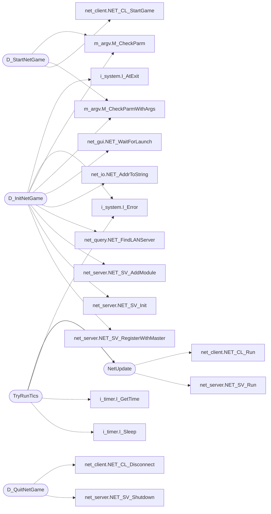

# `progs/doomgeneric/d_loop.c`

> Source: [progs/doomgeneric/d_loop.c:1](../../progs/doomgeneric/d_loop.c#L1) | language `c` | coverage 60.0% | [API index](../index.md)

Copyright(C) 1993-1996 Id Software, Inc.

Copyright(C) 2005-2014 Simon Howard  This program is free software; you can redistribute it and/or modify it under the terms of the GNU General Public License as published by the Free Software Foundation; either version 2 of the License, or (at your option) any later version.  This program is distributed in the hope that it will be useful, but WITHOUT ANY WARRANTY; without even the implied warranty of MERCHANTABILITY or FITNESS FOR A PARTICULAR PURPOSE.  See the GNU General Public License for more details.  DESCRIPTION: Main loop code.

## Contents

- **Structs:** [`ticcmd_set_t`](#ticcmd_set_t)
- **Functions:** [`NetUpdate`](#netupdate), [`D_ReceiveTic`](#d_receivetic), [`D_StartGameLoop`](#d_startgameloop), [`D_StartNetGame`](#d_startnetgame), [`D_InitNetGame`](#d_initnetgame), [`D_QuitNetGame`](#d_quitnetgame), [`TryRunTics`](#tryruntics), [`D_RegisterLoopCallbacks`](#d_registerloopcallbacks)

## Call Graph

Solid arrows stay in this module, dashed arrows leave it.



## Structs

<a id="ticcmd_set_t"></a>

### `ticcmd_set_t`

`struct` | [progs/doomgeneric/d_loop.c:45](../../progs/doomgeneric/d_loop.c#L45)

```c
typedef struct
```

---

## Functions

<a id="netupdate"></a>

### `NetUpdate`

`function` | [progs/doomgeneric/d_loop.c:203](../../progs/doomgeneric/d_loop.c#L203)

```c
void NetUpdate (void)
```

Create any new ticcmds and broadcast to other players.

> **Inherited:** Documentation from [`NetUpdate`](#netupdate) (progs/doomgeneric/d_loop.h:55).

*Calls:* [`NET_CL_Run`](progs.doomgeneric.net_client.h.md#net_cl_run), [`NET_SV_Run`](progs.doomgeneric.net_server.h.md#net_sv_run)

*Called by:* [`TryRunTics`](#tryruntics)

---

<a id="d_receivetic"></a>

### `D_ReceiveTic`

`function` | [progs/doomgeneric/d_loop.c:271](../../progs/doomgeneric/d_loop.c#L271)

```c
void D_ReceiveTic(ticcmd_t *ticcmds, boolean *players_mask)
```

**Parameters**

| Name | Type | Default | Description |
|---|---|---|---|
| `ticcmds` | `ticcmd_t *` |  |  |
| `players_mask` | `boolean *` |  |  |

---

<a id="d_startgameloop"></a>

### `D_StartGameLoop`

`function` | [progs/doomgeneric/d_loop.c:305](../../progs/doomgeneric/d_loop.c#L305)

```c
void D_StartGameLoop(void)
```

Called at start of game loop to initialize timers

> **Inherited:** Documentation from [`D_StartGameLoop`](#d_startgameloop) (progs/doomgeneric/d_loop.h:65).

---

<a id="d_startnetgame"></a>

### `D_StartNetGame`

`function` | [progs/doomgeneric/d_loop.c:340](../../progs/doomgeneric/d_loop.c#L340)

```c
void D_StartNetGame(net_gamesettings_t *settings, netgame_startup_callback_t callback)
```

**Parameters**

| Name | Type | Default | Description |
|---|---|---|---|
| `settings` | `net_gamesettings_t *` |  |  |
| `callback` | `netgame_startup_callback_t` |  |  |

*Calls:* [`M_CheckParm`](progs.doomgeneric.m_argv.h.md#m_checkparm), [`M_CheckParmWithArgs`](progs.doomgeneric.m_argv.h.md#m_checkparmwithargs), [`NET_CL_StartGame`](progs.doomgeneric.net_client.h.md#net_cl_startgame)

---

<a id="d_initnetgame"></a>

### `D_InitNetGame`

`function` | [progs/doomgeneric/d_loop.c:452](../../progs/doomgeneric/d_loop.c#L452)

```c
boolean D_InitNetGame(net_connect_data_t *connect_data)
```

**Parameters**

| Name | Type | Default | Description |
|---|---|---|---|
| `connect_data` | `net_connect_data_t *` |  |  |

**Returns:** `boolean`

*Calls:* [`I_AtExit`](progs.doomgeneric.i_system.h.md#i_atexit), [`I_Error`](progs.doomgeneric.i_system.h.md#i_error), [`M_CheckParm`](progs.doomgeneric.m_argv.h.md#m_checkparm), [`M_CheckParmWithArgs`](progs.doomgeneric.m_argv.h.md#m_checkparmwithargs), [`NET_WaitForLaunch`](progs.doomgeneric.net_gui.h.md#net_waitforlaunch), [`NET_AddrToString`](progs.doomgeneric.net_io.h.md#net_addrtostring), [`NET_FindLANServer`](progs.doomgeneric.net_query.h.md#net_findlanserver), [`NET_SV_AddModule`](progs.doomgeneric.net_server.h.md#net_sv_addmodule), [`NET_SV_Init`](progs.doomgeneric.net_server.h.md#net_sv_init), [`NET_SV_RegisterWithMaster`](progs.doomgeneric.net_server.h.md#net_sv_registerwithmaster)

*Called by:* [`D_ConnectNetGame`](progs.doomgeneric.d_net.c.md#d_connectnetgame)

---

<a id="d_quitnetgame"></a>

### `D_QuitNetGame`

`function` | [progs/doomgeneric/d_loop.c:560](../../progs/doomgeneric/d_loop.c#L560)

```c
void D_QuitNetGame (void)
```

D_QuitNetGame Called before quitting to leave a net game without hanging the other players

*Calls:* [`NET_CL_Disconnect`](progs.doomgeneric.net_client.h.md#net_cl_disconnect), [`NET_SV_Shutdown`](progs.doomgeneric.net_server.h.md#net_sv_shutdown)

---

<a id="tryruntics"></a>

### `TryRunTics`

`function` | [progs/doomgeneric/d_loop.c:706](../../progs/doomgeneric/d_loop.c#L706)

```c
void TryRunTics (void)
```

? how many ticks to run?

> **Inherited:** Documentation from [`TryRunTics`](#tryruntics) (progs/doomgeneric/d_loop.h:62).

*Calls:* [`NetUpdate`](#netupdate), [`I_Error`](progs.doomgeneric.i_system.h.md#i_error), [`I_GetTime`](progs.doomgeneric.i_timer.h.md#i_gettime), [`I_Sleep`](progs.doomgeneric.i_timer.h.md#i_sleep)

---

<a id="d_registerloopcallbacks"></a>

### `D_RegisterLoopCallbacks`

`function` | [progs/doomgeneric/d_loop.c:822](../../progs/doomgeneric/d_loop.c#L822)

```c
void D_RegisterLoopCallbacks(loop_interface_t *i)
```

Register callback functions for the main loop code to use.

**Parameters**

| Name | Type | Default | Description |
|---|---|---|---|
| `i` | `loop_interface_t *` |  |  |

> **Inherited:** Documentation from [`D_RegisterLoopCallbacks`](#d_registerloopcallbacks) (progs/doomgeneric/d_loop.h:52).

---
