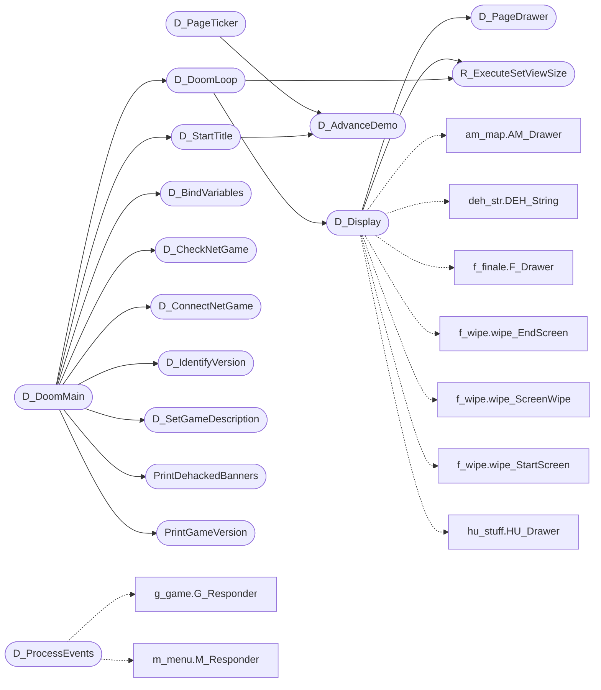

# `progs/doomgeneric/d_main.c`

> Source: [progs/doomgeneric/d_main.c:1](../../progs/doomgeneric/d_main.c#L1) | language `c` | coverage 47.4% | [API index](../index.md)

Copyright(C) 1993-1996 Id Software, Inc.

Copyright(C) 2005-2014 Simon Howard  This program is free software; you can redistribute it and/or modify it under the terms of the GNU General Public License as published by the Free Software Foundation; either version 2 of the License, or (at your option) any later version.  This program is distributed in the hope that it will be useful, but WITHOUT ANY WARRANTY; without even the implied warranty of MERCHANTABILITY or FITNESS FOR A PARTICULAR PURPOSE.  See the GNU General Public License for more details.  DESCRIPTION: DOOM main program (D_DoomMain) and game loop (D_DoomLoop), plus functions to determine game mode (shareware, registered), parse command line parameters, configure game parameters (turbo), and call the startup functions.

## Contents

- **Functions:** [`D_ConnectNetGame`](#d_connectnetgame), [`D_CheckNetGame`](#d_checknetgame), [`D_ProcessEvents`](#d_processevents), [`R_ExecuteSetViewSize`](#r_executesetviewsize), [`D_Display`](#d_display), [`D_BindVariables`](#d_bindvariables), [`D_GrabMouseCallback`](#d_grabmousecallback), [`D_DoomLoop`](#d_doomloop), [`D_PageTicker`](#d_pageticker), [`D_PageDrawer`](#d_pagedrawer), [`D_AdvanceDemo`](#d_advancedemo), [`D_DoAdvanceDemo`](#d_doadvancedemo), [`D_StartTitle`](#d_starttitle), [`D_IdentifyVersion`](#d_identifyversion), [`D_SetGameDescription`](#d_setgamedescription), [`PrintDehackedBanners`](#printdehackedbanners), [`PrintGameVersion`](#printgameversion), [`D_DoomMain`](#d_doommain)
- **Variables:** [`inhelpscreens`](#inhelpscreens), [`setsizeneeded`](#setsizeneeded), [`showMessages`](#showmessages), [`forwardmove`](#forwardmove), [`sidemove`](#sidemove)

## Call Graph

Solid arrows stay in this module, dashed arrows leave it.



## Functions

<a id="d_connectnetgame"></a>

### `D_ConnectNetGame`

`function` | [progs/doomgeneric/d_main.c:131](../../progs/doomgeneric/d_main.c#L131)

```c
void D_ConnectNetGame(void);
```

*Called by:* [`D_DoomMain`](#d_doommain)

---

<a id="d_checknetgame"></a>

### `D_CheckNetGame`

`function` | [progs/doomgeneric/d_main.c:132](../../progs/doomgeneric/d_main.c#L132)

```c
void D_CheckNetGame(void);
```

*Called by:* [`D_DoomMain`](#d_doommain)

---

<a id="d_processevents"></a>

### `D_ProcessEvents`

`function` | [progs/doomgeneric/d_main.c:139](../../progs/doomgeneric/d_main.c#L139)

```c
void D_ProcessEvents (void)
```

D_ProcessEvents Send all the events of the given timestamp down the responder chain

*Calls:* [`G_Responder`](progs.doomgeneric.g_game.c.md#g_responder), [`M_Responder`](progs.doomgeneric.m_menu.c.md#m_responder)

---

<a id="r_executesetviewsize"></a>

### `R_ExecuteSetViewSize`

`function` | [progs/doomgeneric/d_main.c:167](../../progs/doomgeneric/d_main.c#L167)

```c
void R_ExecuteSetViewSize (void);
```

*Called by:* [`D_Display`](#d_display), [`D_DoomLoop`](#d_doomloop)

---

<a id="d_display"></a>

### `D_Display`

`function` | [progs/doomgeneric/d_main.c:169](../../progs/doomgeneric/d_main.c#L169)

```c
void D_Display (void)
```

*Calls:* [`AM_Drawer`](progs.doomgeneric.am_map.h.md#am_drawer), [`D_PageDrawer`](#d_pagedrawer), [`R_ExecuteSetViewSize`](#r_executesetviewsize), [`DEH_String`](progs.doomgeneric.deh_str.h.md#deh_string), [`F_Drawer`](progs.doomgeneric.f_finale.h.md#f_drawer), [`wipe_EndScreen`](progs.doomgeneric.f_wipe.h.md#wipe_endscreen), [`wipe_ScreenWipe`](progs.doomgeneric.f_wipe.h.md#wipe_screenwipe), [`wipe_StartScreen`](progs.doomgeneric.f_wipe.h.md#wipe_startscreen), [`HU_Drawer`](progs.doomgeneric.hu_stuff.h.md#hu_drawer), [`HU_Erase`](progs.doomgeneric.hu_stuff.h.md#hu_erase), [`I_GetTime`](progs.doomgeneric.i_timer.h.md#i_gettime), [`I_Sleep`](progs.doomgeneric.i_timer.h.md#i_sleep) and 9 more

*Called by:* [`D_DoomLoop`](#d_doomloop)

---

<a id="d_bindvariables"></a>

### `D_BindVariables`

`function` | [progs/doomgeneric/d_main.c:335](../../progs/doomgeneric/d_main.c#L335)

```c
void D_BindVariables(void)
```

*Calls:* [`I_BindJoystickVariables`](progs.doomgeneric.i_joystick.h.md#i_bindjoystickvariables), [`I_BindVideoVariables`](progs.doomgeneric.i_video.h.md#i_bindvideovariables), [`M_BindVariable`](progs.doomgeneric.m_config.h.md#m_bindvariable), [`M_ApplyPlatformDefaults`](progs.doomgeneric.m_controls.h.md#m_applyplatformdefaults), [`M_BindBaseControls`](progs.doomgeneric.m_controls.h.md#m_bindbasecontrols), [`M_BindChatControls`](progs.doomgeneric.m_controls.h.md#m_bindchatcontrols), [`M_BindMapControls`](progs.doomgeneric.m_controls.h.md#m_bindmapcontrols), [`M_BindMenuControls`](progs.doomgeneric.m_controls.h.md#m_bindmenucontrols), [`M_BindWeaponControls`](progs.doomgeneric.m_controls.h.md#m_bindweaponcontrols), [`M_snprintf`](progs.doomgeneric.m_misc.h.md#m_snprintf), [`NET_BindVariables`](progs.doomgeneric.net_client.h.md#net_bindvariables)

*Called by:* [`D_DoomMain`](#d_doommain)

---

<a id="d_grabmousecallback"></a>

### `D_GrabMouseCallback`

`function` | [progs/doomgeneric/d_main.c:388](../../progs/doomgeneric/d_main.c#L388)

```c
boolean D_GrabMouseCallback(void)
```

**Returns:** `boolean`

---

<a id="d_doomloop"></a>

### `D_DoomLoop`

`function` | [progs/doomgeneric/d_main.c:408](../../progs/doomgeneric/d_main.c#L408)

```c
void D_DoomLoop (void)
```

D_DoomLoop

*Calls:* [`D_Display`](#d_display), [`R_ExecuteSetViewSize`](#r_executesetviewsize), [`G_BeginRecording`](progs.doomgeneric.g_game.h.md#g_beginrecording), [`I_EnableLoadingDisk`](progs.doomgeneric.i_video.h.md#i_enableloadingdisk), [`I_GraphicsCheckCommandLine`](progs.doomgeneric.i_video.h.md#i_graphicscheckcommandline), [`I_InitGraphics`](progs.doomgeneric.i_video.h.md#i_initgraphics), [`I_SetGrabMouseCallback`](progs.doomgeneric.i_video.h.md#i_setgrabmousecallback), [`I_StartFrame`](progs.doomgeneric.i_video.h.md#i_startframe), [`S_UpdateSounds`](progs.doomgeneric.s_sound.h.md#s_updatesounds), [`V_RestoreBuffer`](progs.doomgeneric.v_video.h.md#v_restorebuffer)

*Called by:* [`D_DoomMain`](#d_doommain)

---

<a id="d_pageticker"></a>

### `D_PageTicker`

`function` | [progs/doomgeneric/d_main.c:490](../../progs/doomgeneric/d_main.c#L490)

```c
void D_PageTicker (void)
```

D_PageTicker Handles timing for warped projection

*Calls:* [`D_AdvanceDemo`](#d_advancedemo)

---

<a id="d_pagedrawer"></a>

### `D_PageDrawer`

`function` | [progs/doomgeneric/d_main.c:501](../../progs/doomgeneric/d_main.c#L501)

```c
void D_PageDrawer (void)
```

D_PageDrawer

*Calls:* [`V_DrawPatch`](progs.doomgeneric.v_video.h.md#v_drawpatch), [`W_CacheLumpName`](progs.doomgeneric.w_wad.h.md#w_cachelumpname)

*Called by:* [`D_Display`](#d_display)

---

<a id="d_advancedemo"></a>

### `D_AdvanceDemo`

`function` | [progs/doomgeneric/d_main.c:511](../../progs/doomgeneric/d_main.c#L511)

```c
void D_AdvanceDemo (void)
```

D_AdvanceDemo Called after each demo or intro demosequence finishes

*Called by:* [`D_PageTicker`](#d_pageticker), [`D_StartTitle`](#d_starttitle)

---

<a id="d_doadvancedemo"></a>

### `D_DoAdvanceDemo`

`function` | [progs/doomgeneric/d_main.c:521](../../progs/doomgeneric/d_main.c#L521)

```c
void D_DoAdvanceDemo (void)
```

This cycles through the demo sequences.

FIXME - version dependend demo numbers?

*Calls:* [`DEH_String`](progs.doomgeneric.deh_str.h.md#deh_string), [`strcasecmp`](progs.doomgeneric.doomtype.h.md#strcasecmp), [`G_DeferedPlayDemo`](progs.doomgeneric.g_game.h.md#g_deferedplaydemo), [`S_StartMusic`](progs.doomgeneric.s_sound.h.md#s_startmusic), [`W_CheckNumForName`](progs.doomgeneric.w_wad.h.md#w_checknumforname)

---

<a id="d_starttitle"></a>

### `D_StartTitle`

`function` | [progs/doomgeneric/d_main.c:609](../../progs/doomgeneric/d_main.c#L609)

```c
void D_StartTitle (void)
```

D_StartTitle

*Calls:* [`D_AdvanceDemo`](#d_advancedemo)

*Called by:* [`D_DoomMain`](#d_doommain)

---

<a id="d_identifyversion"></a>

### `D_IdentifyVersion`

`function` | [progs/doomgeneric/d_main.c:737](../../progs/doomgeneric/d_main.c#L737)

```c
void D_IdentifyVersion(void)
```

*Calls:* [`strncasecmp`](progs.doomgeneric.doomtype.h.md#strncasecmp), [`I_Error`](progs.doomgeneric.i_system.h.md#i_error), [`M_CheckParmWithArgs`](progs.doomgeneric.m_argv.h.md#m_checkparmwithargs), [`W_CheckNumForName`](progs.doomgeneric.w_wad.h.md#w_checknumforname)

*Called by:* [`D_DoomMain`](#d_doommain)

---

<a id="d_setgamedescription"></a>

### `D_SetGameDescription`

`function` | [progs/doomgeneric/d_main.c:820](../../progs/doomgeneric/d_main.c#L820)

```c
void D_SetGameDescription(void)
```

*Calls:* [`W_CheckNumForName`](progs.doomgeneric.w_wad.h.md#w_checknumforname)

*Called by:* [`D_DoomMain`](#d_doommain)

---

<a id="printdehackedbanners"></a>

### `PrintDehackedBanners`

`function` | [progs/doomgeneric/d_main.c:918](../../progs/doomgeneric/d_main.c#L918)

```c
void PrintDehackedBanners(void)
```

*Calls:* [`DEH_String`](progs.doomgeneric.deh_str.h.md#deh_string), [`arrlen`](progs.doomgeneric.doomtype.h.md#arrlen)

*Called by:* [`D_DoomMain`](#d_doommain)

---

<a id="printgameversion"></a>

### `PrintGameVersion`

`function` | [progs/doomgeneric/d_main.c:1065](../../progs/doomgeneric/d_main.c#L1065)

```c
void PrintGameVersion(void)
```

*Called by:* [`D_DoomMain`](#d_doommain)

---

<a id="d_doommain"></a>

### `D_DoomMain`

`function` | [progs/doomgeneric/d_main.c:1178](../../progs/doomgeneric/d_main.c#L1178)

```c
void D_DoomMain (void)
```

D_DoomMain

*Calls:* [`D_FindIWAD`](progs.doomgeneric.d_iwad.h.md#d_findiwad), [`D_SaveGameIWADName`](progs.doomgeneric.d_iwad.h.md#d_savegameiwadname), [`D_BindVariables`](#d_bindvariables), [`D_CheckNetGame`](#d_checknetgame), [`D_ConnectNetGame`](#d_connectnetgame), [`D_DoomLoop`](#d_doomloop), [`D_IdentifyVersion`](#d_identifyversion), [`D_SetGameDescription`](#d_setgamedescription), [`D_StartTitle`](#d_starttitle), [`PrintDehackedBanners`](#printdehackedbanners), [`PrintGameVersion`](#printgameversion), [`DEH_LoadLump`](progs.doomgeneric.deh_main.h.md#deh_loadlump) and 45 more

---

## Variables

<a id="inhelpscreens"></a>

### `inhelpscreens`

`variable` `extern` | [progs/doomgeneric/d_main.c:106](../../progs/doomgeneric/d_main.c#L106)

```c
extern boolean inhelpscreens;
```

---

<a id="setsizeneeded"></a>

### `setsizeneeded`

`variable` `extern` | [progs/doomgeneric/d_main.c:165](../../progs/doomgeneric/d_main.c#L165)

```c
extern boolean setsizeneeded;
```

---

<a id="showmessages"></a>

### `showMessages`

`variable` `extern` | [progs/doomgeneric/d_main.c:166](../../progs/doomgeneric/d_main.c#L166)

```c
extern int showMessages;
```

---

<a id="forwardmove"></a>

### `forwardmove`

`variable` `extern` | [progs/doomgeneric/d_main.c:1351](../../progs/doomgeneric/d_main.c#L1351)

```c
extern int forwardmove[2];
```

---

<a id="sidemove"></a>

### `sidemove`

`variable` `extern` | [progs/doomgeneric/d_main.c:1352](../../progs/doomgeneric/d_main.c#L1352)

```c
extern int sidemove[2];
```

---
