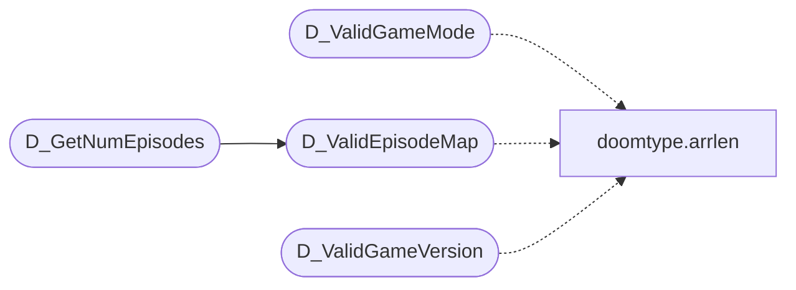

# `progs/doomgeneric/d_mode.c`

> Source: [progs/doomgeneric/d_mode.c:1](../../progs/doomgeneric/d_mode.c#L1) | language `c` | coverage 14.3% | [API index](../index.md)

Copyright(C) 2005-2014 Simon Howard  This program is free software; you can redistribute it and/or modify it under the terms of the GNU General Public License as published by the Free Software Foundation; either version 2 of the License, or (at your option) any later version.

This program is distributed in the hope that it will be useful, but WITHOUT ANY WARRANTY; without even the implied warranty of MERCHANTABILITY or FITNESS FOR A PARTICULAR PURPOSE.  See the GNU General Public License for more details.   DESCRIPTION: Functions and definitions relating to the game type and operational mode.    Valid game mode/mission combinations, with the number of episodes/maps for each.

## Contents

- **Functions:** [`D_ValidGameMode`](#d_validgamemode), [`D_ValidEpisodeMap`](#d_validepisodemap), [`D_GetNumEpisodes`](#d_getnumepisodes), [`D_ValidGameVersion`](#d_validgameversion), [`D_IsEpisodeMap`](#d_isepisodemap), [`D_GameMissionString`](#d_gamemissionstring)

## Call Graph

Solid arrows stay in this module, dashed arrows leave it.



## Functions

<a id="d_validgamemode"></a>

### `D_ValidGameMode`

`function` | [progs/doomgeneric/d_mode.c:50](../../progs/doomgeneric/d_mode.c#L50)

```c
boolean D_ValidGameMode(GameMission_t mission, GameMode_t mode)
```

**Parameters**

| Name | Type | Default | Description |
|---|---|---|---|
| `mission` | `GameMission_t` |  |  |
| `mode` | `GameMode_t` |  |  |

**Returns:** `boolean`

*Calls:* [`arrlen`](progs.doomgeneric.doomtype.h.md#arrlen)

---

<a id="d_validepisodemap"></a>

### `D_ValidEpisodeMap`

`function` | [progs/doomgeneric/d_mode.c:65](../../progs/doomgeneric/d_mode.c#L65)

```c
boolean D_ValidEpisodeMap(GameMission_t mission, GameMode_t mode, int episode, int map)
```

**Parameters**

| Name | Type | Default | Description |
|---|---|---|---|
| `mission` | `GameMission_t` |  |  |
| `mode` | `GameMode_t` |  |  |
| `episode` | `int` |  |  |
| `map` | `int` |  |  |

**Returns:** `boolean`

*Calls:* [`arrlen`](progs.doomgeneric.doomtype.h.md#arrlen)

*Called by:* [`D_GetNumEpisodes`](#d_getnumepisodes)

---

<a id="d_getnumepisodes"></a>

### `D_GetNumEpisodes`

`function` | [progs/doomgeneric/d_mode.c:103](../../progs/doomgeneric/d_mode.c#L103)

```c
int D_GetNumEpisodes(GameMission_t mission, GameMode_t mode)
```

**Parameters**

| Name | Type | Default | Description |
|---|---|---|---|
| `mission` | `GameMission_t` |  |  |
| `mode` | `GameMode_t` |  |  |

**Returns:** `int`

*Calls:* [`D_ValidEpisodeMap`](#d_validepisodemap)

---

<a id="d_validgameversion"></a>

### `D_ValidGameVersion`

`function` | [progs/doomgeneric/d_mode.c:135](../../progs/doomgeneric/d_mode.c#L135)

```c
boolean D_ValidGameVersion(GameMission_t mission, GameVersion_t version)
```

**Parameters**

| Name | Type | Default | Description |
|---|---|---|---|
| `mission` | `GameMission_t` |  |  |
| `version` | `GameVersion_t` |  |  |

**Returns:** `boolean`

*Calls:* [`arrlen`](progs.doomgeneric.doomtype.h.md#arrlen)

---

<a id="d_isepisodemap"></a>

### `D_IsEpisodeMap`

`function` | [progs/doomgeneric/d_mode.c:161](../../progs/doomgeneric/d_mode.c#L161)

```c
boolean D_IsEpisodeMap(GameMission_t mission)
```

**Parameters**

| Name | Type | Default | Description |
|---|---|---|---|
| `mission` | `GameMission_t` |  |  |

**Returns:** `boolean`

---

<a id="d_gamemissionstring"></a>

### `D_GameMissionString`

`function` | [progs/doomgeneric/d_mode.c:182](../../progs/doomgeneric/d_mode.c#L182)

```c
char *D_GameMissionString(GameMission_t mission)
```

**Parameters**

| Name | Type | Default | Description |
|---|---|---|---|
| `mission` | `GameMission_t` |  |  |

**Returns:** `char *`

---
