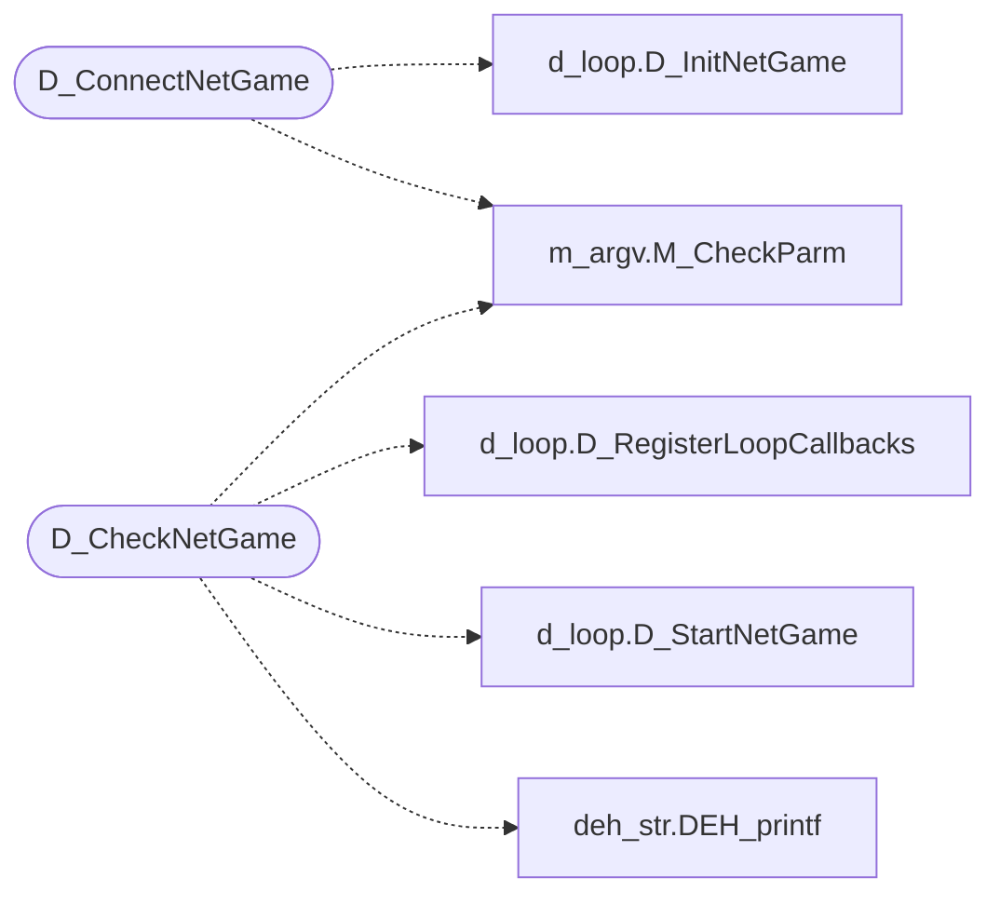

# `progs/doomgeneric/d_net.c`

> Source: [progs/doomgeneric/d_net.c:1](../../progs/doomgeneric/d_net.c#L1) | language `c` | coverage 66.7% | [API index](../index.md)

Copyright(C) 1993-1996 Id Software, Inc.

Copyright(C) 2005-2014 Simon Howard  This program is free software; you can redistribute it and/or modify it under the terms of the GNU General Public License as published by the Free Software Foundation; either version 2 of the License, or (at your option) any later version.  This program is distributed in the hope that it will be useful, but WITHOUT ANY WARRANTY; without even the implied warranty of MERCHANTABILITY or FITNESS FOR A PARTICULAR PURPOSE.  See the GNU General Public License for more details.  DESCRIPTION: DOOM Network game communication and protocol, all OS independend parts.

## Contents

- **Functions:** [`D_ConnectNetGame`](#d_connectnetgame), [`D_CheckNetGame`](#d_checknetgame)
- **Variables:** [`advancedemo`](#advancedemo)

## Call Graph

Solid arrows stay in this module, dashed arrows leave it.



## Functions

<a id="d_connectnetgame"></a>

### `D_ConnectNetGame`

`function` | [progs/doomgeneric/d_net.c:215](../../progs/doomgeneric/d_net.c#L215)

```c
void D_ConnectNetGame(void)
```

*Calls:* [`D_InitNetGame`](progs.doomgeneric.d_loop.c.md#d_initnetgame), [`M_CheckParm`](progs.doomgeneric.m_argv.h.md#m_checkparm)

---

<a id="d_checknetgame"></a>

### `D_CheckNetGame`

`function` | [progs/doomgeneric/d_net.c:240](../../progs/doomgeneric/d_net.c#L240)

```c
void D_CheckNetGame (void)
```

D_CheckNetGame Works out player numbers among the net participants

*Calls:* [`D_RegisterLoopCallbacks`](progs.doomgeneric.d_loop.h.md#d_registerloopcallbacks), [`D_StartNetGame`](progs.doomgeneric.d_loop.h.md#d_startnetgame), [`DEH_printf`](progs.doomgeneric.deh_str.h.md#deh_printf), [`M_CheckParm`](progs.doomgeneric.m_argv.h.md#m_checkparm)

---

## Variables

<a id="advancedemo"></a>

### `advancedemo`

`variable` `extern` | [progs/doomgeneric/d_net.c:73](../../progs/doomgeneric/d_net.c#L73)

```c
extern boolean advancedemo;
```

---
