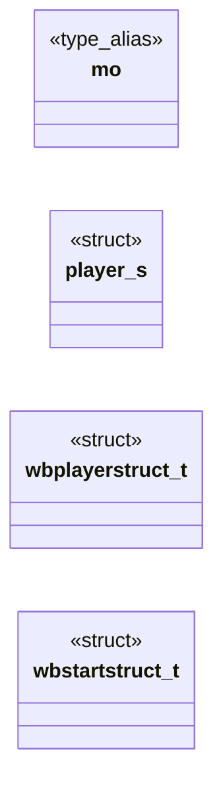

# `progs/doomgeneric/d_player.h`

> Source: [progs/doomgeneric/d_player.h:1](../../progs/doomgeneric/d_player.h#L1) | language `h` | coverage 66.7% | [API index](../index.md)

Copyright(C) 1993-1996 Id Software, Inc.

Copyright(C) 2005-2014 Simon Howard  This program is free software; you can redistribute it and/or modify it under the terms of the GNU General Public License as published by the Free Software Foundation; either version 2 of the License, or (at your option) any later version.  This program is distributed in the hope that it will be useful, but WITHOUT ANY WARRANTY; without even the implied warranty of MERCHANTABILITY or FITNESS FOR A PARTICULAR PURPOSE.  See the GNU General Public License for more details.  DESCRIPTION:       The player data structure depends on a number of other structs: items (internal inventory), animation states (closely tied to the sprites used to represent them, unfortunately).

## Contents

- **Structs:** [`player_s`](#player_s), [`wbplayerstruct_t`](#wbplayerstruct_t), [`wbstartstruct_t`](#wbstartstruct_t)
- **Type Aliases:** [`mo`](#mo)
- **Macros:** [`__D_PLAYER__`](#__d_player__)

## Type Diagram



## Structs

<a id="player_s"></a>

### `player_s`

`struct` | [progs/doomgeneric/d_player.h:78](../../progs/doomgeneric/d_player.h#L78)

```c
typedef struct player_s
```

Extended player object info: player_t

---

<a id="wbplayerstruct_t"></a>

### `wbplayerstruct_t`

`struct` | [progs/doomgeneric/d_player.h:168](../../progs/doomgeneric/d_player.h#L168)

```c
typedef struct
```

INTERMISSION Structure passed e.g. to WI_Start(wb)

---

<a id="wbstartstruct_t"></a>

### `wbstartstruct_t`

`struct` | [progs/doomgeneric/d_player.h:182](../../progs/doomgeneric/d_player.h#L182)

```c
typedef struct
```

---

## Type Aliases

<a id="mo"></a>

### `mo`

`type_alias` | [progs/doomgeneric/d_player.h:78](../../progs/doomgeneric/d_player.h#L78)

```c
typedef struct player_s { mobj_t* mo;
```

Extended player object info: player_t

---

## Macros

<a id="__d_player__"></a>

### `__D_PLAYER__`

`macro` | [progs/doomgeneric/d_player.h:21](../../progs/doomgeneric/d_player.h#L21)

```c
#define __D_PLAYER__
```

---
