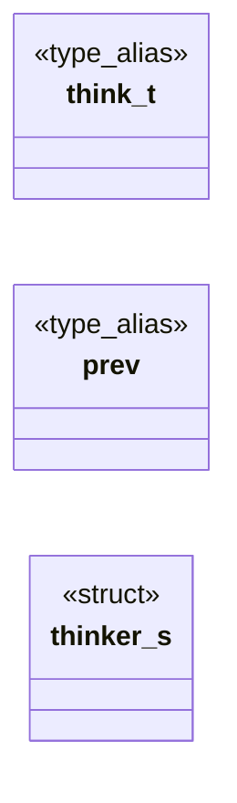

# `progs/doomgeneric/d_think.h`

> Source: [progs/doomgeneric/d_think.h:1](../../progs/doomgeneric/d_think.h#L1) | language `h` | coverage 80.0% | [API index](../index.md)

Copyright(C) 1993-1996 Id Software, Inc.

Copyright(C) 2005-2014 Simon Howard  This program is free software; you can redistribute it and/or modify it under the terms of the GNU General Public License as published by the Free Software Foundation; either version 2 of the License, or (at your option) any later version.  This program is distributed in the hope that it will be useful, but WITHOUT ANY WARRANTY; without even the implied warranty of MERCHANTABILITY or FITNESS FOR A PARTICULAR PURPOSE.  See the GNU General Public License for more details.  DESCRIPTION: MapObj data. Map Objects or mobjs are actors, entities, thinker, take-your-pick... anything that moves, acts, or suffers state changes of more or less violent nature.          Experimental stuff.

## Contents

- **Structs:** [`thinker_s`](#thinker_s)
- **Type Aliases:** [`think_t`](#think_t), [`prev`](#prev)
- **Macros:** [`__D_THINK__`](#__d_think__)

## Type Diagram



## Structs

<a id="thinker_s"></a>

### `thinker_s`

`struct` | [progs/doomgeneric/d_think.h:58](../../progs/doomgeneric/d_think.h#L58)

```c
typedef struct thinker_s
```

Doubly linked list of actors.

---

## Type Aliases

<a id="think_t"></a>

### `think_t`

`type_alias` | [progs/doomgeneric/d_think.h:54](../../progs/doomgeneric/d_think.h#L54)

```c
typedef actionf_t think_t;
```

Historically, "think_t" is yet another function pointer to a routine to handle an actor.

---

<a id="prev"></a>

### `prev`

`type_alias` | [progs/doomgeneric/d_think.h:58](../../progs/doomgeneric/d_think.h#L58)

```c
typedef struct thinker_s { struct thinker_s* prev;
```

Doubly linked list of actors.

---

## Macros

<a id="__d_think__"></a>

### `__D_THINK__`

`macro` | [progs/doomgeneric/d_think.h:23](../../progs/doomgeneric/d_think.h#L23)

```c
#define __D_THINK__
```

---
