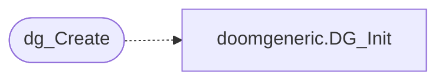

# `progs/doomgeneric/doomgeneric.c`

> Source: [progs/doomgeneric/doomgeneric.c:1](../../progs/doomgeneric/doomgeneric.c#L1) | language `c` | coverage 0.0% | [API index](../index.md)

## Contents

- **Functions:** [`dg_Create`](#dg_create)

## Call Graph

Solid arrows stay in this module, dashed arrows leave it.



## Functions

<a id="dg_create"></a>

### `dg_Create`

`function` | [progs/doomgeneric/doomgeneric.c:6](../../progs/doomgeneric/doomgeneric.c#L6)

```c
void dg_Create()
```

*Calls:* [`DG_Init`](progs.doomgeneric.doomgeneric.h.md#dg_init)

---
