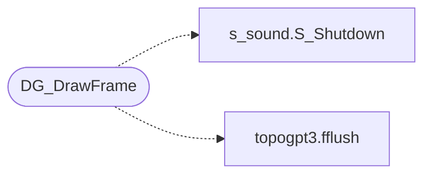

# `progs/doomgeneric/doomgeneric_minios.c`

> Source: [progs/doomgeneric/doomgeneric_minios.c:1](../../progs/doomgeneric/doomgeneric_minios.c#L1) | language `c` | coverage 30.8% | [API index](../index.md)

doomgeneric_minios.c - MiniOS platform layer for doomgeneric.

## Contents

- **Structs:** [`color`](#color)
- **Functions:** [`MINIOS_DOOM_BACKBUF_ADDR`](#minios_doom_backbuf_addr), [`DG_Init`](#dg_init), [`DG_DrawFrame`](#dg_drawframe), [`DG_SleepMs`](#dg_sleepms), [`DG_GetTicksMs`](#dg_getticksms), [`DG_GetKey`](#dg_getkey), [`DG_SetWindowTitle`](#dg_setwindowtitle)
- **Macros:** [`FB_ADDR`](#fb_addr), [`FB_WIDTH`](#fb_width), [`FB_HEIGHT`](#fb_height), [`KBD_QUEUE_SIZE`](#kbd_queue_size)
- **Variables:** [`colors`](#colors), [`I_VideoBuffer`](#i_videobuffer), [`myargc`](#myargc), [`myargv`](#myargv)

## Call Graph

Solid arrows stay in this module, dashed arrows leave it.



## Structs

<a id="color"></a>

### `color`

`struct` | [progs/doomgeneric/doomgeneric_minios.c:103](../../progs/doomgeneric/doomgeneric_minios.c#L103)

```c
struct color { uint32_t b:8; uint32_t g:8; uint32_t r:8; uint32_t a:8; };
```

Extern from i_video.c - the gamma-corrected palette colors

---

## Functions

<a id="minios_doom_backbuf_addr"></a>

### `MINIOS_DOOM_BACKBUF_ADDR`

`function` | [progs/doomgeneric/doomgeneric_minios.c:4](../../progs/doomgeneric/doomgeneric_minios.c#L4)

```c
* MINIOS_DOOM_BACKBUF_ADDR (minios_abi.h);
```

========================================================================= Graphics back-buffers (kernel-mapped into user window) ========================================================================= The kernel allocates these from the kernel heap and maps them into the user window via the 4 KB page tables at boot (mm_setup_protections).

A ring-3 program writes to these addresses and calls the corresponding SYS_*_FRAME syscall; the kernel composites the buffer onto the desktop.

All three sit in the reserved tail above DOOM_BACKBUF_ADDR (the brk cap),
so a growing heap or mmap region can never reach them.  NK_BACKBUF sits
HIGHER than the framebuffer's maximum span: at 1024x768x24/32 the
framebuffer needs up to 3 MB, so a back-buffer at 0x0B400000 would overlap
its tail and steal its bottom rows (the mapped back-buffer overwrote the
framebuffer's second page-table slot, rendering the dock/taskbar black).
=========================================================================

**Parameters**

| Name | Type | Default | Description |
|---|---|---|---|
| `h` | `minios_abi.` |  |  |

**Returns:** `*`

> **Inherited:** Documentation from [`MINIOS_DOOM_BACKBUF_ADDR`](#minios_doom_backbuf_addr) (progs/minios_abi.h:140).

---

<a id="dg_init"></a>

### `DG_Init`

`function` | [progs/doomgeneric/doomgeneric_minios.c:232](../../progs/doomgeneric/doomgeneric_minios.c#L232)

```c
void DG_Init(void)
```

---

<a id="dg_drawframe"></a>

### `DG_DrawFrame`

`function` | [progs/doomgeneric/doomgeneric_minios.c:243](../../progs/doomgeneric/doomgeneric_minios.c#L243)

```c
void DG_DrawFrame(void)
```

*Calls:* [`S_Shutdown`](progs.doomgeneric.s_sound.h.md#s_shutdown), [`fflush`](progs.topogpt3.topogpt3.c.md#fflush)

---

<a id="dg_sleepms"></a>

### `DG_SleepMs`

`function` | [progs/doomgeneric/doomgeneric_minios.c:274](../../progs/doomgeneric/doomgeneric_minios.c#L274)

```c
void DG_SleepMs(uint32_t ms)
```

**Parameters**

| Name | Type | Default | Description |
|---|---|---|---|
| `ms` | `uint32_t` |  |  |

---

<a id="dg_getticksms"></a>

### `DG_GetTicksMs`

`function` | [progs/doomgeneric/doomgeneric_minios.c:280](../../progs/doomgeneric/doomgeneric_minios.c#L280)

```c
uint32_t DG_GetTicksMs(void)
```

**Returns:** `uint32_t`

---

<a id="dg_getkey"></a>

### `DG_GetKey`

`function` | [progs/doomgeneric/doomgeneric_minios.c:284](../../progs/doomgeneric/doomgeneric_minios.c#L284)

```c
int DG_GetKey(int *pressed, unsigned char *key)
```

**Parameters**

| Name | Type | Default | Description |
|---|---|---|---|
| `pressed` | `int *` |  |  |
| `key` | `unsigned char *` |  |  |

**Returns:** `int`

---

<a id="dg_setwindowtitle"></a>

### `DG_SetWindowTitle`

`function` | [progs/doomgeneric/doomgeneric_minios.c:295](../../progs/doomgeneric/doomgeneric_minios.c#L295)

```c
void DG_SetWindowTitle(const char *title)
```

**Parameters**

| Name | Type | Default | Description |
|---|---|---|---|
| `title` | `char *` |  |  |

---

## Macros

<a id="fb_addr"></a>

### `FB_ADDR`

`macro` | [progs/doomgeneric/doomgeneric_minios.c:96](../../progs/doomgeneric/doomgeneric_minios.c#L96)

```c
#define FB_ADDR
```

DOOM renders into a kernel-backed back-buffer in the user window; the kernel composites it onto the desktop as a window on GFX_PRESENT/BUF_GAME.

---

<a id="fb_width"></a>

### `FB_WIDTH`

`macro` | [progs/doomgeneric/doomgeneric_minios.c:97](../../progs/doomgeneric/doomgeneric_minios.c#L97)

```c
#define FB_WIDTH
```

---

<a id="fb_height"></a>

### `FB_HEIGHT`

`macro` | [progs/doomgeneric/doomgeneric_minios.c:98](../../progs/doomgeneric/doomgeneric_minios.c#L98)

```c
#define FB_HEIGHT
```

---

<a id="kbd_queue_size"></a>

### `KBD_QUEUE_SIZE`

`macro` | [progs/doomgeneric/doomgeneric_minios.c:178](../../progs/doomgeneric/doomgeneric_minios.c#L178)

```c
#define KBD_QUEUE_SIZE
```

---

## Variables

<a id="colors"></a>

### `colors`

`variable` `extern` | [progs/doomgeneric/doomgeneric_minios.c:104](../../progs/doomgeneric/doomgeneric_minios.c#L104)

```c
extern struct color colors[256];
```

---

<a id="i_videobuffer"></a>

### `I_VideoBuffer`

`variable` `extern` | [progs/doomgeneric/doomgeneric_minios.c:230](../../progs/doomgeneric/doomgeneric_minios.c#L230)

```c
extern unsigned char *I_VideoBuffer;
```

---

<a id="myargc"></a>

### `myargc`

`variable` `extern` | [progs/doomgeneric/doomgeneric_minios.c:233](../../progs/doomgeneric/doomgeneric_minios.c#L233)

```c
extern int myargc;
```

---

<a id="myargv"></a>

### `myargv`

`variable` `extern` | [progs/doomgeneric/doomgeneric_minios.c:234](../../progs/doomgeneric/doomgeneric_minios.c#L234)

```c
extern char **myargv;
```

---
