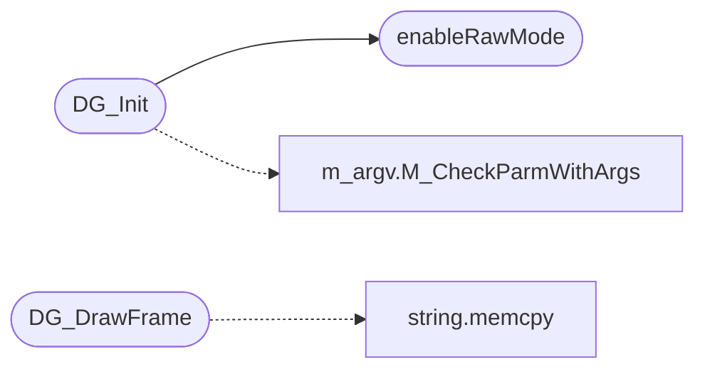

# `progs/doomgeneric/doomgeneric_soso.c`

> Source: [progs/doomgeneric/doomgeneric_soso.c:1](../../progs/doomgeneric/doomgeneric_soso.c#L1) | language `c` | coverage 9.1% | [API index](../index.md)

doomgeneric for soso os

## Contents

- **Enums:** [`EnFrameBuferIoctl`](#enframebuferioctl)
- **Functions:** [`disableRawMode`](#disablerawmode), [`enableRawMode`](#enablerawmode), [`DG_Init`](#dg_init), [`DG_DrawFrame`](#dg_drawframe), [`DG_SleepMs`](#dg_sleepms), [`DG_GetTicksMs`](#dg_getticksms), [`DG_GetKey`](#dg_getkey), [`DG_SetWindowTitle`](#dg_setwindowtitle)
- **Macros:** [`KEYQUEUE_SIZE`](#keyqueue_size)

## Call Graph

Solid arrows stay in this module, dashed arrows leave it.



## Enums

<a id="enframebuferioctl"></a>

### `EnFrameBuferIoctl`

`enum` | [progs/doomgeneric/doomgeneric_soso.c:36](../../progs/doomgeneric/doomgeneric_soso.c#L36)

```c
enum EnFrameBuferIoctl
```

---

## Functions

<a id="disablerawmode"></a>

### `disableRawMode`

`function` | [progs/doomgeneric/doomgeneric_soso.c:108](../../progs/doomgeneric/doomgeneric_soso.c#L108)

```c
void disableRawMode()
```

---

<a id="enablerawmode"></a>

### `enableRawMode`

`function` | [progs/doomgeneric/doomgeneric_soso.c:114](../../progs/doomgeneric/doomgeneric_soso.c#L114)

```c
void enableRawMode()
```

*Called by:* [`DG_Init`](#dg_init)

---

<a id="dg_init"></a>

### `DG_Init`

`function` | [progs/doomgeneric/doomgeneric_soso.c:124](../../progs/doomgeneric/doomgeneric_soso.c#L124)

```c
void DG_Init()
```

*Calls:* [`enableRawMode`](#enablerawmode), [`M_CheckParmWithArgs`](progs.doomgeneric.m_argv.h.md#m_checkparmwithargs)

---

<a id="dg_drawframe"></a>

### `DG_DrawFrame`

`function` | [progs/doomgeneric/doomgeneric_soso.c:214](../../progs/doomgeneric/doomgeneric_soso.c#L214)

```c
void DG_DrawFrame()
```

*Calls:* [`memcpy`](kernel.string.c.md#memcpy)

---

<a id="dg_sleepms"></a>

### `DG_SleepMs`

`function` | [progs/doomgeneric/doomgeneric_soso.c:227](../../progs/doomgeneric/doomgeneric_soso.c#L227)

```c
void DG_SleepMs(uint32_t ms)
```

**Parameters**

| Name | Type | Default | Description |
|---|---|---|---|
| `ms` | `uint32_t` |  |  |

---

<a id="dg_getticksms"></a>

### `DG_GetTicksMs`

`function` | [progs/doomgeneric/doomgeneric_soso.c:232](../../progs/doomgeneric/doomgeneric_soso.c#L232)

```c
uint32_t DG_GetTicksMs()
```

**Returns:** `uint32_t`

---

<a id="dg_getkey"></a>

### `DG_GetKey`

`function` | [progs/doomgeneric/doomgeneric_soso.c:237](../../progs/doomgeneric/doomgeneric_soso.c#L237)

```c
int DG_GetKey(int* pressed, unsigned char* doomKey)
```

**Parameters**

| Name | Type | Default | Description |
|---|---|---|---|
| `pressed` | `int*` |  |  |
| `doomKey` | `unsigned char*` |  |  |

**Returns:** `int`

---

<a id="dg_setwindowtitle"></a>

### `DG_SetWindowTitle`

`function` | [progs/doomgeneric/doomgeneric_soso.c:258](../../progs/doomgeneric/doomgeneric_soso.c#L258)

```c
void DG_SetWindowTitle(const char * title)
```

**Parameters**

| Name | Type | Default | Description |
|---|---|---|---|
| `title` | `char *` |  |  |

---

## Macros

<a id="keyqueue_size"></a>

### `KEYQUEUE_SIZE`

`macro` | [progs/doomgeneric/doomgeneric_soso.c:24](../../progs/doomgeneric/doomgeneric_soso.c#L24)

```c
#define KEYQUEUE_SIZE
```

---
