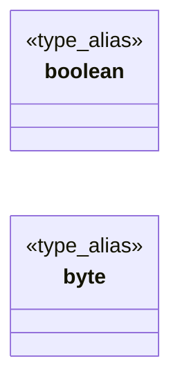

# `progs/doomgeneric/doomtype.h`

> Source: [progs/doomgeneric/doomtype.h:1](../../progs/doomgeneric/doomtype.h#L1) | language `h` | coverage 20.0% | [API index](../index.md)

Copyright(C) 1993-1996 Id Software, Inc.

Copyright(C) 2005-2014 Simon Howard  This program is free software; you can redistribute it and/or modify it under the terms of the GNU General Public License as published by the Free Software Foundation; either version 2 of the License, or (at your option) any later version.  This program is distributed in the hope that it will be useful, but WITHOUT ANY WARRANTY; without even the implied warranty of MERCHANTABILITY or FITNESS FOR A PARTICULAR PURPOSE.  See the GNU General Public License for more details.  DESCRIPTION: Simple basic typedefs, isolated here to make it easier separating modules.     #define macros to provide functions missing in Windows. Outside Windows, we use strings.h for str[n]casecmp.

## Contents

- **Type Aliases:** [`boolean`](#boolean), [`byte`](#byte)
- **Macros:** [`__DOOMTYPE__`](#__doomtype__), [`strcasecmp`](#strcasecmp), [`strncasecmp`](#strncasecmp), [`PACKEDATTR`](#packedattr), [`PACKEDATTR`](#packedattr), [`DIR_SEPARATOR`](#dir_separator), [`DIR_SEPARATOR_S`](#dir_separator_s), [`PATH_SEPARATOR`](#path_separator), [`DIR_SEPARATOR`](#dir_separator), [`DIR_SEPARATOR_S`](#dir_separator_s), [`PATH_SEPARATOR`](#path_separator), [`arrlen`](#arrlen)

## Type Diagram



## Type Aliases

<a id="boolean"></a>

### `boolean`

`type_alias` | [progs/doomgeneric/doomtype.h:68](../../progs/doomgeneric/doomtype.h#L68)

```c
typedef bool boolean;
```

Use builtin bool type with C++.

---

<a id="byte"></a>

### `byte`

`type_alias` | [progs/doomgeneric/doomtype.h:81](../../progs/doomgeneric/doomtype.h#L81)

```c
typedef uint8_t byte;
```

endif

---

## Macros

<a id="__doomtype__"></a>

### `__DOOMTYPE__`

`macro` | [progs/doomgeneric/doomtype.h:22](../../progs/doomgeneric/doomtype.h#L22)

```c
#define __DOOMTYPE__
```

---

<a id="strcasecmp"></a>

### `strcasecmp`

`macro` | [progs/doomgeneric/doomtype.h:30](../../progs/doomgeneric/doomtype.h#L30)

```c
#define strcasecmp
```

*Called by:* [`D_DoAdvanceDemo`](progs.doomgeneric.d_main.c.md#d_doadvancedemo), [`I_GetMemoryValue`](progs.doomgeneric.i_system.c.md#i_getmemoryvalue), [`M_CheckParmWithArgs`](progs.doomgeneric.m_argv.c.md#m_checkparmwithargs), [`W_AddFile`](progs.doomgeneric.w_wad.c.md#w_addfile)

---

<a id="strncasecmp"></a>

### `strncasecmp`

`macro` | [progs/doomgeneric/doomtype.h:31](../../progs/doomgeneric/doomtype.h#L31)

```c
#define strncasecmp
```

*Called by:* [`D_IdentifyVersion`](progs.doomgeneric.d_main.c.md#d_identifyversion), [`M_StrCaseStr`](progs.doomgeneric.m_misc.c.md#m_strcasestr), [`R_CheckTextureNumForName`](progs.doomgeneric.r_data.c.md#r_checktexturenumforname), [`R_InitSpriteDefs`](progs.doomgeneric.r_things.c.md#r_initspritedefs), [`W_CheckNumForName`](progs.doomgeneric.w_wad.c.md#w_checknumforname)

---

<a id="packedattr"></a>

### `PACKEDATTR`

`macro` | [progs/doomgeneric/doomtype.h:50](../../progs/doomgeneric/doomtype.h#L50)

```c
#define PACKEDATTR
```

---

<a id="packedattr"></a>

### `PACKEDATTR`

`macro` | [progs/doomgeneric/doomtype.h:52](../../progs/doomgeneric/doomtype.h#L52)

```c
#define PACKEDATTR
```

---

<a id="dir_separator"></a>

### `DIR_SEPARATOR`

`macro` | [progs/doomgeneric/doomtype.h:88](../../progs/doomgeneric/doomtype.h#L88)

```c
#define DIR_SEPARATOR
```

---

<a id="dir_separator_s"></a>

### `DIR_SEPARATOR_S`

`macro` | [progs/doomgeneric/doomtype.h:89](../../progs/doomgeneric/doomtype.h#L89)

```c
#define DIR_SEPARATOR_S
```

---

<a id="path_separator"></a>

### `PATH_SEPARATOR`

`macro` | [progs/doomgeneric/doomtype.h:90](../../progs/doomgeneric/doomtype.h#L90)

```c
#define PATH_SEPARATOR
```

---

<a id="dir_separator"></a>

### `DIR_SEPARATOR`

`macro` | [progs/doomgeneric/doomtype.h:94](../../progs/doomgeneric/doomtype.h#L94)

```c
#define DIR_SEPARATOR
```

---

<a id="dir_separator_s"></a>

### `DIR_SEPARATOR_S`

`macro` | [progs/doomgeneric/doomtype.h:95](../../progs/doomgeneric/doomtype.h#L95)

```c
#define DIR_SEPARATOR_S
```

---

<a id="path_separator"></a>

### `PATH_SEPARATOR`

`macro` | [progs/doomgeneric/doomtype.h:96](../../progs/doomgeneric/doomtype.h#L96)

```c
#define PATH_SEPARATOR
```

---

<a id="arrlen"></a>

### `arrlen`

`macro` | [progs/doomgeneric/doomtype.h:100](../../progs/doomgeneric/doomtype.h#L100)

```c
#define arrlen(array)
```

*Called by:* [`AM_drawPlayers`](progs.doomgeneric.am_map.c.md#am_drawplayers), [`AM_drawThings`](progs.doomgeneric.am_map.c.md#am_drawthings), [`AM_updateLightLev`](progs.doomgeneric.am_map.c.md#am_updatelightlev), [`D_FindAllIWADs`](progs.doomgeneric.d_iwad.c.md#d_findalliwads), [`D_SaveGameIWADName`](progs.doomgeneric.d_iwad.c.md#d_savegameiwadname), [`D_SuggestGameName`](progs.doomgeneric.d_iwad.c.md#d_suggestgamename), [`D_SuggestIWADName`](progs.doomgeneric.d_iwad.c.md#d_suggestiwadname), [`PrintDehackedBanners`](progs.doomgeneric.d_main.c.md#printdehackedbanners), [`D_ValidEpisodeMap`](progs.doomgeneric.d_mode.c.md#d_validepisodemap), [`D_ValidGameMode`](progs.doomgeneric.d_mode.c.md#d_validgamemode), [`D_ValidGameVersion`](progs.doomgeneric.d_mode.c.md#d_validgameversion), [`F_StartFinale`](progs.doomgeneric.f_finale.c.md#f_startfinale) and 3 more

---
