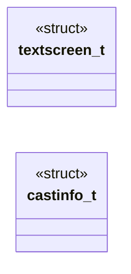
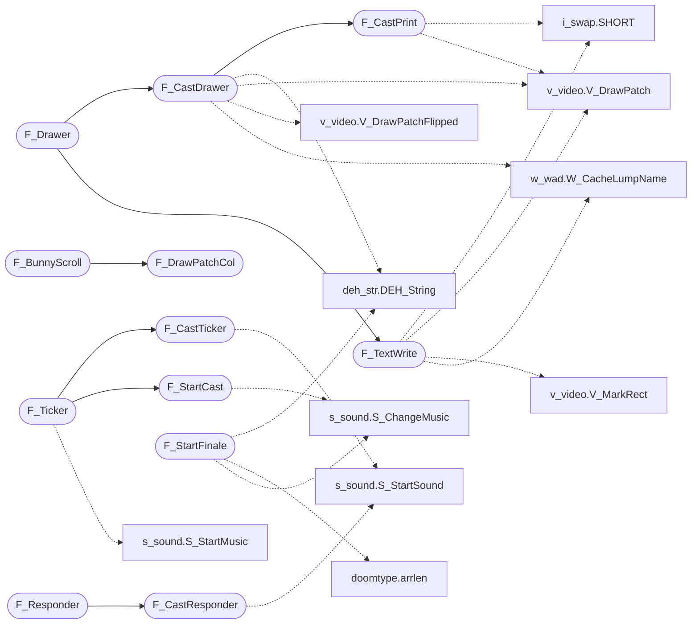

# `progs/doomgeneric/f_finale.c`

> Source: [progs/doomgeneric/f_finale.c:1](../../progs/doomgeneric/f_finale.c#L1) | language `c` | coverage 47.1% | [API index](../index.md)

Copyright(C) 1993-1996 Id Software, Inc.

Copyright(C) 2005-2014 Simon Howard  This program is free software; you can redistribute it and/or modify it under the terms of the GNU General Public License as published by the Free Software Foundation; either version 2 of the License, or (at your option) any later version.  This program is distributed in the hope that it will be useful, but WITHOUT ANY WARRANTY; without even the implied warranty of MERCHANTABILITY or FITNESS FOR A PARTICULAR PURPOSE.  See the GNU General Public License for more details.  DESCRIPTION: Game completion, final screen animation.     Functions.

## Contents

- **Structs:** [`textscreen_t`](#textscreen_t), [`castinfo_t`](#castinfo_t)
- **Functions:** [`F_StartFinale`](#f_startfinale), [`F_Responder`](#f_responder), [`F_Ticker`](#f_ticker), [`F_TextWrite`](#f_textwrite), [`F_StartCast`](#f_startcast), [`F_CastTicker`](#f_castticker), [`F_CastResponder`](#f_castresponder), [`F_CastPrint`](#f_castprint), [`F_CastDrawer`](#f_castdrawer), [`F_DrawPatchCol`](#f_drawpatchcol), [`F_BunnyScroll`](#f_bunnyscroll), [`F_Drawer`](#f_drawer)
- **Macros:** [`TEXTSPEED`](#textspeed), [`TEXTWAIT`](#textwait)
- **Variables:** [`hu_font`](#hu_font)

## Type Diagram



## Call Graph

Solid arrows stay in this module, dashed arrows leave it.



## Structs

<a id="textscreen_t"></a>

### `textscreen_t`

`struct` | [progs/doomgeneric/f_finale.c:60](../../progs/doomgeneric/f_finale.c#L60)

```c
typedef struct
```

---

<a id="castinfo_t"></a>

### `castinfo_t`

`struct` | [progs/doomgeneric/f_finale.c:300](../../progs/doomgeneric/f_finale.c#L300)

```c
typedef struct
```

Final DOOM 2 animation Casting by id Software. in order of appearance

---

## Functions

<a id="f_startfinale"></a>

### `F_StartFinale`

`function` | [progs/doomgeneric/f_finale.c:108](../../progs/doomgeneric/f_finale.c#L108)

```c
void F_StartFinale (void)
```

F_StartFinale

*Calls:* [`DEH_String`](progs.doomgeneric.deh_str.h.md#deh_string), [`arrlen`](progs.doomgeneric.doomtype.h.md#arrlen), [`S_ChangeMusic`](progs.doomgeneric.s_sound.h.md#s_changemusic)

---

<a id="f_responder"></a>

### `F_Responder`

`function` | [progs/doomgeneric/f_finale.c:160](../../progs/doomgeneric/f_finale.c#L160)

```c
boolean F_Responder (event_t *event)
```

**Parameters**

| Name | Type | Default | Description |
|---|---|---|---|
| `event` | `event_t *` |  |  |

**Returns:** `boolean`

*Calls:* [`F_CastResponder`](#f_castresponder)

*Called by:* [`G_Responder`](progs.doomgeneric.g_game.c.md#g_responder)

---

<a id="f_ticker"></a>

### `F_Ticker`

`function` | [progs/doomgeneric/f_finale.c:172](../../progs/doomgeneric/f_finale.c#L172)

```c
void F_Ticker (void)
```

F_Ticker

*Calls:* [`F_CastTicker`](#f_castticker), [`F_StartCast`](#f_startcast), [`S_StartMusic`](progs.doomgeneric.s_sound.h.md#s_startmusic)

---

<a id="f_textwrite"></a>

### `F_TextWrite`

`function` | [progs/doomgeneric/f_finale.c:227](../../progs/doomgeneric/f_finale.c#L227)

```c
void F_TextWrite (void)
```

*Calls:* [`SHORT`](progs.doomgeneric.i_swap.h.md#short), [`V_DrawPatch`](progs.doomgeneric.v_video.h.md#v_drawpatch), [`V_MarkRect`](progs.doomgeneric.v_video.h.md#v_markrect), [`W_CacheLumpName`](progs.doomgeneric.w_wad.h.md#w_cachelumpname)

*Called by:* [`F_Drawer`](#f_drawer)

---

<a id="f_startcast"></a>

### `F_StartCast`

`function` | [progs/doomgeneric/f_finale.c:340](../../progs/doomgeneric/f_finale.c#L340)

```c
void F_StartCast (void)
```

F_StartCast

*Calls:* [`S_ChangeMusic`](progs.doomgeneric.s_sound.h.md#s_changemusic)

*Called by:* [`F_Ticker`](#f_ticker)

---

<a id="f_castticker"></a>

### `F_CastTicker`

`function` | [progs/doomgeneric/f_finale.c:358](../../progs/doomgeneric/f_finale.c#L358)

```c
void F_CastTicker (void)
```

F_CastTicker

*Calls:* [`S_StartSound`](progs.doomgeneric.s_sound.h.md#s_startsound)

*Called by:* [`F_Ticker`](#f_ticker)

---

<a id="f_castresponder"></a>

### `F_CastResponder`

`function` | [progs/doomgeneric/f_finale.c:465](../../progs/doomgeneric/f_finale.c#L465)

```c
boolean F_CastResponder (event_t* ev)
```

**Parameters**

| Name | Type | Default | Description |
|---|---|---|---|
| `ev` | `event_t*` |  |  |

**Returns:** `boolean`

*Calls:* [`S_StartSound`](progs.doomgeneric.s_sound.h.md#s_startsound)

*Called by:* [`F_Responder`](#f_responder)

---

<a id="f_castprint"></a>

### `F_CastPrint`

`function` | [progs/doomgeneric/f_finale.c:486](../../progs/doomgeneric/f_finale.c#L486)

```c
void F_CastPrint (char* text)
```

**Parameters**

| Name | Type | Default | Description |
|---|---|---|---|
| `text` | `char*` |  |  |

*Calls:* [`SHORT`](progs.doomgeneric.i_swap.h.md#short), [`V_DrawPatch`](progs.doomgeneric.v_video.h.md#v_drawpatch)

*Called by:* [`F_CastDrawer`](#f_castdrawer)

---

<a id="f_castdrawer"></a>

### `F_CastDrawer`

`function` | [progs/doomgeneric/f_finale.c:541](../../progs/doomgeneric/f_finale.c#L541)

```c
void F_CastDrawer (void)
```

*Calls:* [`DEH_String`](progs.doomgeneric.deh_str.h.md#deh_string), [`F_CastPrint`](#f_castprint), [`V_DrawPatch`](progs.doomgeneric.v_video.h.md#v_drawpatch), [`V_DrawPatchFlipped`](progs.doomgeneric.v_video.h.md#v_drawpatchflipped), [`W_CacheLumpName`](progs.doomgeneric.w_wad.h.md#w_cachelumpname), [`W_CacheLumpNum`](progs.doomgeneric.w_wad.h.md#w_cachelumpnum)

*Called by:* [`F_Drawer`](#f_drawer)

---

<a id="f_drawpatchcol"></a>

### `F_DrawPatchCol`

`function` | [progs/doomgeneric/f_finale.c:572](../../progs/doomgeneric/f_finale.c#L572)

```c
void F_DrawPatchCol ( int x, patch_t* patch, int col )
```

**Parameters**

| Name | Type | Default | Description |
|---|---|---|---|
| `x` | `int` |  |  |
| `patch` | `patch_t*` |  |  |
| `col` | `int` |  |  |

*Calls:* [`LONG`](progs.doomgeneric.i_swap.h.md#long)

*Called by:* [`F_BunnyScroll`](#f_bunnyscroll)

---

<a id="f_bunnyscroll"></a>

### `F_BunnyScroll`

`function` | [progs/doomgeneric/f_finale.c:606](../../progs/doomgeneric/f_finale.c#L606)

```c
void F_BunnyScroll (void)
```

F_BunnyScroll

*Calls:* [`DEH_String`](progs.doomgeneric.deh_str.h.md#deh_string), [`DEH_snprintf`](progs.doomgeneric.deh_str.h.md#deh_snprintf), [`F_DrawPatchCol`](#f_drawpatchcol), [`S_StartSound`](progs.doomgeneric.s_sound.h.md#s_startsound), [`V_DrawPatch`](progs.doomgeneric.v_video.h.md#v_drawpatch), [`V_MarkRect`](progs.doomgeneric.v_video.h.md#v_markrect), [`W_CacheLumpName`](progs.doomgeneric.w_wad.h.md#w_cachelumpname)

---

<a id="f_drawer"></a>

### `F_Drawer`

`function` | [progs/doomgeneric/f_finale.c:702](../../progs/doomgeneric/f_finale.c#L702)

```c
void F_Drawer (void)
```

F_Drawer

*Calls:* [`F_CastDrawer`](#f_castdrawer), [`F_TextWrite`](#f_textwrite)

---

## Macros

<a id="textspeed"></a>

### `TEXTSPEED`

`macro` | [progs/doomgeneric/f_finale.c:57](../../progs/doomgeneric/f_finale.c#L57)

```c
#define TEXTSPEED
```

---

<a id="textwait"></a>

### `TEXTWAIT`

`macro` | [progs/doomgeneric/f_finale.c:58](../../progs/doomgeneric/f_finale.c#L58)

```c
#define TEXTWAIT
```

---

## Variables

<a id="hu_font"></a>

### `hu_font`

`variable` `extern` | [progs/doomgeneric/f_finale.c:224](../../progs/doomgeneric/f_finale.c#L224)

```c
extern patch_t *hu_font[HU_FONTSIZE];
```

include "hu_stuff.h"

---
