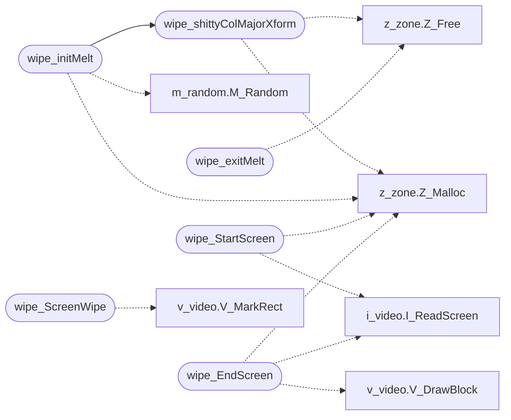

# `progs/doomgeneric/f_wipe.c`

> Source: [progs/doomgeneric/f_wipe.c:1](../../progs/doomgeneric/f_wipe.c#L1) | language `c` | coverage 9.1% | [API index](../index.md)

Copyright(C) 1993-1996 Id Software, Inc.

Copyright(C) 2005-2014 Simon Howard  This program is free software; you can redistribute it and/or modify it under the terms of the GNU General Public License as published by the Free Software Foundation; either version 2 of the License, or (at your option) any later version.  This program is distributed in the hope that it will be useful, but WITHOUT ANY WARRANTY; without even the implied warranty of MERCHANTABILITY or FITNESS FOR A PARTICULAR PURPOSE.  See the GNU General Public License for more details.  DESCRIPTION: Mission begin melt/wipe screen special effect.

## Contents

- **Functions:** [`wipe_shittyColMajorXform`](#wipe_shittycolmajorxform), [`wipe_initColorXForm`](#wipe_initcolorxform), [`wipe_doColorXForm`](#wipe_docolorxform), [`wipe_exitColorXForm`](#wipe_exitcolorxform), [`wipe_initMelt`](#wipe_initmelt), [`wipe_doMelt`](#wipe_domelt), [`wipe_exitMelt`](#wipe_exitmelt), [`wipe_StartScreen`](#wipe_startscreen), [`wipe_EndScreen`](#wipe_endscreen), [`wipe_ScreenWipe`](#wipe_screenwipe)

## Call Graph

Solid arrows stay in this module, dashed arrows leave it.



## Functions

<a id="wipe_shittycolmajorxform"></a>

### `wipe_shittyColMajorXform`

`function` | [progs/doomgeneric/f_wipe.c:43](../../progs/doomgeneric/f_wipe.c#L43)

```c
void wipe_shittyColMajorXform ( short* array, int width, int height )
```

**Parameters**

| Name | Type | Default | Description |
|---|---|---|---|
| `array` | `short*` |  |  |
| `width` | `int` |  |  |
| `height` | `int` |  |  |

*Calls:* [`Z_Free`](progs.doomgeneric.z_zone.h.md#z_free), [`Z_Malloc`](progs.doomgeneric.z_zone.h.md#z_malloc)

*Called by:* [`wipe_initMelt`](#wipe_initmelt)

---

<a id="wipe_initcolorxform"></a>

### `wipe_initColorXForm`

`function` | [progs/doomgeneric/f_wipe.c:65](../../progs/doomgeneric/f_wipe.c#L65)

```c
int wipe_initColorXForm ( int width, int height, int ticks )
```

**Parameters**

| Name | Type | Default | Description |
|---|---|---|---|
| `width` | `int` |  |  |
| `height` | `int` |  |  |
| `ticks` | `int` |  |  |

**Returns:** `int`

---

<a id="wipe_docolorxform"></a>

### `wipe_doColorXForm`

`function` | [progs/doomgeneric/f_wipe.c:75](../../progs/doomgeneric/f_wipe.c#L75)

```c
int wipe_doColorXForm ( int width, int height, int ticks )
```

**Parameters**

| Name | Type | Default | Description |
|---|---|---|---|
| `width` | `int` |  |  |
| `height` | `int` |  |  |
| `ticks` | `int` |  |  |

**Returns:** `int`

---

<a id="wipe_exitcolorxform"></a>

### `wipe_exitColorXForm`

`function` | [progs/doomgeneric/f_wipe.c:121](../../progs/doomgeneric/f_wipe.c#L121)

```c
int wipe_exitColorXForm ( int width, int height, int ticks )
```

**Parameters**

| Name | Type | Default | Description |
|---|---|---|---|
| `width` | `int` |  |  |
| `height` | `int` |  |  |
| `ticks` | `int` |  |  |

**Returns:** `int`

---

<a id="wipe_initmelt"></a>

### `wipe_initMelt`

`function` | [progs/doomgeneric/f_wipe.c:133](../../progs/doomgeneric/f_wipe.c#L133)

```c
int wipe_initMelt ( int width, int height, int ticks )
```

**Parameters**

| Name | Type | Default | Description |
|---|---|---|---|
| `width` | `int` |  |  |
| `height` | `int` |  |  |
| `ticks` | `int` |  |  |

**Returns:** `int`

*Calls:* [`wipe_shittyColMajorXform`](#wipe_shittycolmajorxform), [`M_Random`](progs.doomgeneric.m_random.h.md#m_random), [`Z_Malloc`](progs.doomgeneric.z_zone.h.md#z_malloc)

---

<a id="wipe_domelt"></a>

### `wipe_doMelt`

`function` | [progs/doomgeneric/f_wipe.c:164](../../progs/doomgeneric/f_wipe.c#L164)

```c
int wipe_doMelt ( int width, int height, int ticks )
```

**Parameters**

| Name | Type | Default | Description |
|---|---|---|---|
| `width` | `int` |  |  |
| `height` | `int` |  |  |
| `ticks` | `int` |  |  |

**Returns:** `int`

---

<a id="wipe_exitmelt"></a>

### `wipe_exitMelt`

`function` | [progs/doomgeneric/f_wipe.c:219](../../progs/doomgeneric/f_wipe.c#L219)

```c
int wipe_exitMelt ( int width, int height, int ticks )
```

**Parameters**

| Name | Type | Default | Description |
|---|---|---|---|
| `width` | `int` |  |  |
| `height` | `int` |  |  |
| `ticks` | `int` |  |  |

**Returns:** `int`

*Calls:* [`Z_Free`](progs.doomgeneric.z_zone.h.md#z_free)

---

<a id="wipe_startscreen"></a>

### `wipe_StartScreen`

`function` | [progs/doomgeneric/f_wipe.c:231](../../progs/doomgeneric/f_wipe.c#L231)

```c
int wipe_StartScreen ( int x, int y, int width, int height )
```

**Parameters**

| Name | Type | Default | Description |
|---|---|---|---|
| `x` | `int` |  |  |
| `y` | `int` |  |  |
| `width` | `int` |  |  |
| `height` | `int` |  |  |

**Returns:** `int`

*Calls:* [`I_ReadScreen`](progs.doomgeneric.i_video.h.md#i_readscreen), [`Z_Malloc`](progs.doomgeneric.z_zone.h.md#z_malloc)

---

<a id="wipe_endscreen"></a>

### `wipe_EndScreen`

`function` | [progs/doomgeneric/f_wipe.c:243](../../progs/doomgeneric/f_wipe.c#L243)

```c
int wipe_EndScreen ( int x, int y, int width, int height )
```

**Parameters**

| Name | Type | Default | Description |
|---|---|---|---|
| `x` | `int` |  |  |
| `y` | `int` |  |  |
| `width` | `int` |  |  |
| `height` | `int` |  |  |

**Returns:** `int`

*Calls:* [`I_ReadScreen`](progs.doomgeneric.i_video.h.md#i_readscreen), [`V_DrawBlock`](progs.doomgeneric.v_video.h.md#v_drawblock), [`Z_Malloc`](progs.doomgeneric.z_zone.h.md#z_malloc)

---

<a id="wipe_screenwipe"></a>

### `wipe_ScreenWipe`

`function` | [progs/doomgeneric/f_wipe.c:256](../../progs/doomgeneric/f_wipe.c#L256)

```c
int wipe_ScreenWipe ( int wipeno, int x, int y, int width, int height, int ticks )
```

**Parameters**

| Name | Type | Default | Description |
|---|---|---|---|
| `wipeno` | `int` |  |  |
| `x` | `int` |  |  |
| `y` | `int` |  |  |
| `width` | `int` |  |  |
| `height` | `int` |  |  |
| `ticks` | `int` |  |  |

**Returns:** `int`

*Calls:* [`V_MarkRect`](progs.doomgeneric.v_video.h.md#v_markrect)

---
