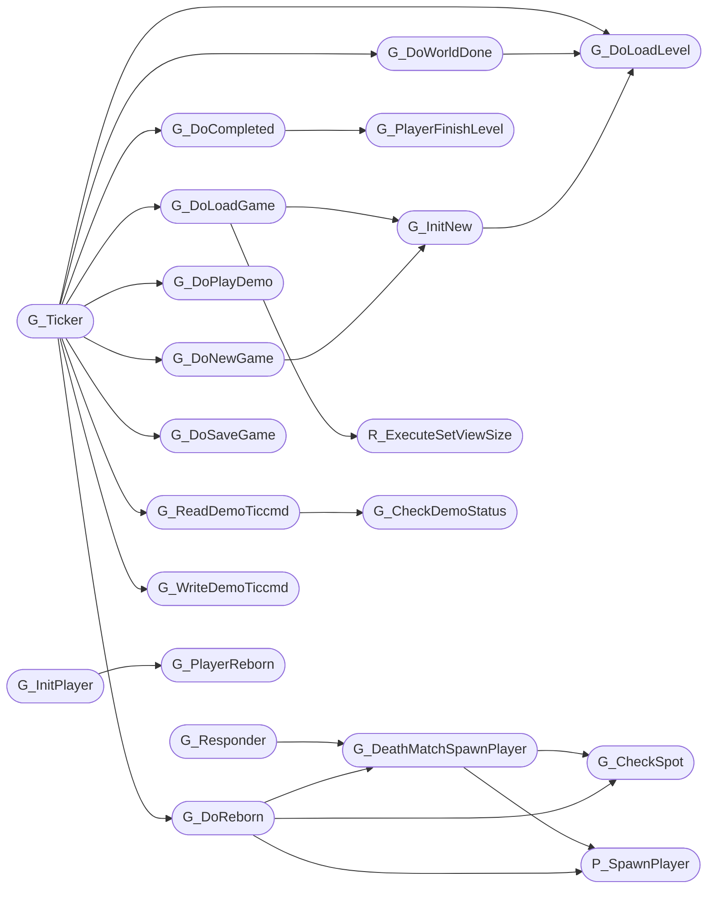

# `progs/doomgeneric/g_game.c`

> Source: [progs/doomgeneric/g_game.c:1](../../progs/doomgeneric/g_game.c#L1) | language `c` | coverage 43.5% | [API index](../index.md)

Copyright(C) 1993-1996 Id Software, Inc.

Copyright(C) 2005-2014 Simon Howard  This program is free software; you can redistribute it and/or modify it under the terms of the GNU General Public License as published by the Free Software Foundation; either version 2 of the License, or (at your option) any later version.  This program is distributed in the hope that it will be useful, but WITHOUT ANY WARRANTY; without even the implied warranty of MERCHANTABILITY or FITNESS FOR A PARTICULAR PURPOSE.  See the GNU General Public License for more details.  DESCRIPTION:  none

## Contents

- **Functions:** [`G_DoVictory`](#g_dovictory), [`G_CmdChecksum`](#g_cmdchecksum), [`G_BuildTiccmd`](#g_buildticcmd), [`G_DoLoadLevel`](#g_doloadlevel), [`G_Responder`](#g_responder), [`G_Ticker`](#g_ticker), [`G_InitPlayer`](#g_initplayer), [`G_PlayerFinishLevel`](#g_playerfinishlevel), [`G_PlayerReborn`](#g_playerreborn), [`P_SpawnPlayer`](#p_spawnplayer), [`G_CheckSpot`](#g_checkspot), [`G_DeathMatchSpawnPlayer`](#g_deathmatchspawnplayer), [`G_DoReborn`](#g_doreborn), [`G_ScreenShot`](#g_screenshot), [`G_ExitLevel`](#g_exitlevel), [`G_SecretExitLevel`](#g_secretexitlevel), [`G_DoCompleted`](#g_docompleted), [`G_WorldDone`](#g_worlddone), [`G_DoWorldDone`](#g_doworlddone), [`R_ExecuteSetViewSize`](#r_executesetviewsize), [`G_LoadGame`](#g_loadgame), [`G_DoLoadGame`](#g_doloadgame), [`G_SaveGame`](#g_savegame), [`G_DoSaveGame`](#g_dosavegame), [`G_DeferedInitNew`](#g_deferedinitnew), [`G_DoNewGame`](#g_donewgame), [`G_InitNew`](#g_initnew), [`G_ReadDemoTiccmd`](#g_readdemoticcmd), [`G_WriteDemoTiccmd`](#g_writedemoticcmd), [`G_RecordDemo`](#g_recorddemo), [`G_VanillaVersionCode`](#g_vanillaversioncode), [`G_BeginRecording`](#g_beginrecording), [`G_DeferedPlayDemo`](#g_deferedplaydemo), [`G_DoPlayDemo`](#g_doplaydemo), [`G_TimeDemo`](#g_timedemo), [`G_CheckDemoStatus`](#g_checkdemostatus)
- **Macros:** [`SAVEGAMESIZE`](#savegamesize), [`MAXPLMOVE`](#maxplmove), [`TURBOTHRESHOLD`](#turbothreshold), [`SLOWTURNTICS`](#slowturntics), [`NUMKEYS`](#numkeys), [`MAX_JOY_BUTTONS`](#max_joy_buttons), [`BODYQUESIZE`](#bodyquesize), [`VERSIONSIZE`](#versionsize), [`DEMOMARKER`](#demomarker)
- **Variables:** [`player_names`](#player_names), [`pagename`](#pagename), [`setsizeneeded`](#setsizeneeded)

## Call Graph

Solid arrows stay in this module, dashed arrows leave it.



## Functions

<a id="g_dovictory"></a>

### `G_DoVictory`

`function` | [progs/doomgeneric/g_game.c:88](../../progs/doomgeneric/g_game.c#L88)

```c
void G_DoVictory (void);
```

---

<a id="g_cmdchecksum"></a>

### `G_CmdChecksum`

`function` | [progs/doomgeneric/g_game.c:233](../../progs/doomgeneric/g_game.c#L233)

```c
int G_CmdChecksum (ticcmd_t* cmd)
```

**Parameters**

| Name | Type | Default | Description |
|---|---|---|---|
| `cmd` | `ticcmd_t*` |  |  |

**Returns:** `int`

---

<a id="g_buildticcmd"></a>

### `G_BuildTiccmd`

`function` | [progs/doomgeneric/g_game.c:322](../../progs/doomgeneric/g_game.c#L322)

```c
void G_BuildTiccmd (ticcmd_t* cmd, int maketic)
```

G_BuildTiccmd Builds a ticcmd from all of the available inputs or reads it from the demo buffer.

If recording a demo, write it out

**Parameters**

| Name | Type | Default | Description |
|---|---|---|---|
| `cmd` | `ticcmd_t*` |  |  |
| `maketic` | `int` |  |  |

*Calls:* [`memset`](kernel.string.c.md#memset), [`arrlen`](progs.doomgeneric.doomtype.h.md#arrlen), [`HU_dequeueChatChar`](progs.doomgeneric.hu_stuff.h.md#hu_dequeuechatchar)

---

<a id="g_doloadlevel"></a>

### `G_DoLoadLevel`

`function` | [progs/doomgeneric/g_game.c:603](../../progs/doomgeneric/g_game.c#L603)

```c
void G_DoLoadLevel (void)
```

G_DoLoadLevel

*Calls:* [`memset`](kernel.string.c.md#memset), [`DEH_String`](progs.doomgeneric.deh_str.h.md#deh_string), [`P_SetupLevel`](progs.doomgeneric.p_setup.h.md#p_setuplevel), [`R_FlatNumForName`](progs.doomgeneric.r_data.h.md#r_flatnumforname), [`R_TextureNumForName`](progs.doomgeneric.r_data.h.md#r_texturenumforname), [`Z_CheckHeap`](progs.doomgeneric.z_zone.h.md#z_checkheap)

*Called by:* [`G_DoWorldDone`](#g_doworlddone), [`G_InitNew`](#g_initnew), [`G_Ticker`](#g_ticker)

---

<a id="g_responder"></a>

### `G_Responder`

`function` | [progs/doomgeneric/g_game.c:733](../../progs/doomgeneric/g_game.c#L733)

```c
boolean G_Responder (event_t* ev)
```

G_Responder Get info needed to make ticcmd_ts for the players.

**Parameters**

| Name | Type | Default | Description |
|---|---|---|---|
| `ev` | `event_t*` |  |  |

**Returns:** `boolean`

*Calls:* [`AM_Responder`](progs.doomgeneric.am_map.c.md#am_responder), [`F_Responder`](progs.doomgeneric.f_finale.c.md#f_responder), [`G_DeathMatchSpawnPlayer`](#g_deathmatchspawnplayer), [`HU_Responder`](progs.doomgeneric.hu_stuff.c.md#hu_responder), [`M_StartControlPanel`](progs.doomgeneric.m_menu.h.md#m_startcontrolpanel), [`ST_Responder`](progs.doomgeneric.st_stuff.c.md#st_responder)

*Called by:* [`D_ProcessEvents`](progs.doomgeneric.d_main.c.md#d_processevents)

---

<a id="g_ticker"></a>

### `G_Ticker`

`function` | [progs/doomgeneric/g_game.c:854](../../progs/doomgeneric/g_game.c#L854)

```c
void G_Ticker (void)
```

G_Ticker Make ticcmd_ts for the players.

*Calls:* [`memcpy`](kernel.string.c.md#memcpy), [`AM_Ticker`](progs.doomgeneric.am_map.h.md#am_ticker), [`D_PageTicker`](progs.doomgeneric.d_main.h.md#d_pageticker), [`DEH_String`](progs.doomgeneric.deh_str.h.md#deh_string), [`F_StartFinale`](progs.doomgeneric.f_finale.h.md#f_startfinale), [`F_Ticker`](progs.doomgeneric.f_finale.h.md#f_ticker), [`G_DoCompleted`](#g_docompleted), [`G_DoLoadGame`](#g_doloadgame), [`G_DoLoadLevel`](#g_doloadlevel), [`G_DoNewGame`](#g_donewgame), [`G_DoPlayDemo`](#g_doplaydemo), [`G_DoReborn`](#g_doreborn) and 15 more

---

<a id="g_initplayer"></a>

### `G_InitPlayer`

`function` | [progs/doomgeneric/g_game.c:1039](../../progs/doomgeneric/g_game.c#L1039)

```c
void G_InitPlayer (int player)
```

G_InitPlayer Called at the start.

Called by the game initialization functions.

**Parameters**

| Name | Type | Default | Description |
|---|---|---|---|
| `player` | `int` |  |  |

*Calls:* [`G_PlayerReborn`](#g_playerreborn)

---

<a id="g_playerfinishlevel"></a>

### `G_PlayerFinishLevel`

`function` | [progs/doomgeneric/g_game.c:1051](../../progs/doomgeneric/g_game.c#L1051)

```c
void G_PlayerFinishLevel (int player)
```

G_PlayerFinishLevel Can when a player completes a level.

**Parameters**

| Name | Type | Default | Description |
|---|---|---|---|
| `player` | `int` |  |  |

*Calls:* [`memset`](kernel.string.c.md#memset)

*Called by:* [`G_DoCompleted`](#g_docompleted)

---

<a id="g_playerreborn"></a>

### `G_PlayerReborn`

`function` | [progs/doomgeneric/g_game.c:1072](../../progs/doomgeneric/g_game.c#L1072)

```c
void G_PlayerReborn (int player)
```

G_PlayerReborn Called after a player dies almost everything is cleared and initialized

**Parameters**

| Name | Type | Default | Description |
|---|---|---|---|
| `player` | `int` |  |  |

*Calls:* [`memcpy`](kernel.string.c.md#memcpy), [`memset`](kernel.string.c.md#memset)

*Called by:* [`G_InitPlayer`](#g_initplayer)

---

<a id="p_spawnplayer"></a>

### `P_SpawnPlayer`

`function` | [progs/doomgeneric/g_game.c:1113](../../progs/doomgeneric/g_game.c#L1113)

```c
void P_SpawnPlayer (mapthing_t* mthing);
```

G_CheckSpot Returns false if the player cannot be respawned at the given mapthing_t spot because something is occupying it

**Parameters**

| Name | Type | Default | Description |
|---|---|---|---|
| `mthing` | `mapthing_t*` |  |  |

*Called by:* [`G_DeathMatchSpawnPlayer`](#g_deathmatchspawnplayer), [`G_DoReborn`](#g_doreborn)

---

<a id="g_checkspot"></a>

### `G_CheckSpot`

`function` | [progs/doomgeneric/g_game.c:1116](../../progs/doomgeneric/g_game.c#L1116)

```c
boolean G_CheckSpot ( int playernum, mapthing_t* mthing )
```

**Parameters**

| Name | Type | Default | Description |
|---|---|---|---|
| `playernum` | `int` |  |  |
| `mthing` | `mapthing_t*` |  |  |

**Returns:** `boolean`

*Calls:* [`I_Error`](progs.doomgeneric.i_system.h.md#i_error), [`P_RemoveMobj`](progs.doomgeneric.p_local.h.md#p_removemobj), [`P_SpawnMobj`](progs.doomgeneric.p_local.h.md#p_spawnmobj), [`P_CheckPosition`](progs.doomgeneric.p_map.c.md#p_checkposition), [`S_StartSound`](progs.doomgeneric.s_sound.h.md#s_startsound)

*Called by:* [`G_DeathMatchSpawnPlayer`](#g_deathmatchspawnplayer), [`G_DoReborn`](#g_doreborn)

---

<a id="g_deathmatchspawnplayer"></a>

### `G_DeathMatchSpawnPlayer`

`function` | [progs/doomgeneric/g_game.c:1223](../../progs/doomgeneric/g_game.c#L1223)

```c
void G_DeathMatchSpawnPlayer (int playernum)
```

G_DeathMatchSpawnPlayer Spawns a player at one of the random death match spots called at level load and each death

**Parameters**

| Name | Type | Default | Description |
|---|---|---|---|
| `playernum` | `int` |  |  |

*Calls:* [`G_CheckSpot`](#g_checkspot), [`P_SpawnPlayer`](#p_spawnplayer), [`I_Error`](progs.doomgeneric.i_system.h.md#i_error), [`P_Random`](progs.doomgeneric.m_random.h.md#p_random)

*Called by:* [`G_DoReborn`](#g_doreborn), [`G_Responder`](#g_responder)

---

<a id="g_doreborn"></a>

### `G_DoReborn`

`function` | [progs/doomgeneric/g_game.c:1250](../../progs/doomgeneric/g_game.c#L1250)

```c
void G_DoReborn (int playernum)
```

G_DoReborn

**Parameters**

| Name | Type | Default | Description |
|---|---|---|---|
| `playernum` | `int` |  |  |

*Calls:* [`G_CheckSpot`](#g_checkspot), [`G_DeathMatchSpawnPlayer`](#g_deathmatchspawnplayer), [`P_SpawnPlayer`](#p_spawnplayer)

*Called by:* [`G_Ticker`](#g_ticker)

---

<a id="g_screenshot"></a>

### `G_ScreenShot`

`function` | [progs/doomgeneric/g_game.c:1296](../../progs/doomgeneric/g_game.c#L1296)

```c
void G_ScreenShot (void)
```

---

<a id="g_exitlevel"></a>

### `G_ExitLevel`

`function` | [progs/doomgeneric/g_game.c:1328](../../progs/doomgeneric/g_game.c#L1328)

```c
void G_ExitLevel (void)
```

---

<a id="g_secretexitlevel"></a>

### `G_SecretExitLevel`

`function` | [progs/doomgeneric/g_game.c:1335](../../progs/doomgeneric/g_game.c#L1335)

```c
void G_SecretExitLevel (void)
```

Here's for the german edition.

*Calls:* [`W_CheckNumForName`](progs.doomgeneric.w_wad.h.md#w_checknumforname)

---

<a id="g_docompleted"></a>

### `G_DoCompleted`

`function` | [progs/doomgeneric/g_game.c:1346](../../progs/doomgeneric/g_game.c#L1346)

```c
void G_DoCompleted (void)
```

*Calls:* [`memcpy`](kernel.string.c.md#memcpy), [`AM_Stop`](progs.doomgeneric.am_map.h.md#am_stop), [`G_PlayerFinishLevel`](#g_playerfinishlevel), [`StatCopy`](progs.doomgeneric.statdump.h.md#statcopy), [`WI_Start`](progs.doomgeneric.wi_stuff.h.md#wi_start)

*Called by:* [`G_Ticker`](#g_ticker)

---

<a id="g_worlddone"></a>

### `G_WorldDone`

`function` | [progs/doomgeneric/g_game.c:1494](../../progs/doomgeneric/g_game.c#L1494)

```c
void G_WorldDone (void)
```

G_WorldDone

*Calls:* [`F_StartFinale`](progs.doomgeneric.f_finale.h.md#f_startfinale)

---

<a id="g_doworlddone"></a>

### `G_DoWorldDone`

`function` | [progs/doomgeneric/g_game.c:1519](../../progs/doomgeneric/g_game.c#L1519)

```c
void G_DoWorldDone (void)
```

*Calls:* [`G_DoLoadLevel`](#g_doloadlevel)

*Called by:* [`G_Ticker`](#g_ticker)

---

<a id="r_executesetviewsize"></a>

### `R_ExecuteSetViewSize`

`function` | [progs/doomgeneric/g_game.c:1535](../../progs/doomgeneric/g_game.c#L1535)

```c
void R_ExecuteSetViewSize (void);
```

*Called by:* [`G_DoLoadGame`](#g_doloadgame)

---

<a id="g_loadgame"></a>

### `G_LoadGame`

`function` | [progs/doomgeneric/g_game.c:1539](../../progs/doomgeneric/g_game.c#L1539)

```c
void G_LoadGame (char* name)
```

Can be called by the startup code or M_Responder, calls P_SetupLevel or W_EnterWorld.

**Parameters**

| Name | Type | Default | Description |
|---|---|---|---|
| `name` | `char*` |  |  |

> **Inherited:** Documentation from [`G_LoadGame`](#g_loadgame) (progs/doomgeneric/g_game.h:44).

*Calls:* [`M_StringCopy`](progs.doomgeneric.m_misc.c.md#m_stringcopy)

---

<a id="g_doloadgame"></a>

### `G_DoLoadGame`

`function` | [progs/doomgeneric/g_game.c:1548](../../progs/doomgeneric/g_game.c#L1548)

```c
void G_DoLoadGame (void)
```

*Calls:* [`G_InitNew`](#g_initnew), [`R_ExecuteSetViewSize`](#r_executesetviewsize), [`I_Error`](progs.doomgeneric.i_system.h.md#i_error), [`P_ReadSaveGameEOF`](progs.doomgeneric.p_saveg.c.md#p_readsavegameeof), [`P_ReadSaveGameHeader`](progs.doomgeneric.p_saveg.c.md#p_readsavegameheader), [`P_UnArchivePlayers`](progs.doomgeneric.p_saveg.h.md#p_unarchiveplayers), [`P_UnArchiveSpecials`](progs.doomgeneric.p_saveg.h.md#p_unarchivespecials), [`P_UnArchiveThinkers`](progs.doomgeneric.p_saveg.h.md#p_unarchivethinkers), [`P_UnArchiveWorld`](progs.doomgeneric.p_saveg.h.md#p_unarchiveworld)

*Called by:* [`G_Ticker`](#g_ticker)

---

<a id="g_savegame"></a>

### `G_SaveGame`

`function` | [progs/doomgeneric/g_game.c:1601](../../progs/doomgeneric/g_game.c#L1601)

```c
void G_SaveGame ( int slot, char* description )
```

Called by M_Responder.

**Parameters**

| Name | Type | Default | Description |
|---|---|---|---|
| `slot` | `int` |  |  |
| `description` | `char*` |  |  |

> **Inherited:** Documentation from [`G_SaveGame`](#g_savegame) (progs/doomgeneric/g_game.h:49).

*Calls:* [`M_StringCopy`](progs.doomgeneric.m_misc.c.md#m_stringcopy)

---

<a id="g_dosavegame"></a>

### `G_DoSaveGame`

`function` | [progs/doomgeneric/g_game.c:1610](../../progs/doomgeneric/g_game.c#L1610)

```c
void G_DoSaveGame (void)
```

*Calls:* [`DEH_String`](progs.doomgeneric.deh_str.h.md#deh_string), [`I_Error`](progs.doomgeneric.i_system.h.md#i_error), [`M_StringCopy`](progs.doomgeneric.m_misc.c.md#m_stringcopy), [`M_TempFile`](progs.doomgeneric.m_misc.h.md#m_tempfile), [`P_ArchivePlayers`](progs.doomgeneric.p_saveg.h.md#p_archiveplayers), [`P_ArchiveSpecials`](progs.doomgeneric.p_saveg.h.md#p_archivespecials), [`P_ArchiveThinkers`](progs.doomgeneric.p_saveg.h.md#p_archivethinkers), [`P_ArchiveWorld`](progs.doomgeneric.p_saveg.h.md#p_archiveworld), [`P_SaveGameFile`](progs.doomgeneric.p_saveg.h.md#p_savegamefile), [`P_TempSaveGameFile`](progs.doomgeneric.p_saveg.h.md#p_tempsavegamefile), [`P_WriteSaveGameEOF`](progs.doomgeneric.p_saveg.h.md#p_writesavegameeof), [`P_WriteSaveGameHeader`](progs.doomgeneric.p_saveg.h.md#p_writesavegameheader)

*Called by:* [`G_Ticker`](#g_ticker)

---

<a id="g_deferedinitnew"></a>

### `G_DeferedInitNew`

`function` | [progs/doomgeneric/g_game.c:1698](../../progs/doomgeneric/g_game.c#L1698)

```c
void G_DeferedInitNew ( skill_t skill, int episode, int map)
```

Can be called by the startup code or M_Responder.

A normal game starts at map 1, but a warp test can start elsewhere

**Parameters**

| Name | Type | Default | Description |
|---|---|---|---|
| `skill` | `skill_t` |  |  |
| `episode` | `int` |  |  |
| `map` | `int` |  |  |

> **Inherited:** Documentation from [`G_DeferedInitNew`](#g_deferedinitnew) (progs/doomgeneric/g_game.h:38).

---

<a id="g_donewgame"></a>

### `G_DoNewGame`

`function` | [progs/doomgeneric/g_game.c:1710](../../progs/doomgeneric/g_game.c#L1710)

```c
void G_DoNewGame (void)
```

*Calls:* [`G_InitNew`](#g_initnew)

*Called by:* [`G_Ticker`](#g_ticker)

---

<a id="g_initnew"></a>

### `G_InitNew`

`function` | [progs/doomgeneric/g_game.c:1727](../../progs/doomgeneric/g_game.c#L1727)

```c
void G_InitNew ( skill_t skill, int episode, int map )
```

**Parameters**

| Name | Type | Default | Description |
|---|---|---|---|
| `skill` | `skill_t` |  |  |
| `episode` | `int` |  |  |
| `map` | `int` |  |  |

*Calls:* [`DEH_String`](progs.doomgeneric.deh_str.h.md#deh_string), [`G_DoLoadLevel`](#g_doloadlevel), [`M_ClearRandom`](progs.doomgeneric.m_random.h.md#m_clearrandom), [`R_TextureNumForName`](progs.doomgeneric.r_data.h.md#r_texturenumforname), [`S_ResumeSound`](progs.doomgeneric.s_sound.h.md#s_resumesound)

*Called by:* [`G_DoLoadGame`](#g_doloadgame), [`G_DoNewGame`](#g_donewgame), [`G_DoPlayDemo`](#g_doplaydemo)

---

<a id="g_readdemoticcmd"></a>

### `G_ReadDemoTiccmd`

`function` | [progs/doomgeneric/g_game.c:1898](../../progs/doomgeneric/g_game.c#L1898)

```c
void G_ReadDemoTiccmd (ticcmd_t* cmd)
```

**Parameters**

| Name | Type | Default | Description |
|---|---|---|---|
| `cmd` | `ticcmd_t*` |  |  |

*Calls:* [`G_CheckDemoStatus`](#g_checkdemostatus)

*Called by:* [`G_Ticker`](#g_ticker), [`G_WriteDemoTiccmd`](#g_writedemoticcmd)

---

<a id="g_writedemoticcmd"></a>

### `G_WriteDemoTiccmd`

`function` | [progs/doomgeneric/g_game.c:1956](../../progs/doomgeneric/g_game.c#L1956)

```c
void G_WriteDemoTiccmd (ticcmd_t* cmd)
```

**Parameters**

| Name | Type | Default | Description |
|---|---|---|---|
| `cmd` | `ticcmd_t*` |  |  |

*Calls:* [`G_CheckDemoStatus`](#g_checkdemostatus), [`G_ReadDemoTiccmd`](#g_readdemoticcmd)

*Called by:* [`G_Ticker`](#g_ticker)

---

<a id="g_recorddemo"></a>

### `G_RecordDemo`

`function` | [progs/doomgeneric/g_game.c:2010](../../progs/doomgeneric/g_game.c#L2010)

```c
void G_RecordDemo (char *name)
```

G_RecordDemo

**Parameters**

| Name | Type | Default | Description |
|---|---|---|---|
| `name` | `char *` |  |  |

*Calls:* [`M_CheckParmWithArgs`](progs.doomgeneric.m_argv.h.md#m_checkparmwithargs), [`M_snprintf`](progs.doomgeneric.m_misc.h.md#m_snprintf), [`Z_Malloc`](progs.doomgeneric.z_zone.h.md#z_malloc)

---

<a id="g_vanillaversioncode"></a>

### `G_VanillaVersionCode`

`function` | [progs/doomgeneric/g_game.c:2040](../../progs/doomgeneric/g_game.c#L2040)

```c
int G_VanillaVersionCode(void)
```

Get the demo version code appropriate for the version set in gameversion.

**Returns:** `int`

*Calls:* [`I_Error`](progs.doomgeneric.i_system.h.md#i_error)

*Called by:* [`G_DoPlayDemo`](#g_doplaydemo)

---

<a id="g_beginrecording"></a>

### `G_BeginRecording`

`function` | [progs/doomgeneric/g_game.c:2058](../../progs/doomgeneric/g_game.c#L2058)

```c
void G_BeginRecording (void)
```

*Calls:* [`M_CheckParm`](progs.doomgeneric.m_argv.h.md#m_checkparm)

---

<a id="g_deferedplaydemo"></a>

### `G_DeferedPlayDemo`

`function` | [progs/doomgeneric/g_game.c:2107](../../progs/doomgeneric/g_game.c#L2107)

```c
void G_DeferedPlayDemo (char* name)
```

**Parameters**

| Name | Type | Default | Description |
|---|---|---|---|
| `name` | `char*` |  |  |

---

<a id="g_doplaydemo"></a>

### `G_DoPlayDemo`

`function` | [progs/doomgeneric/g_game.c:2152](../../progs/doomgeneric/g_game.c#L2152)

```c
void G_DoPlayDemo (void)
```

*Calls:* [`D_StartTitle`](progs.doomgeneric.d_main.h.md#d_starttitle), [`G_InitNew`](#g_initnew), [`G_VanillaVersionCode`](#g_vanillaversioncode), [`I_GetTime`](progs.doomgeneric.i_timer.h.md#i_gettime), [`M_CheckParm`](progs.doomgeneric.m_argv.h.md#m_checkparm), [`W_CacheLumpName`](progs.doomgeneric.w_wad.h.md#w_cachelumpname), [`Z_ChangeTag`](progs.doomgeneric.z_zone.h.md#z_changetag)

*Called by:* [`G_Ticker`](#g_ticker)

---

<a id="g_timedemo"></a>

### `G_TimeDemo`

`function` | [progs/doomgeneric/g_game.c:2215](../../progs/doomgeneric/g_game.c#L2215)

```c
void G_TimeDemo (char* name)
```

G_TimeDemo

**Parameters**

| Name | Type | Default | Description |
|---|---|---|---|
| `name` | `char*` |  |  |

*Calls:* [`M_CheckParm`](progs.doomgeneric.m_argv.h.md#m_checkparm)

---

<a id="g_checkdemostatus"></a>

### `G_CheckDemoStatus`

`function` | [progs/doomgeneric/g_game.c:2243](../../progs/doomgeneric/g_game.c#L2243)

```c
boolean G_CheckDemoStatus (void)
```

**Returns:** `boolean`

*Calls:* [`D_AdvanceDemo`](progs.doomgeneric.d_main.h.md#d_advancedemo), [`I_Error`](progs.doomgeneric.i_system.h.md#i_error), [`I_Quit`](progs.doomgeneric.i_system.h.md#i_quit), [`I_GetTime`](progs.doomgeneric.i_timer.h.md#i_gettime), [`M_WriteFile`](progs.doomgeneric.m_misc.c.md#m_writefile), [`W_ReleaseLumpName`](progs.doomgeneric.w_wad.h.md#w_releaselumpname), [`Z_Free`](progs.doomgeneric.z_zone.h.md#z_free)

*Called by:* [`G_ReadDemoTiccmd`](#g_readdemoticcmd), [`G_WriteDemoTiccmd`](#g_writedemoticcmd)

---

## Macros

<a id="savegamesize"></a>

### `SAVEGAMESIZE`

`macro` | [progs/doomgeneric/g_game.c:76](../../progs/doomgeneric/g_game.c#L76)

```c
#define SAVEGAMESIZE
```

---

<a id="maxplmove"></a>

### `MAXPLMOVE`

`macro` | [progs/doomgeneric/g_game.c:152](../../progs/doomgeneric/g_game.c#L152)

```c
#define MAXPLMOVE
```

---

<a id="turbothreshold"></a>

### `TURBOTHRESHOLD`

`macro` | [progs/doomgeneric/g_game.c:154](../../progs/doomgeneric/g_game.c#L154)

```c
#define TURBOTHRESHOLD
```

---

<a id="slowturntics"></a>

### `SLOWTURNTICS`

`macro` | [progs/doomgeneric/g_game.c:193](../../progs/doomgeneric/g_game.c#L193)

```c
#define SLOWTURNTICS
```

---

<a id="numkeys"></a>

### `NUMKEYS`

`macro` | [progs/doomgeneric/g_game.c:195](../../progs/doomgeneric/g_game.c#L195)

```c
#define NUMKEYS
```

---

<a id="max_joy_buttons"></a>

### `MAX_JOY_BUTTONS`

`macro` | [progs/doomgeneric/g_game.c:196](../../progs/doomgeneric/g_game.c#L196)

```c
#define MAX_JOY_BUTTONS
```

---

<a id="bodyquesize"></a>

### `BODYQUESIZE`

`macro` | [progs/doomgeneric/g_game.c:225](../../progs/doomgeneric/g_game.c#L225)

```c
#define BODYQUESIZE
```

---

<a id="versionsize"></a>

### `VERSIONSIZE`

`macro` | [progs/doomgeneric/g_game.c:1545](../../progs/doomgeneric/g_game.c#L1545)

```c
#define VERSIONSIZE
```

---

<a id="demomarker"></a>

### `DEMOMARKER`

`macro` | [progs/doomgeneric/g_game.c:1895](../../progs/doomgeneric/g_game.c#L1895)

```c
#define DEMOMARKER
```

DEMO RECORDING

---

## Variables

<a id="player_names"></a>

### `player_names`

`variable` `extern` | [progs/doomgeneric/g_game.c:939](../../progs/doomgeneric/g_game.c#L939)

```c
extern char *player_names[4];
```

---

<a id="pagename"></a>

### `pagename`

`variable` `extern` | [progs/doomgeneric/g_game.c:1326](../../progs/doomgeneric/g_game.c#L1326)

```c
extern char* pagename;
```

---

<a id="setsizeneeded"></a>

### `setsizeneeded`

`variable` `extern` | [progs/doomgeneric/g_game.c:1534](../../progs/doomgeneric/g_game.c#L1534)

```c
extern boolean setsizeneeded;
```

G_InitFromSavegame Can be called by the startup code or the menu task.

---
