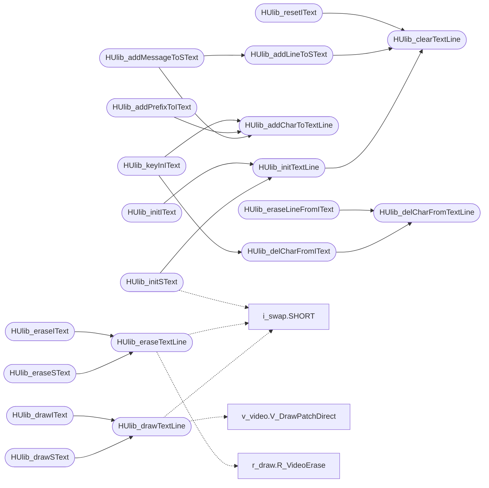

# `progs/doomgeneric/hu_lib.c`

> Source: [progs/doomgeneric/hu_lib.c:1](../../progs/doomgeneric/hu_lib.c#L1) | language `c` | coverage 59.1% | [API index](../index.md)

Copyright(C) 1993-1996 Id Software, Inc.

Copyright(C) 2005-2014 Simon Howard  This program is free software; you can redistribute it and/or modify it under the terms of the GNU General Public License as published by the Free Software Foundation; either version 2 of the License, or (at your option) any later version.  This program is distributed in the hope that it will be useful, but WITHOUT ANY WARRANTY; without even the implied warranty of MERCHANTABILITY or FITNESS FOR A PARTICULAR PURPOSE.  See the GNU General Public License for more details.  DESCRIPTION:  heads-up text and input code

## Contents

- **Functions:** [`HUlib_init`](#hulib_init), [`HUlib_clearTextLine`](#hulib_cleartextline), [`HUlib_initTextLine`](#hulib_inittextline), [`HUlib_addCharToTextLine`](#hulib_addchartotextline), [`HUlib_delCharFromTextLine`](#hulib_delcharfromtextline), [`HUlib_drawTextLine`](#hulib_drawtextline), [`HUlib_eraseTextLine`](#hulib_erasetextline), [`HUlib_initSText`](#hulib_initstext), [`HUlib_addLineToSText`](#hulib_addlinetostext), [`HUlib_addMessageToSText`](#hulib_addmessagetostext), [`HUlib_drawSText`](#hulib_drawstext), [`HUlib_eraseSText`](#hulib_erasestext), [`HUlib_initIText`](#hulib_inititext), [`HUlib_delCharFromIText`](#hulib_delcharfromitext), [`HUlib_eraseLineFromIText`](#hulib_eraselinefromitext), [`HUlib_resetIText`](#hulib_resetitext), [`HUlib_addPrefixToIText`](#hulib_addprefixtoitext), [`HUlib_keyInIText`](#hulib_keyinitext), [`HUlib_drawIText`](#hulib_drawitext), [`HUlib_eraseIText`](#hulib_eraseitext)
- **Macros:** [`noterased`](#noterased)
- **Variables:** [`automapactive`](#automapactive)

## Call Graph

Solid arrows stay in this module, dashed arrows leave it.



## Functions

<a id="hulib_init"></a>

### `HUlib_init`

`function` | [progs/doomgeneric/hu_lib.c:36](../../progs/doomgeneric/hu_lib.c#L36)

```c
void HUlib_init(void)
```

initializes heads-up widget library

> **Inherited:** Documentation from [`HUlib_init`](#hulib_init) (progs/doomgeneric/hu_lib.h:91).

---

<a id="hulib_cleartextline"></a>

### `HUlib_clearTextLine`

`function` | [progs/doomgeneric/hu_lib.c:40](../../progs/doomgeneric/hu_lib.c#L40)

```c
void HUlib_clearTextLine(hu_textline_t* t)
```

clear a line of text

**Parameters**

| Name | Type | Default | Description |
|---|---|---|---|
| `t` | `hu_textline_t*` |  |  |

> **Inherited:** Documentation from [`HUlib_clearTextLine`](#hulib_cleartextline) (progs/doomgeneric/hu_lib.h:98).

*Called by:* [`HUlib_addLineToSText`](#hulib_addlinetostext), [`HUlib_initTextLine`](#hulib_inittextline), [`HUlib_resetIText`](#hulib_resetitext)

---

<a id="hulib_inittextline"></a>

### `HUlib_initTextLine`

`function` | [progs/doomgeneric/hu_lib.c:48](../../progs/doomgeneric/hu_lib.c#L48)

```c
void HUlib_initTextLine ( hu_textline_t* t, int x, int y, patch_t** f, int sc )
```

**Parameters**

| Name | Type | Default | Description |
|---|---|---|---|
| `t` | `hu_textline_t*` |  |  |
| `x` | `int` |  |  |
| `y` | `int` |  |  |
| `f` | `patch_t**` |  |  |
| `sc` | `int` |  |  |

*Calls:* [`HUlib_clearTextLine`](#hulib_cleartextline)

*Called by:* [`HUlib_initIText`](#hulib_inititext), [`HUlib_initSText`](#hulib_initstext)

---

<a id="hulib_addchartotextline"></a>

### `HUlib_addCharToTextLine`

`function` | [progs/doomgeneric/hu_lib.c:63](../../progs/doomgeneric/hu_lib.c#L63)

```c
boolean HUlib_addCharToTextLine ( hu_textline_t* t, char ch )
```

**Parameters**

| Name | Type | Default | Description |
|---|---|---|---|
| `t` | `hu_textline_t*` |  |  |
| `ch` | `char` |  |  |

**Returns:** `boolean`

*Called by:* [`HUlib_addMessageToSText`](#hulib_addmessagetostext), [`HUlib_addPrefixToIText`](#hulib_addprefixtoitext), [`HUlib_keyInIText`](#hulib_keyinitext), [`HU_Start`](progs.doomgeneric.hu_stuff.c.md#hu_start)

---

<a id="hulib_delcharfromtextline"></a>

### `HUlib_delCharFromTextLine`

`function` | [progs/doomgeneric/hu_lib.c:80](../../progs/doomgeneric/hu_lib.c#L80)

```c
boolean HUlib_delCharFromTextLine(hu_textline_t* t)
```

**Parameters**

| Name | Type | Default | Description |
|---|---|---|---|
| `t` | `hu_textline_t*` |  |  |

**Returns:** `boolean`

*Called by:* [`HUlib_delCharFromIText`](#hulib_delcharfromitext), [`HUlib_eraseLineFromIText`](#hulib_eraselinefromitext)

---

<a id="hulib_drawtextline"></a>

### `HUlib_drawTextLine`

`function` | [progs/doomgeneric/hu_lib.c:94](../../progs/doomgeneric/hu_lib.c#L94)

```c
void HUlib_drawTextLine ( hu_textline_t* l, boolean drawcursor )
```

draws tline

**Parameters**

| Name | Type | Default | Description |
|---|---|---|---|
| `l` | `hu_textline_t*` |  |  |
| `drawcursor` | `boolean` |  |  |

> **Inherited:** Documentation from [`HUlib_drawTextLine`](#hulib_drawtextline) (progs/doomgeneric/hu_lib.h:109).

*Calls:* [`SHORT`](progs.doomgeneric.i_swap.h.md#short), [`V_DrawPatchDirect`](progs.doomgeneric.v_video.h.md#v_drawpatchdirect)

*Called by:* [`HUlib_drawIText`](#hulib_drawitext), [`HUlib_drawSText`](#hulib_drawstext)

---

<a id="hulib_erasetextline"></a>

### `HUlib_eraseTextLine`

`function` | [progs/doomgeneric/hu_lib.c:137](../../progs/doomgeneric/hu_lib.c#L137)

```c
void HUlib_eraseTextLine(hu_textline_t* l)
```

sorta called by HU_Erase and just better darn get things straight

**Parameters**

| Name | Type | Default | Description |
|---|---|---|---|
| `l` | `hu_textline_t*` |  |  |

*Calls:* [`SHORT`](progs.doomgeneric.i_swap.h.md#short), [`R_VideoErase`](progs.doomgeneric.r_draw.h.md#r_videoerase)

*Called by:* [`HUlib_eraseIText`](#hulib_eraseitext), [`HUlib_eraseSText`](#hulib_erasestext)

---

<a id="hulib_initstext"></a>

### `HUlib_initSText`

`function` | [progs/doomgeneric/hu_lib.c:169](../../progs/doomgeneric/hu_lib.c#L169)

```c
HUlib_initSText ( hu_stext_t* s, int x, int y, int h, patch_t** font, int startchar, boolean* on )
```

**Parameters**

| Name | Type | Default | Description |
|---|---|---|---|
| `s` | `hu_stext_t*` |  |  |
| `x` | `int` |  |  |
| `y` | `int` |  |  |
| `h` | `int` |  |  |
| `font` | `patch_t**` |  |  |
| `startchar` | `int` |  |  |
| `on` | `boolean*` |  |  |

*Calls:* [`HUlib_initTextLine`](#hulib_inittextline), [`SHORT`](progs.doomgeneric.i_swap.h.md#short)

---

<a id="hulib_addlinetostext"></a>

### `HUlib_addLineToSText`

`function` | [progs/doomgeneric/hu_lib.c:192](../../progs/doomgeneric/hu_lib.c#L192)

```c
void HUlib_addLineToSText(hu_stext_t* s)
```

add a new line

**Parameters**

| Name | Type | Default | Description |
|---|---|---|---|
| `s` | `hu_stext_t*` |  |  |

> **Inherited:** Documentation from [`HUlib_addLineToSText`](#hulib_addlinetostext) (progs/doomgeneric/hu_lib.h:131).

*Calls:* [`HUlib_clearTextLine`](#hulib_cleartextline)

*Called by:* [`HUlib_addMessageToSText`](#hulib_addmessagetostext)

---

<a id="hulib_addmessagetostext"></a>

### `HUlib_addMessageToSText`

`function` | [progs/doomgeneric/hu_lib.c:209](../../progs/doomgeneric/hu_lib.c#L209)

```c
void HUlib_addMessageToSText ( hu_stext_t* s, char* prefix, char* msg )
```

**Parameters**

| Name | Type | Default | Description |
|---|---|---|---|
| `s` | `hu_stext_t*` |  |  |
| `prefix` | `char*` |  |  |
| `msg` | `char*` |  |  |

*Calls:* [`HUlib_addCharToTextLine`](#hulib_addchartotextline), [`HUlib_addLineToSText`](#hulib_addlinetostext)

---

<a id="hulib_drawstext"></a>

### `HUlib_drawSText`

`function` | [progs/doomgeneric/hu_lib.c:223](../../progs/doomgeneric/hu_lib.c#L223)

```c
void HUlib_drawSText(hu_stext_t* s)
```

draws stext

**Parameters**

| Name | Type | Default | Description |
|---|---|---|---|
| `s` | `hu_stext_t*` |  |  |

> **Inherited:** Documentation from [`HUlib_drawSText`](#hulib_drawstext) (progs/doomgeneric/hu_lib.h:141).

*Calls:* [`HUlib_drawTextLine`](#hulib_drawtextline)

---

<a id="hulib_erasestext"></a>

### `HUlib_eraseSText`

`function` | [progs/doomgeneric/hu_lib.c:246](../../progs/doomgeneric/hu_lib.c#L246)

```c
void HUlib_eraseSText(hu_stext_t* s)
```

erases all stext lines

**Parameters**

| Name | Type | Default | Description |
|---|---|---|---|
| `s` | `hu_stext_t*` |  |  |

> **Inherited:** Documentation from [`HUlib_eraseSText`](#hulib_erasestext) (progs/doomgeneric/hu_lib.h:144).

*Calls:* [`HUlib_eraseTextLine`](#hulib_erasetextline)

---

<a id="hulib_inititext"></a>

### `HUlib_initIText`

`function` | [progs/doomgeneric/hu_lib.c:262](../../progs/doomgeneric/hu_lib.c#L262)

```c
HUlib_initIText ( hu_itext_t* it, int x, int y, patch_t** font, int startchar, boolean* on )
```

**Parameters**

| Name | Type | Default | Description |
|---|---|---|---|
| `it` | `hu_itext_t*` |  |  |
| `x` | `int` |  |  |
| `y` | `int` |  |  |
| `font` | `patch_t**` |  |  |
| `startchar` | `int` |  |  |
| `on` | `boolean*` |  |  |

*Calls:* [`HUlib_initTextLine`](#hulib_inittextline)

---

<a id="hulib_delcharfromitext"></a>

### `HUlib_delCharFromIText`

`function` | [progs/doomgeneric/hu_lib.c:278](../../progs/doomgeneric/hu_lib.c#L278)

```c
void HUlib_delCharFromIText(hu_itext_t* it)
```

The following deletion routines adhere to the left margin restriction

**Parameters**

| Name | Type | Default | Description |
|---|---|---|---|
| `it` | `hu_itext_t*` |  |  |

*Calls:* [`HUlib_delCharFromTextLine`](#hulib_delcharfromtextline)

*Called by:* [`HUlib_keyInIText`](#hulib_keyinitext)

---

<a id="hulib_eraselinefromitext"></a>

### `HUlib_eraseLineFromIText`

`function` | [progs/doomgeneric/hu_lib.c:284](../../progs/doomgeneric/hu_lib.c#L284)

```c
void HUlib_eraseLineFromIText(hu_itext_t* it)
```

enforces left margin

**Parameters**

| Name | Type | Default | Description |
|---|---|---|---|
| `it` | `hu_itext_t*` |  |  |

> **Inherited:** Documentation from [`HUlib_eraseLineFromIText`](#hulib_eraselinefromitext) (progs/doomgeneric/hu_lib.h:160).

*Calls:* [`HUlib_delCharFromTextLine`](#hulib_delcharfromtextline)

---

<a id="hulib_resetitext"></a>

### `HUlib_resetIText`

`function` | [progs/doomgeneric/hu_lib.c:291](../../progs/doomgeneric/hu_lib.c#L291)

```c
void HUlib_resetIText(hu_itext_t* it)
```

Resets left margin as well

**Parameters**

| Name | Type | Default | Description |
|---|---|---|---|
| `it` | `hu_itext_t*` |  |  |

*Calls:* [`HUlib_clearTextLine`](#hulib_cleartextline)

---

<a id="hulib_addprefixtoitext"></a>

### `HUlib_addPrefixToIText`

`function` | [progs/doomgeneric/hu_lib.c:298](../../progs/doomgeneric/hu_lib.c#L298)

```c
void HUlib_addPrefixToIText ( hu_itext_t* it, char* str )
```

**Parameters**

| Name | Type | Default | Description |
|---|---|---|---|
| `it` | `hu_itext_t*` |  |  |
| `str` | `char*` |  |  |

*Calls:* [`HUlib_addCharToTextLine`](#hulib_addchartotextline)

---

<a id="hulib_keyinitext"></a>

### `HUlib_keyInIText`

`function` | [progs/doomgeneric/hu_lib.c:310](../../progs/doomgeneric/hu_lib.c#L310)

```c
boolean HUlib_keyInIText ( hu_itext_t* it, unsigned char ch )
```

**Parameters**

| Name | Type | Default | Description |
|---|---|---|---|
| `it` | `hu_itext_t*` |  |  |
| `ch` | `unsigned char` |  |  |

**Returns:** `boolean`

*Calls:* [`HUlib_addCharToTextLine`](#hulib_addchartotextline), [`HUlib_delCharFromIText`](#hulib_delcharfromitext)

*Called by:* [`HU_Responder`](progs.doomgeneric.hu_stuff.c.md#hu_responder), [`HU_Ticker`](progs.doomgeneric.hu_stuff.c.md#hu_ticker)

---

<a id="hulib_drawitext"></a>

### `HUlib_drawIText`

`function` | [progs/doomgeneric/hu_lib.c:329](../../progs/doomgeneric/hu_lib.c#L329)

```c
void HUlib_drawIText(hu_itext_t* it)
```

**Parameters**

| Name | Type | Default | Description |
|---|---|---|---|
| `it` | `hu_itext_t*` |  |  |

*Calls:* [`HUlib_drawTextLine`](#hulib_drawtextline)

---

<a id="hulib_eraseitext"></a>

### `HUlib_eraseIText`

`function` | [progs/doomgeneric/hu_lib.c:340](../../progs/doomgeneric/hu_lib.c#L340)

```c
void HUlib_eraseIText(hu_itext_t* it)
```

erases all itext lines

**Parameters**

| Name | Type | Default | Description |
|---|---|---|---|
| `it` | `hu_itext_t*` |  |  |

> **Inherited:** Documentation from [`HUlib_eraseIText`](#hulib_eraseitext) (progs/doomgeneric/hu_lib.h:180).

*Calls:* [`HUlib_eraseTextLine`](#hulib_erasetextline)

---

## Macros

<a id="noterased"></a>

### `noterased`

`macro` | [progs/doomgeneric/hu_lib.c:32](../../progs/doomgeneric/hu_lib.c#L32)

```c
#define noterased
```

boolean : whether the screen is always erased

---

## Variables

<a id="automapactive"></a>

### `automapactive`

`variable` `extern` | [progs/doomgeneric/hu_lib.c:34](../../progs/doomgeneric/hu_lib.c#L34)

```c
extern boolean automapactive;
```

---
