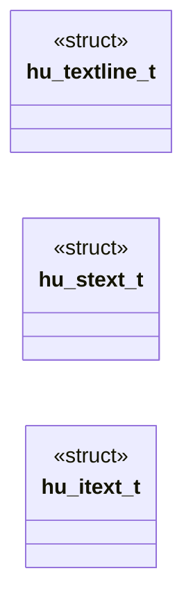

# `progs/doomgeneric/hu_lib.h`

> Source: [progs/doomgeneric/hu_lib.h:1](../../progs/doomgeneric/hu_lib.h#L1) | language `h` | coverage 64.0% | [API index](../index.md)

Copyright(C) 1993-1996 Id Software, Inc.

Copyright(C) 2005-2014 Simon Howard  This program is free software; you can redistribute it and/or modify it under the terms of the GNU General Public License as published by the Free Software Foundation; either version 2 of the License, or (at your option) any later version.  This program is distributed in the hope that it will be useful, but WITHOUT ANY WARRANTY; without even the implied warranty of MERCHANTABILITY or FITNESS FOR A PARTICULAR PURPOSE.  See the GNU General Public License for more details.  DESCRIPTION:  none    We are referring to patches.  font stuff

## Contents

- **Structs:** [`hu_textline_t`](#hu_textline_t), [`hu_stext_t`](#hu_stext_t), [`hu_itext_t`](#hu_itext_t)
- **Functions:** [`HUlib_init`](#hulib_init), [`HUlib_clearTextLine`](#hulib_cleartextline), [`HUlib_initTextLine`](#hulib_inittextline), [`HUlib_drawTextLine`](#hulib_drawtextline), [`HUlib_eraseTextLine`](#hulib_erasetextline), [`HUlib_initSText`](#hulib_initstext), [`HUlib_addLineToSText`](#hulib_addlinetostext), [`HUlib_addMessageToSText`](#hulib_addmessagetostext), [`HUlib_drawSText`](#hulib_drawstext), [`HUlib_eraseSText`](#hulib_erasestext), [`HUlib_initIText`](#hulib_inititext), [`HUlib_delCharFromIText`](#hulib_delcharfromitext), [`HUlib_eraseLineFromIText`](#hulib_eraselinefromitext), [`HUlib_resetIText`](#hulib_resetitext), [`HUlib_addPrefixToIText`](#hulib_addprefixtoitext), [`HUlib_drawIText`](#hulib_drawitext), [`HUlib_eraseIText`](#hulib_eraseitext)
- **Macros:** [`__HULIB__`](#__hulib__), [`HU_CHARERASE`](#hu_charerase), [`HU_MAXLINES`](#hu_maxlines), [`HU_MAXLINELENGTH`](#hu_maxlinelength)

## Type Diagram



## Structs

<a id="hu_textline_t"></a>

### `hu_textline_t`

`struct` | [progs/doomgeneric/hu_lib.h:36](../../progs/doomgeneric/hu_lib.h#L36)

```c
typedef struct
```

Text Line widget (parent of Scrolling Text and Input Text widgets)

---

<a id="hu_stext_t"></a>

### `hu_stext_t`

`struct` | [progs/doomgeneric/hu_lib.h:56](../../progs/doomgeneric/hu_lib.h#L56)

```c
typedef struct
```

Scrolling Text window widget (child of Text Line widget)

---

<a id="hu_itext_t"></a>

### `hu_itext_t`

`struct` | [progs/doomgeneric/hu_lib.h:72](../../progs/doomgeneric/hu_lib.h#L72)

```c
typedef struct
```

Input Text Line widget (child of Text Line widget)

---

## Functions

<a id="hulib_init"></a>

### `HUlib_init`

`function` | [progs/doomgeneric/hu_lib.h:91](../../progs/doomgeneric/hu_lib.h#L91)

```c
void HUlib_init(void);
```

initializes heads-up widget library

---

<a id="hulib_cleartextline"></a>

### `HUlib_clearTextLine`

`function` | [progs/doomgeneric/hu_lib.h:98](../../progs/doomgeneric/hu_lib.h#L98)

```c
void HUlib_clearTextLine(hu_textline_t *t);
```

clear a line of text

**Parameters**

| Name | Type | Default | Description |
|---|---|---|---|
| `t` | `hu_textline_t *` |  |  |

---

<a id="hulib_inittextline"></a>

### `HUlib_initTextLine`

`function` | [progs/doomgeneric/hu_lib.h:100](../../progs/doomgeneric/hu_lib.h#L100)

```c
void HUlib_initTextLine(hu_textline_t *t, int x, int y, patch_t **f, int sc);
```

**Parameters**

| Name | Type | Default | Description |
|---|---|---|---|
| `t` | `hu_textline_t *` |  |  |
| `x` | `int` |  |  |
| `y` | `int` |  |  |
| `f` | `patch_t **` |  |  |
| `sc` | `int` |  |  |

*Called by:* [`HU_Start`](progs.doomgeneric.hu_stuff.c.md#hu_start)

---

<a id="hulib_drawtextline"></a>

### `HUlib_drawTextLine`

`function` | [progs/doomgeneric/hu_lib.h:109](../../progs/doomgeneric/hu_lib.h#L109)

```c
void HUlib_drawTextLine(hu_textline_t *l, boolean drawcursor);
```

draws tline

**Parameters**

| Name | Type | Default | Description |
|---|---|---|---|
| `l` | `hu_textline_t *` |  |  |
| `drawcursor` | `boolean` |  |  |

*Called by:* [`HU_Drawer`](progs.doomgeneric.hu_stuff.c.md#hu_drawer)

---

<a id="hulib_erasetextline"></a>

### `HUlib_eraseTextLine`

`function` | [progs/doomgeneric/hu_lib.h:112](../../progs/doomgeneric/hu_lib.h#L112)

```c
void HUlib_eraseTextLine(hu_textline_t *l);
```

erases text line

**Parameters**

| Name | Type | Default | Description |
|---|---|---|---|
| `l` | `hu_textline_t *` |  |  |

*Called by:* [`HU_Erase`](progs.doomgeneric.hu_stuff.c.md#hu_erase)

---

<a id="hulib_initstext"></a>

### `HUlib_initSText`

`function` | [progs/doomgeneric/hu_lib.h:121](../../progs/doomgeneric/hu_lib.h#L121)

```c
void HUlib_initSText ( hu_stext_t* s, int x, int y, int h, patch_t** font, int startchar, boolean* on );
```

**Parameters**

| Name | Type | Default | Description |
|---|---|---|---|
| `s` | `hu_stext_t*` |  |  |
| `x` | `int` |  |  |
| `y` | `int` |  |  |
| `h` | `int` |  |  |
| `font` | `patch_t**` |  |  |
| `startchar` | `int` |  |  |
| `on` | `boolean*` |  |  |

*Called by:* [`HU_Start`](progs.doomgeneric.hu_stuff.c.md#hu_start)

---

<a id="hulib_addlinetostext"></a>

### `HUlib_addLineToSText`

`function` | [progs/doomgeneric/hu_lib.h:131](../../progs/doomgeneric/hu_lib.h#L131)

```c
void HUlib_addLineToSText(hu_stext_t* s);
```

add a new line

**Parameters**

| Name | Type | Default | Description |
|---|---|---|---|
| `s` | `hu_stext_t*` |  |  |

---

<a id="hulib_addmessagetostext"></a>

### `HUlib_addMessageToSText`

`function` | [progs/doomgeneric/hu_lib.h:135](../../progs/doomgeneric/hu_lib.h#L135)

```c
void HUlib_addMessageToSText ( hu_stext_t* s, char* prefix, char* msg );
```

**Parameters**

| Name | Type | Default | Description |
|---|---|---|---|
| `s` | `hu_stext_t*` |  |  |
| `prefix` | `char*` |  |  |
| `msg` | `char*` |  |  |

*Called by:* [`HU_Ticker`](progs.doomgeneric.hu_stuff.c.md#hu_ticker)

---

<a id="hulib_drawstext"></a>

### `HUlib_drawSText`

`function` | [progs/doomgeneric/hu_lib.h:141](../../progs/doomgeneric/hu_lib.h#L141)

```c
void HUlib_drawSText(hu_stext_t* s);
```

draws stext

**Parameters**

| Name | Type | Default | Description |
|---|---|---|---|
| `s` | `hu_stext_t*` |  |  |

*Called by:* [`HU_Drawer`](progs.doomgeneric.hu_stuff.c.md#hu_drawer)

---

<a id="hulib_erasestext"></a>

### `HUlib_eraseSText`

`function` | [progs/doomgeneric/hu_lib.h:144](../../progs/doomgeneric/hu_lib.h#L144)

```c
void HUlib_eraseSText(hu_stext_t* s);
```

erases all stext lines

**Parameters**

| Name | Type | Default | Description |
|---|---|---|---|
| `s` | `hu_stext_t*` |  |  |

*Called by:* [`HU_Erase`](progs.doomgeneric.hu_stuff.c.md#hu_erase)

---

<a id="hulib_inititext"></a>

### `HUlib_initIText`

`function` | [progs/doomgeneric/hu_lib.h:148](../../progs/doomgeneric/hu_lib.h#L148)

```c
void HUlib_initIText ( hu_itext_t* it, int x, int y, patch_t** font, int startchar, boolean* on );
```

**Parameters**

| Name | Type | Default | Description |
|---|---|---|---|
| `it` | `hu_itext_t*` |  |  |
| `x` | `int` |  |  |
| `y` | `int` |  |  |
| `font` | `patch_t**` |  |  |
| `startchar` | `int` |  |  |
| `on` | `boolean*` |  |  |

*Called by:* [`HU_Start`](progs.doomgeneric.hu_stuff.c.md#hu_start)

---

<a id="hulib_delcharfromitext"></a>

### `HUlib_delCharFromIText`

`function` | [progs/doomgeneric/hu_lib.h:157](../../progs/doomgeneric/hu_lib.h#L157)

```c
void HUlib_delCharFromIText(hu_itext_t* it);
```

enforces left margin

**Parameters**

| Name | Type | Default | Description |
|---|---|---|---|
| `it` | `hu_itext_t*` |  |  |

---

<a id="hulib_eraselinefromitext"></a>

### `HUlib_eraseLineFromIText`

`function` | [progs/doomgeneric/hu_lib.h:160](../../progs/doomgeneric/hu_lib.h#L160)

```c
void HUlib_eraseLineFromIText(hu_itext_t* it);
```

enforces left margin

**Parameters**

| Name | Type | Default | Description |
|---|---|---|---|
| `it` | `hu_itext_t*` |  |  |

---

<a id="hulib_resetitext"></a>

### `HUlib_resetIText`

`function` | [progs/doomgeneric/hu_lib.h:163](../../progs/doomgeneric/hu_lib.h#L163)

```c
void HUlib_resetIText(hu_itext_t* it);
```

resets line and left margin

**Parameters**

| Name | Type | Default | Description |
|---|---|---|---|
| `it` | `hu_itext_t*` |  |  |

*Called by:* [`HU_Responder`](progs.doomgeneric.hu_stuff.c.md#hu_responder), [`HU_Ticker`](progs.doomgeneric.hu_stuff.c.md#hu_ticker)

---

<a id="hulib_addprefixtoitext"></a>

### `HUlib_addPrefixToIText`

`function` | [progs/doomgeneric/hu_lib.h:167](../../progs/doomgeneric/hu_lib.h#L167)

```c
void HUlib_addPrefixToIText ( hu_itext_t* it, char* str );
```

**Parameters**

| Name | Type | Default | Description |
|---|---|---|---|
| `it` | `hu_itext_t*` |  |  |
| `str` | `char*` |  |  |

---

<a id="hulib_drawitext"></a>

### `HUlib_drawIText`

`function` | [progs/doomgeneric/hu_lib.h:177](../../progs/doomgeneric/hu_lib.h#L177)

```c
void HUlib_drawIText(hu_itext_t* it);
```

**Parameters**

| Name | Type | Default | Description |
|---|---|---|---|
| `it` | `hu_itext_t*` |  |  |

*Called by:* [`HU_Drawer`](progs.doomgeneric.hu_stuff.c.md#hu_drawer)

---

<a id="hulib_eraseitext"></a>

### `HUlib_eraseIText`

`function` | [progs/doomgeneric/hu_lib.h:180](../../progs/doomgeneric/hu_lib.h#L180)

```c
void HUlib_eraseIText(hu_itext_t* it);
```

erases all itext lines

**Parameters**

| Name | Type | Default | Description |
|---|---|---|---|
| `it` | `hu_itext_t*` |  |  |

*Called by:* [`HU_Erase`](progs.doomgeneric.hu_stuff.c.md#hu_erase)

---

## Macros

<a id="__hulib__"></a>

### `__HULIB__`

`macro` | [progs/doomgeneric/hu_lib.h:19](../../progs/doomgeneric/hu_lib.h#L19)

```c
#define __HULIB__
```

---

<a id="hu_charerase"></a>

### `HU_CHARERASE`

`macro` | [progs/doomgeneric/hu_lib.h:25](../../progs/doomgeneric/hu_lib.h#L25)

```c
#define HU_CHARERASE
```

font stuff

---

<a id="hu_maxlines"></a>

### `HU_MAXLINES`

`macro` | [progs/doomgeneric/hu_lib.h:27](../../progs/doomgeneric/hu_lib.h#L27)

```c
#define HU_MAXLINES
```

---

<a id="hu_maxlinelength"></a>

### `HU_MAXLINELENGTH`

`macro` | [progs/doomgeneric/hu_lib.h:28](../../progs/doomgeneric/hu_lib.h#L28)

```c
#define HU_MAXLINELENGTH
```

---
