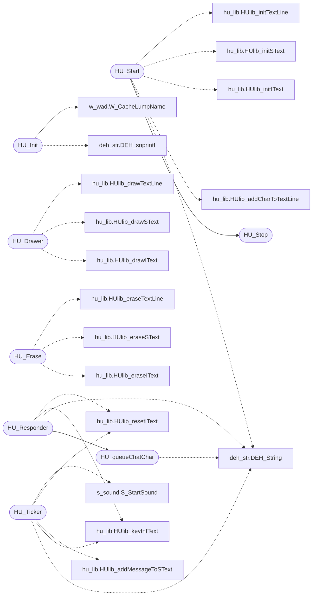

# `progs/doomgeneric/hu_stuff.c`

> Source: [progs/doomgeneric/hu_stuff.c:1](../../progs/doomgeneric/hu_stuff.c#L1) | language `c` | coverage 8.3% | [API index](../index.md)

Copyright(C) 1993-1996 Id Software, Inc.

Copyright(C) 2005-2014 Simon Howard  This program is free software; you can redistribute it and/or modify it under the terms of the GNU General Public License as published by the Free Software Foundation; either version 2 of the License, or (at your option) any later version.  This program is distributed in the hope that it will be useful, but WITHOUT ANY WARRANTY; without even the implied warranty of MERCHANTABILITY or FITNESS FOR A PARTICULAR PURPOSE.  See the GNU General Public License for more details.  DESCRIPTION:  Heads-up displays

## Contents

- **Functions:** [`HU_Init`](#hu_init), [`HU_Stop`](#hu_stop), [`HU_Start`](#hu_start), [`HU_Drawer`](#hu_drawer), [`HU_Erase`](#hu_erase), [`HU_Ticker`](#hu_ticker), [`HU_queueChatChar`](#hu_queuechatchar), [`HU_dequeueChatChar`](#hu_dequeuechatchar), [`HU_Responder`](#hu_responder)
- **Macros:** [`HU_TITLE`](#hu_title), [`HU_TITLE2`](#hu_title2), [`HU_TITLEP`](#hu_titlep), [`HU_TITLET`](#hu_titlet), [`HU_TITLE_CHEX`](#hu_title_chex), [`HU_TITLEHEIGHT`](#hu_titleheight), [`HU_TITLEX`](#hu_titlex), [`HU_TITLEY`](#hu_titley), [`HU_INPUTTOGGLE`](#hu_inputtoggle), [`HU_INPUTX`](#hu_inputx), [`HU_INPUTY`](#hu_inputy), [`HU_INPUTWIDTH`](#hu_inputwidth), [`HU_INPUTHEIGHT`](#hu_inputheight), [`QUEUESIZE`](#queuesize)
- **Variables:** [`showMessages`](#showmessages)

## Call Graph

Solid arrows stay in this module, dashed arrows leave it.



## Functions

<a id="hu_init"></a>

### `HU_Init`

`function` | [progs/doomgeneric/hu_stuff.c:286](../../progs/doomgeneric/hu_stuff.c#L286)

```c
void HU_Init(void)
```

*Calls:* [`DEH_snprintf`](progs.doomgeneric.deh_str.h.md#deh_snprintf), [`W_CacheLumpName`](progs.doomgeneric.w_wad.h.md#w_cachelumpname)

---

<a id="hu_stop"></a>

### `HU_Stop`

`function` | [progs/doomgeneric/hu_stuff.c:303](../../progs/doomgeneric/hu_stuff.c#L303)

```c
void HU_Stop(void)
```

*Called by:* [`HU_Start`](#hu_start)

---

<a id="hu_start"></a>

### `HU_Start`

`function` | [progs/doomgeneric/hu_stuff.c:308](../../progs/doomgeneric/hu_stuff.c#L308)

```c
void HU_Start(void)
```

*Calls:* [`DEH_String`](progs.doomgeneric.deh_str.h.md#deh_string), [`HUlib_addCharToTextLine`](progs.doomgeneric.hu_lib.c.md#hulib_addchartotextline), [`HUlib_initIText`](progs.doomgeneric.hu_lib.h.md#hulib_inititext), [`HUlib_initSText`](progs.doomgeneric.hu_lib.h.md#hulib_initstext), [`HUlib_initTextLine`](progs.doomgeneric.hu_lib.h.md#hulib_inittextline), [`HU_Stop`](#hu_stop)

---

<a id="hu_drawer"></a>

### `HU_Drawer`

`function` | [progs/doomgeneric/hu_stuff.c:383](../../progs/doomgeneric/hu_stuff.c#L383)

```c
void HU_Drawer(void)
```

*Calls:* [`HUlib_drawIText`](progs.doomgeneric.hu_lib.h.md#hulib_drawitext), [`HUlib_drawSText`](progs.doomgeneric.hu_lib.h.md#hulib_drawstext), [`HUlib_drawTextLine`](progs.doomgeneric.hu_lib.h.md#hulib_drawtextline)

---

<a id="hu_erase"></a>

### `HU_Erase`

`function` | [progs/doomgeneric/hu_stuff.c:393](../../progs/doomgeneric/hu_stuff.c#L393)

```c
void HU_Erase(void)
```

*Calls:* [`HUlib_eraseIText`](progs.doomgeneric.hu_lib.h.md#hulib_eraseitext), [`HUlib_eraseSText`](progs.doomgeneric.hu_lib.h.md#hulib_erasestext), [`HUlib_eraseTextLine`](progs.doomgeneric.hu_lib.h.md#hulib_erasetextline)

---

<a id="hu_ticker"></a>

### `HU_Ticker`

`function` | [progs/doomgeneric/hu_stuff.c:402](../../progs/doomgeneric/hu_stuff.c#L402)

```c
void HU_Ticker(void)
```

*Calls:* [`DEH_String`](progs.doomgeneric.deh_str.h.md#deh_string), [`HUlib_keyInIText`](progs.doomgeneric.hu_lib.c.md#hulib_keyinitext), [`HUlib_addMessageToSText`](progs.doomgeneric.hu_lib.h.md#hulib_addmessagetostext), [`HUlib_resetIText`](progs.doomgeneric.hu_lib.h.md#hulib_resetitext), [`S_StartSound`](progs.doomgeneric.s_sound.h.md#s_startsound)

---

<a id="hu_queuechatchar"></a>

### `HU_queueChatChar`

`function` | [progs/doomgeneric/hu_stuff.c:482](../../progs/doomgeneric/hu_stuff.c#L482)

```c
void HU_queueChatChar(char c)
```

**Parameters**

| Name | Type | Default | Description |
|---|---|---|---|
| `c` | `char` |  |  |

*Calls:* [`DEH_String`](progs.doomgeneric.deh_str.h.md#deh_string)

*Called by:* [`HU_Responder`](#hu_responder)

---

<a id="hu_dequeuechatchar"></a>

### `HU_dequeueChatChar`

`function` | [progs/doomgeneric/hu_stuff.c:495](../../progs/doomgeneric/hu_stuff.c#L495)

```c
char HU_dequeueChatChar(void)
```

**Returns:** `char`

---

<a id="hu_responder"></a>

### `HU_Responder`

`function` | [progs/doomgeneric/hu_stuff.c:512](../../progs/doomgeneric/hu_stuff.c#L512)

```c
boolean HU_Responder(event_t *ev)
```

**Parameters**

| Name | Type | Default | Description |
|---|---|---|---|
| `ev` | `event_t *` |  |  |

**Returns:** `boolean`

*Calls:* [`DEH_String`](progs.doomgeneric.deh_str.h.md#deh_string), [`HUlib_keyInIText`](progs.doomgeneric.hu_lib.c.md#hulib_keyinitext), [`HUlib_resetIText`](progs.doomgeneric.hu_lib.h.md#hulib_resetitext), [`HU_queueChatChar`](#hu_queuechatchar), [`M_StringCopy`](progs.doomgeneric.m_misc.c.md#m_stringcopy)

*Called by:* [`G_Responder`](progs.doomgeneric.g_game.c.md#g_responder)

---

## Macros

<a id="hu_title"></a>

### `HU_TITLE`

`macro` | [progs/doomgeneric/hu_stuff.c:47](../../progs/doomgeneric/hu_stuff.c#L47)

```c
#define HU_TITLE
```

Locally used constants, shortcuts.

---

<a id="hu_title2"></a>

### `HU_TITLE2`

`macro` | [progs/doomgeneric/hu_stuff.c:48](../../progs/doomgeneric/hu_stuff.c#L48)

```c
#define HU_TITLE2
```

---

<a id="hu_titlep"></a>

### `HU_TITLEP`

`macro` | [progs/doomgeneric/hu_stuff.c:49](../../progs/doomgeneric/hu_stuff.c#L49)

```c
#define HU_TITLEP
```

---

<a id="hu_titlet"></a>

### `HU_TITLET`

`macro` | [progs/doomgeneric/hu_stuff.c:50](../../progs/doomgeneric/hu_stuff.c#L50)

```c
#define HU_TITLET
```

---

<a id="hu_title_chex"></a>

### `HU_TITLE_CHEX`

`macro` | [progs/doomgeneric/hu_stuff.c:51](../../progs/doomgeneric/hu_stuff.c#L51)

```c
#define HU_TITLE_CHEX
```

---

<a id="hu_titleheight"></a>

### `HU_TITLEHEIGHT`

`macro` | [progs/doomgeneric/hu_stuff.c:52](../../progs/doomgeneric/hu_stuff.c#L52)

```c
#define HU_TITLEHEIGHT
```

---

<a id="hu_titlex"></a>

### `HU_TITLEX`

`macro` | [progs/doomgeneric/hu_stuff.c:53](../../progs/doomgeneric/hu_stuff.c#L53)

```c
#define HU_TITLEX
```

---

<a id="hu_titley"></a>

### `HU_TITLEY`

`macro` | [progs/doomgeneric/hu_stuff.c:54](../../progs/doomgeneric/hu_stuff.c#L54)

```c
#define HU_TITLEY
```

---

<a id="hu_inputtoggle"></a>

### `HU_INPUTTOGGLE`

`macro` | [progs/doomgeneric/hu_stuff.c:56](../../progs/doomgeneric/hu_stuff.c#L56)

```c
#define HU_INPUTTOGGLE
```

---

<a id="hu_inputx"></a>

### `HU_INPUTX`

`macro` | [progs/doomgeneric/hu_stuff.c:57](../../progs/doomgeneric/hu_stuff.c#L57)

```c
#define HU_INPUTX
```

---

<a id="hu_inputy"></a>

### `HU_INPUTY`

`macro` | [progs/doomgeneric/hu_stuff.c:58](../../progs/doomgeneric/hu_stuff.c#L58)

```c
#define HU_INPUTY
```

---

<a id="hu_inputwidth"></a>

### `HU_INPUTWIDTH`

`macro` | [progs/doomgeneric/hu_stuff.c:59](../../progs/doomgeneric/hu_stuff.c#L59)

```c
#define HU_INPUTWIDTH
```

---

<a id="hu_inputheight"></a>

### `HU_INPUTHEIGHT`

`macro` | [progs/doomgeneric/hu_stuff.c:60](../../progs/doomgeneric/hu_stuff.c#L60)

```c
#define HU_INPUTHEIGHT
```

---

<a id="queuesize"></a>

### `QUEUESIZE`

`macro` | [progs/doomgeneric/hu_stuff.c:475](../../progs/doomgeneric/hu_stuff.c#L475)

```c
#define QUEUESIZE
```

---

## Variables

<a id="showmessages"></a>

### `showMessages`

`variable` `extern` | [progs/doomgeneric/hu_stuff.c:103](../../progs/doomgeneric/hu_stuff.c#L103)

```c
extern int showMessages;
```

---
