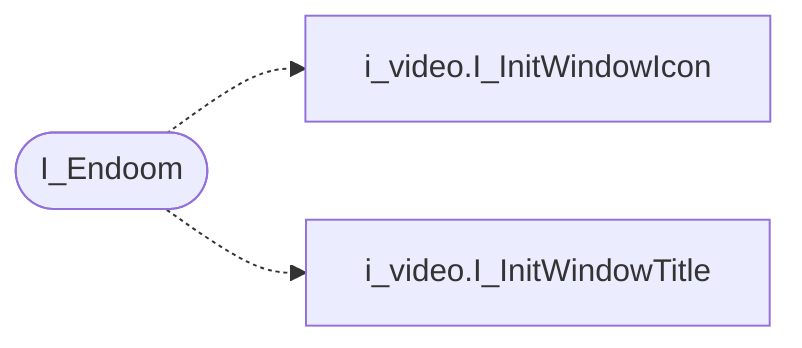

# `progs/doomgeneric/i_endoom.c`

> Source: [progs/doomgeneric/i_endoom.c:1](../../progs/doomgeneric/i_endoom.c#L1) | language `c` | coverage 33.3% | [API index](../index.md)

Copyright(C) 2005-2014 Simon Howard  This program is free software; you can redistribute it and/or modify it under the terms of the GNU General Public License as published by the Free Software Foundation; either version 2 of the License, or (at your option) any later version.

This program is distributed in the hope that it will be useful, but WITHOUT ANY WARRANTY; without even the implied warranty of MERCHANTABILITY or FITNESS FOR A PARTICULAR PURPOSE.  See the GNU General Public License for more details.  DESCRIPTION: Exit text-mode ENDOOM screen.

## Contents

- **Functions:** [`I_Endoom`](#i_endoom)
- **Macros:** [`ENDOOM_W`](#endoom_w)

## Call Graph

Solid arrows stay in this module, dashed arrows leave it.



## Functions

<a id="i_endoom"></a>

### `I_Endoom`

`function` | [progs/doomgeneric/i_endoom.c:36](../../progs/doomgeneric/i_endoom.c#L36)

```c
void I_Endoom(byte *endoom_data)
```

**Parameters**

| Name | Type | Default | Description |
|---|---|---|---|
| `endoom_data` | `byte *` |  |  |

*Calls:* [`I_InitWindowIcon`](progs.doomgeneric.i_video.h.md#i_initwindowicon), [`I_InitWindowTitle`](progs.doomgeneric.i_video.h.md#i_initwindowtitle)

---

## Macros

<a id="endoom_w"></a>

### `ENDOOM_W`

`macro` | [progs/doomgeneric/i_endoom.c:29](../../progs/doomgeneric/i_endoom.c#L29)

```c
#define ENDOOM_W
```

---
