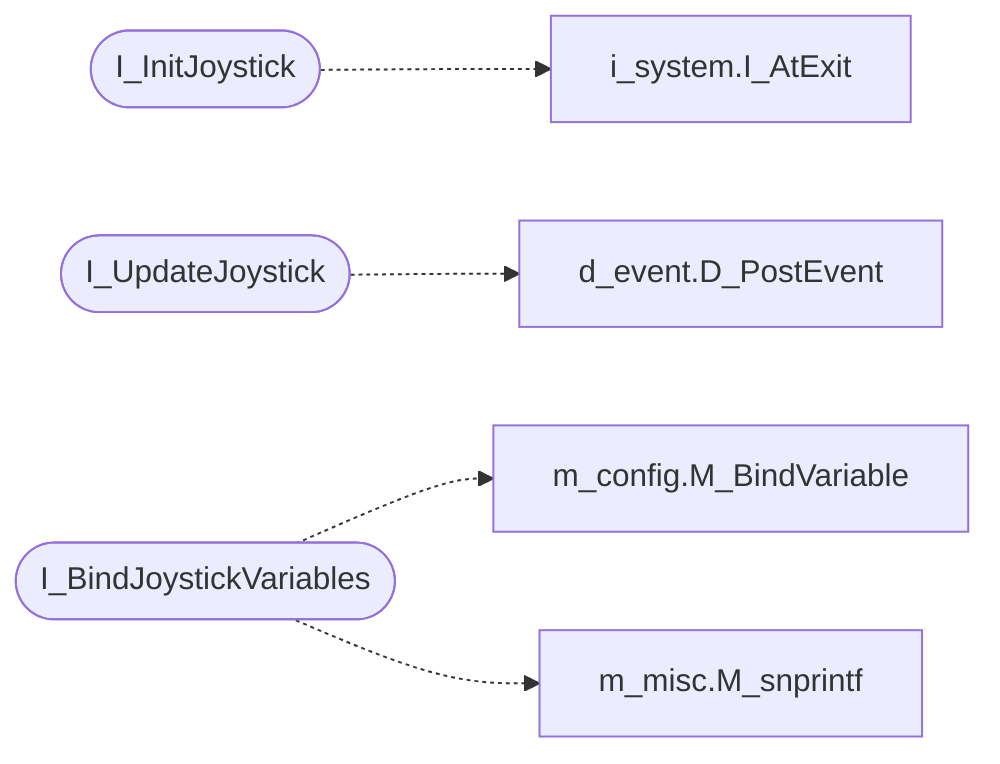

# `progs/doomgeneric/i_joystick.c`

> Source: [progs/doomgeneric/i_joystick.c:1](../../progs/doomgeneric/i_joystick.c#L1) | language `c` | coverage 33.3% | [API index](../index.md)

Copyright(C) 2005-2014 Simon Howard  This program is free software; you can redistribute it and/or modify it under the terms of the GNU General Public License as published by the Free Software Foundation; either version 2 of the License, or (at your option) any later version.

This program is distributed in the hope that it will be useful, but WITHOUT ANY WARRANTY; without even the implied warranty of MERCHANTABILITY or FITNESS FOR A PARTICULAR PURPOSE.  See the GNU General Public License for more details.  DESCRIPTION: SDL Joystick code.

## Contents

- **Functions:** [`I_ShutdownJoystick`](#i_shutdownjoystick), [`I_InitJoystick`](#i_initjoystick), [`I_UpdateJoystick`](#i_updatejoystick), [`I_BindJoystickVariables`](#i_bindjoystickvariables)
- **Macros:** [`DEAD_ZONE`](#dead_zone)

## Call Graph

Solid arrows stay in this module, dashed arrows leave it.



## Functions

<a id="i_shutdownjoystick"></a>

### `I_ShutdownJoystick`

`function` | [progs/doomgeneric/i_joystick.c:77](../../progs/doomgeneric/i_joystick.c#L77)

```c
void I_ShutdownJoystick(void)
```

---

<a id="i_initjoystick"></a>

### `I_InitJoystick`

`function` | [progs/doomgeneric/i_joystick.c:115](../../progs/doomgeneric/i_joystick.c#L115)

```c
void I_InitJoystick(void)
```

*Calls:* [`I_AtExit`](progs.doomgeneric.i_system.h.md#i_atexit)

---

<a id="i_updatejoystick"></a>

### `I_UpdateJoystick`

`function` | [progs/doomgeneric/i_joystick.c:321](../../progs/doomgeneric/i_joystick.c#L321)

```c
void I_UpdateJoystick(void)
```

endif

*Calls:* [`D_PostEvent`](progs.doomgeneric.d_event.h.md#d_postevent)

---

<a id="i_bindjoystickvariables"></a>

### `I_BindJoystickVariables`

`function` | [progs/doomgeneric/i_joystick.c:339](../../progs/doomgeneric/i_joystick.c#L339)

```c
void I_BindJoystickVariables(void)
```

*Calls:* [`M_BindVariable`](progs.doomgeneric.m_config.h.md#m_bindvariable), [`M_snprintf`](progs.doomgeneric.m_misc.h.md#m_snprintf)

---

## Macros

<a id="dead_zone"></a>

### `DEAD_ZONE`

`macro` | [progs/doomgeneric/i_joystick.c:38](../../progs/doomgeneric/i_joystick.c#L38)

```c
#define DEAD_ZONE
```

---
