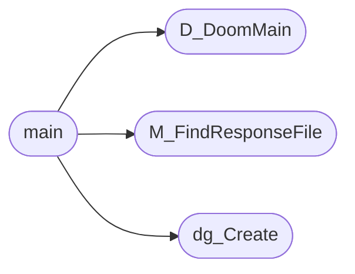

# `progs/doomgeneric/i_main.c`

> Source: [progs/doomgeneric/i_main.c:1](../../progs/doomgeneric/i_main.c#L1) | language `c` | coverage 20.0% | [API index](../index.md)

Copyright(C) 1993-1996 Id Software, Inc.

Copyright(C) 2005-2014 Simon Howard  This program is free software; you can redistribute it and/or modify it under the terms of the GNU General Public License as published by the Free Software Foundation; either version 2 of the License, or (at your option) any later version.  This program is distributed in the hope that it will be useful, but WITHOUT ANY WARRANTY; without even the implied warranty of MERCHANTABILITY or FITNESS FOR A PARTICULAR PURPOSE.  See the GNU General Public License for more details.  DESCRIPTION: Main program, simply calls D_DoomMain high level loop.   #include "config.h"   #include "doomtype.h" #include "i_system.h"   D_DoomMain() Not a globally visible function, just included for source reference, calls all startup code, parses command line options.

## Contents

- **Functions:** [`D_DoomMain`](#d_doommain), [`M_FindResponseFile`](#m_findresponsefile), [`dg_Create`](#dg_create), [`main`](#main)

## Call Graph

Solid arrows stay in this module, dashed arrows leave it.



## Functions

<a id="d_doommain"></a>

### `D_DoomMain`

`function` | [progs/doomgeneric/i_main.c:33](../../progs/doomgeneric/i_main.c#L33)

```c
void D_DoomMain (void);
```

*Called by:* [`main`](#main)

---

<a id="m_findresponsefile"></a>

### `M_FindResponseFile`

`function` | [progs/doomgeneric/i_main.c:35](../../progs/doomgeneric/i_main.c#L35)

```c
void M_FindResponseFile(void);
```

*Called by:* [`main`](#main)

---

<a id="dg_create"></a>

### `dg_Create`

`function` | [progs/doomgeneric/i_main.c:37](../../progs/doomgeneric/i_main.c#L37)

```c
void dg_Create();
```

*Called by:* [`main`](#main)

---

<a id="main"></a>

### `main`

`function` | [progs/doomgeneric/i_main.c:40](../../progs/doomgeneric/i_main.c#L40)

```c
int main(int argc, char **argv)
```

**Parameters**

| Name | Type | Default | Description |
|---|---|---|---|
| `argc` | `int` |  |  |
| `argv` | `char **` |  |  |

**Returns:** `int`

*Calls:* [`D_DoomMain`](#d_doommain), [`M_FindResponseFile`](#m_findresponsefile), [`dg_Create`](#dg_create)

---
