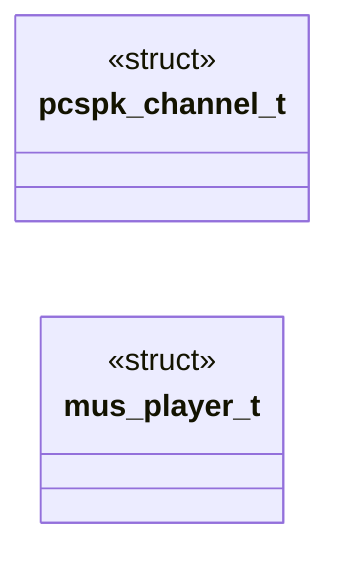

# `progs/doomgeneric/i_minios_sound.c`

> Source: [progs/doomgeneric/i_minios_sound.c:1](../../progs/doomgeneric/i_minios_sound.c#L1) | language `c` | coverage 13.3% | [API index](../index.md)

## Contents

- **Structs:** [`pcspk_channel_t`](#pcspk_channel_t), [`mus_player_t`](#mus_player_t)
- **Functions:** [`muted`](#muted)
- **Macros:** [`PCSPK_CHANNELS`](#pcspk_channels), [`PCSPK_TICK_MS`](#pcspk_tick_ms), [`DOOM_PCM_RATE`](#doom_pcm_rate), [`DOOM_PCM_VOL`](#doom_pcm_vol), [`MUS_TICKS_PER_SEC`](#mus_ticks_per_sec), [`MUS_PERCUSSION_CHAN`](#mus_percussion_chan), [`MUS_ARP_SLOT_MS`](#mus_arp_slot_ms), [`MUS_BASS_HOLD_MS`](#mus_bass_hold_ms), [`MUS_BASS_LINE_MIDI`](#mus_bass_line_midi), [`MUS_ARP_MAX`](#mus_arp_max), [`DOOM_PCM_DRUM_SMP`](#doom_pcm_drum_smp)

## Type Diagram



## Structs

<a id="pcspk_channel_t"></a>

### `pcspk_channel_t`

`struct` | [progs/doomgeneric/i_minios_sound.c:17](../../progs/doomgeneric/i_minios_sound.c#L17)

```c
typedef struct
```

---

<a id="mus_player_t"></a>

### `mus_player_t`

`struct` | [progs/doomgeneric/i_minios_sound.c:146](../../progs/doomgeneric/i_minios_sound.c#L146)

```c
typedef struct
```

---

## Functions

<a id="muted"></a>

### `muted`

`function` | [progs/doomgeneric/i_minios_sound.c:51](../../progs/doomgeneric/i_minios_sound.c#L51)

```c
* pcm2 while sfx stay muted (effect tones ruined the melody);
```

**Parameters**

| Name | Type | Default | Description |
|---|---|---|---|
| `melody` | `effect tones ruined the` |  |  |

**Returns:** `* pcm2 while sfx stay`

---

## Macros

<a id="pcspk_channels"></a>

### `PCSPK_CHANNELS`

`macro` | [progs/doomgeneric/i_minios_sound.c:12](../../progs/doomgeneric/i_minios_sound.c#L12)

```c
#define PCSPK_CHANNELS
```

---

<a id="pcspk_tick_ms"></a>

### `PCSPK_TICK_MS`

`macro` | [progs/doomgeneric/i_minios_sound.c:13](../../progs/doomgeneric/i_minios_sound.c#L13)

```c
#define PCSPK_TICK_MS
```

---

<a id="doom_pcm_rate"></a>

### `DOOM_PCM_RATE`

`macro` | [progs/doomgeneric/i_minios_sound.c:55](../../progs/doomgeneric/i_minios_sound.c#L55)

```c
#define DOOM_PCM_RATE
```

pcm2 primary with PC-speaker fallback (standard audio mode contract).

When the SB16 is present, music streams as polyphonic 8-bit PCM through
pcm2 while sfx stay muted (effect tones ruined the melody); when
pcm2_open refuses, every audio_tone falls through to the legacy sys_tone
and the game sounds exactly as before, sfx included. All pushes are
NONBLOCK and short counts are dropped (a gap beats a stalled game).

---

<a id="doom_pcm_vol"></a>

### `DOOM_PCM_VOL`

`macro` | [progs/doomgeneric/i_minios_sound.c:56](../../progs/doomgeneric/i_minios_sound.c#L56)

```c
#define DOOM_PCM_VOL
```

---

<a id="mus_ticks_per_sec"></a>

### `MUS_TICKS_PER_SEC`

`macro` | [progs/doomgeneric/i_minios_sound.c:118](../../progs/doomgeneric/i_minios_sound.c#L118)

```c
#define MUS_TICKS_PER_SEC
```

---

<a id="mus_percussion_chan"></a>

### `MUS_PERCUSSION_CHAN`

`macro` | [progs/doomgeneric/i_minios_sound.c:119](../../progs/doomgeneric/i_minios_sound.c#L119)

```c
#define MUS_PERCUSSION_CHAN
```

---

<a id="mus_arp_slot_ms"></a>

### `MUS_ARP_SLOT_MS`

`macro` | [progs/doomgeneric/i_minios_sound.c:120](../../progs/doomgeneric/i_minios_sound.c#L120)

```c
#define MUS_ARP_SLOT_MS
```

---

<a id="mus_bass_hold_ms"></a>

### `MUS_BASS_HOLD_MS`

`macro` | [progs/doomgeneric/i_minios_sound.c:121](../../progs/doomgeneric/i_minios_sound.c#L121)

```c
#define MUS_BASS_HOLD_MS
```

---

<a id="mus_bass_line_midi"></a>

### `MUS_BASS_LINE_MIDI`

`macro` | [progs/doomgeneric/i_minios_sound.c:122](../../progs/doomgeneric/i_minios_sound.c#L122)

```c
#define MUS_BASS_LINE_MIDI
```

---

<a id="mus_arp_max"></a>

### `MUS_ARP_MAX`

`macro` | [progs/doomgeneric/i_minios_sound.c:123](../../progs/doomgeneric/i_minios_sound.c#L123)

```c
#define MUS_ARP_MAX
```

---

<a id="doom_pcm_drum_smp"></a>

### `DOOM_PCM_DRUM_SMP`

`macro` | [progs/doomgeneric/i_minios_sound.c:125](../../progs/doomgeneric/i_minios_sound.c#L125)

```c
#define DOOM_PCM_DRUM_SMP
```

Polyphonic pcm2 drum burst: 25 ms of noise per percussion hit.

---
