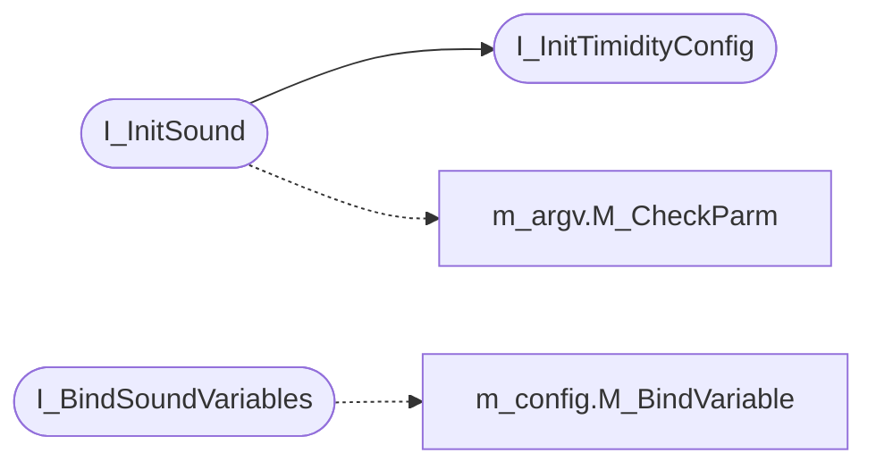

# `progs/doomgeneric/i_sound.c`

> Source: [progs/doomgeneric/i_sound.c:1](../../progs/doomgeneric/i_sound.c#L1) | language `c` | coverage 4.5% | [API index](../index.md)

Copyright(C) 1993-1996 Id Software, Inc.

Copyright(C) 2005-2014 Simon Howard  This program is free software; you can redistribute it and/or modify it under the terms of the GNU General Public License as published by the Free Software Foundation; either version 2 of the License, or (at your option) any later version.  This program is distributed in the hope that it will be useful, but WITHOUT ANY WARRANTY; without even the implied warranty of MERCHANTABILITY or FITNESS FOR A PARTICULAR PURPOSE.  See the GNU General Public License for more details.  DESCRIPTION:  none

## Contents

- **Functions:** [`I_InitTimidityConfig`](#i_inittimidityconfig), [`I_InitSound`](#i_initsound), [`I_ShutdownSound`](#i_shutdownsound), [`I_GetSfxLumpNum`](#i_getsfxlumpnum), [`I_UpdateSound`](#i_updatesound), [`I_UpdateSoundParams`](#i_updatesoundparams), [`I_StartSound`](#i_startsound), [`I_StopSound`](#i_stopsound), [`I_SoundIsPlaying`](#i_soundisplaying), [`I_PrecacheSounds`](#i_precachesounds), [`I_InitMusic`](#i_initmusic), [`I_ShutdownMusic`](#i_shutdownmusic), [`I_SetMusicVolume`](#i_setmusicvolume), [`I_PauseSong`](#i_pausesong), [`I_ResumeSong`](#i_resumesong), [`I_RegisterSong`](#i_registersong), [`I_UnRegisterSong`](#i_unregistersong), [`I_PlaySong`](#i_playsong), [`I_StopSong`](#i_stopsong), [`I_MusicIsPlaying`](#i_musicisplaying), [`I_BindSoundVariables`](#i_bindsoundvariables)
- **Variables:** [`sound_sdl_module`](#sound_sdl_module), [`sound_pcsound_module`](#sound_pcsound_module), [`music_sdl_module`](#music_sdl_module), [`music_opl_module`](#music_opl_module), [`music_pcspeaker_module`](#music_pcspeaker_module), [`opl_io_port`](#opl_io_port), [`timidity_cfg_path`](#timidity_cfg_path), [`use_libsamplerate`](#use_libsamplerate), [`libsamplerate_scale`](#libsamplerate_scale)

## Call Graph

Solid arrows stay in this module, dashed arrows leave it.



## Functions

<a id="i_inittimidityconfig"></a>

### `I_InitTimidityConfig`

`function` `extern` | [progs/doomgeneric/i_sound.c:65](../../progs/doomgeneric/i_sound.c#L65)

```c
extern void I_InitTimidityConfig(void);
```

*Called by:* [`I_InitSound`](#i_initsound)

---

<a id="i_initsound"></a>

### `I_InitSound`

`function` | [progs/doomgeneric/i_sound.c:195](../../progs/doomgeneric/i_sound.c#L195)

```c
void I_InitSound(boolean use_sfx_prefix)
```

**Parameters**

| Name | Type | Default | Description |
|---|---|---|---|
| `use_sfx_prefix` | `boolean` |  |  |

*Calls:* [`I_InitTimidityConfig`](#i_inittimidityconfig), [`M_CheckParm`](progs.doomgeneric.m_argv.h.md#m_checkparm)

---

<a id="i_shutdownsound"></a>

### `I_ShutdownSound`

`function` | [progs/doomgeneric/i_sound.c:250](../../progs/doomgeneric/i_sound.c#L250)

```c
void I_ShutdownSound(void)
```

---

<a id="i_getsfxlumpnum"></a>

### `I_GetSfxLumpNum`

`function` | [progs/doomgeneric/i_sound.c:263](../../progs/doomgeneric/i_sound.c#L263)

```c
int I_GetSfxLumpNum(sfxinfo_t *sfxinfo)
```

**Parameters**

| Name | Type | Default | Description |
|---|---|---|---|
| `sfxinfo` | `sfxinfo_t *` |  |  |

**Returns:** `int`

---

<a id="i_updatesound"></a>

### `I_UpdateSound`

`function` | [progs/doomgeneric/i_sound.c:275](../../progs/doomgeneric/i_sound.c#L275)

```c
void I_UpdateSound(void)
```

---

<a id="i_updatesoundparams"></a>

### `I_UpdateSoundParams`

`function` | [progs/doomgeneric/i_sound.c:309](../../progs/doomgeneric/i_sound.c#L309)

```c
void I_UpdateSoundParams(int channel, int vol, int sep)
```

**Parameters**

| Name | Type | Default | Description |
|---|---|---|---|
| `channel` | `int` |  |  |
| `vol` | `int` |  |  |
| `sep` | `int` |  |  |

---

<a id="i_startsound"></a>

### `I_StartSound`

`function` | [progs/doomgeneric/i_sound.c:318](../../progs/doomgeneric/i_sound.c#L318)

```c
int I_StartSound(sfxinfo_t *sfxinfo, int channel, int vol, int sep)
```

**Parameters**

| Name | Type | Default | Description |
|---|---|---|---|
| `sfxinfo` | `sfxinfo_t *` |  |  |
| `channel` | `int` |  |  |
| `vol` | `int` |  |  |
| `sep` | `int` |  |  |

**Returns:** `int`

---

<a id="i_stopsound"></a>

### `I_StopSound`

`function` | [progs/doomgeneric/i_sound.c:331](../../progs/doomgeneric/i_sound.c#L331)

```c
void I_StopSound(int channel)
```

**Parameters**

| Name | Type | Default | Description |
|---|---|---|---|
| `channel` | `int` |  |  |

---

<a id="i_soundisplaying"></a>

### `I_SoundIsPlaying`

`function` | [progs/doomgeneric/i_sound.c:339](../../progs/doomgeneric/i_sound.c#L339)

```c
boolean I_SoundIsPlaying(int channel)
```

**Parameters**

| Name | Type | Default | Description |
|---|---|---|---|
| `channel` | `int` |  |  |

**Returns:** `boolean`

*Called by:* [`S_UpdateSounds`](progs.doomgeneric.s_sound.c.md#s_updatesounds)

---

<a id="i_precachesounds"></a>

### `I_PrecacheSounds`

`function` | [progs/doomgeneric/i_sound.c:351](../../progs/doomgeneric/i_sound.c#L351)

```c
void I_PrecacheSounds(sfxinfo_t *sounds, int num_sounds)
```

**Parameters**

| Name | Type | Default | Description |
|---|---|---|---|
| `sounds` | `sfxinfo_t *` |  |  |
| `num_sounds` | `int` |  |  |

---

<a id="i_initmusic"></a>

### `I_InitMusic`

`function` | [progs/doomgeneric/i_sound.c:359](../../progs/doomgeneric/i_sound.c#L359)

```c
void I_InitMusic(void)
```

---

<a id="i_shutdownmusic"></a>

### `I_ShutdownMusic`

`function` | [progs/doomgeneric/i_sound.c:363](../../progs/doomgeneric/i_sound.c#L363)

```c
void I_ShutdownMusic(void)
```

---

<a id="i_setmusicvolume"></a>

### `I_SetMusicVolume`

`function` | [progs/doomgeneric/i_sound.c:368](../../progs/doomgeneric/i_sound.c#L368)

```c
void I_SetMusicVolume(int volume)
```

**Parameters**

| Name | Type | Default | Description |
|---|---|---|---|
| `volume` | `int` |  |  |

---

<a id="i_pausesong"></a>

### `I_PauseSong`

`function` | [progs/doomgeneric/i_sound.c:376](../../progs/doomgeneric/i_sound.c#L376)

```c
void I_PauseSong(void)
```

---

<a id="i_resumesong"></a>

### `I_ResumeSong`

`function` | [progs/doomgeneric/i_sound.c:384](../../progs/doomgeneric/i_sound.c#L384)

```c
void I_ResumeSong(void)
```

---

<a id="i_registersong"></a>

### `I_RegisterSong`

`function` | [progs/doomgeneric/i_sound.c:392](../../progs/doomgeneric/i_sound.c#L392)

```c
void *I_RegisterSong(void *data, int len)
```

**Parameters**

| Name | Type | Default | Description |
|---|---|---|---|
| `data` | `void *` |  |  |
| `len` | `int` |  |  |

**Returns:** `void *`

---

<a id="i_unregistersong"></a>

### `I_UnRegisterSong`

`function` | [progs/doomgeneric/i_sound.c:404](../../progs/doomgeneric/i_sound.c#L404)

```c
void I_UnRegisterSong(void *handle)
```

**Parameters**

| Name | Type | Default | Description |
|---|---|---|---|
| `handle` | `void *` |  |  |

---

<a id="i_playsong"></a>

### `I_PlaySong`

`function` | [progs/doomgeneric/i_sound.c:412](../../progs/doomgeneric/i_sound.c#L412)

```c
void I_PlaySong(void *handle, boolean looping)
```

**Parameters**

| Name | Type | Default | Description |
|---|---|---|---|
| `handle` | `void *` |  |  |
| `looping` | `boolean` |  |  |

---

<a id="i_stopsong"></a>

### `I_StopSong`

`function` | [progs/doomgeneric/i_sound.c:420](../../progs/doomgeneric/i_sound.c#L420)

```c
void I_StopSong(void)
```

---

<a id="i_musicisplaying"></a>

### `I_MusicIsPlaying`

`function` | [progs/doomgeneric/i_sound.c:428](../../progs/doomgeneric/i_sound.c#L428)

```c
boolean I_MusicIsPlaying(void)
```

**Returns:** `boolean`

*Called by:* [`S_MusicPlaying`](progs.doomgeneric.s_sound.c.md#s_musicplaying)

---

<a id="i_bindsoundvariables"></a>

### `I_BindSoundVariables`

`function` | [progs/doomgeneric/i_sound.c:440](../../progs/doomgeneric/i_sound.c#L440)

```c
void I_BindSoundVariables(void)
```

*Calls:* [`M_BindVariable`](progs.doomgeneric.m_config.h.md#m_bindvariable)

---

## Variables

<a id="sound_sdl_module"></a>

### `sound_sdl_module`

`variable` `extern` | [progs/doomgeneric/i_sound.c:66](../../progs/doomgeneric/i_sound.c#L66)

```c
extern sound_module_t sound_sdl_module;
```

---

<a id="sound_pcsound_module"></a>

### `sound_pcsound_module`

`variable` `extern` | [progs/doomgeneric/i_sound.c:67](../../progs/doomgeneric/i_sound.c#L67)

```c
extern sound_module_t sound_pcsound_module;
```

---

<a id="music_sdl_module"></a>

### `music_sdl_module`

`variable` `extern` | [progs/doomgeneric/i_sound.c:68](../../progs/doomgeneric/i_sound.c#L68)

```c
extern music_module_t music_sdl_module;
```

---

<a id="music_opl_module"></a>

### `music_opl_module`

`variable` `extern` | [progs/doomgeneric/i_sound.c:69](../../progs/doomgeneric/i_sound.c#L69)

```c
extern music_module_t music_opl_module;
```

---

<a id="music_pcspeaker_module"></a>

### `music_pcspeaker_module`

`variable` `extern` | [progs/doomgeneric/i_sound.c:70](../../progs/doomgeneric/i_sound.c#L70)

```c
extern music_module_t music_pcspeaker_module;
```

---

<a id="opl_io_port"></a>

### `opl_io_port`

`variable` `extern` | [progs/doomgeneric/i_sound.c:74](../../progs/doomgeneric/i_sound.c#L74)

```c
extern int opl_io_port;
```

---

<a id="timidity_cfg_path"></a>

### `timidity_cfg_path`

`variable` `extern` | [progs/doomgeneric/i_sound.c:78](../../progs/doomgeneric/i_sound.c#L78)

```c
extern char *timidity_cfg_path;
```

---

<a id="use_libsamplerate"></a>

### `use_libsamplerate`

`variable` `extern` | [progs/doomgeneric/i_sound.c:443](../../progs/doomgeneric/i_sound.c#L443)

```c
extern int use_libsamplerate;
```

ifdef ORIGCODE

---

<a id="libsamplerate_scale"></a>

### `libsamplerate_scale`

`variable` `extern` | [progs/doomgeneric/i_sound.c:444](../../progs/doomgeneric/i_sound.c#L444)

```c
extern float libsamplerate_scale;
```

---
