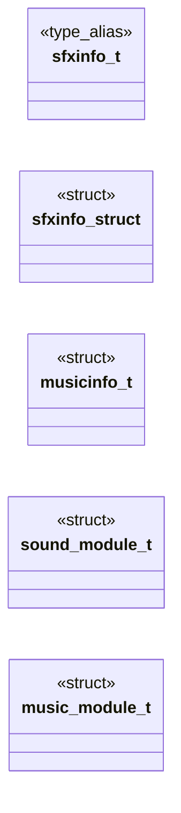

# `progs/doomgeneric/i_sound.h`

> Source: [progs/doomgeneric/i_sound.h:1](../../progs/doomgeneric/i_sound.h#L1) | language `h` | coverage 12.0% | [API index](../index.md)

Copyright(C) 1993-1996 Id Software, Inc.

Copyright(C) 2005-2014 Simon Howard  This program is free software; you can redistribute it and/or modify it under the terms of the GNU General Public License as published by the Free Software Foundation; either version 2 of the License, or (at your option) any later version.  This program is distributed in the hope that it will be useful, but WITHOUT ANY WARRANTY; without even the implied warranty of MERCHANTABILITY or FITNESS FOR A PARTICULAR PURPOSE.  See the GNU General Public License for more details.  DESCRIPTION: The not so system specific sound interface.        SoundFX struct.

## Contents

- **Structs:** [`sfxinfo_struct`](#sfxinfo_struct), [`musicinfo_t`](#musicinfo_t), [`sound_module_t`](#sound_module_t), [`music_module_t`](#music_module_t)
- **Type Aliases:** [`sfxinfo_t`](#sfxinfo_t)
- **Functions:** [`I_InitSound`](#i_initsound), [`I_ShutdownSound`](#i_shutdownsound), [`I_GetSfxLumpNum`](#i_getsfxlumpnum), [`I_UpdateSound`](#i_updatesound), [`I_UpdateSoundParams`](#i_updatesoundparams), [`I_StartSound`](#i_startsound), [`I_StopSound`](#i_stopsound), [`I_PrecacheSounds`](#i_precachesounds), [`I_InitMusic`](#i_initmusic), [`I_ShutdownMusic`](#i_shutdownmusic), [`I_SetMusicVolume`](#i_setmusicvolume), [`I_PauseSong`](#i_pausesong), [`I_ResumeSong`](#i_resumesong), [`I_RegisterSong`](#i_registersong), [`I_UnRegisterSong`](#i_unregistersong), [`I_PlaySong`](#i_playsong), [`I_StopSong`](#i_stopsong), [`I_BindSoundVariables`](#i_bindsoundvariables)
- **Macros:** [`__I_SOUND__`](#__i_sound__)
- **Variables:** [`snd_sfxdevice`](#snd_sfxdevice), [`snd_musicdevice`](#snd_musicdevice), [`snd_samplerate`](#snd_samplerate), [`snd_cachesize`](#snd_cachesize), [`snd_maxslicetime_ms`](#snd_maxslicetime_ms), [`snd_musiccmd`](#snd_musiccmd)

## Type Diagram



## Structs

<a id="sfxinfo_struct"></a>

### `sfxinfo_struct`

`struct` | [progs/doomgeneric/i_sound.h:31](../../progs/doomgeneric/i_sound.h#L31)

```c
struct sfxinfo_struct
```

---

<a id="musicinfo_t"></a>

### `musicinfo_t`

`struct` | [progs/doomgeneric/i_sound.h:72](../../progs/doomgeneric/i_sound.h#L72)

```c
typedef struct
```

MusicInfo struct.

---

<a id="sound_module_t"></a>

### `sound_module_t`

`struct` | [progs/doomgeneric/i_sound.h:105](../../progs/doomgeneric/i_sound.h#L105)

```c
typedef struct
```

---

<a id="music_module_t"></a>

### `music_module_t`

`struct` | [progs/doomgeneric/i_sound.h:164](../../progs/doomgeneric/i_sound.h#L164)

```c
typedef struct
```

---

## Type Aliases

<a id="sfxinfo_t"></a>

### `sfxinfo_t`

`type_alias` | [progs/doomgeneric/i_sound.h:29](../../progs/doomgeneric/i_sound.h#L29)

```c
typedef struct sfxinfo_struct sfxinfo_t;
```

SoundFX struct.

---

## Functions

<a id="i_initsound"></a>

### `I_InitSound`

`function` | [progs/doomgeneric/i_sound.h:152](../../progs/doomgeneric/i_sound.h#L152)

```c
void I_InitSound(boolean use_sfx_prefix);
```

**Parameters**

| Name | Type | Default | Description |
|---|---|---|---|
| `use_sfx_prefix` | `boolean` |  |  |

---

<a id="i_shutdownsound"></a>

### `I_ShutdownSound`

`function` | [progs/doomgeneric/i_sound.h:153](../../progs/doomgeneric/i_sound.h#L153)

```c
void I_ShutdownSound(void);
```

*Called by:* [`S_Shutdown`](progs.doomgeneric.s_sound.c.md#s_shutdown)

---

<a id="i_getsfxlumpnum"></a>

### `I_GetSfxLumpNum`

`function` | [progs/doomgeneric/i_sound.h:154](../../progs/doomgeneric/i_sound.h#L154)

```c
int I_GetSfxLumpNum(sfxinfo_t *sfxinfo);
```

**Parameters**

| Name | Type | Default | Description |
|---|---|---|---|
| `sfxinfo` | `sfxinfo_t *` |  |  |

**Returns:** `int`

*Called by:* [`S_StartSound`](progs.doomgeneric.s_sound.c.md#s_startsound)

---

<a id="i_updatesound"></a>

### `I_UpdateSound`

`function` | [progs/doomgeneric/i_sound.h:155](../../progs/doomgeneric/i_sound.h#L155)

```c
void I_UpdateSound(void);
```

*Called by:* [`S_UpdateSounds`](progs.doomgeneric.s_sound.c.md#s_updatesounds)

---

<a id="i_updatesoundparams"></a>

### `I_UpdateSoundParams`

`function` | [progs/doomgeneric/i_sound.h:156](../../progs/doomgeneric/i_sound.h#L156)

```c
void I_UpdateSoundParams(int channel, int vol, int sep);
```

**Parameters**

| Name | Type | Default | Description |
|---|---|---|---|
| `channel` | `int` |  |  |
| `vol` | `int` |  |  |
| `sep` | `int` |  |  |

*Called by:* [`S_UpdateSounds`](progs.doomgeneric.s_sound.c.md#s_updatesounds)

---

<a id="i_startsound"></a>

### `I_StartSound`

`function` | [progs/doomgeneric/i_sound.h:157](../../progs/doomgeneric/i_sound.h#L157)

```c
int I_StartSound(sfxinfo_t *sfxinfo, int channel, int vol, int sep);
```

**Parameters**

| Name | Type | Default | Description |
|---|---|---|---|
| `sfxinfo` | `sfxinfo_t *` |  |  |
| `channel` | `int` |  |  |
| `vol` | `int` |  |  |
| `sep` | `int` |  |  |

**Returns:** `int`

*Called by:* [`S_StartSound`](progs.doomgeneric.s_sound.c.md#s_startsound)

---

<a id="i_stopsound"></a>

### `I_StopSound`

`function` | [progs/doomgeneric/i_sound.h:158](../../progs/doomgeneric/i_sound.h#L158)

```c
void I_StopSound(int channel);
```

**Parameters**

| Name | Type | Default | Description |
|---|---|---|---|
| `channel` | `int` |  |  |

---

<a id="i_precachesounds"></a>

### `I_PrecacheSounds`

`function` | [progs/doomgeneric/i_sound.h:160](../../progs/doomgeneric/i_sound.h#L160)

```c
void I_PrecacheSounds(sfxinfo_t *sounds, int num_sounds);
```

**Parameters**

| Name | Type | Default | Description |
|---|---|---|---|
| `sounds` | `sfxinfo_t *` |  |  |
| `num_sounds` | `int` |  |  |

*Called by:* [`S_Init`](progs.doomgeneric.s_sound.c.md#s_init)

---

<a id="i_initmusic"></a>

### `I_InitMusic`

`function` | [progs/doomgeneric/i_sound.h:217](../../progs/doomgeneric/i_sound.h#L217)

```c
void I_InitMusic(void);
```

---

<a id="i_shutdownmusic"></a>

### `I_ShutdownMusic`

`function` | [progs/doomgeneric/i_sound.h:218](../../progs/doomgeneric/i_sound.h#L218)

```c
void I_ShutdownMusic(void);
```

*Called by:* [`S_Shutdown`](progs.doomgeneric.s_sound.c.md#s_shutdown)

---

<a id="i_setmusicvolume"></a>

### `I_SetMusicVolume`

`function` | [progs/doomgeneric/i_sound.h:219](../../progs/doomgeneric/i_sound.h#L219)

```c
void I_SetMusicVolume(int volume);
```

**Parameters**

| Name | Type | Default | Description |
|---|---|---|---|
| `volume` | `int` |  |  |

*Called by:* [`S_SetMusicVolume`](progs.doomgeneric.s_sound.c.md#s_setmusicvolume)

---

<a id="i_pausesong"></a>

### `I_PauseSong`

`function` | [progs/doomgeneric/i_sound.h:220](../../progs/doomgeneric/i_sound.h#L220)

```c
void I_PauseSong(void);
```

*Called by:* [`S_PauseSound`](progs.doomgeneric.s_sound.c.md#s_pausesound)

---

<a id="i_resumesong"></a>

### `I_ResumeSong`

`function` | [progs/doomgeneric/i_sound.h:221](../../progs/doomgeneric/i_sound.h#L221)

```c
void I_ResumeSong(void);
```

*Called by:* [`S_ResumeSound`](progs.doomgeneric.s_sound.c.md#s_resumesound), [`S_StopMusic`](progs.doomgeneric.s_sound.c.md#s_stopmusic)

---

<a id="i_registersong"></a>

### `I_RegisterSong`

`function` | [progs/doomgeneric/i_sound.h:222](../../progs/doomgeneric/i_sound.h#L222)

```c
void *I_RegisterSong(void *data, int len);
```

**Parameters**

| Name | Type | Default | Description |
|---|---|---|---|
| `data` | `void *` |  |  |
| `len` | `int` |  |  |

**Returns:** `void *`

*Called by:* [`S_ChangeMusic`](progs.doomgeneric.s_sound.c.md#s_changemusic)

---

<a id="i_unregistersong"></a>

### `I_UnRegisterSong`

`function` | [progs/doomgeneric/i_sound.h:223](../../progs/doomgeneric/i_sound.h#L223)

```c
void I_UnRegisterSong(void *handle);
```

**Parameters**

| Name | Type | Default | Description |
|---|---|---|---|
| `handle` | `void *` |  |  |

*Called by:* [`S_StopMusic`](progs.doomgeneric.s_sound.c.md#s_stopmusic)

---

<a id="i_playsong"></a>

### `I_PlaySong`

`function` | [progs/doomgeneric/i_sound.h:224](../../progs/doomgeneric/i_sound.h#L224)

```c
void I_PlaySong(void *handle, boolean looping);
```

**Parameters**

| Name | Type | Default | Description |
|---|---|---|---|
| `handle` | `void *` |  |  |
| `looping` | `boolean` |  |  |

*Called by:* [`S_ChangeMusic`](progs.doomgeneric.s_sound.c.md#s_changemusic)

---

<a id="i_stopsong"></a>

### `I_StopSong`

`function` | [progs/doomgeneric/i_sound.h:225](../../progs/doomgeneric/i_sound.h#L225)

```c
void I_StopSong(void);
```

*Called by:* [`S_StopMusic`](progs.doomgeneric.s_sound.c.md#s_stopmusic)

---

<a id="i_bindsoundvariables"></a>

### `I_BindSoundVariables`

`function` | [progs/doomgeneric/i_sound.h:235](../../progs/doomgeneric/i_sound.h#L235)

```c
void I_BindSoundVariables(void);
```

---

## Macros

<a id="__i_sound__"></a>

### `__I_SOUND__`

`macro` | [progs/doomgeneric/i_sound.h:21](../../progs/doomgeneric/i_sound.h#L21)

```c
#define __I_SOUND__
```

---

## Variables

<a id="snd_sfxdevice"></a>

### `snd_sfxdevice`

`variable` `extern` | [progs/doomgeneric/i_sound.h:228](../../progs/doomgeneric/i_sound.h#L228)

```c
extern int snd_sfxdevice;
```

---

<a id="snd_musicdevice"></a>

### `snd_musicdevice`

`variable` `extern` | [progs/doomgeneric/i_sound.h:229](../../progs/doomgeneric/i_sound.h#L229)

```c
extern int snd_musicdevice;
```

---

<a id="snd_samplerate"></a>

### `snd_samplerate`

`variable` `extern` | [progs/doomgeneric/i_sound.h:230](../../progs/doomgeneric/i_sound.h#L230)

```c
extern int snd_samplerate;
```

---

<a id="snd_cachesize"></a>

### `snd_cachesize`

`variable` `extern` | [progs/doomgeneric/i_sound.h:231](../../progs/doomgeneric/i_sound.h#L231)

```c
extern int snd_cachesize;
```

---

<a id="snd_maxslicetime_ms"></a>

### `snd_maxslicetime_ms`

`variable` `extern` | [progs/doomgeneric/i_sound.h:232](../../progs/doomgeneric/i_sound.h#L232)

```c
extern int snd_maxslicetime_ms;
```

---

<a id="snd_musiccmd"></a>

### `snd_musiccmd`

`variable` `extern` | [progs/doomgeneric/i_sound.h:233](../../progs/doomgeneric/i_sound.h#L233)

```c
extern char *snd_musiccmd;
```

---
