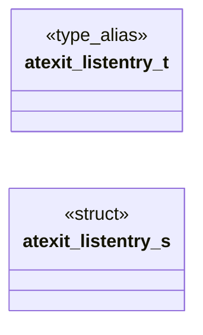
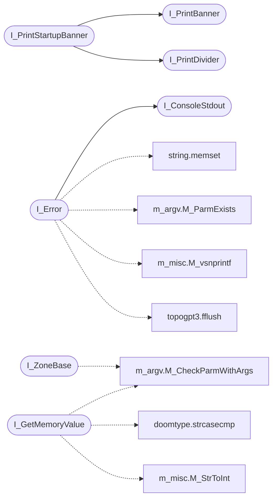

# `progs/doomgeneric/i_system.c`

> Source: [progs/doomgeneric/i_system.c:1](../../progs/doomgeneric/i_system.c#L1) | language `c` | coverage 27.8% | [API index](../index.md)

Copyright(C) 1993-1996 Id Software, Inc.

Copyright(C) 2005-2014 Simon Howard  This program is free software; you can redistribute it and/or modify it under the terms of the GNU General Public License as published by the Free Software Foundation; either version 2 of the License, or (at your option) any later version.  This program is distributed in the hope that it will be useful, but WITHOUT ANY WARRANTY; without even the implied warranty of MERCHANTABILITY or FITNESS FOR A PARTICULAR PURPOSE.  See the GNU General Public License for more details.  DESCRIPTION:

## Contents

- **Structs:** [`atexit_listentry_s`](#atexit_listentry_s)
- **Type Aliases:** [`atexit_listentry_t`](#atexit_listentry_t)
- **Functions:** [`I_AtExit`](#i_atexit), [`I_Tactile`](#i_tactile), [`I_ZoneBase`](#i_zonebase), [`I_PrintBanner`](#i_printbanner), [`I_PrintDivider`](#i_printdivider), [`I_PrintStartupBanner`](#i_printstartupbanner), [`I_ConsoleStdout`](#i_consolestdout), [`I_Quit`](#i_quit), [`I_Error`](#i_error), [`I_GetMemoryValue`](#i_getmemoryvalue)
- **Macros:** [`WIN32_LEAN_AND_MEAN`](#win32_lean_and_mean), [`DEFAULT_RAM`](#default_ram), [`MIN_RAM`](#min_ram), [`ZENITY_BINARY`](#zenity_binary), [`DOS_MEM_DUMP_SIZE`](#dos_mem_dump_size)

## Type Diagram



## Call Graph

Solid arrows stay in this module, dashed arrows leave it.



## Structs

<a id="atexit_listentry_s"></a>

### `atexit_listentry_s`

`struct` | [progs/doomgeneric/i_system.c:64](../../progs/doomgeneric/i_system.c#L64)

```c
struct atexit_listentry_s
```

---

## Type Aliases

<a id="atexit_listentry_t"></a>

### `atexit_listentry_t`

`type_alias` | [progs/doomgeneric/i_system.c:60](../../progs/doomgeneric/i_system.c#L60)

```c
typedef struct atexit_listentry_s atexit_listentry_t;
```

MiB

---

## Functions

<a id="i_atexit"></a>

### `I_AtExit`

`function` | [progs/doomgeneric/i_system.c:73](../../progs/doomgeneric/i_system.c#L73)

```c
void I_AtExit(atexit_func_t func, boolean run_on_error)
```

**Parameters**

| Name | Type | Default | Description |
|---|---|---|---|
| `func` | `atexit_func_t` |  |  |
| `run_on_error` | `boolean` |  |  |

---

<a id="i_tactile"></a>

### `I_Tactile`

`function` | [progs/doomgeneric/i_system.c:87](../../progs/doomgeneric/i_system.c#L87)

```c
void I_Tactile(int on, int off, int total)
```

**Parameters**

| Name | Type | Default | Description |
|---|---|---|---|
| `on` | `int` |  |  |
| `off` | `int` |  |  |
| `total` | `int` |  |  |

---

<a id="i_zonebase"></a>

### `I_ZoneBase`

`function` | [progs/doomgeneric/i_system.c:133](../../progs/doomgeneric/i_system.c#L133)

```c
byte *I_ZoneBase (int *size)
```

Called by startup code to get the ammount of memory to malloc for the zone management.

**Parameters**

| Name | Type | Default | Description |
|---|---|---|---|
| `size` | `int *` |  |  |

**Returns:** `byte *`

> **Inherited:** Documentation from [`I_ZoneBase`](#i_zonebase) (progs/doomgeneric/i_system.h:35).

*Calls:* [`M_CheckParmWithArgs`](progs.doomgeneric.m_argv.h.md#m_checkparmwithargs)

---

<a id="i_printbanner"></a>

### `I_PrintBanner`

`function` | [progs/doomgeneric/i_system.c:166](../../progs/doomgeneric/i_system.c#L166)

```c
void I_PrintBanner(char *msg)
```

**Parameters**

| Name | Type | Default | Description |
|---|---|---|---|
| `msg` | `char *` |  |  |

*Called by:* [`I_PrintStartupBanner`](#i_printstartupbanner)

---

<a id="i_printdivider"></a>

### `I_PrintDivider`

`function` | [progs/doomgeneric/i_system.c:177](../../progs/doomgeneric/i_system.c#L177)

```c
void I_PrintDivider(void)
```

*Called by:* [`I_PrintStartupBanner`](#i_printstartupbanner)

---

<a id="i_printstartupbanner"></a>

### `I_PrintStartupBanner`

`function` | [progs/doomgeneric/i_system.c:189](../../progs/doomgeneric/i_system.c#L189)

```c
void I_PrintStartupBanner(char *gamedescription)
```

**Parameters**

| Name | Type | Default | Description |
|---|---|---|---|
| `gamedescription` | `char *` |  |  |

*Calls:* [`I_PrintBanner`](#i_printbanner), [`I_PrintDivider`](#i_printdivider)

---

<a id="i_consolestdout"></a>

### `I_ConsoleStdout`

`function` | [progs/doomgeneric/i_system.c:210](../../progs/doomgeneric/i_system.c#L210)

```c
boolean I_ConsoleStdout(void)
```

**Returns:** `boolean`

*Called by:* [`I_Error`](#i_error), [`R_InitTextures`](progs.doomgeneric.r_data.c.md#r_inittextures)

---

<a id="i_quit"></a>

### `I_Quit`

`function` | [progs/doomgeneric/i_system.c:246](../../progs/doomgeneric/i_system.c#L246)

```c
void I_Quit (void)
```

Called by M_Responder when quit is selected.

Clean exit, displays sell blurb.

> **Inherited:** Documentation from [`I_Quit`](#i_quit) (progs/doomgeneric/i_system.h:53).

---

<a id="i_error"></a>

### `I_Error`

`function` | [progs/doomgeneric/i_system.c:359](../../progs/doomgeneric/i_system.c#L359)

```c
void I_Error (char *error, ...)
```

**Parameters**

| Name | Type | Default | Description |
|---|---|---|---|
| `error` | `char *` |  |  |
| `...` |  |  |  |

*Calls:* [`memset`](kernel.string.c.md#memset), [`I_ConsoleStdout`](#i_consolestdout), [`M_ParmExists`](progs.doomgeneric.m_argv.c.md#m_parmexists), [`M_vsnprintf`](progs.doomgeneric.m_misc.h.md#m_vsnprintf), [`fflush`](progs.topogpt3.topogpt3.c.md#fflush)

---

<a id="i_getmemoryvalue"></a>

### `I_GetMemoryValue`

`function` | [progs/doomgeneric/i_system.c:502](../../progs/doomgeneric/i_system.c#L502)

```c
boolean I_GetMemoryValue(unsigned int offset, void *value, int size)
```

**Parameters**

| Name | Type | Default | Description |
|---|---|---|---|
| `offset` | `unsigned int` |  |  |
| `value` | `void *` |  |  |
| `size` | `int` |  |  |

**Returns:** `boolean`

*Calls:* [`strcasecmp`](progs.doomgeneric.doomtype.h.md#strcasecmp), [`M_CheckParmWithArgs`](progs.doomgeneric.m_argv.h.md#m_checkparmwithargs), [`M_StrToInt`](progs.doomgeneric.m_misc.c.md#m_strtoint)

*Called by:* [`GetSectorAtNullAddress`](progs.doomgeneric.p_setup.c.md#getsectoratnulladdress)

---

## Macros

<a id="win32_lean_and_mean"></a>

### `WIN32_LEAN_AND_MEAN`

`macro` | [progs/doomgeneric/i_system.c:27](../../progs/doomgeneric/i_system.c#L27)

```c
#define WIN32_LEAN_AND_MEAN
```

---

<a id="default_ram"></a>

### `DEFAULT_RAM`

`macro` | [progs/doomgeneric/i_system.c:58](../../progs/doomgeneric/i_system.c#L58)

```c
#define DEFAULT_RAM
```

---

<a id="min_ram"></a>

### `MIN_RAM`

`macro` | [progs/doomgeneric/i_system.c:59](../../progs/doomgeneric/i_system.c#L59)

```c
#define MIN_RAM
```

MiB

---

<a id="zenity_binary"></a>

### `ZENITY_BINARY`

`macro` | [progs/doomgeneric/i_system.c:268](../../progs/doomgeneric/i_system.c#L268)

```c
#define ZENITY_BINARY
```

---

<a id="dos_mem_dump_size"></a>

### `DOS_MEM_DUMP_SIZE`

`macro` | [progs/doomgeneric/i_system.c:490](../../progs/doomgeneric/i_system.c#L490)

```c
#define DOS_MEM_DUMP_SIZE
```

---
