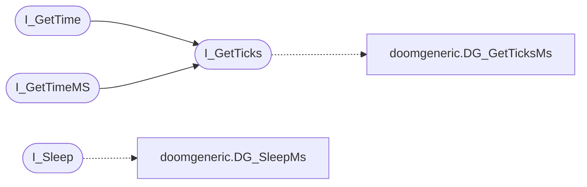

# `progs/doomgeneric/i_timer.c`

> Source: [progs/doomgeneric/i_timer.c:1](../../progs/doomgeneric/i_timer.c#L1) | language `c` | coverage 85.7% | [API index](../index.md)

Copyright(C) 1993-1996 Id Software, Inc.

Copyright(C) 2005-2014 Simon Howard  This program is free software; you can redistribute it and/or modify it under the terms of the GNU General Public License as published by the Free Software Foundation; either version 2 of the License, or (at your option) any later version.  This program is distributed in the hope that it will be useful, but WITHOUT ANY WARRANTY; without even the implied warranty of MERCHANTABILITY or FITNESS FOR A PARTICULAR PURPOSE.  See the GNU General Public License for more details.  DESCRIPTION: Timer functions.     #include <sys/time.h> #include <unistd.h>    I_GetTime

## Contents

- **Functions:** [`I_GetTicks`](#i_getticks), [`I_GetTime`](#i_gettime), [`I_GetTimeMS`](#i_gettimems), [`I_Sleep`](#i_sleep), [`I_WaitVBL`](#i_waitvbl), [`I_InitTimer`](#i_inittimer)

## Call Graph

Solid arrows stay in this module, dashed arrows leave it.



## Functions

<a id="i_getticks"></a>

### `I_GetTicks`

`function` | [progs/doomgeneric/i_timer.c:37](../../progs/doomgeneric/i_timer.c#L37)

```c
int I_GetTicks(void)
```

**Returns:** `int`

*Calls:* [`DG_GetTicksMs`](progs.doomgeneric.doomgeneric.h.md#dg_getticksms)

*Called by:* [`I_GetTime`](#i_gettime), [`I_GetTimeMS`](#i_gettimems)

---

<a id="i_gettime"></a>

### `I_GetTime`

`function` | [progs/doomgeneric/i_timer.c:42](../../progs/doomgeneric/i_timer.c#L42)

```c
int I_GetTime (void)
```

Called by D_DoomLoop, returns current time in tics.

**Returns:** `int`

> **Inherited:** Documentation from [`I_GetTime`](#i_gettime) (progs/doomgeneric/i_timer.h:27).

*Calls:* [`I_GetTicks`](#i_getticks)

---

<a id="i_gettimems"></a>

### `I_GetTimeMS`

`function` | [progs/doomgeneric/i_timer.c:61](../../progs/doomgeneric/i_timer.c#L61)

```c
int I_GetTimeMS(void)
```

returns current time in ms

**Returns:** `int`

> **Inherited:** Documentation from [`I_GetTimeMS`](#i_gettimems) (progs/doomgeneric/i_timer.h:30).

*Calls:* [`I_GetTicks`](#i_getticks)

---

<a id="i_sleep"></a>

### `I_Sleep`

`function` | [progs/doomgeneric/i_timer.c:75](../../progs/doomgeneric/i_timer.c#L75)

```c
void I_Sleep(int ms)
```

Pause for a specified number of ms

**Parameters**

| Name | Type | Default | Description |
|---|---|---|---|
| `ms` | `int` |  |  |

> **Inherited:** Documentation from [`I_Sleep`](#i_sleep) (progs/doomgeneric/i_timer.h:33).

*Calls:* [`DG_SleepMs`](progs.doomgeneric.doomgeneric.h.md#dg_sleepms)

---

<a id="i_waitvbl"></a>

### `I_WaitVBL`

`function` | [progs/doomgeneric/i_timer.c:83](../../progs/doomgeneric/i_timer.c#L83)

```c
void I_WaitVBL(int count)
```

Wait for vertical retrace or pause a bit.

**Parameters**

| Name | Type | Default | Description |
|---|---|---|---|
| `count` | `int` |  |  |

> **Inherited:** Documentation from [`I_WaitVBL`](#i_waitvbl) (progs/doomgeneric/i_timer.h:39).

---

<a id="i_inittimer"></a>

### `I_InitTimer`

`function` | [progs/doomgeneric/i_timer.c:89](../../progs/doomgeneric/i_timer.c#L89)

```c
void I_InitTimer(void)
```

Initialize timer

> **Inherited:** Documentation from [`I_InitTimer`](#i_inittimer) (progs/doomgeneric/i_timer.h:36).

---
