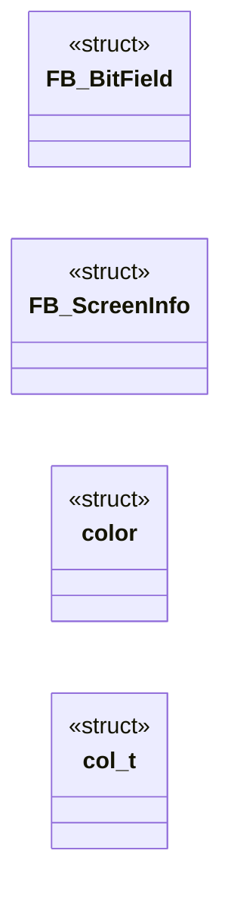
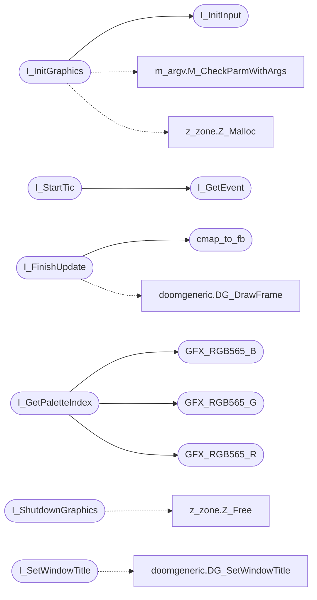

# `progs/doomgeneric/i_video.c`

> Source: [progs/doomgeneric/i_video.c:1](../../progs/doomgeneric/i_video.c#L1) | language `c` | coverage 16.1% | [API index](../index.md)

Emacs style mode select   -*- C++ -*- -----------------------------------------------------------------------------  $Id:$  Copyright (C) 1993-1996 by id Software, Inc.

This program is free software; you can redistribute it and/or modify it under the terms of the GNU General Public License as published by the Free Software Foundation; either version 2 of the License, or (at your option) any later version.  This program is distributed in the hope that it will be useful, but WITHOUT ANY WARRANTY; without even the implied warranty of MERCHANTABILITY or FITNESS FOR A PARTICULAR PURPOSE.  See the GNU General Public License for more details.  $Log:$  DESCRIPTION: DOOM graphics stuff for X11, UNIX.  -----------------------------------------------------------------------------

## Contents

- **Structs:** [`FB_BitField`](#fb_bitfield), [`FB_ScreenInfo`](#fb_screeninfo), [`color`](#color), [`col_t`](#col_t)
- **Functions:** [`I_GetEvent`](#i_getevent), [`cmap_to_rgb565`](#cmap_to_rgb565), [`cmap_to_fb`](#cmap_to_fb), [`I_InitGraphics`](#i_initgraphics), [`I_InitInput`](#i_initinput), [`I_ShutdownGraphics`](#i_shutdowngraphics), [`I_StartFrame`](#i_startframe), [`I_StartTic`](#i_starttic), [`I_UpdateNoBlit`](#i_updatenoblit), [`I_FinishUpdate`](#i_finishupdate), [`I_ReadScreen`](#i_readscreen), [`I_SetPalette`](#i_setpalette), [`I_GetPaletteIndex`](#i_getpaletteindex), [`I_BeginRead`](#i_beginread), [`I_EndRead`](#i_endread), [`I_SetWindowTitle`](#i_setwindowtitle), [`I_GraphicsCheckCommandLine`](#i_graphicscheckcommandline), [`I_SetGrabMouseCallback`](#i_setgrabmousecallback), [`I_EnableLoadingDisk`](#i_enableloadingdisk), [`I_BindVideoVariables`](#i_bindvideovariables), [`I_DisplayFPSDots`](#i_displayfpsdots), [`I_CheckIsScreensaver`](#i_checkisscreensaver)
- **Macros:** [`GFX_RGB565`](#gfx_rgb565), [`GFX_RGB565_R`](#gfx_rgb565_r), [`GFX_RGB565_G`](#gfx_rgb565_g), [`GFX_RGB565_B`](#gfx_rgb565_b)
- **Variables:** [`minios_palette_dirty`](#minios_palette_dirty)

## Type Diagram



## Call Graph

Solid arrows stay in this module, dashed arrows leave it.



## Structs

<a id="fb_bitfield"></a>

### `FB_BitField`

`struct` | [progs/doomgeneric/i_video.c:54](../../progs/doomgeneric/i_video.c#L54)

```c
struct FB_BitField
```

---

<a id="fb_screeninfo"></a>

### `FB_ScreenInfo`

`struct` | [progs/doomgeneric/i_video.c:60](../../progs/doomgeneric/i_video.c#L60)

```c
struct FB_ScreenInfo
```

---

<a id="color"></a>

### `color`

`struct` | [progs/doomgeneric/i_video.c:80](../../progs/doomgeneric/i_video.c#L80)

```c
struct color
```

---

<a id="col_t"></a>

### `col_t`

`struct` | [progs/doomgeneric/i_video.c:120](../../progs/doomgeneric/i_video.c#L120)

```c
typedef struct
```

---

## Functions

<a id="i_getevent"></a>

### `I_GetEvent`

`function` | [progs/doomgeneric/i_video.c:89](../../progs/doomgeneric/i_video.c#L89)

```c
void I_GetEvent(void);
```

*Called by:* [`I_StartTic`](#i_starttic)

---

<a id="cmap_to_rgb565"></a>

### `cmap_to_rgb565`

`function` | [progs/doomgeneric/i_video.c:131](../../progs/doomgeneric/i_video.c#L131)

```c
void cmap_to_rgb565(uint16_t * out, uint8_t * in, int in_pixels)
```

**Parameters**

| Name | Type | Default | Description |
|---|---|---|---|
| `out` | `uint16_t *` |  |  |
| `in` | `uint8_t *` |  |  |
| `in_pixels` | `int` |  |  |

---

<a id="cmap_to_fb"></a>

### `cmap_to_fb`

`function` | [progs/doomgeneric/i_video.c:152](../../progs/doomgeneric/i_video.c#L152)

```c
void cmap_to_fb(uint8_t * out, uint8_t * in, int in_pixels)
```

**Parameters**

| Name | Type | Default | Description |
|---|---|---|---|
| `out` | `uint8_t *` |  |  |
| `in` | `uint8_t *` |  |  |
| `in_pixels` | `int` |  |  |

*Called by:* [`I_FinishUpdate`](#i_finishupdate)

---

<a id="i_initgraphics"></a>

### `I_InitGraphics`

`function` | [progs/doomgeneric/i_video.c:179](../../progs/doomgeneric/i_video.c#L179)

```c
void I_InitGraphics (void)
```

Called by D_DoomMain, determines the hardware configuration and sets up the video mode

> **Inherited:** Documentation from [`I_InitGraphics`](#i_initgraphics) (progs/doomgeneric/i_video.h:97).

*Calls:* [`I_InitInput`](#i_initinput), [`M_CheckParmWithArgs`](progs.doomgeneric.m_argv.h.md#m_checkparmwithargs), [`Z_Malloc`](progs.doomgeneric.z_zone.h.md#z_malloc)

---

<a id="i_initinput"></a>

### `I_InitInput`

`function` `extern` | [progs/doomgeneric/i_video.c:228](../../progs/doomgeneric/i_video.c#L228)

```c
extern int I_InitInput(void);
```

**Returns:** `int`

*Called by:* [`I_InitGraphics`](#i_initgraphics)

---

<a id="i_shutdowngraphics"></a>

### `I_ShutdownGraphics`

`function` | [progs/doomgeneric/i_video.c:232](../../progs/doomgeneric/i_video.c#L232)

```c
void I_ShutdownGraphics (void)
```

*Calls:* [`Z_Free`](progs.doomgeneric.z_zone.h.md#z_free)

---

<a id="i_startframe"></a>

### `I_StartFrame`

`function` | [progs/doomgeneric/i_video.c:237](../../progs/doomgeneric/i_video.c#L237)

```c
void I_StartFrame (void)
```

---

<a id="i_starttic"></a>

### `I_StartTic`

`function` | [progs/doomgeneric/i_video.c:242](../../progs/doomgeneric/i_video.c#L242)

```c
void I_StartTic (void)
```

*Calls:* [`I_GetEvent`](#i_getevent)

---

<a id="i_updatenoblit"></a>

### `I_UpdateNoBlit`

`function` | [progs/doomgeneric/i_video.c:247](../../progs/doomgeneric/i_video.c#L247)

```c
void I_UpdateNoBlit (void)
```

---

<a id="i_finishupdate"></a>

### `I_FinishUpdate`

`function` | [progs/doomgeneric/i_video.c:255](../../progs/doomgeneric/i_video.c#L255)

```c
void I_FinishUpdate (void)
```

*Calls:* [`DG_DrawFrame`](progs.doomgeneric.doomgeneric.h.md#dg_drawframe), [`cmap_to_fb`](#cmap_to_fb)

---

<a id="i_readscreen"></a>

### `I_ReadScreen`

`function` | [progs/doomgeneric/i_video.c:302](../../progs/doomgeneric/i_video.c#L302)

```c
void I_ReadScreen (byte* scr)
```

I_ReadScreen

**Parameters**

| Name | Type | Default | Description |
|---|---|---|---|
| `scr` | `byte*` |  |  |

---

<a id="i_setpalette"></a>

### `I_SetPalette`

`function` | [progs/doomgeneric/i_video.c:315](../../progs/doomgeneric/i_video.c#L315)

```c
void I_SetPalette (byte* palette)
```

Takes full 8 bit values.

**Parameters**

| Name | Type | Default | Description |
|---|---|---|---|
| `palette` | `byte*` |  |  |

> **Inherited:** Documentation from [`I_SetPalette`](#i_setpalette) (progs/doomgeneric/i_video.h:104).

---

<a id="i_getpaletteindex"></a>

### `I_GetPaletteIndex`

`function` | [progs/doomgeneric/i_video.c:333](../../progs/doomgeneric/i_video.c#L333)

```c
int I_GetPaletteIndex (int r, int g, int b)
```

**Parameters**

| Name | Type | Default | Description |
|---|---|---|---|
| `r` | `int` |  |  |
| `g` | `int` |  |  |
| `b` | `int` |  |  |

**Returns:** `int`

*Calls:* [`GFX_RGB565_B`](#gfx_rgb565_b), [`GFX_RGB565_G`](#gfx_rgb565_g), [`GFX_RGB565_R`](#gfx_rgb565_r)

---

<a id="i_beginread"></a>

### `I_BeginRead`

`function` | [progs/doomgeneric/i_video.c:369](../../progs/doomgeneric/i_video.c#L369)

```c
void I_BeginRead (void)
```

---

<a id="i_endread"></a>

### `I_EndRead`

`function` | [progs/doomgeneric/i_video.c:373](../../progs/doomgeneric/i_video.c#L373)

```c
void I_EndRead (void)
```

---

<a id="i_setwindowtitle"></a>

### `I_SetWindowTitle`

`function` | [progs/doomgeneric/i_video.c:377](../../progs/doomgeneric/i_video.c#L377)

```c
void I_SetWindowTitle (char *title)
```

**Parameters**

| Name | Type | Default | Description |
|---|---|---|---|
| `title` | `char *` |  |  |

*Calls:* [`DG_SetWindowTitle`](progs.doomgeneric.doomgeneric.h.md#dg_setwindowtitle)

---

<a id="i_graphicscheckcommandline"></a>

### `I_GraphicsCheckCommandLine`

`function` | [progs/doomgeneric/i_video.c:382](../../progs/doomgeneric/i_video.c#L382)

```c
void I_GraphicsCheckCommandLine (void)
```

---

<a id="i_setgrabmousecallback"></a>

### `I_SetGrabMouseCallback`

`function` | [progs/doomgeneric/i_video.c:386](../../progs/doomgeneric/i_video.c#L386)

```c
void I_SetGrabMouseCallback (grabmouse_callback_t func)
```

**Parameters**

| Name | Type | Default | Description |
|---|---|---|---|
| `func` | `grabmouse_callback_t` |  |  |

---

<a id="i_enableloadingdisk"></a>

### `I_EnableLoadingDisk`

`function` | [progs/doomgeneric/i_video.c:390](../../progs/doomgeneric/i_video.c#L390)

```c
void I_EnableLoadingDisk(void)
```

---

<a id="i_bindvideovariables"></a>

### `I_BindVideoVariables`

`function` | [progs/doomgeneric/i_video.c:394](../../progs/doomgeneric/i_video.c#L394)

```c
void I_BindVideoVariables (void)
```

---

<a id="i_displayfpsdots"></a>

### `I_DisplayFPSDots`

`function` | [progs/doomgeneric/i_video.c:398](../../progs/doomgeneric/i_video.c#L398)

```c
void I_DisplayFPSDots (boolean dots_on)
```

**Parameters**

| Name | Type | Default | Description |
|---|---|---|---|
| `dots_on` | `boolean` |  |  |

---

<a id="i_checkisscreensaver"></a>

### `I_CheckIsScreensaver`

`function` | [progs/doomgeneric/i_video.c:402](../../progs/doomgeneric/i_video.c#L402)

```c
void I_CheckIsScreensaver (void)
```

---

## Macros

<a id="gfx_rgb565"></a>

### `GFX_RGB565`

`macro` | [progs/doomgeneric/i_video.c:310](../../progs/doomgeneric/i_video.c#L310)

```c
#define GFX_RGB565(r, g, b)
```

I_SetPalette

---

<a id="gfx_rgb565_r"></a>

### `GFX_RGB565_R`

`macro` | [progs/doomgeneric/i_video.c:311](../../progs/doomgeneric/i_video.c#L311)

```c
#define GFX_RGB565_R(color)
```

*Called by:* [`I_GetPaletteIndex`](#i_getpaletteindex)

---

<a id="gfx_rgb565_g"></a>

### `GFX_RGB565_G`

`macro` | [progs/doomgeneric/i_video.c:312](../../progs/doomgeneric/i_video.c#L312)

```c
#define GFX_RGB565_G(color)
```

*Called by:* [`I_GetPaletteIndex`](#i_getpaletteindex)

---

<a id="gfx_rgb565_b"></a>

### `GFX_RGB565_B`

`macro` | [progs/doomgeneric/i_video.c:313](../../progs/doomgeneric/i_video.c#L313)

```c
#define GFX_RGB565_B(color)
```

*Called by:* [`I_GetPaletteIndex`](#i_getpaletteindex)

---

## Variables

<a id="minios_palette_dirty"></a>

### `minios_palette_dirty`

`variable` `extern` | [progs/doomgeneric/i_video.c:52](../../progs/doomgeneric/i_video.c#L52)

```c
extern volatile int minios_palette_dirty;
```

---
