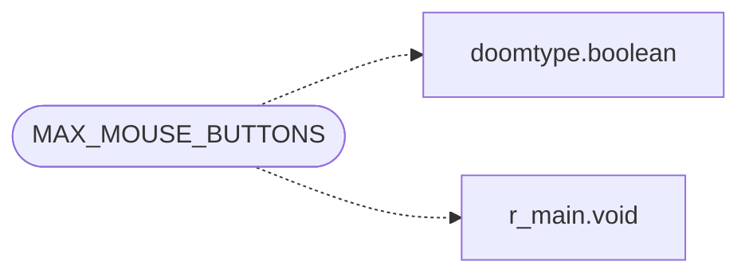

# `progs/doomgeneric/i_video.h`

> Source: [progs/doomgeneric/i_video.h:1](../../progs/doomgeneric/i_video.h#L1) | language `h` | coverage 11.1% | [API index](../index.md)

Copyright(C) 1993-1996 Id Software, Inc.

Copyright(C) 2005-2014 Simon Howard  This program is free software; you can redistribute it and/or modify it under the terms of the GNU General Public License as published by the Free Software Foundation; either version 2 of the License, or (at your option) any later version.  This program is distributed in the hope that it will be useful, but WITHOUT ANY WARRANTY; without even the implied warranty of MERCHANTABILITY or FITNESS FOR A PARTICULAR PURPOSE.  See the GNU General Public License for more details.  DESCRIPTION: System specific interface stuff.      Screen width and height.   Screen width used for "squash" scale functions

## Contents

- **Structs:** [`screen_mode_t`](#screen_mode_t)
- **Functions:** [`I_InitGraphics`](#i_initgraphics), [`I_GraphicsCheckCommandLine`](#i_graphicscheckcommandline), [`I_ShutdownGraphics`](#i_shutdowngraphics), [`I_SetPalette`](#i_setpalette), [`I_GetPaletteIndex`](#i_getpaletteindex), [`I_UpdateNoBlit`](#i_updatenoblit), [`I_FinishUpdate`](#i_finishupdate), [`I_ReadScreen`](#i_readscreen), [`I_BeginRead`](#i_beginread), [`I_SetWindowTitle`](#i_setwindowtitle), [`I_CheckIsScreensaver`](#i_checkisscreensaver), [`I_SetGrabMouseCallback`](#i_setgrabmousecallback), [`I_DisplayFPSDots`](#i_displayfpsdots), [`I_BindVideoVariables`](#i_bindvideovariables), [`I_InitWindowTitle`](#i_initwindowtitle), [`I_InitWindowIcon`](#i_initwindowicon), [`I_StartFrame`](#i_startframe), [`I_StartTic`](#i_starttic), [`I_EnableLoadingDisk`](#i_enableloadingdisk)
- **Macros:** [`__I_VIDEO__`](#__i_video__), [`SCREENWIDTH`](#screenwidth), [`SCREENHEIGHT`](#screenheight), [`SCREENWIDTH_4_3`](#screenwidth_4_3), [`SCREENHEIGHT_4_3`](#screenheight_4_3), [`MAX_MOUSE_BUTTONS`](#max_mouse_buttons)
- **Variables:** [`video_driver`](#video_driver), [`screenvisible`](#screenvisible), [`mouse_acceleration`](#mouse_acceleration), [`mouse_threshold`](#mouse_threshold), [`vanilla_keyboard_mapping`](#vanilla_keyboard_mapping), [`screensaver_mode`](#screensaver_mode), [`usegamma`](#usegamma), [`I_VideoBuffer`](#i_videobuffer), [`screen_width`](#screen_width), [`screen_height`](#screen_height), [`screen_bpp`](#screen_bpp), [`fullscreen`](#fullscreen), [`aspect_ratio_correct`](#aspect_ratio_correct), [`show_diskicon`](#show_diskicon), [`diskicon_readbytes`](#diskicon_readbytes)

## Call Graph

Solid arrows stay in this module, dashed arrows leave it.



## Structs

<a id="screen_mode_t"></a>

### `screen_mode_t`

`struct` | [progs/doomgeneric/i_video.h:40](../../progs/doomgeneric/i_video.h#L40)

```c
typedef struct
```

---

## Functions

<a id="i_initgraphics"></a>

### `I_InitGraphics`

`function` | [progs/doomgeneric/i_video.h:97](../../progs/doomgeneric/i_video.h#L97)

```c
void I_InitGraphics (void);
```

Called by D_DoomMain, determines the hardware configuration and sets up the video mode

*Called by:* [`D_DoomLoop`](progs.doomgeneric.d_main.c.md#d_doomloop)

---

<a id="i_graphicscheckcommandline"></a>

### `I_GraphicsCheckCommandLine`

`function` | [progs/doomgeneric/i_video.h:99](../../progs/doomgeneric/i_video.h#L99)

```c
void I_GraphicsCheckCommandLine(void);
```

*Called by:* [`D_DoomLoop`](progs.doomgeneric.d_main.c.md#d_doomloop)

---

<a id="i_shutdowngraphics"></a>

### `I_ShutdownGraphics`

`function` | [progs/doomgeneric/i_video.h:101](../../progs/doomgeneric/i_video.h#L101)

```c
void I_ShutdownGraphics(void);
```

---

<a id="i_setpalette"></a>

### `I_SetPalette`

`function` | [progs/doomgeneric/i_video.h:104](../../progs/doomgeneric/i_video.h#L104)

```c
void I_SetPalette (byte* palette);
```

Takes full 8 bit values.

**Parameters**

| Name | Type | Default | Description |
|---|---|---|---|
| `palette` | `byte*` |  |  |

*Called by:* [`D_Display`](progs.doomgeneric.d_main.c.md#d_display), [`M_Responder`](progs.doomgeneric.m_menu.c.md#m_responder), [`ST_Stop`](progs.doomgeneric.st_stuff.c.md#st_stop), [`ST_doPaletteStuff`](progs.doomgeneric.st_stuff.c.md#st_dopalettestuff)

---

<a id="i_getpaletteindex"></a>

### `I_GetPaletteIndex`

`function` | [progs/doomgeneric/i_video.h:105](../../progs/doomgeneric/i_video.h#L105)

```c
int I_GetPaletteIndex(int r, int g, int b);
```

**Parameters**

| Name | Type | Default | Description |
|---|---|---|---|
| `r` | `int` |  |  |
| `g` | `int` |  |  |
| `b` | `int` |  |  |

**Returns:** `int`

*Called by:* [`V_DrawMouseSpeedBox`](progs.doomgeneric.v_video.c.md#v_drawmousespeedbox)

---

<a id="i_updatenoblit"></a>

### `I_UpdateNoBlit`

`function` | [progs/doomgeneric/i_video.h:107](../../progs/doomgeneric/i_video.h#L107)

```c
void I_UpdateNoBlit (void);
```

*Called by:* [`D_Display`](progs.doomgeneric.d_main.c.md#d_display)

---

<a id="i_finishupdate"></a>

### `I_FinishUpdate`

`function` | [progs/doomgeneric/i_video.h:108](../../progs/doomgeneric/i_video.h#L108)

```c
void I_FinishUpdate (void);
```

*Called by:* [`D_Display`](progs.doomgeneric.d_main.c.md#d_display)

---

<a id="i_readscreen"></a>

### `I_ReadScreen`

`function` | [progs/doomgeneric/i_video.h:110](../../progs/doomgeneric/i_video.h#L110)

```c
void I_ReadScreen (byte* scr);
```

**Parameters**

| Name | Type | Default | Description |
|---|---|---|---|
| `scr` | `byte*` |  |  |

*Called by:* [`wipe_EndScreen`](progs.doomgeneric.f_wipe.c.md#wipe_endscreen), [`wipe_StartScreen`](progs.doomgeneric.f_wipe.c.md#wipe_startscreen)

---

<a id="i_beginread"></a>

### `I_BeginRead`

`function` | [progs/doomgeneric/i_video.h:112](../../progs/doomgeneric/i_video.h#L112)

```c
void I_BeginRead (void);
```

*Called by:* [`W_ReadLump`](progs.doomgeneric.w_wad.c.md#w_readlump)

---

<a id="i_setwindowtitle"></a>

### `I_SetWindowTitle`

`function` | [progs/doomgeneric/i_video.h:114](../../progs/doomgeneric/i_video.h#L114)

```c
void I_SetWindowTitle(char *title);
```

**Parameters**

| Name | Type | Default | Description |
|---|---|---|---|
| `title` | `char *` |  |  |

---

<a id="i_checkisscreensaver"></a>

### `I_CheckIsScreensaver`

`function` | [progs/doomgeneric/i_video.h:116](../../progs/doomgeneric/i_video.h#L116)

```c
void I_CheckIsScreensaver(void);
```

*Called by:* [`D_DoomMain`](progs.doomgeneric.d_main.c.md#d_doommain)

---

<a id="i_setgrabmousecallback"></a>

### `I_SetGrabMouseCallback`

`function` | [progs/doomgeneric/i_video.h:117](../../progs/doomgeneric/i_video.h#L117)

```c
void I_SetGrabMouseCallback(grabmouse_callback_t func);
```

**Parameters**

| Name | Type | Default | Description |
|---|---|---|---|
| `func` | `grabmouse_callback_t` |  |  |

*Called by:* [`D_DoomLoop`](progs.doomgeneric.d_main.c.md#d_doomloop)

---

<a id="i_displayfpsdots"></a>

### `I_DisplayFPSDots`

`function` | [progs/doomgeneric/i_video.h:119](../../progs/doomgeneric/i_video.h#L119)

```c
void I_DisplayFPSDots(boolean dots_on);
```

**Parameters**

| Name | Type | Default | Description |
|---|---|---|---|
| `dots_on` | `boolean` |  |  |

*Called by:* [`D_DoomMain`](progs.doomgeneric.d_main.c.md#d_doommain)

---

<a id="i_bindvideovariables"></a>

### `I_BindVideoVariables`

`function` | [progs/doomgeneric/i_video.h:120](../../progs/doomgeneric/i_video.h#L120)

```c
void I_BindVideoVariables(void);
```

*Called by:* [`D_BindVariables`](progs.doomgeneric.d_main.c.md#d_bindvariables)

---

<a id="i_initwindowtitle"></a>

### `I_InitWindowTitle`

`function` | [progs/doomgeneric/i_video.h:122](../../progs/doomgeneric/i_video.h#L122)

```c
void I_InitWindowTitle(void);
```

*Called by:* [`I_Endoom`](progs.doomgeneric.i_endoom.c.md#i_endoom)

---

<a id="i_initwindowicon"></a>

### `I_InitWindowIcon`

`function` | [progs/doomgeneric/i_video.h:123](../../progs/doomgeneric/i_video.h#L123)

```c
void I_InitWindowIcon(void);
```

*Called by:* [`I_Endoom`](progs.doomgeneric.i_endoom.c.md#i_endoom)

---

<a id="i_startframe"></a>

### `I_StartFrame`

`function` | [progs/doomgeneric/i_video.h:128](../../progs/doomgeneric/i_video.h#L128)

```c
void I_StartFrame (void);
```

*Called by:* [`D_DoomLoop`](progs.doomgeneric.d_main.c.md#d_doomloop)

---

<a id="i_starttic"></a>

### `I_StartTic`

`function` | [progs/doomgeneric/i_video.h:133](../../progs/doomgeneric/i_video.h#L133)

```c
void I_StartTic (void);
```

---

<a id="i_enableloadingdisk"></a>

### `I_EnableLoadingDisk`

`function` | [progs/doomgeneric/i_video.h:137](../../progs/doomgeneric/i_video.h#L137)

```c
void I_EnableLoadingDisk(void);
```

*Called by:* [`D_DoomLoop`](progs.doomgeneric.d_main.c.md#d_doomloop)

---

## Macros

<a id="__i_video__"></a>

### `__I_VIDEO__`

`macro` | [progs/doomgeneric/i_video.h:21](../../progs/doomgeneric/i_video.h#L21)

```c
#define __I_VIDEO__
```

---

<a id="screenwidth"></a>

### `SCREENWIDTH`

`macro` | [progs/doomgeneric/i_video.h:27](../../progs/doomgeneric/i_video.h#L27)

```c
#define SCREENWIDTH
```

---

<a id="screenheight"></a>

### `SCREENHEIGHT`

`macro` | [progs/doomgeneric/i_video.h:28](../../progs/doomgeneric/i_video.h#L28)

```c
#define SCREENHEIGHT
```

---

<a id="screenwidth_4_3"></a>

### `SCREENWIDTH_4_3`

`macro` | [progs/doomgeneric/i_video.h:32](../../progs/doomgeneric/i_video.h#L32)

```c
#define SCREENWIDTH_4_3
```

---

<a id="screenheight_4_3"></a>

### `SCREENHEIGHT_4_3`

`macro` | [progs/doomgeneric/i_video.h:36](../../progs/doomgeneric/i_video.h#L36)

```c
#define SCREENHEIGHT_4_3
```

---

<a id="max_mouse_buttons"></a>

### `MAX_MOUSE_BUTTONS`

`macro` | [progs/doomgeneric/i_video.h:38](../../progs/doomgeneric/i_video.h#L38)

```c
#define MAX_MOUSE_BUTTONS
```

*Calls:* [`boolean`](progs.doomgeneric.doomtype.h.md#boolean), [`void`](progs.doomgeneric.r_main.h.md#void)

---

## Variables

<a id="video_driver"></a>

### `video_driver`

`variable` `extern` | [progs/doomgeneric/i_video.h:139](../../progs/doomgeneric/i_video.h#L139)

```c
extern char *video_driver;
```

---

<a id="screenvisible"></a>

### `screenvisible`

`variable` `extern` | [progs/doomgeneric/i_video.h:140](../../progs/doomgeneric/i_video.h#L140)

```c
extern boolean screenvisible;
```

---

<a id="mouse_acceleration"></a>

### `mouse_acceleration`

`variable` `extern` | [progs/doomgeneric/i_video.h:142](../../progs/doomgeneric/i_video.h#L142)

```c
extern float mouse_acceleration;
```

---

<a id="mouse_threshold"></a>

### `mouse_threshold`

`variable` `extern` | [progs/doomgeneric/i_video.h:143](../../progs/doomgeneric/i_video.h#L143)

```c
extern int mouse_threshold;
```

---

<a id="vanilla_keyboard_mapping"></a>

### `vanilla_keyboard_mapping`

`variable` `extern` | [progs/doomgeneric/i_video.h:144](../../progs/doomgeneric/i_video.h#L144)

```c
extern int vanilla_keyboard_mapping;
```

---

<a id="screensaver_mode"></a>

### `screensaver_mode`

`variable` `extern` | [progs/doomgeneric/i_video.h:145](../../progs/doomgeneric/i_video.h#L145)

```c
extern boolean screensaver_mode;
```

---

<a id="usegamma"></a>

### `usegamma`

`variable` `extern` | [progs/doomgeneric/i_video.h:146](../../progs/doomgeneric/i_video.h#L146)

```c
extern int usegamma;
```

---

<a id="i_videobuffer"></a>

### `I_VideoBuffer`

`variable` `extern` | [progs/doomgeneric/i_video.h:147](../../progs/doomgeneric/i_video.h#L147)

```c
extern byte *I_VideoBuffer;
```

---

<a id="screen_width"></a>

### `screen_width`

`variable` `extern` | [progs/doomgeneric/i_video.h:149](../../progs/doomgeneric/i_video.h#L149)

```c
extern int screen_width;
```

---

<a id="screen_height"></a>

### `screen_height`

`variable` `extern` | [progs/doomgeneric/i_video.h:150](../../progs/doomgeneric/i_video.h#L150)

```c
extern int screen_height;
```

---

<a id="screen_bpp"></a>

### `screen_bpp`

`variable` `extern` | [progs/doomgeneric/i_video.h:151](../../progs/doomgeneric/i_video.h#L151)

```c
extern int screen_bpp;
```

---

<a id="fullscreen"></a>

### `fullscreen`

`variable` `extern` | [progs/doomgeneric/i_video.h:152](../../progs/doomgeneric/i_video.h#L152)

```c
extern int fullscreen;
```

---

<a id="aspect_ratio_correct"></a>

### `aspect_ratio_correct`

`variable` `extern` | [progs/doomgeneric/i_video.h:153](../../progs/doomgeneric/i_video.h#L153)

```c
extern int aspect_ratio_correct;
```

---

<a id="show_diskicon"></a>

### `show_diskicon`

`variable` `extern` | [progs/doomgeneric/i_video.h:155](../../progs/doomgeneric/i_video.h#L155)

```c
extern int show_diskicon;
```

---

<a id="diskicon_readbytes"></a>

### `diskicon_readbytes`

`variable` `extern` | [progs/doomgeneric/i_video.h:156](../../progs/doomgeneric/i_video.h#L156)

```c
extern int diskicon_readbytes;
```

---
