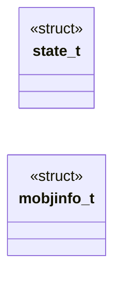

# `progs/doomgeneric/info.h`

> Source: [progs/doomgeneric/info.h:1](../../progs/doomgeneric/info.h#L1) | language `h` | coverage 25.0% | [API index](../index.md)

Copyright(C) 1993-1996 Id Software, Inc.

Copyright(C) 2005-2014 Simon Howard  This program is free software; you can redistribute it and/or modify it under the terms of the GNU General Public License as published by the Free Software Foundation; either version 2 of the License, or (at your option) any later version.  This program is distributed in the hope that it will be useful, but WITHOUT ANY WARRANTY; without even the implied warranty of MERCHANTABILITY or FITNESS FOR A PARTICULAR PURPOSE.  See the GNU General Public License for more details.  DESCRIPTION: Thing frame/state LUT, generated by multigen utilitiy. This one is the original DOOM version, preserved.    Needed for action function pointer handling.

## Contents

- **Structs:** [`state_t`](#state_t), [`mobjinfo_t`](#mobjinfo_t)
- **Macros:** [`__INFO__`](#__info__)
- **Variables:** [`states`](#states), [`sprnames`](#sprnames), [`mobjinfo`](#mobjinfo)

## Type Diagram



## Structs

<a id="state_t"></a>

### `state_t`

`struct` | [progs/doomgeneric/info.h:1144](../../progs/doomgeneric/info.h#L1144)

```c
typedef struct
```

---

<a id="mobjinfo_t"></a>

### `mobjinfo_t`

`struct` | [progs/doomgeneric/info.h:1301](../../progs/doomgeneric/info.h#L1301)

```c
typedef struct
```

---

## Macros

<a id="__info__"></a>

### `__INFO__`

`macro` | [progs/doomgeneric/info.h:22](../../progs/doomgeneric/info.h#L22)

```c
#define __INFO__
```

---

## Variables

<a id="states"></a>

### `states`

`variable` `extern` | [progs/doomgeneric/info.h:1156](../../progs/doomgeneric/info.h#L1156)

```c
extern state_t states[NUMSTATES];
```

---

<a id="sprnames"></a>

### `sprnames`

`variable` `extern` | [progs/doomgeneric/info.h:1157](../../progs/doomgeneric/info.h#L1157)

```c
extern char *sprnames[];
```

---

<a id="mobjinfo"></a>

### `mobjinfo`

`variable` `extern` | [progs/doomgeneric/info.h:1329](../../progs/doomgeneric/info.h#L1329)

```c
extern mobjinfo_t mobjinfo[NUMMOBJTYPES];
```

---
