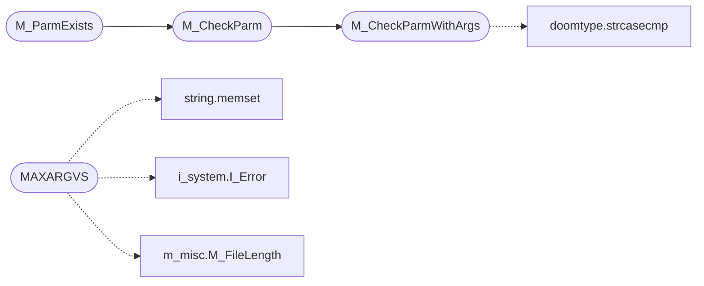

# `progs/doomgeneric/m_argv.c`

> Source: [progs/doomgeneric/m_argv.c:1](../../progs/doomgeneric/m_argv.c#L1) | language `c` | coverage 42.9% | [API index](../index.md)

Copyright(C) 1993-1996 Id Software, Inc.

Copyright(C) 2005-2014 Simon Howard  This program is free software; you can redistribute it and/or modify it under the terms of the GNU General Public License as published by the Free Software Foundation; either version 2 of the License, or (at your option) any later version.  This program is distributed in the hope that it will be useful, but WITHOUT ANY WARRANTY; without even the implied warranty of MERCHANTABILITY or FITNESS FOR A PARTICULAR PURPOSE.  See the GNU General Public License for more details.  DESCRIPTION:

## Contents

- **Functions:** [`M_CheckParmWithArgs`](#m_checkparmwithargs), [`M_ParmExists`](#m_parmexists), [`M_CheckParm`](#m_checkparm), [`M_FindResponseFile`](#m_findresponsefile), [`M_GetExecutableName`](#m_getexecutablename)
- **Macros:** [`MAXARGVS`](#maxargvs)

## Call Graph

Solid arrows stay in this module, dashed arrows leave it.



## Functions

<a id="m_checkparmwithargs"></a>

### `M_CheckParmWithArgs`

`function` | [progs/doomgeneric/m_argv.c:43](../../progs/doomgeneric/m_argv.c#L43)

```c
int M_CheckParmWithArgs(char *check, int num_args)
```

Same as M_CheckParm, but checks that num_args arguments are available following the specified argument.

**Parameters**

| Name | Type | Default | Description |
|---|---|---|---|
| `check` | `char *` |  |  |
| `num_args` | `int` |  |  |

**Returns:** `int`

> **Inherited:** Documentation from [`M_CheckParmWithArgs`](#m_checkparmwithargs) (progs/doomgeneric/m_argv.h:37).

*Calls:* [`strcasecmp`](progs.doomgeneric.doomtype.h.md#strcasecmp)

*Called by:* [`M_CheckParm`](#m_checkparm)

---

<a id="m_parmexists"></a>

### `M_ParmExists`

`function` | [progs/doomgeneric/m_argv.c:63](../../progs/doomgeneric/m_argv.c#L63)

```c
boolean M_ParmExists(char *check)
```

**Parameters**

| Name | Type | Default | Description |
|---|---|---|---|
| `check` | `char *` |  |  |

**Returns:** `boolean`

*Calls:* [`M_CheckParm`](#m_checkparm)

*Called by:* [`D_DoomMain`](progs.doomgeneric.d_main.c.md#d_doommain), [`I_Error`](progs.doomgeneric.i_system.c.md#i_error), [`StatCopy`](progs.doomgeneric.statdump.c.md#statcopy)

---

<a id="m_checkparm"></a>

### `M_CheckParm`

`function` | [progs/doomgeneric/m_argv.c:68](../../progs/doomgeneric/m_argv.c#L68)

```c
int M_CheckParm(char *check)
```

Returns the position of the given parameter in the arg list (0 if not found).

**Parameters**

| Name | Type | Default | Description |
|---|---|---|---|
| `check` | `char *` |  |  |

**Returns:** `int`

> **Inherited:** Documentation from [`M_CheckParm`](#m_checkparm) (progs/doomgeneric/m_argv.h:33).

*Calls:* [`M_CheckParmWithArgs`](#m_checkparmwithargs)

*Called by:* [`M_ParmExists`](#m_parmexists)

---

<a id="m_findresponsefile"></a>

### `M_FindResponseFile`

`function` | [progs/doomgeneric/m_argv.c:235](../../progs/doomgeneric/m_argv.c#L235)

```c
void M_FindResponseFile(void)
```

---

<a id="m_getexecutablename"></a>

### `M_GetExecutableName`

`function` | [progs/doomgeneric/m_argv.c:250](../../progs/doomgeneric/m_argv.c#L250)

```c
char *M_GetExecutableName(void)
```

**Returns:** `char *`

---

## Macros

<a id="maxargvs"></a>

### `MAXARGVS`

`macro` | [progs/doomgeneric/m_argv.c:73](../../progs/doomgeneric/m_argv.c#L73)

```c
#define MAXARGVS
```

*Calls:* [`memset`](kernel.string.c.md#memset), [`I_Error`](progs.doomgeneric.i_system.h.md#i_error), [`M_FileLength`](progs.doomgeneric.m_misc.h.md#m_filelength)

---
