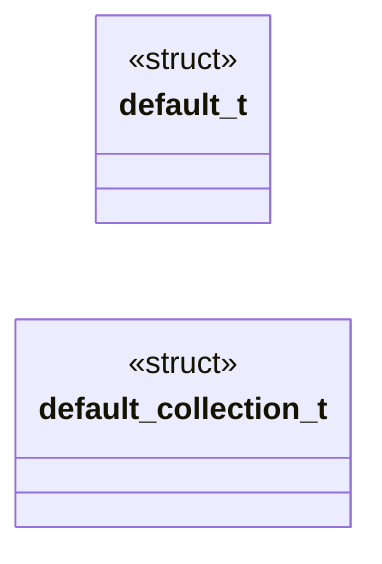
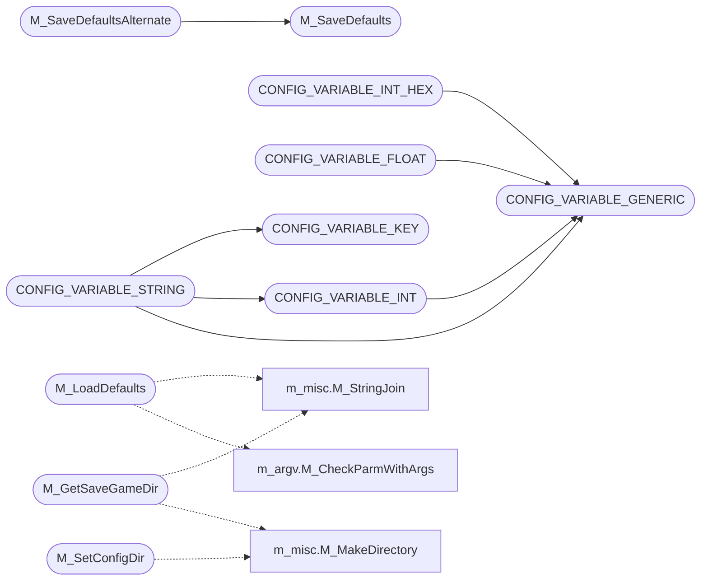

# `progs/doomgeneric/m_config.c`

> Source: [progs/doomgeneric/m_config.c:1](../../progs/doomgeneric/m_config.c#L1) | language `c` | coverage 5.0% | [API index](../index.md)

Copyright(C) 1993-1996 Id Software, Inc.

Copyright(C) 1993-2008 Raven Software Copyright(C) 2005-2014 Simon Howard  This program is free software; you can redistribute it and/or modify it under the terms of the GNU General Public License as published by the Free Software Foundation; either version 2 of the License, or (at your option) any later version.  This program is distributed in the hope that it will be useful, but WITHOUT ANY WARRANTY; without even the implied warranty of MERCHANTABILITY or FITNESS FOR A PARTICULAR PURPOSE.  See the GNU General Public License for more details.  DESCRIPTION: Configuration file interface.

## Contents

- **Structs:** [`default_t`](#default_t), [`default_collection_t`](#default_collection_t)
- **Functions:** [`M_SetConfigFilenames`](#m_setconfigfilenames), [`M_SaveDefaults`](#m_savedefaults), [`M_SaveDefaultsAlternate`](#m_savedefaultsalternate), [`M_LoadDefaults`](#m_loaddefaults), [`M_BindVariable`](#m_bindvariable), [`M_SetVariable`](#m_setvariable), [`M_GetIntVariable`](#m_getintvariable), [`M_GetStrVariable`](#m_getstrvariable), [`M_GetFloatVariable`](#m_getfloatvariable), [`M_SetConfigDir`](#m_setconfigdir), [`M_GetSaveGameDir`](#m_getsavegamedir)
- **Macros:** [`CONFIG_VARIABLE_GENERIC`](#config_variable_generic), [`CONFIG_VARIABLE_KEY`](#config_variable_key), [`CONFIG_VARIABLE_INT`](#config_variable_int), [`CONFIG_VARIABLE_INT_HEX`](#config_variable_int_hex), [`CONFIG_VARIABLE_FLOAT`](#config_variable_float), [`CONFIG_VARIABLE_STRING`](#config_variable_string)

## Type Diagram



## Call Graph

Solid arrows stay in this module, dashed arrows leave it.



## Structs

<a id="default_t"></a>

### `default_t`

`struct` | [progs/doomgeneric/m_config.c:61](../../progs/doomgeneric/m_config.c#L61)

```c
typedef struct
```

---

<a id="default_collection_t"></a>

### `default_collection_t`

`struct` | [progs/doomgeneric/m_config.c:88](../../progs/doomgeneric/m_config.c#L88)

```c
typedef struct
```

---

## Functions

<a id="m_setconfigfilenames"></a>

### `M_SetConfigFilenames`

`function` | [progs/doomgeneric/m_config.c:1836](../../progs/doomgeneric/m_config.c#L1836)

```c
void M_SetConfigFilenames(char *main_config, char *extra_config)
```

**Parameters**

| Name | Type | Default | Description |
|---|---|---|---|
| `main_config` | `char *` |  |  |
| `extra_config` | `char *` |  |  |

---

<a id="m_savedefaults"></a>

### `M_SaveDefaults`

`function` | [progs/doomgeneric/m_config.c:1846](../../progs/doomgeneric/m_config.c#L1846)

```c
void M_SaveDefaults (void)
```

*Called by:* [`M_SaveDefaultsAlternate`](#m_savedefaultsalternate)

---

<a id="m_savedefaultsalternate"></a>

### `M_SaveDefaultsAlternate`

`function` | [progs/doomgeneric/m_config.c:1856](../../progs/doomgeneric/m_config.c#L1856)

```c
void M_SaveDefaultsAlternate(char *main, char *extra)
```

**Parameters**

| Name | Type | Default | Description |
|---|---|---|---|
| `main` | `char *` |  |  |
| `extra` | `char *` |  |  |

*Calls:* [`M_SaveDefaults`](#m_savedefaults)

---

<a id="m_loaddefaults"></a>

### `M_LoadDefaults`

`function` | [progs/doomgeneric/m_config.c:1881](../../progs/doomgeneric/m_config.c#L1881)

```c
void M_LoadDefaults (void)
```

*Calls:* [`M_CheckParmWithArgs`](progs.doomgeneric.m_argv.h.md#m_checkparmwithargs), [`M_StringJoin`](progs.doomgeneric.m_misc.h.md#m_stringjoin)

---

<a id="m_bindvariable"></a>

### `M_BindVariable`

`function` | [progs/doomgeneric/m_config.c:1964](../../progs/doomgeneric/m_config.c#L1964)

```c
void M_BindVariable(char *name, void *location)
```

**Parameters**

| Name | Type | Default | Description |
|---|---|---|---|
| `name` | `char *` |  |  |
| `location` | `void *` |  |  |

---

<a id="m_setvariable"></a>

### `M_SetVariable`

`function` | [progs/doomgeneric/m_config.c:1977](../../progs/doomgeneric/m_config.c#L1977)

```c
boolean M_SetVariable(char *name, char *value)
```

**Parameters**

| Name | Type | Default | Description |
|---|---|---|---|
| `name` | `char *` |  |  |
| `value` | `char *` |  |  |

**Returns:** `boolean`

---

<a id="m_getintvariable"></a>

### `M_GetIntVariable`

`function` | [progs/doomgeneric/m_config.c:1995](../../progs/doomgeneric/m_config.c#L1995)

```c
int M_GetIntVariable(char *name)
```

**Parameters**

| Name | Type | Default | Description |
|---|---|---|---|
| `name` | `char *` |  |  |

**Returns:** `int`

---

<a id="m_getstrvariable"></a>

### `M_GetStrVariable`

`function` `const` | [progs/doomgeneric/m_config.c:2010](../../progs/doomgeneric/m_config.c#L2010)

```c
const char *M_GetStrVariable(char *name)
```

**Parameters**

| Name | Type | Default | Description |
|---|---|---|---|
| `name` | `char *` |  |  |

**Returns:** `char *`

---

<a id="m_getfloatvariable"></a>

### `M_GetFloatVariable`

`function` | [progs/doomgeneric/m_config.c:2025](../../progs/doomgeneric/m_config.c#L2025)

```c
float M_GetFloatVariable(char *name)
```

**Parameters**

| Name | Type | Default | Description |
|---|---|---|---|
| `name` | `char *` |  |  |

**Returns:** `float`

---

<a id="m_setconfigdir"></a>

### `M_SetConfigDir`

`function` | [progs/doomgeneric/m_config.c:2059](../../progs/doomgeneric/m_config.c#L2059)

```c
void M_SetConfigDir(char *dir)
```

**Parameters**

| Name | Type | Default | Description |
|---|---|---|---|
| `dir` | `char *` |  |  |

*Calls:* [`M_MakeDirectory`](progs.doomgeneric.m_misc.h.md#m_makedirectory)

---

<a id="m_getsavegamedir"></a>

### `M_GetSaveGameDir`

`function` | [progs/doomgeneric/m_config.c:2087](../../progs/doomgeneric/m_config.c#L2087)

```c
char *M_GetSaveGameDir(char *iwadname)
```

**Parameters**

| Name | Type | Default | Description |
|---|---|---|---|
| `iwadname` | `char *` |  |  |

**Returns:** `char *`

*Calls:* [`M_MakeDirectory`](progs.doomgeneric.m_misc.h.md#m_makedirectory), [`M_StringJoin`](progs.doomgeneric.m_misc.h.md#m_stringjoin)

---

## Macros

<a id="config_variable_generic"></a>

### `CONFIG_VARIABLE_GENERIC`

`macro` | [progs/doomgeneric/m_config.c:95](../../progs/doomgeneric/m_config.c#L95)

```c
#define CONFIG_VARIABLE_GENERIC(name, type)
```

*Called by:* [`CONFIG_VARIABLE_FLOAT`](#config_variable_float), [`CONFIG_VARIABLE_INT`](#config_variable_int), [`CONFIG_VARIABLE_INT_HEX`](#config_variable_int_hex), [`CONFIG_VARIABLE_STRING`](#config_variable_string)

---

<a id="config_variable_key"></a>

### `CONFIG_VARIABLE_KEY`

`macro` | [progs/doomgeneric/m_config.c:98](../../progs/doomgeneric/m_config.c#L98)

```c
#define CONFIG_VARIABLE_KEY(name)
```

*Called by:* [`CONFIG_VARIABLE_STRING`](#config_variable_string)

---

<a id="config_variable_int"></a>

### `CONFIG_VARIABLE_INT`

`macro` | [progs/doomgeneric/m_config.c:100](../../progs/doomgeneric/m_config.c#L100)

```c
#define CONFIG_VARIABLE_INT(name)
```

*Calls:* [`CONFIG_VARIABLE_GENERIC`](#config_variable_generic)

*Called by:* [`CONFIG_VARIABLE_STRING`](#config_variable_string)

---

<a id="config_variable_int_hex"></a>

### `CONFIG_VARIABLE_INT_HEX`

`macro` | [progs/doomgeneric/m_config.c:102](../../progs/doomgeneric/m_config.c#L102)

```c
#define CONFIG_VARIABLE_INT_HEX(name)
```

*Calls:* [`CONFIG_VARIABLE_GENERIC`](#config_variable_generic)

---

<a id="config_variable_float"></a>

### `CONFIG_VARIABLE_FLOAT`

`macro` | [progs/doomgeneric/m_config.c:104](../../progs/doomgeneric/m_config.c#L104)

```c
#define CONFIG_VARIABLE_FLOAT(name)
```

*Calls:* [`CONFIG_VARIABLE_GENERIC`](#config_variable_generic)

---

<a id="config_variable_string"></a>

### `CONFIG_VARIABLE_STRING`

`macro` | [progs/doomgeneric/m_config.c:106](../../progs/doomgeneric/m_config.c#L106)

```c
#define CONFIG_VARIABLE_STRING(name)
```

*Calls:* [`CONFIG_VARIABLE_GENERIC`](#config_variable_generic), [`CONFIG_VARIABLE_INT`](#config_variable_int), [`CONFIG_VARIABLE_KEY`](#config_variable_key)

---
