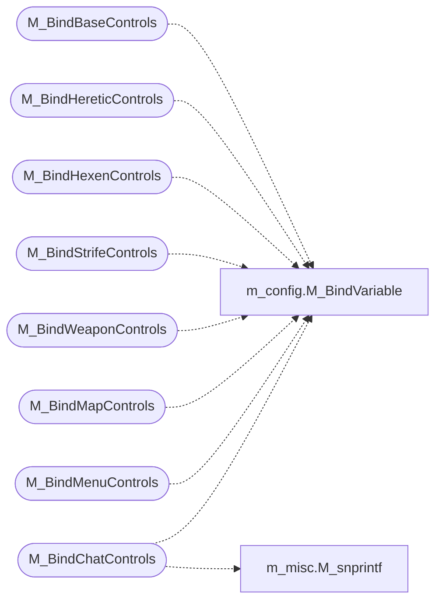

# `progs/doomgeneric/m_controls.c`

> Source: [progs/doomgeneric/m_controls.c:1](../../progs/doomgeneric/m_controls.c#L1) | language `c` | coverage 10.0% | [API index](../index.md)

Copyright(C) 1993-1996 Id Software, Inc.

Copyright(C) 1993-2008 Raven Software Copyright(C) 2005-2014 Simon Howard  This program is free software; you can redistribute it and/or modify it under the terms of the GNU General Public License as published by the Free Software Foundation; either version 2 of the License, or (at your option) any later version.  This program is distributed in the hope that it will be useful, but WITHOUT ANY WARRANTY; without even the implied warranty of MERCHANTABILITY or FITNESS FOR A PARTICULAR PURPOSE.  See the GNU General Public License for more details.       Keyboard controls

## Contents

- **Functions:** [`M_BindBaseControls`](#m_bindbasecontrols), [`M_BindHereticControls`](#m_bindhereticcontrols), [`M_BindHexenControls`](#m_bindhexencontrols), [`M_BindStrifeControls`](#m_bindstrifecontrols), [`M_BindWeaponControls`](#m_bindweaponcontrols), [`M_BindMapControls`](#m_bindmapcontrols), [`M_BindMenuControls`](#m_bindmenucontrols), [`M_BindChatControls`](#m_bindchatcontrols), [`M_ApplyPlatformDefaults`](#m_applyplatformdefaults)

## Call Graph

Solid arrows stay in this module, dashed arrows leave it.



## Functions

<a id="m_bindbasecontrols"></a>

### `M_BindBaseControls`

`function` | [progs/doomgeneric/m_controls.c:204](../../progs/doomgeneric/m_controls.c#L204)

```c
void M_BindBaseControls(void)
```

*Calls:* [`M_BindVariable`](progs.doomgeneric.m_config.h.md#m_bindvariable)

---

<a id="m_bindhereticcontrols"></a>

### `M_BindHereticControls`

`function` | [progs/doomgeneric/m_controls.c:241](../../progs/doomgeneric/m_controls.c#L241)

```c
void M_BindHereticControls(void)
```

*Calls:* [`M_BindVariable`](progs.doomgeneric.m_config.h.md#m_bindvariable)

---

<a id="m_bindhexencontrols"></a>

### `M_BindHexenControls`

`function` | [progs/doomgeneric/m_controls.c:256](../../progs/doomgeneric/m_controls.c#L256)

```c
void M_BindHexenControls(void)
```

*Calls:* [`M_BindVariable`](progs.doomgeneric.m_config.h.md#m_bindvariable)

---

<a id="m_bindstrifecontrols"></a>

### `M_BindStrifeControls`

`function` | [progs/doomgeneric/m_controls.c:272](../../progs/doomgeneric/m_controls.c#L272)

```c
void M_BindStrifeControls(void)
```

*Calls:* [`M_BindVariable`](progs.doomgeneric.m_config.h.md#m_bindvariable)

---

<a id="m_bindweaponcontrols"></a>

### `M_BindWeaponControls`

`function` | [progs/doomgeneric/m_controls.c:307](../../progs/doomgeneric/m_controls.c#L307)

```c
void M_BindWeaponControls(void)
```

*Calls:* [`M_BindVariable`](progs.doomgeneric.m_config.h.md#m_bindvariable)

---

<a id="m_bindmapcontrols"></a>

### `M_BindMapControls`

`function` | [progs/doomgeneric/m_controls.c:328](../../progs/doomgeneric/m_controls.c#L328)

```c
void M_BindMapControls(void)
```

*Calls:* [`M_BindVariable`](progs.doomgeneric.m_config.h.md#m_bindvariable)

---

<a id="m_bindmenucontrols"></a>

### `M_BindMenuControls`

`function` | [progs/doomgeneric/m_controls.c:344](../../progs/doomgeneric/m_controls.c#L344)

```c
void M_BindMenuControls(void)
```

*Calls:* [`M_BindVariable`](progs.doomgeneric.m_config.h.md#m_bindvariable)

---

<a id="m_bindchatcontrols"></a>

### `M_BindChatControls`

`function` | [progs/doomgeneric/m_controls.c:375](../../progs/doomgeneric/m_controls.c#L375)

```c
void M_BindChatControls(unsigned int num_players)
```

**Parameters**

| Name | Type | Default | Description |
|---|---|---|---|
| `num_players` | `unsigned int` |  |  |

*Calls:* [`M_BindVariable`](progs.doomgeneric.m_config.h.md#m_bindvariable), [`M_snprintf`](progs.doomgeneric.m_misc.h.md#m_snprintf)

---

<a id="m_applyplatformdefaults"></a>

### `M_ApplyPlatformDefaults`

`function` | [progs/doomgeneric/m_controls.c:394](../../progs/doomgeneric/m_controls.c#L394)

```c
void M_ApplyPlatformDefaults(void)
```

---
