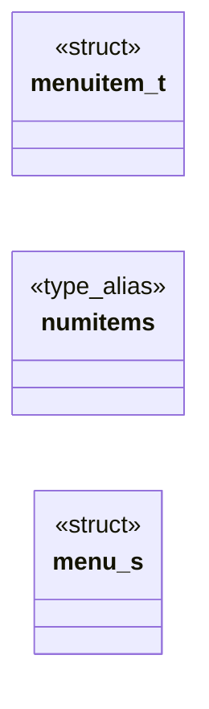
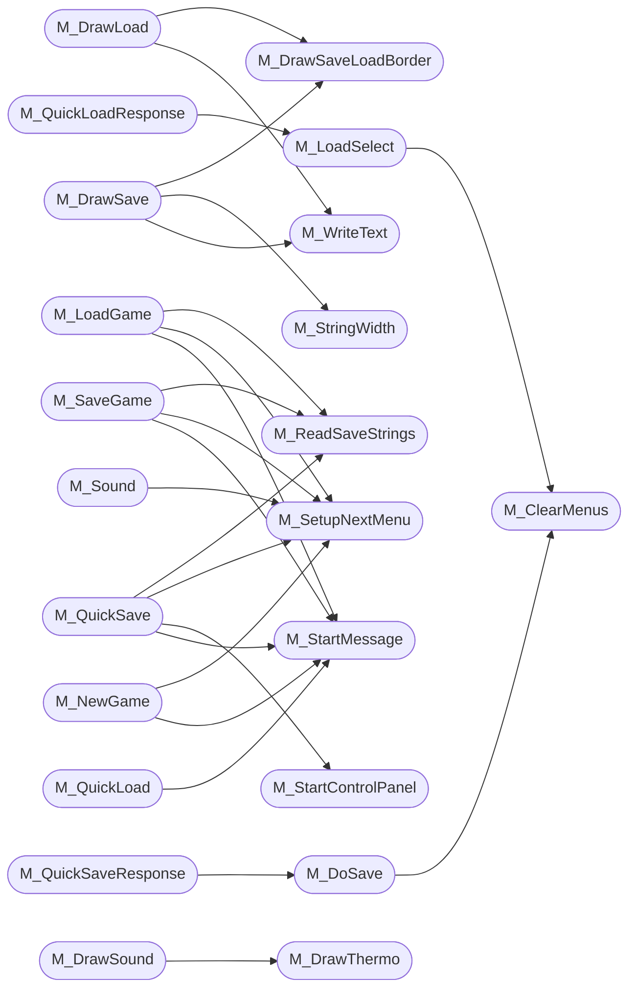

# `progs/doomgeneric/m_menu.c`

> Source: [progs/doomgeneric/m_menu.c:1](../../progs/doomgeneric/m_menu.c#L1) | language `c` | coverage 46.8% | [API index](../index.md)

Copyright(C) 1993-1996 Id Software, Inc.

Copyright(C) 2005-2014 Simon Howard  This program is free software; you can redistribute it and/or modify it under the terms of the GNU General Public License as published by the Free Software Foundation; either version 2 of the License, or (at your option) any later version.  This program is distributed in the hope that it will be useful, but WITHOUT ANY WARRANTY; without even the implied warranty of MERCHANTABILITY or FITNESS FOR A PARTICULAR PURPOSE.  See the GNU General Public License for more details.  DESCRIPTION: DOOM selection menu, options, episode etc. Sliders and icons. Kinda widget stuff.

## Contents

- **Structs:** [`menuitem_t`](#menuitem_t), [`menu_s`](#menu_s)
- **Type Aliases:** [`numitems`](#numitems)
- **Functions:** [`M_StartGame`](#m_startgame), [`M_ReadSaveStrings`](#m_readsavestrings), [`M_DrawLoad`](#m_drawload), [`M_DrawSaveLoadBorder`](#m_drawsaveloadborder), [`M_LoadSelect`](#m_loadselect), [`M_LoadGame`](#m_loadgame), [`M_DrawSave`](#m_drawsave), [`M_DoSave`](#m_dosave), [`M_SaveSelect`](#m_saveselect), [`M_SaveGame`](#m_savegame), [`M_QuickSaveResponse`](#m_quicksaveresponse), [`M_QuickSave`](#m_quicksave), [`M_QuickLoadResponse`](#m_quickloadresponse), [`M_QuickLoad`](#m_quickload), [`M_DrawReadThis1`](#m_drawreadthis1), [`M_DrawReadThis2`](#m_drawreadthis2), [`M_DrawSound`](#m_drawsound), [`M_Sound`](#m_sound), [`M_SfxVol`](#m_sfxvol), [`M_MusicVol`](#m_musicvol), [`M_DrawMainMenu`](#m_drawmainmenu), [`M_DrawNewGame`](#m_drawnewgame), [`M_NewGame`](#m_newgame), [`M_DrawEpisode`](#m_drawepisode), [`M_VerifyNightmare`](#m_verifynightmare), [`M_ChooseSkill`](#m_chooseskill), [`M_Episode`](#m_episode), [`M_DrawOptions`](#m_drawoptions), [`M_Options`](#m_options), [`M_ChangeMessages`](#m_changemessages), [`M_EndGameResponse`](#m_endgameresponse), [`M_EndGame`](#m_endgame), [`M_ReadThis`](#m_readthis), [`M_ReadThis2`](#m_readthis2), [`M_FinishReadThis`](#m_finishreadthis), [`M_QuitResponse`](#m_quitresponse), [`M_QuitDOOM`](#m_quitdoom), [`M_ChangeSensitivity`](#m_changesensitivity), [`M_ChangeDetail`](#m_changedetail), [`M_SizeDisplay`](#m_sizedisplay), [`M_DrawThermo`](#m_drawthermo), [`M_DrawEmptyCell`](#m_drawemptycell), [`M_DrawSelCell`](#m_drawselcell), [`M_StartMessage`](#m_startmessage), [`M_StopMessage`](#m_stopmessage), [`M_StringWidth`](#m_stringwidth), [`M_StringHeight`](#m_stringheight), [`M_WriteText`](#m_writetext), [`M_Responder`](#m_responder), [`M_StartControlPanel`](#m_startcontrolpanel), [`I_OPL_DevMessages`](#i_opl_devmessages), [`M_Drawer`](#m_drawer), [`M_ClearMenus`](#m_clearmenus), [`M_SetupNextMenu`](#m_setupnextmenu), [`M_Ticker`](#m_ticker), [`M_Init`](#m_init)
- **Macros:** [`SKULLXOFF`](#skullxoff), [`LINEHEIGHT`](#lineheight)
- **Variables:** [`hu_font`](#hu_font), [`message_dontfuckwithme`](#message_dontfuckwithme), [`chat_on`](#chat_on), [`sendpause`](#sendpause)

## Type Diagram



## Call Graph

Solid arrows stay in this module, dashed arrows leave it.



## Structs

<a id="menuitem_t"></a>

### `menuitem_t`

`struct` | [progs/doomgeneric/m_menu.c:133](../../progs/doomgeneric/m_menu.c#L133)

```c
typedef struct
```

MENU TYPEDEFS

---

<a id="menu_s"></a>

### `menu_s`

`struct` | [progs/doomgeneric/m_menu.c:151](../../progs/doomgeneric/m_menu.c#L151)

```c
typedef struct menu_s
```

---

## Type Aliases

<a id="numitems"></a>

### `numitems`

`type_alias` | [progs/doomgeneric/m_menu.c:148](../../progs/doomgeneric/m_menu.c#L148)

```c
typedef struct menu_s { short numitems;
```

---

## Functions

<a id="m_startgame"></a>

### `M_StartGame`

`function` | [progs/doomgeneric/m_menu.c:193](../../progs/doomgeneric/m_menu.c#L193)

```c
void M_StartGame(int choice);
```

**Parameters**

| Name | Type | Default | Description |
|---|---|---|---|
| `choice` | `int` |  |  |

---

<a id="m_readsavestrings"></a>

### `M_ReadSaveStrings`

`function` | [progs/doomgeneric/m_menu.c:503](../../progs/doomgeneric/m_menu.c#L503)

```c
void M_ReadSaveStrings(void)
```

M_ReadSaveStrings read the strings from the savegame files

*Calls:* [`M_StringCopy`](progs.doomgeneric.m_misc.c.md#m_stringcopy), [`P_SaveGameFile`](progs.doomgeneric.p_saveg.h.md#p_savegamefile)

*Called by:* [`M_LoadGame`](#m_loadgame), [`M_QuickSave`](#m_quicksave), [`M_SaveGame`](#m_savegame)

---

<a id="m_drawload"></a>

### `M_DrawLoad`

`function` | [progs/doomgeneric/m_menu.c:530](../../progs/doomgeneric/m_menu.c#L530)

```c
void M_DrawLoad(void)
```

M_LoadGame & Cie.

*Calls:* [`DEH_String`](progs.doomgeneric.deh_str.h.md#deh_string), [`M_DrawSaveLoadBorder`](#m_drawsaveloadborder), [`M_WriteText`](#m_writetext), [`V_DrawPatchDirect`](progs.doomgeneric.v_video.h.md#v_drawpatchdirect), [`W_CacheLumpName`](progs.doomgeneric.w_wad.h.md#w_cachelumpname)

---

<a id="m_drawsaveloadborder"></a>

### `M_DrawSaveLoadBorder`

`function` | [progs/doomgeneric/m_menu.c:549](../../progs/doomgeneric/m_menu.c#L549)

```c
void M_DrawSaveLoadBorder(int x,int y)
```

Draw border for the savegame description

**Parameters**

| Name | Type | Default | Description |
|---|---|---|---|
| `x` | `int` |  |  |
| `y` | `int` |  |  |

*Calls:* [`DEH_String`](progs.doomgeneric.deh_str.h.md#deh_string), [`V_DrawPatchDirect`](progs.doomgeneric.v_video.h.md#v_drawpatchdirect), [`W_CacheLumpName`](progs.doomgeneric.w_wad.h.md#w_cachelumpname)

*Called by:* [`M_DrawLoad`](#m_drawload), [`M_DrawSave`](#m_drawsave)

---

<a id="m_loadselect"></a>

### `M_LoadSelect`

`function` | [progs/doomgeneric/m_menu.c:572](../../progs/doomgeneric/m_menu.c#L572)

```c
void M_LoadSelect(int choice)
```

User wants to load this game

**Parameters**

| Name | Type | Default | Description |
|---|---|---|---|
| `choice` | `int` |  |  |

*Calls:* [`G_LoadGame`](progs.doomgeneric.g_game.h.md#g_loadgame), [`M_ClearMenus`](#m_clearmenus), [`M_StringCopy`](progs.doomgeneric.m_misc.c.md#m_stringcopy), [`P_SaveGameFile`](progs.doomgeneric.p_saveg.h.md#p_savegamefile)

*Called by:* [`M_QuickLoadResponse`](#m_quickloadresponse)

---

<a id="m_loadgame"></a>

### `M_LoadGame`

`function` | [progs/doomgeneric/m_menu.c:585](../../progs/doomgeneric/m_menu.c#L585)

```c
void M_LoadGame (int choice)
```

Selected from DOOM menu

**Parameters**

| Name | Type | Default | Description |
|---|---|---|---|
| `choice` | `int` |  |  |

*Calls:* [`DEH_String`](progs.doomgeneric.deh_str.h.md#deh_string), [`M_ReadSaveStrings`](#m_readsavestrings), [`M_SetupNextMenu`](#m_setupnextmenu), [`M_StartMessage`](#m_startmessage)

*Called by:* [`M_Responder`](#m_responder)

---

<a id="m_drawsave"></a>

### `M_DrawSave`

`function` | [progs/doomgeneric/m_menu.c:601](../../progs/doomgeneric/m_menu.c#L601)

```c
void M_DrawSave(void)
```

M_SaveGame & Cie.

*Calls:* [`DEH_String`](progs.doomgeneric.deh_str.h.md#deh_string), [`M_DrawSaveLoadBorder`](#m_drawsaveloadborder), [`M_StringWidth`](#m_stringwidth), [`M_WriteText`](#m_writetext), [`V_DrawPatchDirect`](progs.doomgeneric.v_video.h.md#v_drawpatchdirect), [`W_CacheLumpName`](progs.doomgeneric.w_wad.h.md#w_cachelumpname)

---

<a id="m_dosave"></a>

### `M_DoSave`

`function` | [progs/doomgeneric/m_menu.c:622](../../progs/doomgeneric/m_menu.c#L622)

```c
void M_DoSave(int slot)
```

M_Responder calls this when user is finished

**Parameters**

| Name | Type | Default | Description |
|---|---|---|---|
| `slot` | `int` |  |  |

*Calls:* [`G_SaveGame`](progs.doomgeneric.g_game.h.md#g_savegame), [`M_ClearMenus`](#m_clearmenus)

*Called by:* [`M_QuickSaveResponse`](#m_quicksaveresponse), [`M_Responder`](#m_responder)

---

<a id="m_saveselect"></a>

### `M_SaveSelect`

`function` | [progs/doomgeneric/m_menu.c:635](../../progs/doomgeneric/m_menu.c#L635)

```c
void M_SaveSelect(int choice)
```

User wants to save.

Start string input for M_Responder

**Parameters**

| Name | Type | Default | Description |
|---|---|---|---|
| `choice` | `int` |  |  |

*Calls:* [`M_StringCopy`](progs.doomgeneric.m_misc.c.md#m_stringcopy)

---

<a id="m_savegame"></a>

### `M_SaveGame`

`function` | [progs/doomgeneric/m_menu.c:650](../../progs/doomgeneric/m_menu.c#L650)

```c
void M_SaveGame (int choice)
```

Selected from DOOM menu

**Parameters**

| Name | Type | Default | Description |
|---|---|---|---|
| `choice` | `int` |  |  |

*Calls:* [`DEH_String`](progs.doomgeneric.deh_str.h.md#deh_string), [`M_ReadSaveStrings`](#m_readsavestrings), [`M_SetupNextMenu`](#m_setupnextmenu), [`M_StartMessage`](#m_startmessage)

*Called by:* [`M_Responder`](#m_responder)

---

<a id="m_quicksaveresponse"></a>

### `M_QuickSaveResponse`

`function` | [progs/doomgeneric/m_menu.c:672](../../progs/doomgeneric/m_menu.c#L672)

```c
void M_QuickSaveResponse(int key)
```

**Parameters**

| Name | Type | Default | Description |
|---|---|---|---|
| `key` | `int` |  |  |

*Calls:* [`M_DoSave`](#m_dosave), [`S_StartSound`](progs.doomgeneric.s_sound.h.md#s_startsound)

---

<a id="m_quicksave"></a>

### `M_QuickSave`

`function` | [progs/doomgeneric/m_menu.c:681](../../progs/doomgeneric/m_menu.c#L681)

```c
void M_QuickSave(void)
```

*Calls:* [`DEH_snprintf`](progs.doomgeneric.deh_str.h.md#deh_snprintf), [`M_ReadSaveStrings`](#m_readsavestrings), [`M_SetupNextMenu`](#m_setupnextmenu), [`M_StartControlPanel`](#m_startcontrolpanel), [`M_StartMessage`](#m_startmessage), [`S_StartSound`](progs.doomgeneric.s_sound.h.md#s_startsound)

*Called by:* [`M_Responder`](#m_responder)

---

<a id="m_quickloadresponse"></a>

### `M_QuickLoadResponse`

`function` | [progs/doomgeneric/m_menu.c:709](../../progs/doomgeneric/m_menu.c#L709)

```c
void M_QuickLoadResponse(int key)
```

M_QuickLoad

**Parameters**

| Name | Type | Default | Description |
|---|---|---|---|
| `key` | `int` |  |  |

*Calls:* [`M_LoadSelect`](#m_loadselect), [`S_StartSound`](progs.doomgeneric.s_sound.h.md#s_startsound)

---

<a id="m_quickload"></a>

### `M_QuickLoad`

`function` | [progs/doomgeneric/m_menu.c:719](../../progs/doomgeneric/m_menu.c#L719)

```c
void M_QuickLoad(void)
```

*Calls:* [`DEH_String`](progs.doomgeneric.deh_str.h.md#deh_string), [`DEH_snprintf`](progs.doomgeneric.deh_str.h.md#deh_snprintf), [`M_StartMessage`](#m_startmessage)

*Called by:* [`M_Responder`](#m_responder)

---

<a id="m_drawreadthis1"></a>

### `M_DrawReadThis1`

`function` | [progs/doomgeneric/m_menu.c:743](../../progs/doomgeneric/m_menu.c#L743)

```c
void M_DrawReadThis1(void)
```

Read This Menus Had a "quick hack to fix romero bug"

*Calls:* [`DEH_String`](progs.doomgeneric.deh_str.h.md#deh_string), [`I_Error`](progs.doomgeneric.i_system.h.md#i_error), [`V_DrawPatchDirect`](progs.doomgeneric.v_video.h.md#v_drawpatchdirect), [`W_CacheLumpName`](progs.doomgeneric.w_wad.h.md#w_cachelumpname)

---

<a id="m_drawreadthis2"></a>

### `M_DrawReadThis2`

`function` | [progs/doomgeneric/m_menu.c:820](../../progs/doomgeneric/m_menu.c#L820)

```c
void M_DrawReadThis2(void)
```

Read This Menus - optional second page.

*Calls:* [`DEH_String`](progs.doomgeneric.deh_str.h.md#deh_string), [`V_DrawPatchDirect`](progs.doomgeneric.v_video.h.md#v_drawpatchdirect), [`W_CacheLumpName`](progs.doomgeneric.w_wad.h.md#w_cachelumpname)

---

<a id="m_drawsound"></a>

### `M_DrawSound`

`function` | [progs/doomgeneric/m_menu.c:834](../../progs/doomgeneric/m_menu.c#L834)

```c
void M_DrawSound(void)
```

Change Sfx & Music volumes

*Calls:* [`DEH_String`](progs.doomgeneric.deh_str.h.md#deh_string), [`M_DrawThermo`](#m_drawthermo), [`V_DrawPatchDirect`](progs.doomgeneric.v_video.h.md#v_drawpatchdirect), [`W_CacheLumpName`](progs.doomgeneric.w_wad.h.md#w_cachelumpname)

---

<a id="m_sound"></a>

### `M_Sound`

`function` | [progs/doomgeneric/m_menu.c:845](../../progs/doomgeneric/m_menu.c#L845)

```c
void M_Sound(int choice)
```

**Parameters**

| Name | Type | Default | Description |
|---|---|---|---|
| `choice` | `int` |  |  |

*Calls:* [`M_SetupNextMenu`](#m_setupnextmenu)

---

<a id="m_sfxvol"></a>

### `M_SfxVol`

`function` | [progs/doomgeneric/m_menu.c:850](../../progs/doomgeneric/m_menu.c#L850)

```c
void M_SfxVol(int choice)
```

**Parameters**

| Name | Type | Default | Description |
|---|---|---|---|
| `choice` | `int` |  |  |

*Calls:* [`S_SetSfxVolume`](progs.doomgeneric.s_sound.h.md#s_setsfxvolume)

---

<a id="m_musicvol"></a>

### `M_MusicVol`

`function` | [progs/doomgeneric/m_menu.c:867](../../progs/doomgeneric/m_menu.c#L867)

```c
void M_MusicVol(int choice)
```

**Parameters**

| Name | Type | Default | Description |
|---|---|---|---|
| `choice` | `int` |  |  |

*Calls:* [`S_SetMusicVolume`](progs.doomgeneric.s_sound.h.md#s_setmusicvolume)

---

<a id="m_drawmainmenu"></a>

### `M_DrawMainMenu`

`function` | [progs/doomgeneric/m_menu.c:890](../../progs/doomgeneric/m_menu.c#L890)

```c
void M_DrawMainMenu(void)
```

M_DrawMainMenu

*Calls:* [`DEH_String`](progs.doomgeneric.deh_str.h.md#deh_string), [`V_DrawPatchDirect`](progs.doomgeneric.v_video.h.md#v_drawpatchdirect), [`W_CacheLumpName`](progs.doomgeneric.w_wad.h.md#w_cachelumpname)

---

<a id="m_drawnewgame"></a>

### `M_DrawNewGame`

`function` | [progs/doomgeneric/m_menu.c:902](../../progs/doomgeneric/m_menu.c#L902)

```c
void M_DrawNewGame(void)
```

M_NewGame

*Calls:* [`DEH_String`](progs.doomgeneric.deh_str.h.md#deh_string), [`V_DrawPatchDirect`](progs.doomgeneric.v_video.h.md#v_drawpatchdirect), [`W_CacheLumpName`](progs.doomgeneric.w_wad.h.md#w_cachelumpname)

---

<a id="m_newgame"></a>

### `M_NewGame`

`function` | [progs/doomgeneric/m_menu.c:908](../../progs/doomgeneric/m_menu.c#L908)

```c
void M_NewGame(int choice)
```

**Parameters**

| Name | Type | Default | Description |
|---|---|---|---|
| `choice` | `int` |  |  |

*Calls:* [`DEH_String`](progs.doomgeneric.deh_str.h.md#deh_string), [`M_SetupNextMenu`](#m_setupnextmenu), [`M_StartMessage`](#m_startmessage)

---

<a id="m_drawepisode"></a>

### `M_DrawEpisode`

`function` | [progs/doomgeneric/m_menu.c:930](../../progs/doomgeneric/m_menu.c#L930)

```c
void M_DrawEpisode(void)
```

*Calls:* [`DEH_String`](progs.doomgeneric.deh_str.h.md#deh_string), [`V_DrawPatchDirect`](progs.doomgeneric.v_video.h.md#v_drawpatchdirect), [`W_CacheLumpName`](progs.doomgeneric.w_wad.h.md#w_cachelumpname)

---

<a id="m_verifynightmare"></a>

### `M_VerifyNightmare`

`function` | [progs/doomgeneric/m_menu.c:935](../../progs/doomgeneric/m_menu.c#L935)

```c
void M_VerifyNightmare(int key)
```

**Parameters**

| Name | Type | Default | Description |
|---|---|---|---|
| `key` | `int` |  |  |

*Calls:* [`G_DeferedInitNew`](progs.doomgeneric.g_game.h.md#g_deferedinitnew), [`M_ClearMenus`](#m_clearmenus)

---

<a id="m_chooseskill"></a>

### `M_ChooseSkill`

`function` | [progs/doomgeneric/m_menu.c:944](../../progs/doomgeneric/m_menu.c#L944)

```c
void M_ChooseSkill(int choice)
```

**Parameters**

| Name | Type | Default | Description |
|---|---|---|---|
| `choice` | `int` |  |  |

*Calls:* [`DEH_String`](progs.doomgeneric.deh_str.h.md#deh_string), [`G_DeferedInitNew`](progs.doomgeneric.g_game.h.md#g_deferedinitnew), [`M_ClearMenus`](#m_clearmenus), [`M_StartMessage`](#m_startmessage)

---

<a id="m_episode"></a>

### `M_Episode`

`function` | [progs/doomgeneric/m_menu.c:956](../../progs/doomgeneric/m_menu.c#L956)

```c
void M_Episode(int choice)
```

**Parameters**

| Name | Type | Default | Description |
|---|---|---|---|
| `choice` | `int` |  |  |

*Calls:* [`DEH_String`](progs.doomgeneric.deh_str.h.md#deh_string), [`M_SetupNextMenu`](#m_setupnextmenu), [`M_StartMessage`](#m_startmessage)

---

<a id="m_drawoptions"></a>

### `M_DrawOptions`

`function` | [progs/doomgeneric/m_menu.c:987](../../progs/doomgeneric/m_menu.c#L987)

```c
void M_DrawOptions(void)
```

*Calls:* [`DEH_String`](progs.doomgeneric.deh_str.h.md#deh_string), [`M_DrawThermo`](#m_drawthermo), [`V_DrawPatchDirect`](progs.doomgeneric.v_video.h.md#v_drawpatchdirect), [`W_CacheLumpName`](progs.doomgeneric.w_wad.h.md#w_cachelumpname)

---

<a id="m_options"></a>

### `M_Options`

`function` | [progs/doomgeneric/m_menu.c:1007](../../progs/doomgeneric/m_menu.c#L1007)

```c
void M_Options(int choice)
```

**Parameters**

| Name | Type | Default | Description |
|---|---|---|---|
| `choice` | `int` |  |  |

*Calls:* [`M_SetupNextMenu`](#m_setupnextmenu)

---

<a id="m_changemessages"></a>

### `M_ChangeMessages`

`function` | [progs/doomgeneric/m_menu.c:1017](../../progs/doomgeneric/m_menu.c#L1017)

```c
void M_ChangeMessages(int choice)
```

Toggle messages on/off

**Parameters**

| Name | Type | Default | Description |
|---|---|---|---|
| `choice` | `int` |  |  |

*Calls:* [`DEH_String`](progs.doomgeneric.deh_str.h.md#deh_string)

*Called by:* [`M_Responder`](#m_responder)

---

<a id="m_endgameresponse"></a>

### `M_EndGameResponse`

`function` | [progs/doomgeneric/m_menu.c:1035](../../progs/doomgeneric/m_menu.c#L1035)

```c
void M_EndGameResponse(int key)
```

M_EndGame

**Parameters**

| Name | Type | Default | Description |
|---|---|---|---|
| `key` | `int` |  |  |

*Calls:* [`D_StartTitle`](progs.doomgeneric.d_main.h.md#d_starttitle), [`M_ClearMenus`](#m_clearmenus)

---

<a id="m_endgame"></a>

### `M_EndGame`

`function` | [progs/doomgeneric/m_menu.c:1045](../../progs/doomgeneric/m_menu.c#L1045)

```c
void M_EndGame(int choice)
```

**Parameters**

| Name | Type | Default | Description |
|---|---|---|---|
| `choice` | `int` |  |  |

*Calls:* [`DEH_String`](progs.doomgeneric.deh_str.h.md#deh_string), [`M_StartMessage`](#m_startmessage), [`S_StartSound`](progs.doomgeneric.s_sound.h.md#s_startsound)

*Called by:* [`M_Responder`](#m_responder)

---

<a id="m_readthis"></a>

### `M_ReadThis`

`function` | [progs/doomgeneric/m_menu.c:1069](../../progs/doomgeneric/m_menu.c#L1069)

```c
void M_ReadThis(int choice)
```

M_ReadThis

**Parameters**

| Name | Type | Default | Description |
|---|---|---|---|
| `choice` | `int` |  |  |

*Calls:* [`M_SetupNextMenu`](#m_setupnextmenu)

---

<a id="m_readthis2"></a>

### `M_ReadThis2`

`function` | [progs/doomgeneric/m_menu.c:1075](../../progs/doomgeneric/m_menu.c#L1075)

```c
void M_ReadThis2(int choice)
```

**Parameters**

| Name | Type | Default | Description |
|---|---|---|---|
| `choice` | `int` |  |  |

*Calls:* [`M_FinishReadThis`](#m_finishreadthis), [`M_SetupNextMenu`](#m_setupnextmenu)

---

<a id="m_finishreadthis"></a>

### `M_FinishReadThis`

`function` | [progs/doomgeneric/m_menu.c:1093](../../progs/doomgeneric/m_menu.c#L1093)

```c
void M_FinishReadThis(int choice)
```

**Parameters**

| Name | Type | Default | Description |
|---|---|---|---|
| `choice` | `int` |  |  |

*Calls:* [`M_SetupNextMenu`](#m_setupnextmenu)

*Called by:* [`M_ReadThis2`](#m_readthis2)

---

<a id="m_quitresponse"></a>

### `M_QuitResponse`

`function` | [progs/doomgeneric/m_menu.c:1131](../../progs/doomgeneric/m_menu.c#L1131)

```c
void M_QuitResponse(int key)
```

**Parameters**

| Name | Type | Default | Description |
|---|---|---|---|
| `key` | `int` |  |  |

*Calls:* [`I_Quit`](progs.doomgeneric.i_system.h.md#i_quit), [`I_WaitVBL`](progs.doomgeneric.i_timer.h.md#i_waitvbl), [`S_StartSound`](progs.doomgeneric.s_sound.h.md#s_startsound)

*Called by:* [`M_Responder`](#m_responder)

---

<a id="m_quitdoom"></a>

### `M_QuitDOOM`

`function` | [progs/doomgeneric/m_menu.c:1168](../../progs/doomgeneric/m_menu.c#L1168)

```c
void M_QuitDOOM(int choice)
```

**Parameters**

| Name | Type | Default | Description |
|---|---|---|---|
| `choice` | `int` |  |  |

*Calls:* [`DEH_String`](progs.doomgeneric.deh_str.h.md#deh_string), [`DEH_snprintf`](progs.doomgeneric.deh_str.h.md#deh_snprintf), [`M_StartMessage`](#m_startmessage)

*Called by:* [`M_Responder`](#m_responder)

---

<a id="m_changesensitivity"></a>

### `M_ChangeSensitivity`

`function` | [progs/doomgeneric/m_menu.c:1179](../../progs/doomgeneric/m_menu.c#L1179)

```c
void M_ChangeSensitivity(int choice)
```

**Parameters**

| Name | Type | Default | Description |
|---|---|---|---|
| `choice` | `int` |  |  |

---

<a id="m_changedetail"></a>

### `M_ChangeDetail`

`function` | [progs/doomgeneric/m_menu.c:1197](../../progs/doomgeneric/m_menu.c#L1197)

```c
void M_ChangeDetail(int choice)
```

**Parameters**

| Name | Type | Default | Description |
|---|---|---|---|
| `choice` | `int` |  |  |

*Calls:* [`DEH_String`](progs.doomgeneric.deh_str.h.md#deh_string)

*Called by:* [`M_Responder`](#m_responder)

---

<a id="m_sizedisplay"></a>

### `M_SizeDisplay`

`function` | [progs/doomgeneric/m_menu.c:1213](../../progs/doomgeneric/m_menu.c#L1213)

```c
void M_SizeDisplay(int choice)
```

**Parameters**

| Name | Type | Default | Description |
|---|---|---|---|
| `choice` | `int` |  |  |

*Called by:* [`M_Responder`](#m_responder)

---

<a id="m_drawthermo"></a>

### `M_DrawThermo`

`function` | [progs/doomgeneric/m_menu.c:1244](../../progs/doomgeneric/m_menu.c#L1244)

```c
void M_DrawThermo ( int x, int y, int thermWidth, int thermDot )
```

**Parameters**

| Name | Type | Default | Description |
|---|---|---|---|
| `x` | `int` |  |  |
| `y` | `int` |  |  |
| `thermWidth` | `int` |  |  |
| `thermDot` | `int` |  |  |

*Calls:* [`DEH_String`](progs.doomgeneric.deh_str.h.md#deh_string), [`V_DrawPatchDirect`](progs.doomgeneric.v_video.h.md#v_drawpatchdirect), [`W_CacheLumpName`](progs.doomgeneric.w_wad.h.md#w_cachelumpname)

*Called by:* [`M_DrawOptions`](#m_drawoptions), [`M_DrawSound`](#m_drawsound)

---

<a id="m_drawemptycell"></a>

### `M_DrawEmptyCell`

`function` | [progs/doomgeneric/m_menu.c:1270](../../progs/doomgeneric/m_menu.c#L1270)

```c
void M_DrawEmptyCell ( menu_t* menu, int item )
```

**Parameters**

| Name | Type | Default | Description |
|---|---|---|---|
| `menu` | `menu_t*` |  |  |
| `item` | `int` |  |  |

*Calls:* [`DEH_String`](progs.doomgeneric.deh_str.h.md#deh_string), [`V_DrawPatchDirect`](progs.doomgeneric.v_video.h.md#v_drawpatchdirect), [`W_CacheLumpName`](progs.doomgeneric.w_wad.h.md#w_cachelumpname)

---

<a id="m_drawselcell"></a>

### `M_DrawSelCell`

`function` | [progs/doomgeneric/m_menu.c:1279](../../progs/doomgeneric/m_menu.c#L1279)

```c
void M_DrawSelCell ( menu_t* menu, int item )
```

**Parameters**

| Name | Type | Default | Description |
|---|---|---|---|
| `menu` | `menu_t*` |  |  |
| `item` | `int` |  |  |

*Calls:* [`DEH_String`](progs.doomgeneric.deh_str.h.md#deh_string), [`V_DrawPatchDirect`](progs.doomgeneric.v_video.h.md#v_drawpatchdirect), [`W_CacheLumpName`](progs.doomgeneric.w_wad.h.md#w_cachelumpname)

---

<a id="m_startmessage"></a>

### `M_StartMessage`

`function` | [progs/doomgeneric/m_menu.c:1289](../../progs/doomgeneric/m_menu.c#L1289)

```c
void M_StartMessage ( char* string, void* routine, boolean input )
```

**Parameters**

| Name | Type | Default | Description |
|---|---|---|---|
| `string` | `char*` |  |  |
| `routine` | `void*` |  |  |
| `input` | `boolean` |  |  |

*Called by:* [`M_ChooseSkill`](#m_chooseskill), [`M_EndGame`](#m_endgame), [`M_Episode`](#m_episode), [`M_LoadGame`](#m_loadgame), [`M_NewGame`](#m_newgame), [`M_QuickLoad`](#m_quickload), [`M_QuickSave`](#m_quicksave), [`M_QuitDOOM`](#m_quitdoom), [`M_SaveGame`](#m_savegame)

---

<a id="m_stopmessage"></a>

### `M_StopMessage`

`function` | [progs/doomgeneric/m_menu.c:1304](../../progs/doomgeneric/m_menu.c#L1304)

```c
void M_StopMessage(void)
```

---

<a id="m_stringwidth"></a>

### `M_StringWidth`

`function` | [progs/doomgeneric/m_menu.c:1315](../../progs/doomgeneric/m_menu.c#L1315)

```c
int M_StringWidth(char* string)
```

Find string width from hu_font chars

**Parameters**

| Name | Type | Default | Description |
|---|---|---|---|
| `string` | `char*` |  |  |

**Returns:** `int`

*Calls:* [`SHORT`](progs.doomgeneric.i_swap.h.md#short)

*Called by:* [`M_DrawSave`](#m_drawsave), [`M_Drawer`](#m_drawer), [`M_Responder`](#m_responder)

---

<a id="m_stringheight"></a>

### `M_StringHeight`

`function` | [progs/doomgeneric/m_menu.c:1338](../../progs/doomgeneric/m_menu.c#L1338)

```c
int M_StringHeight(char* string)
```

Find string height from hu_font chars

**Parameters**

| Name | Type | Default | Description |
|---|---|---|---|
| `string` | `char*` |  |  |

**Returns:** `int`

*Calls:* [`SHORT`](progs.doomgeneric.i_swap.h.md#short)

*Called by:* [`M_Drawer`](#m_drawer)

---

<a id="m_writetext"></a>

### `M_WriteText`

`function` | [progs/doomgeneric/m_menu.c:1357](../../progs/doomgeneric/m_menu.c#L1357)

```c
void M_WriteText ( int x, int y, char* string)
```

**Parameters**

| Name | Type | Default | Description |
|---|---|---|---|
| `x` | `int` |  |  |
| `y` | `int` |  |  |
| `string` | `char*` |  |  |

*Calls:* [`SHORT`](progs.doomgeneric.i_swap.h.md#short), [`V_DrawPatchDirect`](progs.doomgeneric.v_video.h.md#v_drawpatchdirect)

*Called by:* [`M_DrawLoad`](#m_drawload), [`M_DrawSave`](#m_drawsave), [`M_Drawer`](#m_drawer)

---

<a id="m_responder"></a>

### `M_Responder`

`function` | [progs/doomgeneric/m_menu.c:1416](../../progs/doomgeneric/m_menu.c#L1416)

```c
boolean M_Responder (event_t* ev)
```

M_Responder

**Parameters**

| Name | Type | Default | Description |
|---|---|---|---|
| `ev` | `event_t*` |  |  |

**Returns:** `boolean`

*Calls:* [`DEH_String`](progs.doomgeneric.deh_str.h.md#deh_string), [`G_ScreenShot`](progs.doomgeneric.g_game.h.md#g_screenshot), [`I_Quit`](progs.doomgeneric.i_system.h.md#i_quit), [`I_GetTime`](progs.doomgeneric.i_timer.h.md#i_gettime), [`I_SetPalette`](progs.doomgeneric.i_video.h.md#i_setpalette), [`M_ChangeDetail`](#m_changedetail), [`M_ChangeMessages`](#m_changemessages), [`M_ClearMenus`](#m_clearmenus), [`M_DoSave`](#m_dosave), [`M_EndGame`](#m_endgame), [`M_LoadGame`](#m_loadgame), [`M_QuickLoad`](#m_quickload) and 10 more

*Called by:* [`D_ProcessEvents`](progs.doomgeneric.d_main.c.md#d_processevents)

---

<a id="m_startcontrolpanel"></a>

### `M_StartControlPanel`

`function` | [progs/doomgeneric/m_menu.c:1899](../../progs/doomgeneric/m_menu.c#L1899)

```c
void M_StartControlPanel (void)
```

M_StartControlPanel

*Called by:* [`M_QuickSave`](#m_quicksave), [`M_Responder`](#m_responder)

---

<a id="i_opl_devmessages"></a>

### `I_OPL_DevMessages`

`function` `extern` | [progs/doomgeneric/m_menu.c:1915](../../progs/doomgeneric/m_menu.c#L1915)

```c
extern void I_OPL_DevMessages(char *, size_t);
```

**Parameters**

| Name | Type | Default | Description |
|---|---|---|---|
| `char` |  |  |  |

---

<a id="m_drawer"></a>

### `M_Drawer`

`function` | [progs/doomgeneric/m_menu.c:1951](../../progs/doomgeneric/m_menu.c#L1951)

```c
void M_Drawer (void)
```

M_Drawer Called after the view has been rendered, but before it has been blitted.

*Calls:* [`DEH_String`](progs.doomgeneric.deh_str.h.md#deh_string), [`SHORT`](progs.doomgeneric.i_swap.h.md#short), [`M_StringHeight`](#m_stringheight), [`M_StringWidth`](#m_stringwidth), [`M_WriteText`](#m_writetext), [`M_StringCopy`](progs.doomgeneric.m_misc.c.md#m_stringcopy), [`V_DrawPatchDirect`](progs.doomgeneric.v_video.h.md#v_drawpatchdirect), [`W_CacheLumpName`](progs.doomgeneric.w_wad.h.md#w_cachelumpname)

---

<a id="m_clearmenus"></a>

### `M_ClearMenus`

`function` | [progs/doomgeneric/m_menu.c:2041](../../progs/doomgeneric/m_menu.c#L2041)

```c
void M_ClearMenus (void)
```

M_ClearMenus

*Called by:* [`M_ChooseSkill`](#m_chooseskill), [`M_DoSave`](#m_dosave), [`M_EndGameResponse`](#m_endgameresponse), [`M_LoadSelect`](#m_loadselect), [`M_Responder`](#m_responder), [`M_VerifyNightmare`](#m_verifynightmare)

---

<a id="m_setupnextmenu"></a>

### `M_SetupNextMenu`

`function` | [progs/doomgeneric/m_menu.c:2054](../../progs/doomgeneric/m_menu.c#L2054)

```c
void M_SetupNextMenu(menu_t *menudef)
```

M_SetupNextMenu

**Parameters**

| Name | Type | Default | Description |
|---|---|---|---|
| `menudef` | `menu_t *` |  |  |

*Called by:* [`M_Episode`](#m_episode), [`M_FinishReadThis`](#m_finishreadthis), [`M_LoadGame`](#m_loadgame), [`M_NewGame`](#m_newgame), [`M_Options`](#m_options), [`M_QuickSave`](#m_quicksave), [`M_ReadThis`](#m_readthis), [`M_ReadThis2`](#m_readthis2), [`M_SaveGame`](#m_savegame), [`M_Sound`](#m_sound)

---

<a id="m_ticker"></a>

### `M_Ticker`

`function` | [progs/doomgeneric/m_menu.c:2064](../../progs/doomgeneric/m_menu.c#L2064)

```c
void M_Ticker (void)
```

M_Ticker

---

<a id="m_init"></a>

### `M_Init`

`function` | [progs/doomgeneric/m_menu.c:2077](../../progs/doomgeneric/m_menu.c#L2077)

```c
void M_Init (void)
```

M_Init

---

## Macros

<a id="skullxoff"></a>

### `SKULLXOFF`

`macro` | [progs/doomgeneric/m_menu.c:120](../../progs/doomgeneric/m_menu.c#L120)

```c
#define SKULLXOFF
```

---

<a id="lineheight"></a>

### `LINEHEIGHT`

`macro` | [progs/doomgeneric/m_menu.c:121](../../progs/doomgeneric/m_menu.c#L121)

```c
#define LINEHEIGHT
```

---

## Variables

<a id="hu_font"></a>

### `hu_font`

`variable` `extern` | [progs/doomgeneric/m_menu.c:62](../../progs/doomgeneric/m_menu.c#L62)

```c
extern patch_t* hu_font[HU_FONTSIZE];
```

---

<a id="message_dontfuckwithme"></a>

### `message_dontfuckwithme`

`variable` `extern` | [progs/doomgeneric/m_menu.c:63](../../progs/doomgeneric/m_menu.c#L63)

```c
extern boolean message_dontfuckwithme;
```

---

<a id="chat_on"></a>

### `chat_on`

`variable` `extern` | [progs/doomgeneric/m_menu.c:65](../../progs/doomgeneric/m_menu.c#L65)

```c
extern boolean chat_on;
```

---

<a id="sendpause"></a>

### `sendpause`

`variable` `extern` | [progs/doomgeneric/m_menu.c:123](../../progs/doomgeneric/m_menu.c#L123)

```c
extern boolean sendpause;
```

---
