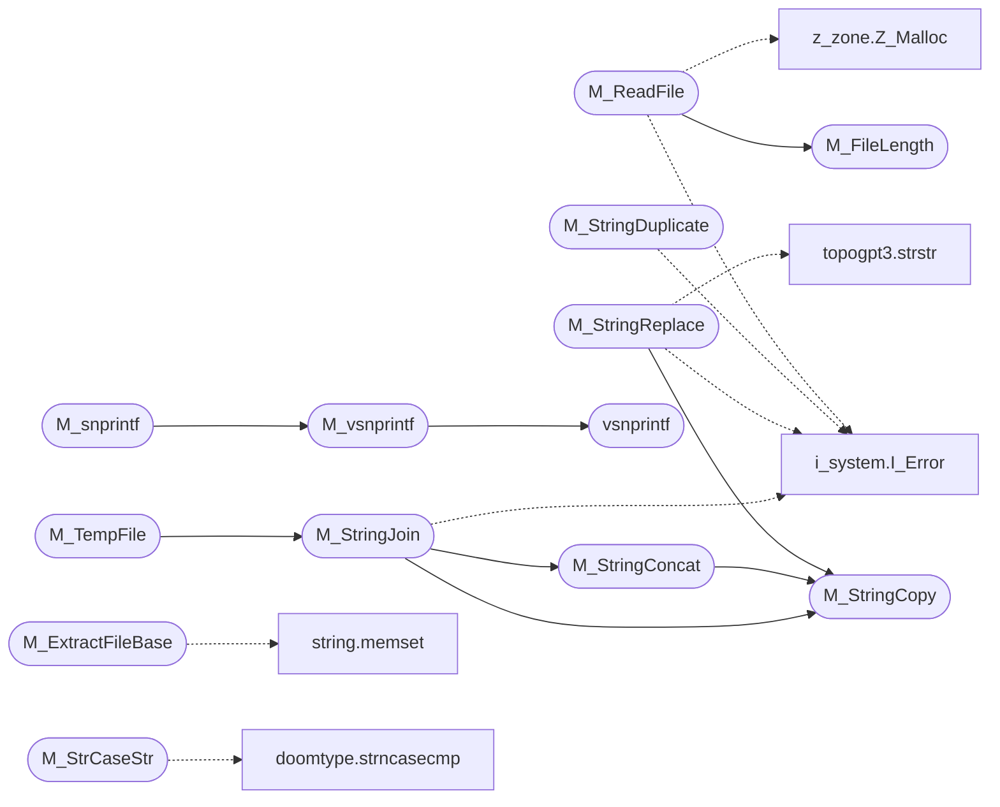

# `progs/doomgeneric/m_misc.c`

> Source: [progs/doomgeneric/m_misc.c:1](../../progs/doomgeneric/m_misc.c#L1) | language `c` | coverage 17.4% | [API index](../index.md)

Copyright(C) 1993-1996 Id Software, Inc.

Copyright(C) 1993-2008 Raven Software Copyright(C) 2005-2014 Simon Howard  This program is free software; you can redistribute it and/or modify it under the terms of the GNU General Public License as published by the Free Software Foundation; either version 2 of the License, or (at your option) any later version.  This program is distributed in the hope that it will be useful, but WITHOUT ANY WARRANTY; without even the implied warranty of MERCHANTABILITY or FITNESS FOR A PARTICULAR PURPOSE.  See the GNU General Public License for more details.  DESCRIPTION: Miscellaneous.

## Contents

- **Functions:** [`M_MakeDirectory`](#m_makedirectory), [`M_FileExists`](#m_fileexists), [`M_FileLength`](#m_filelength), [`M_WriteFile`](#m_writefile), [`M_ReadFile`](#m_readfile), [`M_TempFile`](#m_tempfile), [`M_StrToInt`](#m_strtoint), [`M_ExtractFileBase`](#m_extractfilebase), [`M_ForceUppercase`](#m_forceuppercase), [`M_StrCaseStr`](#m_strcasestr), [`M_StringDuplicate`](#m_stringduplicate), [`M_StringReplace`](#m_stringreplace), [`M_StringCopy`](#m_stringcopy), [`M_StringConcat`](#m_stringconcat), [`M_StringStartsWith`](#m_stringstartswith), [`M_StringEndsWith`](#m_stringendswith), [`M_StringJoin`](#m_stringjoin), [`M_vsnprintf`](#m_vsnprintf), [`M_snprintf`](#m_snprintf), [`M_OEMToUTF8`](#m_oemtoutf8)
- **Macros:** [`WIN32_LEAN_AND_MEAN`](#win32_lean_and_mean), [`vsnprintf`](#vsnprintf)

## Call Graph

Solid arrows stay in this module, dashed arrows leave it.



## Functions

<a id="m_makedirectory"></a>

### `M_MakeDirectory`

`function` | [progs/doomgeneric/m_misc.c:55](../../progs/doomgeneric/m_misc.c#L55)

```c
void M_MakeDirectory(char *path)
```

**Parameters**

| Name | Type | Default | Description |
|---|---|---|---|
| `path` | `char *` |  |  |

---

<a id="m_fileexists"></a>

### `M_FileExists`

`function` | [progs/doomgeneric/m_misc.c:66](../../progs/doomgeneric/m_misc.c#L66)

```c
boolean M_FileExists(char *filename)
```

**Parameters**

| Name | Type | Default | Description |
|---|---|---|---|
| `filename` | `char *` |  |  |

**Returns:** `boolean`

*Called by:* [`D_FindWADByName`](progs.doomgeneric.d_iwad.c.md#d_findwadbyname), [`V_ScreenShot`](progs.doomgeneric.v_video.c.md#v_screenshot)

---

<a id="m_filelength"></a>

### `M_FileLength`

`function` | [progs/doomgeneric/m_misc.c:89](../../progs/doomgeneric/m_misc.c#L89)

```c
long M_FileLength(FILE *handle)
```

**Parameters**

| Name | Type | Default | Description |
|---|---|---|---|
| `handle` | `FILE *` |  |  |

**Returns:** `long`

*Called by:* [`M_ReadFile`](#m_readfile)

---

<a id="m_writefile"></a>

### `M_WriteFile`

`function` | [progs/doomgeneric/m_misc.c:111](../../progs/doomgeneric/m_misc.c#L111)

```c
boolean M_WriteFile(char *name, void *source, int length)
```

**Parameters**

| Name | Type | Default | Description |
|---|---|---|---|
| `name` | `char *` |  |  |
| `source` | `void *` |  |  |
| `length` | `int` |  |  |

**Returns:** `boolean`

*Called by:* [`G_CheckDemoStatus`](progs.doomgeneric.g_game.c.md#g_checkdemostatus), [`WritePCXfile`](progs.doomgeneric.v_video.c.md#writepcxfile)

---

<a id="m_readfile"></a>

### `M_ReadFile`

`function` | [progs/doomgeneric/m_misc.c:135](../../progs/doomgeneric/m_misc.c#L135)

```c
int M_ReadFile(char *name, byte **buffer)
```

**Parameters**

| Name | Type | Default | Description |
|---|---|---|---|
| `name` | `char *` |  |  |
| `buffer` | `byte **` |  |  |

**Returns:** `int`

*Calls:* [`I_Error`](progs.doomgeneric.i_system.h.md#i_error), [`M_FileLength`](#m_filelength), [`Z_Malloc`](progs.doomgeneric.z_zone.h.md#z_malloc)

---

<a id="m_tempfile"></a>

### `M_TempFile`

`function` | [progs/doomgeneric/m_misc.c:166](../../progs/doomgeneric/m_misc.c#L166)

```c
char *M_TempFile(char *s)
```

**Parameters**

| Name | Type | Default | Description |
|---|---|---|---|
| `s` | `char *` |  |  |

**Returns:** `char *`

*Calls:* [`M_StringJoin`](#m_stringjoin)

---

<a id="m_strtoint"></a>

### `M_StrToInt`

`function` | [progs/doomgeneric/m_misc.c:189](../../progs/doomgeneric/m_misc.c#L189)

```c
boolean M_StrToInt(const char *str, int *result)
```

**Parameters**

| Name | Type | Default | Description |
|---|---|---|---|
| `str` | `char *` |  |  |
| `result` | `int *` |  |  |

**Returns:** `boolean`

*Called by:* [`I_GetMemoryValue`](progs.doomgeneric.i_system.c.md#i_getmemoryvalue)

---

<a id="m_extractfilebase"></a>

### `M_ExtractFileBase`

`function` | [progs/doomgeneric/m_misc.c:197](../../progs/doomgeneric/m_misc.c#L197)

```c
void M_ExtractFileBase(char *path, char *dest)
```

**Parameters**

| Name | Type | Default | Description |
|---|---|---|---|
| `path` | `char *` |  |  |
| `dest` | `char *` |  |  |

*Calls:* [`memset`](kernel.string.c.md#memset)

---

<a id="m_forceuppercase"></a>

### `M_ForceUppercase`

`function` | [progs/doomgeneric/m_misc.c:242](../../progs/doomgeneric/m_misc.c#L242)

```c
void M_ForceUppercase(char *text)
```

**Parameters**

| Name | Type | Default | Description |
|---|---|---|---|
| `text` | `char *` |  |  |

---

<a id="m_strcasestr"></a>

### `M_StrCaseStr`

`function` | [progs/doomgeneric/m_misc.c:258](../../progs/doomgeneric/m_misc.c#L258)

```c
char *M_StrCaseStr(char *haystack, char *needle)
```

**Parameters**

| Name | Type | Default | Description |
|---|---|---|---|
| `haystack` | `char *` |  |  |
| `needle` | `char *` |  |  |

**Returns:** `char *`

*Calls:* [`strncasecmp`](progs.doomgeneric.doomtype.h.md#strncasecmp)

---

<a id="m_stringduplicate"></a>

### `M_StringDuplicate`

`function` | [progs/doomgeneric/m_misc.c:291](../../progs/doomgeneric/m_misc.c#L291)

```c
char *M_StringDuplicate(const char *orig)
```

**Parameters**

| Name | Type | Default | Description |
|---|---|---|---|
| `orig` | `char *` |  |  |

**Returns:** `char *`

*Calls:* [`I_Error`](progs.doomgeneric.i_system.h.md#i_error)

---

<a id="m_stringreplace"></a>

### `M_StringReplace`

`function` | [progs/doomgeneric/m_misc.c:310](../../progs/doomgeneric/m_misc.c#L310)

```c
char *M_StringReplace(const char *haystack, const char *needle, const char *replacement)
```

**Parameters**

| Name | Type | Default | Description |
|---|---|---|---|
| `haystack` | `char *` |  |  |
| `needle` | `char *` |  |  |
| `replacement` | `char *` |  |  |

**Returns:** `char *`

*Calls:* [`I_Error`](progs.doomgeneric.i_system.h.md#i_error), [`M_StringCopy`](#m_stringcopy), [`strstr`](progs.topogpt3.topogpt3.c.md#strstr)

---

<a id="m_stringcopy"></a>

### `M_StringCopy`

`function` | [progs/doomgeneric/m_misc.c:372](../../progs/doomgeneric/m_misc.c#L372)

```c
boolean M_StringCopy(char *dest, const char *src, size_t dest_size)
```

**Parameters**

| Name | Type | Default | Description |
|---|---|---|---|
| `dest` | `char *` |  |  |
| `src` | `char *` |  |  |
| `dest_size` | `size_t` |  |  |

**Returns:** `boolean`

*Called by:* [`D_DoomMain`](progs.doomgeneric.d_main.c.md#d_doommain), [`G_DoSaveGame`](progs.doomgeneric.g_game.c.md#g_dosavegame), [`G_LoadGame`](progs.doomgeneric.g_game.c.md#g_loadgame), [`G_SaveGame`](progs.doomgeneric.g_game.c.md#g_savegame), [`G_Ticker`](progs.doomgeneric.g_game.c.md#g_ticker), [`HU_Responder`](progs.doomgeneric.hu_stuff.c.md#hu_responder), [`M_Drawer`](progs.doomgeneric.m_menu.c.md#m_drawer), [`M_LoadSelect`](progs.doomgeneric.m_menu.c.md#m_loadselect), [`M_ReadSaveStrings`](progs.doomgeneric.m_menu.c.md#m_readsavestrings), [`M_Responder`](progs.doomgeneric.m_menu.c.md#m_responder), [`M_SaveSelect`](progs.doomgeneric.m_menu.c.md#m_saveselect), [`M_StringConcat`](#m_stringconcat) and 3 more

---

<a id="m_stringconcat"></a>

### `M_StringConcat`

`function` | [progs/doomgeneric/m_misc.c:393](../../progs/doomgeneric/m_misc.c#L393)

```c
boolean M_StringConcat(char *dest, const char *src, size_t dest_size)
```

**Parameters**

| Name | Type | Default | Description |
|---|---|---|---|
| `dest` | `char *` |  |  |
| `src` | `char *` |  |  |
| `dest_size` | `size_t` |  |  |

**Returns:** `boolean`

*Calls:* [`M_StringCopy`](#m_stringcopy)

*Called by:* [`M_StringJoin`](#m_stringjoin)

---

<a id="m_stringstartswith"></a>

### `M_StringStartsWith`

`function` | [progs/doomgeneric/m_misc.c:408](../../progs/doomgeneric/m_misc.c#L408)

```c
boolean M_StringStartsWith(const char *s, const char *prefix)
```

**Parameters**

| Name | Type | Default | Description |
|---|---|---|---|
| `s` | `char *` |  |  |
| `prefix` | `char *` |  |  |

**Returns:** `boolean`

---

<a id="m_stringendswith"></a>

### `M_StringEndsWith`

`function` | [progs/doomgeneric/m_misc.c:416](../../progs/doomgeneric/m_misc.c#L416)

```c
boolean M_StringEndsWith(const char *s, const char *suffix)
```

**Parameters**

| Name | Type | Default | Description |
|---|---|---|---|
| `s` | `char *` |  |  |
| `suffix` | `char *` |  |  |

**Returns:** `boolean`

*Called by:* [`D_DoomMain`](progs.doomgeneric.d_main.c.md#d_doommain)

---

<a id="m_stringjoin"></a>

### `M_StringJoin`

`function` | [progs/doomgeneric/m_misc.c:425](../../progs/doomgeneric/m_misc.c#L425)

```c
char *M_StringJoin(const char *s, ...)
```

**Parameters**

| Name | Type | Default | Description |
|---|---|---|---|
| `s` | `char *` |  |  |
| `...` |  |  |  |

**Returns:** `char *`

*Calls:* [`I_Error`](progs.doomgeneric.i_system.h.md#i_error), [`M_StringConcat`](#m_stringconcat), [`M_StringCopy`](#m_stringcopy)

*Called by:* [`M_TempFile`](#m_tempfile)

---

<a id="m_vsnprintf"></a>

### `M_vsnprintf`

`function` | [progs/doomgeneric/m_misc.c:481](../../progs/doomgeneric/m_misc.c#L481)

```c
int M_vsnprintf(char *buf, size_t buf_len, const char *s, va_list args)
```

Safe, portable vsnprintf().

**Parameters**

| Name | Type | Default | Description |
|---|---|---|---|
| `buf` | `char *` |  |  |
| `buf_len` | `size_t` |  |  |
| `s` | `char *` |  |  |
| `args` | `va_list` |  |  |

**Returns:** `int`

*Calls:* [`vsnprintf`](#vsnprintf)

*Called by:* [`M_snprintf`](#m_snprintf)

---

<a id="m_snprintf"></a>

### `M_snprintf`

`function` | [progs/doomgeneric/m_misc.c:507](../../progs/doomgeneric/m_misc.c#L507)

```c
int M_snprintf(char *buf, size_t buf_len, const char *s, ...)
```

Safe, portable snprintf().

**Parameters**

| Name | Type | Default | Description |
|---|---|---|---|
| `buf` | `char *` |  |  |
| `buf_len` | `size_t` |  |  |
| `s` | `char *` |  |  |
| `...` |  |  |  |

**Returns:** `int`

*Calls:* [`M_vsnprintf`](#m_vsnprintf)

---

<a id="m_oemtoutf8"></a>

### `M_OEMToUTF8`

`function` | [progs/doomgeneric/m_misc.c:519](../../progs/doomgeneric/m_misc.c#L519)

```c
char *M_OEMToUTF8(const char *oem)
```

**Parameters**

| Name | Type | Default | Description |
|---|---|---|---|
| `oem` | `char *` |  |  |

**Returns:** `char *`

---

## Macros

<a id="win32_lean_and_mean"></a>

### `WIN32_LEAN_AND_MEAN`

`macro` | [progs/doomgeneric/m_misc.c:28](../../progs/doomgeneric/m_misc.c#L28)

```c
#define WIN32_LEAN_AND_MEAN
```

---

<a id="vsnprintf"></a>

### `vsnprintf`

`macro` | [progs/doomgeneric/m_misc.c:476](../../progs/doomgeneric/m_misc.c#L476)

```c
#define vsnprintf
```

not needed for Visual Studio 2008

*Called by:* [`M_vsnprintf`](#m_vsnprintf)

---
