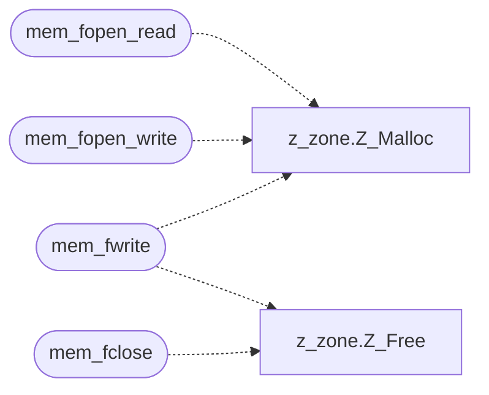

# `progs/doomgeneric/memio.c`

> Source: [progs/doomgeneric/memio.c:1](../../progs/doomgeneric/memio.c#L1) | language `c` | coverage 10.0% | [API index](../index.md)

Copyright(C) 1993-1996 Id Software, Inc.

Copyright(C) 2005-2014 Simon Howard  This program is free software; you can redistribute it and/or modify it under the terms of the GNU General Public License as published by the Free Software Foundation; either version 2 of the License, or (at your option) any later version.  This program is distributed in the hope that it will be useful, but WITHOUT ANY WARRANTY; without even the implied warranty of MERCHANTABILITY or FITNESS FOR A PARTICULAR PURPOSE.  See the GNU General Public License for more details.  Emulates the IO functions in C stdio.h reading and writing to memory.

## Contents

- **Structs:** [`_MEMFILE`](#_memfile)
- **Functions:** [`mem_fopen_read`](#mem_fopen_read), [`mem_fread`](#mem_fread), [`mem_fopen_write`](#mem_fopen_write), [`mem_fwrite`](#mem_fwrite), [`mem_get_buf`](#mem_get_buf), [`mem_fclose`](#mem_fclose), [`mem_ftell`](#mem_ftell), [`mem_fseek`](#mem_fseek)

## Call Graph

Solid arrows stay in this module, dashed arrows leave it.



## Structs

<a id="_memfile"></a>

### `_MEMFILE`

`struct` | [progs/doomgeneric/memio.c:32](../../progs/doomgeneric/memio.c#L32)

```c
struct _MEMFILE
```

---

## Functions

<a id="mem_fopen_read"></a>

### `mem_fopen_read`

`function` | [progs/doomgeneric/memio.c:42](../../progs/doomgeneric/memio.c#L42)

```c
MEMFILE *mem_fopen_read(void *buf, size_t buflen)
```

**Parameters**

| Name | Type | Default | Description |
|---|---|---|---|
| `buf` | `void *` |  |  |
| `buflen` | `size_t` |  |  |

**Returns:** `MEMFILE *`

*Calls:* [`Z_Malloc`](progs.doomgeneric.z_zone.h.md#z_malloc)

---

<a id="mem_fread"></a>

### `mem_fread`

`function` | [progs/doomgeneric/memio.c:58](../../progs/doomgeneric/memio.c#L58)

```c
size_t mem_fread(void *buf, size_t size, size_t nmemb, MEMFILE *stream)
```

**Parameters**

| Name | Type | Default | Description |
|---|---|---|---|
| `buf` | `void *` |  |  |
| `size` | `size_t` |  |  |
| `nmemb` | `size_t` |  |  |
| `stream` | `MEMFILE *` |  |  |

**Returns:** `size_t`

---

<a id="mem_fopen_write"></a>

### `mem_fopen_write`

`function` | [progs/doomgeneric/memio.c:90](../../progs/doomgeneric/memio.c#L90)

```c
MEMFILE *mem_fopen_write(void)
```

**Returns:** `MEMFILE *`

*Calls:* [`Z_Malloc`](progs.doomgeneric.z_zone.h.md#z_malloc)

---

<a id="mem_fwrite"></a>

### `mem_fwrite`

`function` | [progs/doomgeneric/memio.c:107](../../progs/doomgeneric/memio.c#L107)

```c
size_t mem_fwrite(const void *ptr, size_t size, size_t nmemb, MEMFILE *stream)
```

**Parameters**

| Name | Type | Default | Description |
|---|---|---|---|
| `ptr` | `void *` |  |  |
| `size` | `size_t` |  |  |
| `nmemb` | `size_t` |  |  |
| `stream` | `MEMFILE *` |  |  |

**Returns:** `size_t`

*Calls:* [`Z_Free`](progs.doomgeneric.z_zone.h.md#z_free), [`Z_Malloc`](progs.doomgeneric.z_zone.h.md#z_malloc)

---

<a id="mem_get_buf"></a>

### `mem_get_buf`

`function` | [progs/doomgeneric/memio.c:143](../../progs/doomgeneric/memio.c#L143)

```c
void mem_get_buf(MEMFILE *stream, void **buf, size_t *buflen)
```

**Parameters**

| Name | Type | Default | Description |
|---|---|---|---|
| `stream` | `MEMFILE *` |  |  |
| `buf` | `void **` |  |  |
| `buflen` | `size_t *` |  |  |

---

<a id="mem_fclose"></a>

### `mem_fclose`

`function` | [progs/doomgeneric/memio.c:149](../../progs/doomgeneric/memio.c#L149)

```c
void mem_fclose(MEMFILE *stream)
```

**Parameters**

| Name | Type | Default | Description |
|---|---|---|---|
| `stream` | `MEMFILE *` |  |  |

*Calls:* [`Z_Free`](progs.doomgeneric.z_zone.h.md#z_free)

---

<a id="mem_ftell"></a>

### `mem_ftell`

`function` | [progs/doomgeneric/memio.c:159](../../progs/doomgeneric/memio.c#L159)

```c
long mem_ftell(MEMFILE *stream)
```

**Parameters**

| Name | Type | Default | Description |
|---|---|---|---|
| `stream` | `MEMFILE *` |  |  |

**Returns:** `long`

---

<a id="mem_fseek"></a>

### `mem_fseek`

`function` | [progs/doomgeneric/memio.c:164](../../progs/doomgeneric/memio.c#L164)

```c
int mem_fseek(MEMFILE *stream, signed long position, mem_rel_t whence)
```

**Parameters**

| Name | Type | Default | Description |
|---|---|---|---|
| `stream` | `MEMFILE *` |  |  |
| `position` | `signed long` |  |  |
| `whence` | `mem_rel_t` |  |  |

**Returns:** `int`

---
