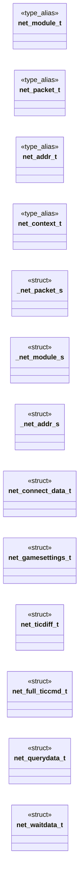

# `progs/doomgeneric/net_defs.h`

> Source: [progs/doomgeneric/net_defs.h:1](../../progs/doomgeneric/net_defs.h#L1) | language `h` | coverage 7.1% | [API index](../index.md)

Copyright(C) 2005-2014 Simon Howard  This program is free software; you can redistribute it and/or modify it under the terms of the GNU General Public License as published by the Free Software Foundation; either version 2 of the License, or (at your option) any later version.

This program is distributed in the hope that it will be useful, but WITHOUT ANY WARRANTY; without even the implied warranty of MERCHANTABILITY or FITNESS FOR A PARTICULAR PURPOSE.  See the GNU General Public License for more details.  DESCRIPTION: Definitions for use in networking code.      Absolute maximum number of "nodes" in the game.  This is different to NET_MAXPLAYERS, as there may be observers that are not participating (eg. left/right monitors)

## Contents

- **Structs:** [`_net_packet_s`](#_net_packet_s), [`_net_module_s`](#_net_module_s), [`_net_addr_s`](#_net_addr_s), [`net_connect_data_t`](#net_connect_data_t), [`net_gamesettings_t`](#net_gamesettings_t), [`net_ticdiff_t`](#net_ticdiff_t), [`net_full_ticcmd_t`](#net_full_ticcmd_t), [`net_querydata_t`](#net_querydata_t), [`net_waitdata_t`](#net_waitdata_t)
- **Type Aliases:** [`net_module_t`](#net_module_t), [`net_packet_t`](#net_packet_t), [`net_addr_t`](#net_addr_t), [`net_context_t`](#net_context_t)
- **Macros:** [`MAXNETNODES`](#maxnetnodes), [`NET_MAXPLAYERS`](#net_maxplayers), [`MAXPLAYERNAME`](#maxplayername), [`BACKUPTICS`](#backuptics), [`NET_MAGIC_NUMBER`](#net_magic_number), [`NET_RELIABLE_PACKET`](#net_reliable_packet), [`NET_TICDIFF_FORWARD`](#net_ticdiff_forward), [`NET_TICDIFF_SIDE`](#net_ticdiff_side), [`NET_TICDIFF_TURN`](#net_ticdiff_turn), [`NET_TICDIFF_BUTTONS`](#net_ticdiff_buttons), [`NET_TICDIFF_CONSISTANCY`](#net_ticdiff_consistancy), [`NET_TICDIFF_CHATCHAR`](#net_ticdiff_chatchar), [`NET_TICDIFF_RAVEN`](#net_ticdiff_raven), [`NET_TICDIFF_STRIFE`](#net_ticdiff_strife)

## Type Diagram



## Structs

<a id="_net_packet_s"></a>

### `_net_packet_s`

`struct` | [progs/doomgeneric/net_defs.h:52](../../progs/doomgeneric/net_defs.h#L52)

```c
struct _net_packet_s
```

---

<a id="_net_module_s"></a>

### `_net_module_s`

`struct` | [progs/doomgeneric/net_defs.h:60](../../progs/doomgeneric/net_defs.h#L60)

```c
struct _net_module_s
```

---

<a id="_net_addr_s"></a>

### `_net_addr_s`

`struct` | [progs/doomgeneric/net_defs.h:95](../../progs/doomgeneric/net_defs.h#L95)

```c
struct _net_addr_s
```

---

<a id="net_connect_data_t"></a>

### `net_connect_data_t`

`struct` | [progs/doomgeneric/net_defs.h:147](../../progs/doomgeneric/net_defs.h#L147)

```c
typedef struct
```

---

<a id="net_gamesettings_t"></a>

### `net_gamesettings_t`

`struct` | [progs/doomgeneric/net_defs.h:163](../../progs/doomgeneric/net_defs.h#L163)

```c
typedef struct
```

---

<a id="net_ticdiff_t"></a>

### `net_ticdiff_t`

`struct` | [progs/doomgeneric/net_defs.h:202](../../progs/doomgeneric/net_defs.h#L202)

```c
typedef struct
```

---

<a id="net_full_ticcmd_t"></a>

### `net_full_ticcmd_t`

`struct` | [progs/doomgeneric/net_defs.h:210](../../progs/doomgeneric/net_defs.h#L210)

```c
typedef struct
```

---

<a id="net_querydata_t"></a>

### `net_querydata_t`

`struct` | [progs/doomgeneric/net_defs.h:220](../../progs/doomgeneric/net_defs.h#L220)

```c
typedef struct
```

---

<a id="net_waitdata_t"></a>

### `net_waitdata_t`

`struct` | [progs/doomgeneric/net_defs.h:233](../../progs/doomgeneric/net_defs.h#L233)

```c
typedef struct
```

---

## Type Aliases

<a id="net_module_t"></a>

### `net_module_t`

`type_alias` | [progs/doomgeneric/net_defs.h:46](../../progs/doomgeneric/net_defs.h#L46)

```c
typedef struct _net_module_s net_module_t;
```

define BACKUPTICS 128

---

<a id="net_packet_t"></a>

### `net_packet_t`

`type_alias` | [progs/doomgeneric/net_defs.h:48](../../progs/doomgeneric/net_defs.h#L48)

```c
typedef struct _net_packet_s net_packet_t;
```

---

<a id="net_addr_t"></a>

### `net_addr_t`

`type_alias` | [progs/doomgeneric/net_defs.h:49](../../progs/doomgeneric/net_defs.h#L49)

```c
typedef struct _net_addr_s net_addr_t;
```

---

<a id="net_context_t"></a>

### `net_context_t`

`type_alias` | [progs/doomgeneric/net_defs.h:50](../../progs/doomgeneric/net_defs.h#L50)

```c
typedef struct _net_context_s net_context_t;
```

---

## Macros

<a id="maxnetnodes"></a>

### `MAXNETNODES`

`macro` | [progs/doomgeneric/net_defs.h:31](../../progs/doomgeneric/net_defs.h#L31)

```c
#define MAXNETNODES
```

---

<a id="net_maxplayers"></a>

### `NET_MAXPLAYERS`

`macro` | [progs/doomgeneric/net_defs.h:37](../../progs/doomgeneric/net_defs.h#L37)

```c
#define NET_MAXPLAYERS
```

---

<a id="maxplayername"></a>

### `MAXPLAYERNAME`

`macro` | [progs/doomgeneric/net_defs.h:41](../../progs/doomgeneric/net_defs.h#L41)

```c
#define MAXPLAYERNAME
```

---

<a id="backuptics"></a>

### `BACKUPTICS`

`macro` | [progs/doomgeneric/net_defs.h:45](../../progs/doomgeneric/net_defs.h#L45)

```c
#define BACKUPTICS
```

---

<a id="net_magic_number"></a>

### `NET_MAGIC_NUMBER`

`macro` | [progs/doomgeneric/net_defs.h:103](../../progs/doomgeneric/net_defs.h#L103)

```c
#define NET_MAGIC_NUMBER
```

---

<a id="net_reliable_packet"></a>

### `NET_RELIABLE_PACKET`

`macro` | [progs/doomgeneric/net_defs.h:107](../../progs/doomgeneric/net_defs.h#L107)

```c
#define NET_RELIABLE_PACKET
```

---

<a id="net_ticdiff_forward"></a>

### `NET_TICDIFF_FORWARD`

`macro` | [progs/doomgeneric/net_defs.h:193](../../progs/doomgeneric/net_defs.h#L193)

```c
#define NET_TICDIFF_FORWARD
```

---

<a id="net_ticdiff_side"></a>

### `NET_TICDIFF_SIDE`

`macro` | [progs/doomgeneric/net_defs.h:194](../../progs/doomgeneric/net_defs.h#L194)

```c
#define NET_TICDIFF_SIDE
```

---

<a id="net_ticdiff_turn"></a>

### `NET_TICDIFF_TURN`

`macro` | [progs/doomgeneric/net_defs.h:195](../../progs/doomgeneric/net_defs.h#L195)

```c
#define NET_TICDIFF_TURN
```

---

<a id="net_ticdiff_buttons"></a>

### `NET_TICDIFF_BUTTONS`

`macro` | [progs/doomgeneric/net_defs.h:196](../../progs/doomgeneric/net_defs.h#L196)

```c
#define NET_TICDIFF_BUTTONS
```

---

<a id="net_ticdiff_consistancy"></a>

### `NET_TICDIFF_CONSISTANCY`

`macro` | [progs/doomgeneric/net_defs.h:197](../../progs/doomgeneric/net_defs.h#L197)

```c
#define NET_TICDIFF_CONSISTANCY
```

---

<a id="net_ticdiff_chatchar"></a>

### `NET_TICDIFF_CHATCHAR`

`macro` | [progs/doomgeneric/net_defs.h:198](../../progs/doomgeneric/net_defs.h#L198)

```c
#define NET_TICDIFF_CHATCHAR
```

---

<a id="net_ticdiff_raven"></a>

### `NET_TICDIFF_RAVEN`

`macro` | [progs/doomgeneric/net_defs.h:199](../../progs/doomgeneric/net_defs.h#L199)

```c
#define NET_TICDIFF_RAVEN
```

---

<a id="net_ticdiff_strife"></a>

### `NET_TICDIFF_STRIFE`

`macro` | [progs/doomgeneric/net_defs.h:200](../../progs/doomgeneric/net_defs.h#L200)

```c
#define NET_TICDIFF_STRIFE
```

---
