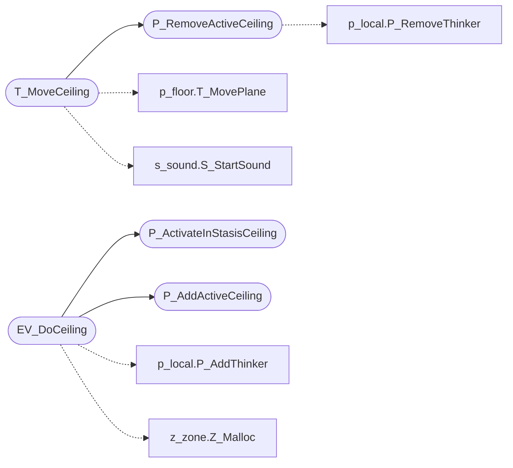

# `progs/doomgeneric/p_ceilng.c`

> Source: [progs/doomgeneric/p_ceilng.c:1](../../progs/doomgeneric/p_ceilng.c#L1) | language `c` | coverage 71.4% | [API index](../index.md)

Copyright(C) 1993-1996 Id Software, Inc.

Copyright(C) 2005-2014 Simon Howard  This program is free software; you can redistribute it and/or modify it under the terms of the GNU General Public License as published by the Free Software Foundation; either version 2 of the License, or (at your option) any later version.  This program is distributed in the hope that it will be useful, but WITHOUT ANY WARRANTY; without even the implied warranty of MERCHANTABILITY or FITNESS FOR A PARTICULAR PURPOSE.  See the GNU General Public License for more details.  DESCRIPTION:  Ceiling aninmation (lowering, crushing, raising)       State.  Data.

## Contents

- **Functions:** [`T_MoveCeiling`](#t_moveceiling), [`EV_DoCeiling`](#ev_doceiling), [`P_AddActiveCeiling`](#p_addactiveceiling), [`P_RemoveActiveCeiling`](#p_removeactiveceiling), [`P_ActivateInStasisCeiling`](#p_activateinstasisceiling), [`EV_CeilingCrushStop`](#ev_ceilingcrushstop)

## Call Graph

Solid arrows stay in this module, dashed arrows leave it.



## Functions

<a id="t_moveceiling"></a>

### `T_MoveCeiling`

`function` | [progs/doomgeneric/p_ceilng.c:45](../../progs/doomgeneric/p_ceilng.c#L45)

```c
void T_MoveCeiling (ceiling_t* ceiling)
```

**Parameters**

| Name | Type | Default | Description |
|---|---|---|---|
| `ceiling` | `ceiling_t*` |  |  |

*Calls:* [`P_RemoveActiveCeiling`](#p_removeactiveceiling), [`T_MovePlane`](progs.doomgeneric.p_floor.c.md#t_moveplane), [`S_StartSound`](progs.doomgeneric.s_sound.h.md#s_startsound)

---

<a id="ev_doceiling"></a>

### `EV_DoCeiling`

`function` | [progs/doomgeneric/p_ceilng.c:161](../../progs/doomgeneric/p_ceilng.c#L161)

```c
int EV_DoCeiling ( line_t* line, ceiling_e type )
```

**Parameters**

| Name | Type | Default | Description |
|---|---|---|---|
| `line` | `line_t*` |  |  |
| `type` | `ceiling_e` |  |  |

**Returns:** `int`

*Calls:* [`P_ActivateInStasisCeiling`](#p_activateinstasisceiling), [`P_AddActiveCeiling`](#p_addactiveceiling), [`P_AddThinker`](progs.doomgeneric.p_local.h.md#p_addthinker), [`Z_Malloc`](progs.doomgeneric.z_zone.h.md#z_malloc)

*Called by:* [`P_UseSpecialLine`](progs.doomgeneric.p_switch.c.md#p_usespecialline)

---

<a id="p_addactiveceiling"></a>

### `P_AddActiveCeiling`

`function` | [progs/doomgeneric/p_ceilng.c:240](../../progs/doomgeneric/p_ceilng.c#L240)

```c
void P_AddActiveCeiling(ceiling_t* c)
```

Add an active ceiling

**Parameters**

| Name | Type | Default | Description |
|---|---|---|---|
| `c` | `ceiling_t*` |  |  |

*Called by:* [`EV_DoCeiling`](#ev_doceiling), [`P_UnArchiveSpecials`](progs.doomgeneric.p_saveg.c.md#p_unarchivespecials)

---

<a id="p_removeactiveceiling"></a>

### `P_RemoveActiveCeiling`

`function` | [progs/doomgeneric/p_ceilng.c:259](../../progs/doomgeneric/p_ceilng.c#L259)

```c
void P_RemoveActiveCeiling(ceiling_t* c)
```

Remove a ceiling's thinker

**Parameters**

| Name | Type | Default | Description |
|---|---|---|---|
| `c` | `ceiling_t*` |  |  |

*Calls:* [`P_RemoveThinker`](progs.doomgeneric.p_local.h.md#p_removethinker)

*Called by:* [`T_MoveCeiling`](#t_moveceiling)

---

<a id="p_activateinstasisceiling"></a>

### `P_ActivateInStasisCeiling`

`function` | [progs/doomgeneric/p_ceilng.c:280](../../progs/doomgeneric/p_ceilng.c#L280)

```c
void P_ActivateInStasisCeiling(line_t* line)
```

Restart a ceiling that's in-stasis

**Parameters**

| Name | Type | Default | Description |
|---|---|---|---|
| `line` | `line_t*` |  |  |

*Called by:* [`EV_DoCeiling`](#ev_doceiling)

---

<a id="ev_ceilingcrushstop"></a>

### `EV_CeilingCrushStop`

`function` | [progs/doomgeneric/p_ceilng.c:303](../../progs/doomgeneric/p_ceilng.c#L303)

```c
int EV_CeilingCrushStop(line_t *line)
```

EV_CeilingCrushStop Stop a ceiling from crushing!

**Parameters**

| Name | Type | Default | Description |
|---|---|---|---|
| `line` | `line_t *` |  |  |

**Returns:** `int`

---
