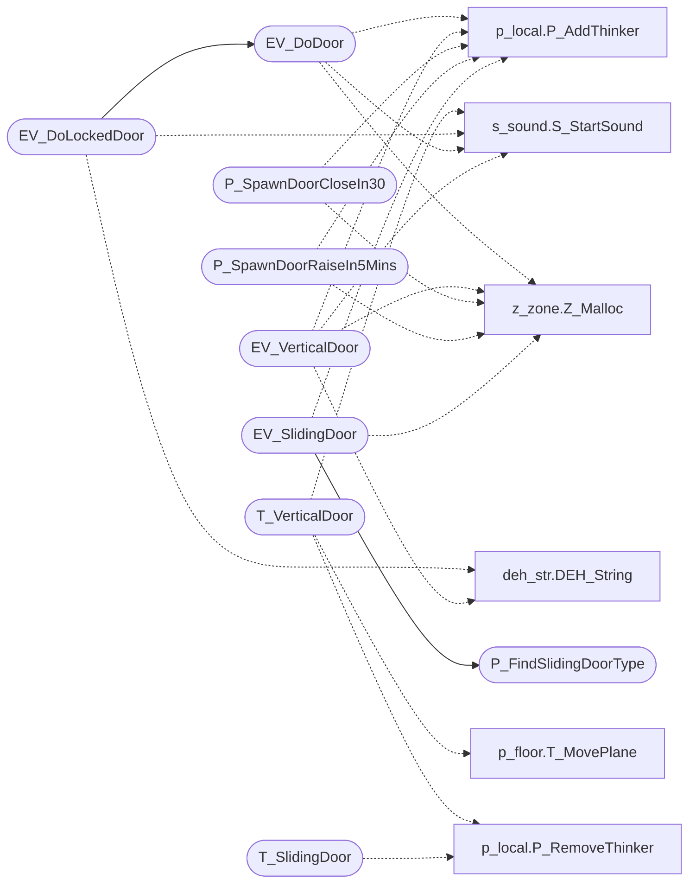

# `progs/doomgeneric/p_doors.c`

> Source: [progs/doomgeneric/p_doors.c:1](../../progs/doomgeneric/p_doors.c#L1) | language `c` | coverage 36.4% | [API index](../index.md)

Copyright(C) 1993-1996 Id Software, Inc.

Copyright(C) 2005-2014 Simon Howard  This program is free software; you can redistribute it and/or modify it under the terms of the GNU General Public License as published by the Free Software Foundation; either version 2 of the License, or (at your option) any later version.  This program is distributed in the hope that it will be useful, but WITHOUT ANY WARRANTY; without even the implied warranty of MERCHANTABILITY or FITNESS FOR A PARTICULAR PURPOSE.  See the GNU General Public License for more details.  DESCRIPTION: Door animation code (opening/closing)        State.

## Contents

- **Functions:** [`T_VerticalDoor`](#t_verticaldoor), [`EV_DoLockedDoor`](#ev_dolockeddoor), [`EV_DoDoor`](#ev_dodoor), [`EV_VerticalDoor`](#ev_verticaldoor), [`P_SpawnDoorCloseIn30`](#p_spawndoorclosein30), [`P_SpawnDoorRaiseIn5Mins`](#p_spawndoorraisein5mins), [`P_InitSlidingDoorFrames`](#p_initslidingdoorframes), [`P_FindSlidingDoorType`](#p_findslidingdoortype), [`T_SlidingDoor`](#t_slidingdoor), [`EV_SlidingDoor`](#ev_slidingdoor)

## Call Graph

Solid arrows stay in this module, dashed arrows leave it.



## Functions

<a id="t_verticaldoor"></a>

### `T_VerticalDoor`

`function` | [progs/doomgeneric/p_doors.c:57](../../progs/doomgeneric/p_doors.c#L57)

```c
void T_VerticalDoor (vldoor_t* door)
```

T_VerticalDoor

**Parameters**

| Name | Type | Default | Description |
|---|---|---|---|
| `door` | `vldoor_t*` |  |  |

*Calls:* [`T_MovePlane`](progs.doomgeneric.p_floor.c.md#t_moveplane), [`P_RemoveThinker`](progs.doomgeneric.p_local.h.md#p_removethinker), [`S_StartSound`](progs.doomgeneric.s_sound.h.md#s_startsound)

---

<a id="ev_dolockeddoor"></a>

### `EV_DoLockedDoor`

`function` | [progs/doomgeneric/p_doors.c:195](../../progs/doomgeneric/p_doors.c#L195)

```c
int EV_DoLockedDoor ( line_t* line, vldoor_e type, mobj_t* thing )
```

**Parameters**

| Name | Type | Default | Description |
|---|---|---|---|
| `line` | `line_t*` |  |  |
| `type` | `vldoor_e` |  |  |
| `thing` | `mobj_t*` |  |  |

**Returns:** `int`

*Calls:* [`DEH_String`](progs.doomgeneric.deh_str.h.md#deh_string), [`EV_DoDoor`](#ev_dodoor), [`S_StartSound`](progs.doomgeneric.s_sound.h.md#s_startsound)

*Called by:* [`P_UseSpecialLine`](progs.doomgeneric.p_switch.c.md#p_usespecialline)

---

<a id="ev_dodoor"></a>

### `EV_DoDoor`

`function` | [progs/doomgeneric/p_doors.c:252](../../progs/doomgeneric/p_doors.c#L252)

```c
int EV_DoDoor ( line_t* line, vldoor_e type )
```

**Parameters**

| Name | Type | Default | Description |
|---|---|---|---|
| `line` | `line_t*` |  |  |
| `type` | `vldoor_e` |  |  |

**Returns:** `int`

*Calls:* [`P_AddThinker`](progs.doomgeneric.p_local.h.md#p_addthinker), [`S_StartSound`](progs.doomgeneric.s_sound.h.md#s_startsound), [`Z_Malloc`](progs.doomgeneric.z_zone.h.md#z_malloc)

*Called by:* [`EV_DoLockedDoor`](#ev_dolockeddoor), [`A_BossDeath`](progs.doomgeneric.p_enemy.c.md#a_bossdeath), [`A_KeenDie`](progs.doomgeneric.p_enemy.c.md#a_keendie), [`P_UseSpecialLine`](progs.doomgeneric.p_switch.c.md#p_usespecialline)

---

<a id="ev_verticaldoor"></a>

### `EV_VerticalDoor`

`function` | [progs/doomgeneric/p_doors.c:337](../../progs/doomgeneric/p_doors.c#L337)

```c
void EV_VerticalDoor ( line_t* line, mobj_t* thing )
```

**Parameters**

| Name | Type | Default | Description |
|---|---|---|---|
| `line` | `line_t*` |  |  |
| `thing` | `mobj_t*` |  |  |

*Calls:* [`DEH_String`](progs.doomgeneric.deh_str.h.md#deh_string), [`P_AddThinker`](progs.doomgeneric.p_local.h.md#p_addthinker), [`S_StartSound`](progs.doomgeneric.s_sound.h.md#s_startsound), [`Z_Malloc`](progs.doomgeneric.z_zone.h.md#z_malloc)

*Called by:* [`P_UseSpecialLine`](progs.doomgeneric.p_switch.c.md#p_usespecialline)

---

<a id="p_spawndoorclosein30"></a>

### `P_SpawnDoorCloseIn30`

`function` | [progs/doomgeneric/p_doors.c:519](../../progs/doomgeneric/p_doors.c#L519)

```c
void P_SpawnDoorCloseIn30 (sector_t* sec)
```

Spawn a door that closes after 30 seconds

**Parameters**

| Name | Type | Default | Description |
|---|---|---|---|
| `sec` | `sector_t*` |  |  |

*Calls:* [`P_AddThinker`](progs.doomgeneric.p_local.h.md#p_addthinker), [`Z_Malloc`](progs.doomgeneric.z_zone.h.md#z_malloc)

---

<a id="p_spawndoorraisein5mins"></a>

### `P_SpawnDoorRaiseIn5Mins`

`function` | [progs/doomgeneric/p_doors.c:542](../../progs/doomgeneric/p_doors.c#L542)

```c
void P_SpawnDoorRaiseIn5Mins ( sector_t* sec, int secnum )
```

**Parameters**

| Name | Type | Default | Description |
|---|---|---|---|
| `sec` | `sector_t*` |  |  |
| `secnum` | `int` |  |  |

*Calls:* [`P_AddThinker`](progs.doomgeneric.p_local.h.md#p_addthinker), [`Z_Malloc`](progs.doomgeneric.z_zone.h.md#z_malloc)

---

<a id="p_initslidingdoorframes"></a>

### `P_InitSlidingDoorFrames`

`function` | [progs/doomgeneric/p_doors.c:580](../../progs/doomgeneric/p_doors.c#L580)

```c
void P_InitSlidingDoorFrames(void)
```

---

<a id="p_findslidingdoortype"></a>

### `P_FindSlidingDoorType`

`function` | [progs/doomgeneric/p_doors.c:624](../../progs/doomgeneric/p_doors.c#L624)

```c
int P_FindSlidingDoorType(line_t* line)
```

Return index into "slideFrames" array for which door type to use

**Parameters**

| Name | Type | Default | Description |
|---|---|---|---|
| `line` | `line_t*` |  |  |

**Returns:** `int`

*Called by:* [`EV_SlidingDoor`](#ev_slidingdoor)

---

<a id="t_slidingdoor"></a>

### `T_SlidingDoor`

`function` | [progs/doomgeneric/p_doors.c:639](../../progs/doomgeneric/p_doors.c#L639)

```c
void T_SlidingDoor (slidedoor_t* door)
```

**Parameters**

| Name | Type | Default | Description |
|---|---|---|---|
| `door` | `slidedoor_t*` |  |  |

*Calls:* [`P_RemoveThinker`](progs.doomgeneric.p_local.h.md#p_removethinker)

---

<a id="ev_slidingdoor"></a>

### `EV_SlidingDoor`

`function` | [progs/doomgeneric/p_doors.c:727](../../progs/doomgeneric/p_doors.c#L727)

```c
void EV_SlidingDoor ( line_t* line, mobj_t* thing )
```

**Parameters**

| Name | Type | Default | Description |
|---|---|---|---|
| `line` | `line_t*` |  |  |
| `thing` | `mobj_t*` |  |  |

*Calls:* [`P_FindSlidingDoorType`](#p_findslidingdoortype), [`P_AddThinker`](progs.doomgeneric.p_local.h.md#p_addthinker), [`Z_Malloc`](progs.doomgeneric.z_zone.h.md#z_malloc)

---
