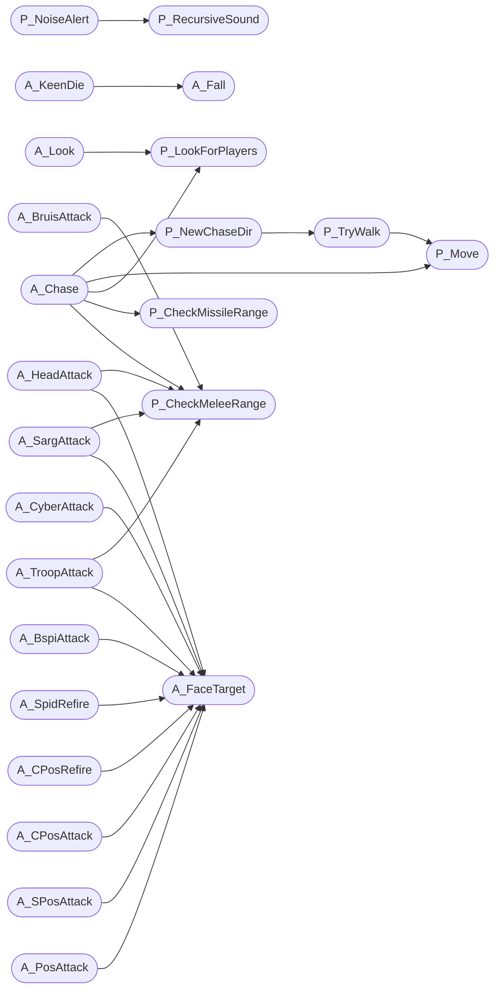

# `progs/doomgeneric/p_enemy.c`

> Source: [progs/doomgeneric/p_enemy.c:1](../../progs/doomgeneric/p_enemy.c#L1) | language `c` | coverage 32.4% | [API index](../index.md)

Copyright(C) 1993-1996 Id Software, Inc.

Copyright(C) 2005-2014 Simon Howard  This program is free software; you can redistribute it and/or modify it under the terms of the GNU General Public License as published by the Free Software Foundation; either version 2 of the License, or (at your option) any later version.  This program is distributed in the hope that it will be useful, but WITHOUT ANY WARRANTY; without even the implied warranty of MERCHANTABILITY or FITNESS FOR A PARTICULAR PURPOSE.  See the GNU General Public License for more details.  DESCRIPTION: Enemy thinking, AI. Action Pointer Functions that are associated with states/frames.

## Contents

- **Functions:** [`P_RecursiveSound`](#p_recursivesound), [`P_NoiseAlert`](#p_noisealert), [`P_CheckMeleeRange`](#p_checkmeleerange), [`P_CheckMissileRange`](#p_checkmissilerange), [`P_Move`](#p_move), [`P_TryWalk`](#p_trywalk), [`P_NewChaseDir`](#p_newchasedir), [`P_LookForPlayers`](#p_lookforplayers), [`A_KeenDie`](#a_keendie), [`A_Look`](#a_look), [`A_Chase`](#a_chase), [`A_FaceTarget`](#a_facetarget), [`A_PosAttack`](#a_posattack), [`A_SPosAttack`](#a_sposattack), [`A_CPosAttack`](#a_cposattack), [`A_CPosRefire`](#a_cposrefire), [`A_SpidRefire`](#a_spidrefire), [`A_BspiAttack`](#a_bspiattack), [`A_TroopAttack`](#a_troopattack), [`A_SargAttack`](#a_sargattack), [`A_HeadAttack`](#a_headattack), [`A_CyberAttack`](#a_cyberattack), [`A_BruisAttack`](#a_bruisattack), [`A_SkelMissile`](#a_skelmissile), [`A_Tracer`](#a_tracer), [`A_SkelWhoosh`](#a_skelwhoosh), [`A_SkelFist`](#a_skelfist), [`PIT_VileCheck`](#pit_vilecheck), [`A_VileChase`](#a_vilechase), [`A_VileStart`](#a_vilestart), [`A_StartFire`](#a_startfire), [`A_FireCrackle`](#a_firecrackle), [`A_Fire`](#a_fire), [`A_VileTarget`](#a_viletarget), [`A_VileAttack`](#a_vileattack), [`A_FatRaise`](#a_fatraise), [`A_FatAttack1`](#a_fatattack1), [`A_FatAttack2`](#a_fatattack2), [`A_FatAttack3`](#a_fatattack3), [`A_SkullAttack`](#a_skullattack), [`A_PainShootSkull`](#a_painshootskull), [`A_PainAttack`](#a_painattack), [`A_PainDie`](#a_paindie), [`A_Scream`](#a_scream), [`A_XScream`](#a_xscream), [`A_Pain`](#a_pain), [`A_Fall`](#a_fall), [`A_Explode`](#a_explode), [`A_BossDeath`](#a_bossdeath), [`A_Hoof`](#a_hoof), [`A_Metal`](#a_metal), [`A_BabyMetal`](#a_babymetal), [`A_OpenShotgun2`](#a_openshotgun2), [`A_LoadShotgun2`](#a_loadshotgun2), [`A_ReFire`](#a_refire), [`A_CloseShotgun2`](#a_closeshotgun2), [`A_BrainAwake`](#a_brainawake), [`A_BrainPain`](#a_brainpain), [`A_BrainScream`](#a_brainscream), [`A_BrainExplode`](#a_brainexplode), [`A_BrainDie`](#a_braindie), [`A_BrainSpit`](#a_brainspit), [`A_SpawnSound`](#a_spawnsound), [`A_SpawnFly`](#a_spawnfly), [`A_PlayerScream`](#a_playerscream)
- **Macros:** [`FATSPREAD`](#fatspread), [`SKULLSPEED`](#skullspeed)

## Call Graph

Solid arrows stay in this module, dashed arrows leave it.



## Functions

<a id="p_recursivesound"></a>

### `P_RecursiveSound`

`function` | [progs/doomgeneric/p_enemy.c:99](../../progs/doomgeneric/p_enemy.c#L99)

```c
void P_RecursiveSound ( sector_t* sec, int soundblocks )
```

**Parameters**

| Name | Type | Default | Description |
|---|---|---|---|
| `sec` | `sector_t*` |  |  |
| `soundblocks` | `int` |  |  |

*Calls:* [`P_LineOpening`](progs.doomgeneric.p_local.h.md#p_lineopening)

*Called by:* [`P_NoiseAlert`](#p_noisealert)

---

<a id="p_noisealert"></a>

### `P_NoiseAlert`

`function` | [progs/doomgeneric/p_enemy.c:152](../../progs/doomgeneric/p_enemy.c#L152)

```c
void P_NoiseAlert ( mobj_t* target, mobj_t* emmiter )
```

P_ENEMY

**Parameters**

| Name | Type | Default | Description |
|---|---|---|---|
| `target` | `mobj_t*` |  |  |
| `emmiter` | `mobj_t*` |  |  |

> **Inherited:** Documentation from [`P_NoiseAlert`](#p_noisealert) (progs/doomgeneric/p_local.h:127).

*Calls:* [`P_RecursiveSound`](#p_recursivesound)

---

<a id="p_checkmeleerange"></a>

### `P_CheckMeleeRange`

`function` | [progs/doomgeneric/p_enemy.c:167](../../progs/doomgeneric/p_enemy.c#L167)

```c
boolean P_CheckMeleeRange (mobj_t* actor)
```

P_CheckMeleeRange

**Parameters**

| Name | Type | Default | Description |
|---|---|---|---|
| `actor` | `mobj_t*` |  |  |

**Returns:** `boolean`

*Calls:* [`P_AproxDistance`](progs.doomgeneric.p_local.h.md#p_aproxdistance), [`P_CheckSight`](progs.doomgeneric.p_sight.c.md#p_checksight)

*Called by:* [`A_BruisAttack`](#a_bruisattack), [`A_Chase`](#a_chase), [`A_HeadAttack`](#a_headattack), [`A_SargAttack`](#a_sargattack), [`A_SkelFist`](#a_skelfist), [`A_TroopAttack`](#a_troopattack)

---

<a id="p_checkmissilerange"></a>

### `P_CheckMissileRange`

`function` | [progs/doomgeneric/p_enemy.c:190](../../progs/doomgeneric/p_enemy.c#L190)

```c
boolean P_CheckMissileRange (mobj_t* actor)
```

P_CheckMissileRange

**Parameters**

| Name | Type | Default | Description |
|---|---|---|---|
| `actor` | `mobj_t*` |  |  |

**Returns:** `boolean`

*Calls:* [`P_Random`](progs.doomgeneric.m_random.h.md#p_random), [`P_AproxDistance`](progs.doomgeneric.p_local.h.md#p_aproxdistance), [`P_CheckSight`](progs.doomgeneric.p_sight.c.md#p_checksight)

*Called by:* [`A_Chase`](#a_chase)

---

<a id="p_move"></a>

### `P_Move`

`function` | [progs/doomgeneric/p_enemy.c:260](../../progs/doomgeneric/p_enemy.c#L260)

```c
boolean P_Move (mobj_t* actor)
```

**Parameters**

| Name | Type | Default | Description |
|---|---|---|---|
| `actor` | `mobj_t*` |  |  |

**Returns:** `boolean`

*Calls:* [`I_Error`](progs.doomgeneric.i_system.h.md#i_error), [`P_TryMove`](progs.doomgeneric.p_map.c.md#p_trymove), [`P_UseSpecialLine`](progs.doomgeneric.p_switch.c.md#p_usespecialline)

*Called by:* [`A_Chase`](#a_chase), [`P_TryWalk`](#p_trywalk)

---

<a id="p_trywalk"></a>

### `P_TryWalk`

`function` | [progs/doomgeneric/p_enemy.c:337](../../progs/doomgeneric/p_enemy.c#L337)

```c
boolean P_TryWalk (mobj_t* actor)
```

TryWalk Attempts to move actor on in its current (ob->moveangle) direction.

If blocked by either a wall or an actor returns FALSE If move is either clear or blocked only by a door, returns TRUE and sets... If a door is in the way, an OpenDoor call is made to start it opening.

**Parameters**

| Name | Type | Default | Description |
|---|---|---|---|
| `actor` | `mobj_t*` |  |  |

**Returns:** `boolean`

*Calls:* [`P_Random`](progs.doomgeneric.m_random.h.md#p_random), [`P_Move`](#p_move)

*Called by:* [`P_NewChaseDir`](#p_newchasedir)

---

<a id="p_newchasedir"></a>

### `P_NewChaseDir`

`function` | [progs/doomgeneric/p_enemy.c:351](../../progs/doomgeneric/p_enemy.c#L351)

```c
void P_NewChaseDir (mobj_t* actor)
```

**Parameters**

| Name | Type | Default | Description |
|---|---|---|---|
| `actor` | `mobj_t*` |  |  |

*Calls:* [`I_Error`](progs.doomgeneric.i_system.h.md#i_error), [`P_Random`](progs.doomgeneric.m_random.h.md#p_random), [`P_TryWalk`](#p_trywalk)

*Called by:* [`A_Chase`](#a_chase)

---

<a id="p_lookforplayers"></a>

### `P_LookForPlayers`

`function` | [progs/doomgeneric/p_enemy.c:487](../../progs/doomgeneric/p_enemy.c#L487)

```c
boolean P_LookForPlayers ( mobj_t* actor, boolean allaround )
```

**Parameters**

| Name | Type | Default | Description |
|---|---|---|---|
| `actor` | `mobj_t*` |  |  |
| `allaround` | `boolean` |  |  |

**Returns:** `boolean`

*Calls:* [`P_AproxDistance`](progs.doomgeneric.p_local.h.md#p_aproxdistance), [`P_CheckSight`](progs.doomgeneric.p_sight.c.md#p_checksight)

*Called by:* [`A_Chase`](#a_chase), [`A_Look`](#a_look), [`A_SpawnFly`](#a_spawnfly)

---

<a id="a_keendie"></a>

### `A_KeenDie`

`function` | [progs/doomgeneric/p_enemy.c:551](../../progs/doomgeneric/p_enemy.c#L551)

```c
void A_KeenDie (mobj_t* mo)
```

A_KeenDie DOOM II special, map 32.

Uses special tag 666.

**Parameters**

| Name | Type | Default | Description |
|---|---|---|---|
| `mo` | `mobj_t*` |  |  |

*Calls:* [`EV_DoDoor`](progs.doomgeneric.p_doors.c.md#ev_dodoor), [`A_Fall`](#a_fall)

---

<a id="a_look"></a>

### `A_Look`

`function` | [progs/doomgeneric/p_enemy.c:589](../../progs/doomgeneric/p_enemy.c#L589)

```c
void A_Look (mobj_t* actor)
```

A_Look Stay in state until a player is sighted.

**Parameters**

| Name | Type | Default | Description |
|---|---|---|---|
| `actor` | `mobj_t*` |  |  |

*Calls:* [`P_Random`](progs.doomgeneric.m_random.h.md#p_random), [`P_LookForPlayers`](#p_lookforplayers), [`P_SetMobjState`](progs.doomgeneric.p_mobj.c.md#p_setmobjstate), [`P_CheckSight`](progs.doomgeneric.p_sight.c.md#p_checksight), [`S_StartSound`](progs.doomgeneric.s_sound.h.md#s_startsound)

---

<a id="a_chase"></a>

### `A_Chase`

`function` | [progs/doomgeneric/p_enemy.c:657](../../progs/doomgeneric/p_enemy.c#L657)

```c
void A_Chase (mobj_t* actor)
```

A_Chase Actor has a melee attack, so it tries to close as fast as possible

**Parameters**

| Name | Type | Default | Description |
|---|---|---|---|
| `actor` | `mobj_t*` |  |  |

*Calls:* [`P_Random`](progs.doomgeneric.m_random.h.md#p_random), [`P_CheckMeleeRange`](#p_checkmeleerange), [`P_CheckMissileRange`](#p_checkmissilerange), [`P_LookForPlayers`](#p_lookforplayers), [`P_Move`](#p_move), [`P_NewChaseDir`](#p_newchasedir), [`P_SetMobjState`](progs.doomgeneric.p_mobj.c.md#p_setmobjstate), [`P_CheckSight`](progs.doomgeneric.p_sight.c.md#p_checksight), [`S_StartSound`](progs.doomgeneric.s_sound.h.md#s_startsound)

*Called by:* [`A_BabyMetal`](#a_babymetal), [`A_Hoof`](#a_hoof), [`A_Metal`](#a_metal), [`A_VileChase`](#a_vilechase)

---

<a id="a_facetarget"></a>

### `A_FaceTarget`

`function` | [progs/doomgeneric/p_enemy.c:767](../../progs/doomgeneric/p_enemy.c#L767)

```c
void A_FaceTarget (mobj_t* actor)
```

A_FaceTarget

**Parameters**

| Name | Type | Default | Description |
|---|---|---|---|
| `actor` | `mobj_t*` |  |  |

*Calls:* [`P_Random`](progs.doomgeneric.m_random.h.md#p_random)

*Called by:* [`A_BspiAttack`](#a_bspiattack), [`A_CPosAttack`](#a_cposattack), [`A_CPosRefire`](#a_cposrefire), [`A_CyberAttack`](#a_cyberattack), [`A_FatAttack1`](#a_fatattack1), [`A_FatAttack2`](#a_fatattack2), [`A_FatAttack3`](#a_fatattack3), [`A_FatRaise`](#a_fatraise), [`A_HeadAttack`](#a_headattack), [`A_PainAttack`](#a_painattack), [`A_PosAttack`](#a_posattack), [`A_SPosAttack`](#a_sposattack) and 10 more

---

<a id="a_posattack"></a>

### `A_PosAttack`

`function` | [progs/doomgeneric/p_enemy.c:787](../../progs/doomgeneric/p_enemy.c#L787)

```c
void A_PosAttack (mobj_t* actor)
```

A_PosAttack

**Parameters**

| Name | Type | Default | Description |
|---|---|---|---|
| `actor` | `mobj_t*` |  |  |

*Calls:* [`P_Random`](progs.doomgeneric.m_random.h.md#p_random), [`A_FaceTarget`](#a_facetarget), [`P_AimLineAttack`](progs.doomgeneric.p_local.h.md#p_aimlineattack), [`P_LineAttack`](progs.doomgeneric.p_local.h.md#p_lineattack), [`S_StartSound`](progs.doomgeneric.s_sound.h.md#s_startsound)

---

<a id="a_sposattack"></a>

### `A_SPosAttack`

`function` | [progs/doomgeneric/p_enemy.c:806](../../progs/doomgeneric/p_enemy.c#L806)

```c
void A_SPosAttack (mobj_t* actor)
```

**Parameters**

| Name | Type | Default | Description |
|---|---|---|---|
| `actor` | `mobj_t*` |  |  |

*Calls:* [`P_Random`](progs.doomgeneric.m_random.h.md#p_random), [`A_FaceTarget`](#a_facetarget), [`P_AimLineAttack`](progs.doomgeneric.p_local.h.md#p_aimlineattack), [`P_LineAttack`](progs.doomgeneric.p_local.h.md#p_lineattack), [`S_StartSound`](progs.doomgeneric.s_sound.h.md#s_startsound)

---

<a id="a_cposattack"></a>

### `A_CPosAttack`

`function` | [progs/doomgeneric/p_enemy.c:830](../../progs/doomgeneric/p_enemy.c#L830)

```c
void A_CPosAttack (mobj_t* actor)
```

**Parameters**

| Name | Type | Default | Description |
|---|---|---|---|
| `actor` | `mobj_t*` |  |  |

*Calls:* [`P_Random`](progs.doomgeneric.m_random.h.md#p_random), [`A_FaceTarget`](#a_facetarget), [`P_AimLineAttack`](progs.doomgeneric.p_local.h.md#p_aimlineattack), [`P_LineAttack`](progs.doomgeneric.p_local.h.md#p_lineattack), [`S_StartSound`](progs.doomgeneric.s_sound.h.md#s_startsound)

---

<a id="a_cposrefire"></a>

### `A_CPosRefire`

`function` | [progs/doomgeneric/p_enemy.c:850](../../progs/doomgeneric/p_enemy.c#L850)

```c
void A_CPosRefire (mobj_t* actor)
```

**Parameters**

| Name | Type | Default | Description |
|---|---|---|---|
| `actor` | `mobj_t*` |  |  |

*Calls:* [`P_Random`](progs.doomgeneric.m_random.h.md#p_random), [`A_FaceTarget`](#a_facetarget), [`P_SetMobjState`](progs.doomgeneric.p_mobj.c.md#p_setmobjstate), [`P_CheckSight`](progs.doomgeneric.p_sight.c.md#p_checksight)

---

<a id="a_spidrefire"></a>

### `A_SpidRefire`

`function` | [progs/doomgeneric/p_enemy.c:867](../../progs/doomgeneric/p_enemy.c#L867)

```c
void A_SpidRefire (mobj_t* actor)
```

**Parameters**

| Name | Type | Default | Description |
|---|---|---|---|
| `actor` | `mobj_t*` |  |  |

*Calls:* [`P_Random`](progs.doomgeneric.m_random.h.md#p_random), [`A_FaceTarget`](#a_facetarget), [`P_SetMobjState`](progs.doomgeneric.p_mobj.c.md#p_setmobjstate), [`P_CheckSight`](progs.doomgeneric.p_sight.c.md#p_checksight)

---

<a id="a_bspiattack"></a>

### `A_BspiAttack`

`function` | [progs/doomgeneric/p_enemy.c:883](../../progs/doomgeneric/p_enemy.c#L883)

```c
void A_BspiAttack (mobj_t *actor)
```

**Parameters**

| Name | Type | Default | Description |
|---|---|---|---|
| `actor` | `mobj_t *` |  |  |

*Calls:* [`A_FaceTarget`](#a_facetarget), [`P_SpawnMissile`](progs.doomgeneric.p_local.h.md#p_spawnmissile)

---

<a id="a_troopattack"></a>

### `A_TroopAttack`

`function` | [progs/doomgeneric/p_enemy.c:898](../../progs/doomgeneric/p_enemy.c#L898)

```c
void A_TroopAttack (mobj_t* actor)
```

A_TroopAttack

**Parameters**

| Name | Type | Default | Description |
|---|---|---|---|
| `actor` | `mobj_t*` |  |  |

*Calls:* [`P_Random`](progs.doomgeneric.m_random.h.md#p_random), [`A_FaceTarget`](#a_facetarget), [`P_CheckMeleeRange`](#p_checkmeleerange), [`P_DamageMobj`](progs.doomgeneric.p_local.h.md#p_damagemobj), [`P_SpawnMissile`](progs.doomgeneric.p_local.h.md#p_spawnmissile), [`S_StartSound`](progs.doomgeneric.s_sound.h.md#s_startsound)

---

<a id="a_sargattack"></a>

### `A_SargAttack`

`function` | [progs/doomgeneric/p_enemy.c:920](../../progs/doomgeneric/p_enemy.c#L920)

```c
void A_SargAttack (mobj_t* actor)
```

**Parameters**

| Name | Type | Default | Description |
|---|---|---|---|
| `actor` | `mobj_t*` |  |  |

*Calls:* [`P_Random`](progs.doomgeneric.m_random.h.md#p_random), [`A_FaceTarget`](#a_facetarget), [`P_CheckMeleeRange`](#p_checkmeleerange), [`P_DamageMobj`](progs.doomgeneric.p_local.h.md#p_damagemobj)

---

<a id="a_headattack"></a>

### `A_HeadAttack`

`function` | [progs/doomgeneric/p_enemy.c:935](../../progs/doomgeneric/p_enemy.c#L935)

```c
void A_HeadAttack (mobj_t* actor)
```

**Parameters**

| Name | Type | Default | Description |
|---|---|---|---|
| `actor` | `mobj_t*` |  |  |

*Calls:* [`P_Random`](progs.doomgeneric.m_random.h.md#p_random), [`A_FaceTarget`](#a_facetarget), [`P_CheckMeleeRange`](#p_checkmeleerange), [`P_DamageMobj`](progs.doomgeneric.p_local.h.md#p_damagemobj), [`P_SpawnMissile`](progs.doomgeneric.p_local.h.md#p_spawnmissile)

---

<a id="a_cyberattack"></a>

### `A_CyberAttack`

`function` | [progs/doomgeneric/p_enemy.c:954](../../progs/doomgeneric/p_enemy.c#L954)

```c
void A_CyberAttack (mobj_t* actor)
```

**Parameters**

| Name | Type | Default | Description |
|---|---|---|---|
| `actor` | `mobj_t*` |  |  |

*Calls:* [`A_FaceTarget`](#a_facetarget), [`P_SpawnMissile`](progs.doomgeneric.p_local.h.md#p_spawnmissile)

---

<a id="a_bruisattack"></a>

### `A_BruisAttack`

`function` | [progs/doomgeneric/p_enemy.c:964](../../progs/doomgeneric/p_enemy.c#L964)

```c
void A_BruisAttack (mobj_t* actor)
```

**Parameters**

| Name | Type | Default | Description |
|---|---|---|---|
| `actor` | `mobj_t*` |  |  |

*Calls:* [`P_Random`](progs.doomgeneric.m_random.h.md#p_random), [`P_CheckMeleeRange`](#p_checkmeleerange), [`P_DamageMobj`](progs.doomgeneric.p_local.h.md#p_damagemobj), [`P_SpawnMissile`](progs.doomgeneric.p_local.h.md#p_spawnmissile), [`S_StartSound`](progs.doomgeneric.s_sound.h.md#s_startsound)

---

<a id="a_skelmissile"></a>

### `A_SkelMissile`

`function` | [progs/doomgeneric/p_enemy.c:987](../../progs/doomgeneric/p_enemy.c#L987)

```c
void A_SkelMissile (mobj_t* actor)
```

A_SkelMissile

**Parameters**

| Name | Type | Default | Description |
|---|---|---|---|
| `actor` | `mobj_t*` |  |  |

*Calls:* [`A_FaceTarget`](#a_facetarget), [`P_SpawnMissile`](progs.doomgeneric.p_local.h.md#p_spawnmissile)

---

<a id="a_tracer"></a>

### `A_Tracer`

`function` | [progs/doomgeneric/p_enemy.c:1006](../../progs/doomgeneric/p_enemy.c#L1006)

```c
void A_Tracer (mobj_t* actor)
```

**Parameters**

| Name | Type | Default | Description |
|---|---|---|---|
| `actor` | `mobj_t*` |  |  |

*Calls:* [`P_Random`](progs.doomgeneric.m_random.h.md#p_random), [`P_AproxDistance`](progs.doomgeneric.p_local.h.md#p_aproxdistance), [`P_SpawnMobj`](progs.doomgeneric.p_local.h.md#p_spawnmobj), [`P_SpawnPuff`](progs.doomgeneric.p_local.h.md#p_spawnpuff)

---

<a id="a_skelwhoosh"></a>

### `A_SkelWhoosh`

`function` | [progs/doomgeneric/p_enemy.c:1078](../../progs/doomgeneric/p_enemy.c#L1078)

```c
void A_SkelWhoosh (mobj_t* actor)
```

**Parameters**

| Name | Type | Default | Description |
|---|---|---|---|
| `actor` | `mobj_t*` |  |  |

*Calls:* [`A_FaceTarget`](#a_facetarget), [`S_StartSound`](progs.doomgeneric.s_sound.h.md#s_startsound)

---

<a id="a_skelfist"></a>

### `A_SkelFist`

`function` | [progs/doomgeneric/p_enemy.c:1086](../../progs/doomgeneric/p_enemy.c#L1086)

```c
void A_SkelFist (mobj_t* actor)
```

**Parameters**

| Name | Type | Default | Description |
|---|---|---|---|
| `actor` | `mobj_t*` |  |  |

*Calls:* [`P_Random`](progs.doomgeneric.m_random.h.md#p_random), [`A_FaceTarget`](#a_facetarget), [`P_CheckMeleeRange`](#p_checkmeleerange), [`P_DamageMobj`](progs.doomgeneric.p_local.h.md#p_damagemobj), [`S_StartSound`](progs.doomgeneric.s_sound.h.md#s_startsound)

---

<a id="pit_vilecheck"></a>

### `PIT_VileCheck`

`function` | [progs/doomgeneric/p_enemy.c:1114](../../progs/doomgeneric/p_enemy.c#L1114)

```c
boolean PIT_VileCheck (mobj_t* thing)
```

**Parameters**

| Name | Type | Default | Description |
|---|---|---|---|
| `thing` | `mobj_t*` |  |  |

**Returns:** `boolean`

*Calls:* [`P_CheckPosition`](progs.doomgeneric.p_map.c.md#p_checkposition)

---

<a id="a_vilechase"></a>

### `A_VileChase`

`function` | [progs/doomgeneric/p_enemy.c:1152](../../progs/doomgeneric/p_enemy.c#L1152)

```c
void A_VileChase (mobj_t* actor)
```

A_VileChase Check for ressurecting a body

**Parameters**

| Name | Type | Default | Description |
|---|---|---|---|
| `actor` | `mobj_t*` |  |  |

*Calls:* [`A_Chase`](#a_chase), [`A_FaceTarget`](#a_facetarget), [`P_BlockThingsIterator`](progs.doomgeneric.p_maputl.c.md#p_blockthingsiterator), [`P_SetMobjState`](progs.doomgeneric.p_mobj.c.md#p_setmobjstate), [`S_StartSound`](progs.doomgeneric.s_sound.h.md#s_startsound)

---

<a id="a_vilestart"></a>

### `A_VileStart`

`function` | [progs/doomgeneric/p_enemy.c:1218](../../progs/doomgeneric/p_enemy.c#L1218)

```c
void A_VileStart (mobj_t* actor)
```

A_VileStart

**Parameters**

| Name | Type | Default | Description |
|---|---|---|---|
| `actor` | `mobj_t*` |  |  |

*Calls:* [`S_StartSound`](progs.doomgeneric.s_sound.h.md#s_startsound)

---

<a id="a_startfire"></a>

### `A_StartFire`

`function` | [progs/doomgeneric/p_enemy.c:1230](../../progs/doomgeneric/p_enemy.c#L1230)

```c
void A_StartFire (mobj_t* actor)
```

**Parameters**

| Name | Type | Default | Description |
|---|---|---|---|
| `actor` | `mobj_t*` |  |  |

*Calls:* [`A_Fire`](#a_fire), [`S_StartSound`](progs.doomgeneric.s_sound.h.md#s_startsound)

---

<a id="a_firecrackle"></a>

### `A_FireCrackle`

`function` | [progs/doomgeneric/p_enemy.c:1236](../../progs/doomgeneric/p_enemy.c#L1236)

```c
void A_FireCrackle (mobj_t* actor)
```

**Parameters**

| Name | Type | Default | Description |
|---|---|---|---|
| `actor` | `mobj_t*` |  |  |

*Calls:* [`A_Fire`](#a_fire), [`S_StartSound`](progs.doomgeneric.s_sound.h.md#s_startsound)

---

<a id="a_fire"></a>

### `A_Fire`

`function` | [progs/doomgeneric/p_enemy.c:1242](../../progs/doomgeneric/p_enemy.c#L1242)

```c
void A_Fire (mobj_t* actor)
```

**Parameters**

| Name | Type | Default | Description |
|---|---|---|---|
| `actor` | `mobj_t*` |  |  |

*Calls:* [`P_SetThingPosition`](progs.doomgeneric.p_local.h.md#p_setthingposition), [`P_SubstNullMobj`](progs.doomgeneric.p_local.h.md#p_substnullmobj), [`P_UnsetThingPosition`](progs.doomgeneric.p_local.h.md#p_unsetthingposition), [`P_CheckSight`](progs.doomgeneric.p_sight.c.md#p_checksight)

*Called by:* [`A_FireCrackle`](#a_firecrackle), [`A_StartFire`](#a_startfire), [`A_VileTarget`](#a_viletarget)

---

<a id="a_viletarget"></a>

### `A_VileTarget`

`function` | [progs/doomgeneric/p_enemy.c:1273](../../progs/doomgeneric/p_enemy.c#L1273)

```c
void A_VileTarget (mobj_t* actor)
```

A_VileTarget Spawn the hellfire

**Parameters**

| Name | Type | Default | Description |
|---|---|---|---|
| `actor` | `mobj_t*` |  |  |

*Calls:* [`A_FaceTarget`](#a_facetarget), [`A_Fire`](#a_fire), [`P_SpawnMobj`](progs.doomgeneric.p_local.h.md#p_spawnmobj)

---

<a id="a_vileattack"></a>

### `A_VileAttack`

`function` | [progs/doomgeneric/p_enemy.c:1298](../../progs/doomgeneric/p_enemy.c#L1298)

```c
void A_VileAttack (mobj_t* actor)
```

A_VileAttack

**Parameters**

| Name | Type | Default | Description |
|---|---|---|---|
| `actor` | `mobj_t*` |  |  |

*Calls:* [`A_FaceTarget`](#a_facetarget), [`P_DamageMobj`](progs.doomgeneric.p_local.h.md#p_damagemobj), [`P_RadiusAttack`](progs.doomgeneric.p_local.h.md#p_radiusattack), [`P_CheckSight`](progs.doomgeneric.p_sight.c.md#p_checksight), [`S_StartSound`](progs.doomgeneric.s_sound.h.md#s_startsound)

---

<a id="a_fatraise"></a>

### `A_FatRaise`

`function` | [progs/doomgeneric/p_enemy.c:1339](../../progs/doomgeneric/p_enemy.c#L1339)

```c
void A_FatRaise (mobj_t *actor)
```

**Parameters**

| Name | Type | Default | Description |
|---|---|---|---|
| `actor` | `mobj_t *` |  |  |

*Calls:* [`A_FaceTarget`](#a_facetarget), [`S_StartSound`](progs.doomgeneric.s_sound.h.md#s_startsound)

---

<a id="a_fatattack1"></a>

### `A_FatAttack1`

`function` | [progs/doomgeneric/p_enemy.c:1346](../../progs/doomgeneric/p_enemy.c#L1346)

```c
void A_FatAttack1 (mobj_t* actor)
```

**Parameters**

| Name | Type | Default | Description |
|---|---|---|---|
| `actor` | `mobj_t*` |  |  |

*Calls:* [`A_FaceTarget`](#a_facetarget), [`P_SpawnMissile`](progs.doomgeneric.p_local.h.md#p_spawnmissile), [`P_SubstNullMobj`](progs.doomgeneric.p_local.h.md#p_substnullmobj)

---

<a id="a_fatattack2"></a>

### `A_FatAttack2`

`function` | [progs/doomgeneric/p_enemy.c:1366](../../progs/doomgeneric/p_enemy.c#L1366)

```c
void A_FatAttack2 (mobj_t* actor)
```

**Parameters**

| Name | Type | Default | Description |
|---|---|---|---|
| `actor` | `mobj_t*` |  |  |

*Calls:* [`A_FaceTarget`](#a_facetarget), [`P_SpawnMissile`](progs.doomgeneric.p_local.h.md#p_spawnmissile), [`P_SubstNullMobj`](progs.doomgeneric.p_local.h.md#p_substnullmobj)

---

<a id="a_fatattack3"></a>

### `A_FatAttack3`

`function` | [progs/doomgeneric/p_enemy.c:1385](../../progs/doomgeneric/p_enemy.c#L1385)

```c
void A_FatAttack3 (mobj_t* actor)
```

**Parameters**

| Name | Type | Default | Description |
|---|---|---|---|
| `actor` | `mobj_t*` |  |  |

*Calls:* [`A_FaceTarget`](#a_facetarget), [`P_SpawnMissile`](progs.doomgeneric.p_local.h.md#p_spawnmissile), [`P_SubstNullMobj`](progs.doomgeneric.p_local.h.md#p_substnullmobj)

---

<a id="a_skullattack"></a>

### `A_SkullAttack`

`function` | [progs/doomgeneric/p_enemy.c:1415](../../progs/doomgeneric/p_enemy.c#L1415)

```c
void A_SkullAttack (mobj_t* actor)
```

**Parameters**

| Name | Type | Default | Description |
|---|---|---|---|
| `actor` | `mobj_t*` |  |  |

*Calls:* [`A_FaceTarget`](#a_facetarget), [`P_AproxDistance`](progs.doomgeneric.p_local.h.md#p_aproxdistance), [`S_StartSound`](progs.doomgeneric.s_sound.h.md#s_startsound)

*Called by:* [`A_PainShootSkull`](#a_painshootskull)

---

<a id="a_painshootskull"></a>

### `A_PainShootSkull`

`function` | [progs/doomgeneric/p_enemy.c:1446](../../progs/doomgeneric/p_enemy.c#L1446)

```c
void A_PainShootSkull ( mobj_t* actor, angle_t angle )
```

**Parameters**

| Name | Type | Default | Description |
|---|---|---|---|
| `actor` | `mobj_t*` |  |  |
| `angle` | `angle_t` |  |  |

*Calls:* [`A_SkullAttack`](#a_skullattack), [`P_DamageMobj`](progs.doomgeneric.p_local.h.md#p_damagemobj), [`P_SpawnMobj`](progs.doomgeneric.p_local.h.md#p_spawnmobj), [`P_TryMove`](progs.doomgeneric.p_map.c.md#p_trymove)

*Called by:* [`A_PainAttack`](#a_painattack), [`A_PainDie`](#a_paindie)

---

<a id="a_painattack"></a>

### `A_PainAttack`

`function` | [progs/doomgeneric/p_enemy.c:1508](../../progs/doomgeneric/p_enemy.c#L1508)

```c
void A_PainAttack (mobj_t* actor)
```

A_PainAttack Spawn a lost soul and launch it at the target

**Parameters**

| Name | Type | Default | Description |
|---|---|---|---|
| `actor` | `mobj_t*` |  |  |

*Calls:* [`A_FaceTarget`](#a_facetarget), [`A_PainShootSkull`](#a_painshootskull)

---

<a id="a_paindie"></a>

### `A_PainDie`

`function` | [progs/doomgeneric/p_enemy.c:1518](../../progs/doomgeneric/p_enemy.c#L1518)

```c
void A_PainDie (mobj_t* actor)
```

**Parameters**

| Name | Type | Default | Description |
|---|---|---|---|
| `actor` | `mobj_t*` |  |  |

*Calls:* [`A_Fall`](#a_fall), [`A_PainShootSkull`](#a_painshootskull)

---

<a id="a_scream"></a>

### `A_Scream`

`function` | [progs/doomgeneric/p_enemy.c:1531](../../progs/doomgeneric/p_enemy.c#L1531)

```c
void A_Scream (mobj_t* actor)
```

**Parameters**

| Name | Type | Default | Description |
|---|---|---|---|
| `actor` | `mobj_t*` |  |  |

*Calls:* [`P_Random`](progs.doomgeneric.m_random.h.md#p_random), [`S_StartSound`](progs.doomgeneric.s_sound.h.md#s_startsound)

---

<a id="a_xscream"></a>

### `A_XScream`

`function` | [progs/doomgeneric/p_enemy.c:1568](../../progs/doomgeneric/p_enemy.c#L1568)

```c
void A_XScream (mobj_t* actor)
```

**Parameters**

| Name | Type | Default | Description |
|---|---|---|---|
| `actor` | `mobj_t*` |  |  |

*Calls:* [`S_StartSound`](progs.doomgeneric.s_sound.h.md#s_startsound)

---

<a id="a_pain"></a>

### `A_Pain`

`function` | [progs/doomgeneric/p_enemy.c:1573](../../progs/doomgeneric/p_enemy.c#L1573)

```c
void A_Pain (mobj_t* actor)
```

**Parameters**

| Name | Type | Default | Description |
|---|---|---|---|
| `actor` | `mobj_t*` |  |  |

*Calls:* [`S_StartSound`](progs.doomgeneric.s_sound.h.md#s_startsound)

---

<a id="a_fall"></a>

### `A_Fall`

`function` | [progs/doomgeneric/p_enemy.c:1581](../../progs/doomgeneric/p_enemy.c#L1581)

```c
void A_Fall (mobj_t *actor)
```

**Parameters**

| Name | Type | Default | Description |
|---|---|---|---|
| `actor` | `mobj_t *` |  |  |

*Called by:* [`A_KeenDie`](#a_keendie), [`A_PainDie`](#a_paindie)

---

<a id="a_explode"></a>

### `A_Explode`

`function` | [progs/doomgeneric/p_enemy.c:1594](../../progs/doomgeneric/p_enemy.c#L1594)

```c
void A_Explode (mobj_t* thingy)
```

A_Explode

**Parameters**

| Name | Type | Default | Description |
|---|---|---|---|
| `thingy` | `mobj_t*` |  |  |

*Calls:* [`P_RadiusAttack`](progs.doomgeneric.p_local.h.md#p_radiusattack)

---

<a id="a_bossdeath"></a>

### `A_BossDeath`

`function` | [progs/doomgeneric/p_enemy.c:1656](../../progs/doomgeneric/p_enemy.c#L1656)

```c
void A_BossDeath (mobj_t* mo)
```

A_BossDeath Possibly trigger special effects if on first boss level

**Parameters**

| Name | Type | Default | Description |
|---|---|---|---|
| `mo` | `mobj_t*` |  |  |

*Calls:* [`G_ExitLevel`](progs.doomgeneric.g_game.h.md#g_exitlevel), [`EV_DoDoor`](progs.doomgeneric.p_doors.c.md#ev_dodoor), [`EV_DoFloor`](progs.doomgeneric.p_floor.c.md#ev_dofloor)

---

<a id="a_hoof"></a>

### `A_Hoof`

`function` | [progs/doomgeneric/p_enemy.c:1757](../../progs/doomgeneric/p_enemy.c#L1757)

```c
void A_Hoof (mobj_t* mo)
```

**Parameters**

| Name | Type | Default | Description |
|---|---|---|---|
| `mo` | `mobj_t*` |  |  |

*Calls:* [`A_Chase`](#a_chase), [`S_StartSound`](progs.doomgeneric.s_sound.h.md#s_startsound)

---

<a id="a_metal"></a>

### `A_Metal`

`function` | [progs/doomgeneric/p_enemy.c:1763](../../progs/doomgeneric/p_enemy.c#L1763)

```c
void A_Metal (mobj_t* mo)
```

**Parameters**

| Name | Type | Default | Description |
|---|---|---|---|
| `mo` | `mobj_t*` |  |  |

*Calls:* [`A_Chase`](#a_chase), [`S_StartSound`](progs.doomgeneric.s_sound.h.md#s_startsound)

---

<a id="a_babymetal"></a>

### `A_BabyMetal`

`function` | [progs/doomgeneric/p_enemy.c:1769](../../progs/doomgeneric/p_enemy.c#L1769)

```c
void A_BabyMetal (mobj_t* mo)
```

**Parameters**

| Name | Type | Default | Description |
|---|---|---|---|
| `mo` | `mobj_t*` |  |  |

*Calls:* [`A_Chase`](#a_chase), [`S_StartSound`](progs.doomgeneric.s_sound.h.md#s_startsound)

---

<a id="a_openshotgun2"></a>

### `A_OpenShotgun2`

`function` | [progs/doomgeneric/p_enemy.c:1776](../../progs/doomgeneric/p_enemy.c#L1776)

```c
void A_OpenShotgun2 ( player_t* player, pspdef_t* psp )
```

**Parameters**

| Name | Type | Default | Description |
|---|---|---|---|
| `player` | `player_t*` |  |  |
| `psp` | `pspdef_t*` |  |  |

*Calls:* [`S_StartSound`](progs.doomgeneric.s_sound.h.md#s_startsound)

---

<a id="a_loadshotgun2"></a>

### `A_LoadShotgun2`

`function` | [progs/doomgeneric/p_enemy.c:1784](../../progs/doomgeneric/p_enemy.c#L1784)

```c
void A_LoadShotgun2 ( player_t* player, pspdef_t* psp )
```

**Parameters**

| Name | Type | Default | Description |
|---|---|---|---|
| `player` | `player_t*` |  |  |
| `psp` | `pspdef_t*` |  |  |

*Calls:* [`S_StartSound`](progs.doomgeneric.s_sound.h.md#s_startsound)

---

<a id="a_refire"></a>

### `A_ReFire`

`function` | [progs/doomgeneric/p_enemy.c:1792](../../progs/doomgeneric/p_enemy.c#L1792)

```c
void A_ReFire ( player_t* player, pspdef_t* psp );
```

**Parameters**

| Name | Type | Default | Description |
|---|---|---|---|
| `player` | `player_t*` |  |  |
| `psp` | `pspdef_t*` |  |  |

*Called by:* [`A_CloseShotgun2`](#a_closeshotgun2)

---

<a id="a_closeshotgun2"></a>

### `A_CloseShotgun2`

`function` | [progs/doomgeneric/p_enemy.c:1797](../../progs/doomgeneric/p_enemy.c#L1797)

```c
void A_CloseShotgun2 ( player_t* player, pspdef_t* psp )
```

**Parameters**

| Name | Type | Default | Description |
|---|---|---|---|
| `player` | `player_t*` |  |  |
| `psp` | `pspdef_t*` |  |  |

*Calls:* [`A_ReFire`](#a_refire), [`S_StartSound`](progs.doomgeneric.s_sound.h.md#s_startsound)

---

<a id="a_brainawake"></a>

### `A_BrainAwake`

`function` | [progs/doomgeneric/p_enemy.c:1811](../../progs/doomgeneric/p_enemy.c#L1811)

```c
void A_BrainAwake (mobj_t* mo)
```

**Parameters**

| Name | Type | Default | Description |
|---|---|---|---|
| `mo` | `mobj_t*` |  |  |

*Calls:* [`S_StartSound`](progs.doomgeneric.s_sound.h.md#s_startsound)

---

<a id="a_brainpain"></a>

### `A_BrainPain`

`function` | [progs/doomgeneric/p_enemy.c:1841](../../progs/doomgeneric/p_enemy.c#L1841)

```c
void A_BrainPain (mobj_t* mo)
```

**Parameters**

| Name | Type | Default | Description |
|---|---|---|---|
| `mo` | `mobj_t*` |  |  |

*Calls:* [`S_StartSound`](progs.doomgeneric.s_sound.h.md#s_startsound)

---

<a id="a_brainscream"></a>

### `A_BrainScream`

`function` | [progs/doomgeneric/p_enemy.c:1847](../../progs/doomgeneric/p_enemy.c#L1847)

```c
void A_BrainScream (mobj_t* mo)
```

**Parameters**

| Name | Type | Default | Description |
|---|---|---|---|
| `mo` | `mobj_t*` |  |  |

*Calls:* [`P_Random`](progs.doomgeneric.m_random.h.md#p_random), [`P_SpawnMobj`](progs.doomgeneric.p_local.h.md#p_spawnmobj), [`P_SetMobjState`](progs.doomgeneric.p_mobj.c.md#p_setmobjstate), [`S_StartSound`](progs.doomgeneric.s_sound.h.md#s_startsound)

---

<a id="a_brainexplode"></a>

### `A_BrainExplode`

`function` | [progs/doomgeneric/p_enemy.c:1873](../../progs/doomgeneric/p_enemy.c#L1873)

```c
void A_BrainExplode (mobj_t* mo)
```

**Parameters**

| Name | Type | Default | Description |
|---|---|---|---|
| `mo` | `mobj_t*` |  |  |

*Calls:* [`P_Random`](progs.doomgeneric.m_random.h.md#p_random), [`P_SpawnMobj`](progs.doomgeneric.p_local.h.md#p_spawnmobj), [`P_SetMobjState`](progs.doomgeneric.p_mobj.c.md#p_setmobjstate)

---

<a id="a_braindie"></a>

### `A_BrainDie`

`function` | [progs/doomgeneric/p_enemy.c:1894](../../progs/doomgeneric/p_enemy.c#L1894)

```c
void A_BrainDie (mobj_t* mo)
```

**Parameters**

| Name | Type | Default | Description |
|---|---|---|---|
| `mo` | `mobj_t*` |  |  |

*Calls:* [`G_ExitLevel`](progs.doomgeneric.g_game.h.md#g_exitlevel)

---

<a id="a_brainspit"></a>

### `A_BrainSpit`

`function` | [progs/doomgeneric/p_enemy.c:1899](../../progs/doomgeneric/p_enemy.c#L1899)

```c
void A_BrainSpit (mobj_t* mo)
```

**Parameters**

| Name | Type | Default | Description |
|---|---|---|---|
| `mo` | `mobj_t*` |  |  |

*Calls:* [`P_SpawnMissile`](progs.doomgeneric.p_local.h.md#p_spawnmissile), [`S_StartSound`](progs.doomgeneric.s_sound.h.md#s_startsound)

---

<a id="a_spawnsound"></a>

### `A_SpawnSound`

`function` | [progs/doomgeneric/p_enemy.c:1928](../../progs/doomgeneric/p_enemy.c#L1928)

```c
void A_SpawnSound (mobj_t* mo)
```

travelling cube sound

**Parameters**

| Name | Type | Default | Description |
|---|---|---|---|
| `mo` | `mobj_t*` |  |  |

*Calls:* [`A_SpawnFly`](#a_spawnfly), [`S_StartSound`](progs.doomgeneric.s_sound.h.md#s_startsound)

---

<a id="a_spawnfly"></a>

### `A_SpawnFly`

`function` | [progs/doomgeneric/p_enemy.c:1934](../../progs/doomgeneric/p_enemy.c#L1934)

```c
void A_SpawnFly (mobj_t* mo)
```

**Parameters**

| Name | Type | Default | Description |
|---|---|---|---|
| `mo` | `mobj_t*` |  |  |

*Calls:* [`P_Random`](progs.doomgeneric.m_random.h.md#p_random), [`P_LookForPlayers`](#p_lookforplayers), [`P_RemoveMobj`](progs.doomgeneric.p_local.h.md#p_removemobj), [`P_SpawnMobj`](progs.doomgeneric.p_local.h.md#p_spawnmobj), [`P_SubstNullMobj`](progs.doomgeneric.p_local.h.md#p_substnullmobj), [`P_TeleportMove`](progs.doomgeneric.p_map.c.md#p_teleportmove), [`P_SetMobjState`](progs.doomgeneric.p_mobj.c.md#p_setmobjstate), [`S_StartSound`](progs.doomgeneric.s_sound.h.md#s_startsound)

*Called by:* [`A_SpawnSound`](#a_spawnsound)

---

<a id="a_playerscream"></a>

### `A_PlayerScream`

`function` | [progs/doomgeneric/p_enemy.c:1992](../../progs/doomgeneric/p_enemy.c#L1992)

```c
void A_PlayerScream (mobj_t* mo)
```

**Parameters**

| Name | Type | Default | Description |
|---|---|---|---|
| `mo` | `mobj_t*` |  |  |

*Calls:* [`S_StartSound`](progs.doomgeneric.s_sound.h.md#s_startsound)

---

## Macros

<a id="fatspread"></a>

### `FATSPREAD`

`macro` | [progs/doomgeneric/p_enemy.c:1337](../../progs/doomgeneric/p_enemy.c#L1337)

```c
#define FATSPREAD
```

Mancubus attack, firing three missiles (bruisers) in three different directions?

Doesn't look like it.

---

<a id="skullspeed"></a>

### `SKULLSPEED`

`macro` | [progs/doomgeneric/p_enemy.c:1413](../../progs/doomgeneric/p_enemy.c#L1413)

```c
#define SKULLSPEED
```

SkullAttack Fly at the player like a missile.

---
