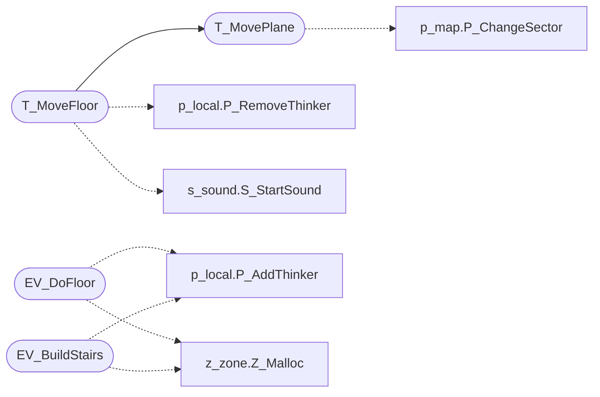

# `progs/doomgeneric/p_floor.c`

> Source: [progs/doomgeneric/p_floor.c:1](../../progs/doomgeneric/p_floor.c#L1) | language `c` | coverage 40.0% | [API index](../index.md)

Copyright(C) 1993-1996 Id Software, Inc.

Copyright(C) 2005-2014 Simon Howard  This program is free software; you can redistribute it and/or modify it under the terms of the GNU General Public License as published by the Free Software Foundation; either version 2 of the License, or (at your option) any later version.  This program is distributed in the hope that it will be useful, but WITHOUT ANY WARRANTY; without even the implied warranty of MERCHANTABILITY or FITNESS FOR A PARTICULAR PURPOSE.  See the GNU General Public License for more details.  DESCRIPTION: Floor animation: raising stairs.       State. Data.

## Contents

- **Functions:** [`T_MovePlane`](#t_moveplane), [`T_MoveFloor`](#t_movefloor), [`EV_DoFloor`](#ev_dofloor), [`EV_BuildStairs`](#ev_buildstairs)

## Call Graph

Solid arrows stay in this module, dashed arrows leave it.



## Functions

<a id="t_moveplane"></a>

### `T_MovePlane`

`function` | [progs/doomgeneric/p_floor.c:42](../../progs/doomgeneric/p_floor.c#L42)

```c
T_MovePlane ( sector_t* sector, fixed_t speed, fixed_t dest, boolean crush, int floorOrCeiling, int direction )
```

**Parameters**

| Name | Type | Default | Description |
|---|---|---|---|
| `sector` | `sector_t*` |  |  |
| `speed` | `fixed_t` |  |  |
| `dest` | `fixed_t` |  |  |
| `crush` | `boolean` |  |  |
| `floorOrCeiling` | `int` |  |  |
| `direction` | `int` |  |  |

*Calls:* [`P_ChangeSector`](progs.doomgeneric.p_map.c.md#p_changesector)

*Called by:* [`T_MoveCeiling`](progs.doomgeneric.p_ceilng.c.md#t_moveceiling), [`T_VerticalDoor`](progs.doomgeneric.p_doors.c.md#t_verticaldoor), [`T_MoveFloor`](#t_movefloor), [`T_PlatRaise`](progs.doomgeneric.p_plats.c.md#t_platraise)

---

<a id="t_movefloor"></a>

### `T_MoveFloor`

`function` | [progs/doomgeneric/p_floor.c:202](../../progs/doomgeneric/p_floor.c#L202)

```c
void T_MoveFloor(floormove_t* floor)
```

MOVE A FLOOR TO IT'S DESTINATION (UP OR DOWN)

**Parameters**

| Name | Type | Default | Description |
|---|---|---|---|
| `floor` | `floormove_t*` |  |  |

*Calls:* [`T_MovePlane`](#t_moveplane), [`P_RemoveThinker`](progs.doomgeneric.p_local.h.md#p_removethinker), [`S_StartSound`](progs.doomgeneric.s_sound.h.md#s_startsound)

---

<a id="ev_dofloor"></a>

### `EV_DoFloor`

`function` | [progs/doomgeneric/p_floor.c:251](../../progs/doomgeneric/p_floor.c#L251)

```c
int EV_DoFloor ( line_t* line, floor_e floortype )
```

**Parameters**

| Name | Type | Default | Description |
|---|---|---|---|
| `line` | `line_t*` |  |  |
| `floortype` | `floor_e` |  |  |

**Returns:** `int`

*Calls:* [`P_AddThinker`](progs.doomgeneric.p_local.h.md#p_addthinker), [`Z_Malloc`](progs.doomgeneric.z_zone.h.md#z_malloc)

*Called by:* [`A_BossDeath`](progs.doomgeneric.p_enemy.c.md#a_bossdeath), [`P_UseSpecialLine`](progs.doomgeneric.p_switch.c.md#p_usespecialline)

---

<a id="ev_buildstairs"></a>

### `EV_BuildStairs`

`function` | [progs/doomgeneric/p_floor.c:444](../../progs/doomgeneric/p_floor.c#L444)

```c
int EV_BuildStairs ( line_t* line, stair_e type )
```

**Parameters**

| Name | Type | Default | Description |
|---|---|---|---|
| `line` | `line_t*` |  |  |
| `type` | `stair_e` |  |  |

**Returns:** `int`

*Calls:* [`P_AddThinker`](progs.doomgeneric.p_local.h.md#p_addthinker), [`Z_Malloc`](progs.doomgeneric.z_zone.h.md#z_malloc)

*Called by:* [`P_UseSpecialLine`](progs.doomgeneric.p_switch.c.md#p_usespecialline)

---
