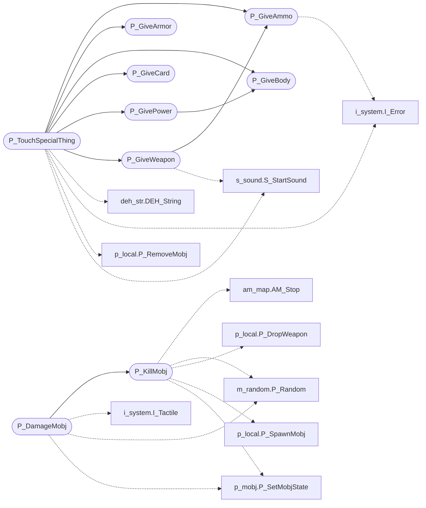

# `progs/doomgeneric/p_inter.c`

> Source: [progs/doomgeneric/p_inter.c:1](../../progs/doomgeneric/p_inter.c#L1) | language `c` | coverage 9.1% | [API index](../index.md)

Copyright(C) 1993-1996 Id Software, Inc.

Copyright(C) 2005-2014 Simon Howard  This program is free software; you can redistribute it and/or modify it under the terms of the GNU General Public License as published by the Free Software Foundation; either version 2 of the License, or (at your option) any later version.  This program is distributed in the hope that it will be useful, but WITHOUT ANY WARRANTY; without even the implied warranty of MERCHANTABILITY or FITNESS FOR A PARTICULAR PURPOSE.  See the GNU General Public License for more details.  DESCRIPTION: Handling interactions (i.e., collisions).      Data.

## Contents

- **Functions:** [`P_GiveAmmo`](#p_giveammo), [`P_GiveWeapon`](#p_giveweapon), [`P_GiveBody`](#p_givebody), [`P_GiveArmor`](#p_givearmor), [`P_GiveCard`](#p_givecard), [`P_GivePower`](#p_givepower), [`P_TouchSpecialThing`](#p_touchspecialthing), [`P_KillMobj`](#p_killmobj), [`P_DamageMobj`](#p_damagemobj)
- **Macros:** [`BONUSADD`](#bonusadd)

## Call Graph

Solid arrows stay in this module, dashed arrows leave it.



## Functions

<a id="p_giveammo"></a>

### `P_GiveAmmo`

`function` | [progs/doomgeneric/p_inter.c:66](../../progs/doomgeneric/p_inter.c#L66)

```c
boolean P_GiveAmmo ( player_t* player, ammotype_t ammo, int num )
```

**Parameters**

| Name | Type | Default | Description |
|---|---|---|---|
| `player` | `player_t*` |  |  |
| `ammo` | `ammotype_t` |  |  |
| `num` | `int` |  |  |

**Returns:** `boolean`

*Calls:* [`I_Error`](progs.doomgeneric.i_system.h.md#i_error)

*Called by:* [`P_GiveWeapon`](#p_giveweapon), [`P_TouchSpecialThing`](#p_touchspecialthing)

---

<a id="p_giveweapon"></a>

### `P_GiveWeapon`

`function` | [progs/doomgeneric/p_inter.c:160](../../progs/doomgeneric/p_inter.c#L160)

```c
boolean P_GiveWeapon ( player_t* player, weapontype_t weapon, boolean dropped )
```

**Parameters**

| Name | Type | Default | Description |
|---|---|---|---|
| `player` | `player_t*` |  |  |
| `weapon` | `weapontype_t` |  |  |
| `dropped` | `boolean` |  |  |

**Returns:** `boolean`

*Calls:* [`P_GiveAmmo`](#p_giveammo), [`S_StartSound`](progs.doomgeneric.s_sound.h.md#s_startsound)

*Called by:* [`P_TouchSpecialThing`](#p_touchspecialthing)

---

<a id="p_givebody"></a>

### `P_GiveBody`

`function` | [progs/doomgeneric/p_inter.c:223](../../progs/doomgeneric/p_inter.c#L223)

```c
boolean P_GiveBody ( player_t* player, int num )
```

**Parameters**

| Name | Type | Default | Description |
|---|---|---|---|
| `player` | `player_t*` |  |  |
| `num` | `int` |  |  |

**Returns:** `boolean`

*Called by:* [`P_GivePower`](#p_givepower), [`P_TouchSpecialThing`](#p_touchspecialthing)

---

<a id="p_givearmor"></a>

### `P_GiveArmor`

`function` | [progs/doomgeneric/p_inter.c:246](../../progs/doomgeneric/p_inter.c#L246)

```c
boolean P_GiveArmor ( player_t* player, int armortype )
```

**Parameters**

| Name | Type | Default | Description |
|---|---|---|---|
| `player` | `player_t*` |  |  |
| `armortype` | `int` |  |  |

**Returns:** `boolean`

*Called by:* [`P_TouchSpecialThing`](#p_touchspecialthing)

---

<a id="p_givecard"></a>

### `P_GiveCard`

`function` | [progs/doomgeneric/p_inter.c:268](../../progs/doomgeneric/p_inter.c#L268)

```c
void P_GiveCard ( player_t* player, card_t card )
```

**Parameters**

| Name | Type | Default | Description |
|---|---|---|---|
| `player` | `player_t*` |  |  |
| `card` | `card_t` |  |  |

*Called by:* [`P_TouchSpecialThing`](#p_touchspecialthing)

---

<a id="p_givepower"></a>

### `P_GivePower`

`function` | [progs/doomgeneric/p_inter.c:284](../../progs/doomgeneric/p_inter.c#L284)

```c
boolean P_GivePower ( player_t* player, int /*powertype_t*/ power )
```

**Parameters**

| Name | Type | Default | Description |
|---|---|---|---|
| `player` | `player_t*` |  |  |
| `power` | `int /*powertype_t*/` |  |  |

**Returns:** `boolean`

*Calls:* [`P_GiveBody`](#p_givebody)

*Called by:* [`P_TouchSpecialThing`](#p_touchspecialthing), [`ST_Responder`](progs.doomgeneric.st_stuff.c.md#st_responder)

---

<a id="p_touchspecialthing"></a>

### `P_TouchSpecialThing`

`function` | [progs/doomgeneric/p_inter.c:333](../../progs/doomgeneric/p_inter.c#L333)

```c
void P_TouchSpecialThing ( mobj_t* special, mobj_t* toucher )
```

**Parameters**

| Name | Type | Default | Description |
|---|---|---|---|
| `special` | `mobj_t*` |  |  |
| `toucher` | `mobj_t*` |  |  |

*Calls:* [`DEH_String`](progs.doomgeneric.deh_str.h.md#deh_string), [`I_Error`](progs.doomgeneric.i_system.h.md#i_error), [`P_GiveAmmo`](#p_giveammo), [`P_GiveArmor`](#p_givearmor), [`P_GiveBody`](#p_givebody), [`P_GiveCard`](#p_givecard), [`P_GivePower`](#p_givepower), [`P_GiveWeapon`](#p_giveweapon), [`P_RemoveMobj`](progs.doomgeneric.p_local.h.md#p_removemobj), [`S_StartSound`](progs.doomgeneric.s_sound.h.md#s_startsound)

---

<a id="p_killmobj"></a>

### `P_KillMobj`

`function` | [progs/doomgeneric/p_inter.c:666](../../progs/doomgeneric/p_inter.c#L666)

```c
void P_KillMobj ( mobj_t* source, mobj_t* target )
```

**Parameters**

| Name | Type | Default | Description |
|---|---|---|---|
| `source` | `mobj_t*` |  |  |
| `target` | `mobj_t*` |  |  |

*Calls:* [`AM_Stop`](progs.doomgeneric.am_map.h.md#am_stop), [`P_Random`](progs.doomgeneric.m_random.h.md#p_random), [`P_DropWeapon`](progs.doomgeneric.p_local.h.md#p_dropweapon), [`P_SpawnMobj`](progs.doomgeneric.p_local.h.md#p_spawnmobj), [`P_SetMobjState`](progs.doomgeneric.p_mobj.c.md#p_setmobjstate)

*Called by:* [`P_DamageMobj`](#p_damagemobj)

---

<a id="p_damagemobj"></a>

### `P_DamageMobj`

`function` | [progs/doomgeneric/p_inter.c:779](../../progs/doomgeneric/p_inter.c#L779)

```c
void P_DamageMobj ( mobj_t* target, mobj_t* inflictor, mobj_t* source, int damage )
```

**Parameters**

| Name | Type | Default | Description |
|---|---|---|---|
| `target` | `mobj_t*` |  |  |
| `inflictor` | `mobj_t*` |  |  |
| `source` | `mobj_t*` |  |  |
| `damage` | `int` |  |  |

*Calls:* [`I_Tactile`](progs.doomgeneric.i_system.h.md#i_tactile), [`P_Random`](progs.doomgeneric.m_random.h.md#p_random), [`P_KillMobj`](#p_killmobj), [`P_SetMobjState`](progs.doomgeneric.p_mobj.c.md#p_setmobjstate)

---

## Macros

<a id="bonusadd"></a>

### `BONUSADD`

`macro` | [progs/doomgeneric/p_inter.c:43](../../progs/doomgeneric/p_inter.c#L43)

```c
#define BONUSADD
```

---
