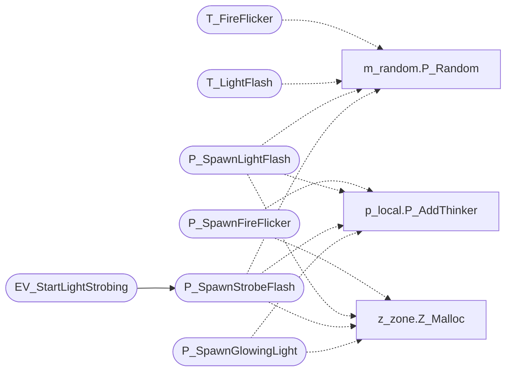

# `progs/doomgeneric/p_lights.c`

> Source: [progs/doomgeneric/p_lights.c:1](../../progs/doomgeneric/p_lights.c#L1) | language `c` | coverage 66.7% | [API index](../index.md)

Copyright(C) 1993-1996 Id Software, Inc.

Copyright(C) 2005-2014 Simon Howard  This program is free software; you can redistribute it and/or modify it under the terms of the GNU General Public License as published by the Free Software Foundation; either version 2 of the License, or (at your option) any later version.  This program is distributed in the hope that it will be useful, but WITHOUT ANY WARRANTY; without even the implied warranty of MERCHANTABILITY or FITNESS FOR A PARTICULAR PURPOSE.  See the GNU General Public License for more details.  DESCRIPTION: Handle Sector base lighting effects. Muzzle flash?        State.

## Contents

- **Functions:** [`T_FireFlicker`](#t_fireflicker), [`P_SpawnFireFlicker`](#p_spawnfireflicker), [`T_LightFlash`](#t_lightflash), [`P_SpawnLightFlash`](#p_spawnlightflash), [`T_StrobeFlash`](#t_strobeflash), [`P_SpawnStrobeFlash`](#p_spawnstrobeflash), [`EV_StartLightStrobing`](#ev_startlightstrobing), [`EV_TurnTagLightsOff`](#ev_turntaglightsoff), [`EV_LightTurnOn`](#ev_lightturnon), [`T_Glow`](#t_glow), [`P_SpawnGlowingLight`](#p_spawnglowinglight)

## Call Graph

Solid arrows stay in this module, dashed arrows leave it.



## Functions

<a id="t_fireflicker"></a>

### `T_FireFlicker`

`function` | [progs/doomgeneric/p_lights.c:39](../../progs/doomgeneric/p_lights.c#L39)

```c
void T_FireFlicker (fireflicker_t* flick)
```

T_FireFlicker

**Parameters**

| Name | Type | Default | Description |
|---|---|---|---|
| `flick` | `fireflicker_t*` |  |  |

*Calls:* [`P_Random`](progs.doomgeneric.m_random.h.md#p_random)

---

<a id="p_spawnfireflicker"></a>

### `P_SpawnFireFlicker`

`function` | [progs/doomgeneric/p_lights.c:61](../../progs/doomgeneric/p_lights.c#L61)

```c
void P_SpawnFireFlicker (sector_t* sector)
```

P_SpawnFireFlicker

**Parameters**

| Name | Type | Default | Description |
|---|---|---|---|
| `sector` | `sector_t*` |  |  |

*Calls:* [`P_AddThinker`](progs.doomgeneric.p_local.h.md#p_addthinker), [`Z_Malloc`](progs.doomgeneric.z_zone.h.md#z_malloc)

---

<a id="t_lightflash"></a>

### `T_LightFlash`

`function` | [progs/doomgeneric/p_lights.c:91](../../progs/doomgeneric/p_lights.c#L91)

```c
void T_LightFlash (lightflash_t* flash)
```

T_LightFlash Do flashing lights.

**Parameters**

| Name | Type | Default | Description |
|---|---|---|---|
| `flash` | `lightflash_t*` |  |  |

*Calls:* [`P_Random`](progs.doomgeneric.m_random.h.md#p_random)

---

<a id="p_spawnlightflash"></a>

### `P_SpawnLightFlash`

`function` | [progs/doomgeneric/p_lights.c:117](../../progs/doomgeneric/p_lights.c#L117)

```c
void P_SpawnLightFlash (sector_t* sector)
```

P_SpawnLightFlash After the map has been loaded, scan each sector for specials that spawn thinkers

**Parameters**

| Name | Type | Default | Description |
|---|---|---|---|
| `sector` | `sector_t*` |  |  |

*Calls:* [`P_Random`](progs.doomgeneric.m_random.h.md#p_random), [`P_AddThinker`](progs.doomgeneric.p_local.h.md#p_addthinker), [`Z_Malloc`](progs.doomgeneric.z_zone.h.md#z_malloc)

---

<a id="t_strobeflash"></a>

### `T_StrobeFlash`

`function` | [progs/doomgeneric/p_lights.c:148](../../progs/doomgeneric/p_lights.c#L148)

```c
void T_StrobeFlash (strobe_t* flash)
```

T_StrobeFlash

**Parameters**

| Name | Type | Default | Description |
|---|---|---|---|
| `flash` | `strobe_t*` |  |  |

---

<a id="p_spawnstrobeflash"></a>

### `P_SpawnStrobeFlash`

`function` | [progs/doomgeneric/p_lights.c:174](../../progs/doomgeneric/p_lights.c#L174)

```c
void P_SpawnStrobeFlash ( sector_t* sector, int fastOrSlow, int inSync )
```

**Parameters**

| Name | Type | Default | Description |
|---|---|---|---|
| `sector` | `sector_t*` |  |  |
| `fastOrSlow` | `int` |  |  |
| `inSync` | `int` |  |  |

*Calls:* [`P_Random`](progs.doomgeneric.m_random.h.md#p_random), [`P_AddThinker`](progs.doomgeneric.p_local.h.md#p_addthinker), [`Z_Malloc`](progs.doomgeneric.z_zone.h.md#z_malloc)

*Called by:* [`EV_StartLightStrobing`](#ev_startlightstrobing)

---

<a id="ev_startlightstrobing"></a>

### `EV_StartLightStrobing`

`function` | [progs/doomgeneric/p_lights.c:208](../../progs/doomgeneric/p_lights.c#L208)

```c
void EV_StartLightStrobing(line_t* line)
```

Start strobing lights (usually from a trigger)

**Parameters**

| Name | Type | Default | Description |
|---|---|---|---|
| `line` | `line_t*` |  |  |

*Calls:* [`P_SpawnStrobeFlash`](#p_spawnstrobeflash)

---

<a id="ev_turntaglightsoff"></a>

### `EV_TurnTagLightsOff`

`function` | [progs/doomgeneric/p_lights.c:229](../../progs/doomgeneric/p_lights.c#L229)

```c
void EV_TurnTagLightsOff(line_t* line)
```

TURN LINE'S TAG LIGHTS OFF

**Parameters**

| Name | Type | Default | Description |
|---|---|---|---|
| `line` | `line_t*` |  |  |

---

<a id="ev_lightturnon"></a>

### `EV_LightTurnOn`

`function` | [progs/doomgeneric/p_lights.c:264](../../progs/doomgeneric/p_lights.c#L264)

```c
void EV_LightTurnOn ( line_t* line, int bright )
```

**Parameters**

| Name | Type | Default | Description |
|---|---|---|---|
| `line` | `line_t*` |  |  |
| `bright` | `int` |  |  |

*Called by:* [`P_UseSpecialLine`](progs.doomgeneric.p_switch.c.md#p_usespecialline)

---

<a id="t_glow"></a>

### `T_Glow`

`function` | [progs/doomgeneric/p_lights.c:307](../../progs/doomgeneric/p_lights.c#L307)

```c
void T_Glow(glow_t* g)
```

**Parameters**

| Name | Type | Default | Description |
|---|---|---|---|
| `g` | `glow_t*` |  |  |

---

<a id="p_spawnglowinglight"></a>

### `P_SpawnGlowingLight`

`function` | [progs/doomgeneric/p_lights.c:334](../../progs/doomgeneric/p_lights.c#L334)

```c
void P_SpawnGlowingLight(sector_t* sector)
```

**Parameters**

| Name | Type | Default | Description |
|---|---|---|---|
| `sector` | `sector_t*` |  |  |

*Calls:* [`P_AddThinker`](progs.doomgeneric.p_local.h.md#p_addthinker), [`Z_Malloc`](progs.doomgeneric.z_zone.h.md#z_malloc)

---
