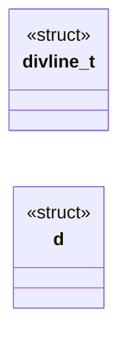

# `progs/doomgeneric/p_local.h`

> Source: [progs/doomgeneric/p_local.h:1](../../progs/doomgeneric/p_local.h#L1) | language `h` | coverage 17.5% | [API index](../index.md)

Copyright(C) 1993-1996 Id Software, Inc.

Copyright(C) 2005-2014 Simon Howard  This program is free software; you can redistribute it and/or modify it under the terms of the GNU General Public License as published by the Free Software Foundation; either version 2 of the License, or (at your option) any later version.  This program is distributed in the hope that it will be useful, but WITHOUT ANY WARRANTY; without even the implied warranty of MERCHANTABILITY or FITNESS FOR A PARTICULAR PURPOSE.  See the GNU General Public License for more details.  DESCRIPTION: Play functions, animation, global header.

## Contents

- **Structs:** [`divline_t`](#divline_t), [`d`](#d)
- **Functions:** [`P_InitThinkers`](#p_initthinkers), [`P_AddThinker`](#p_addthinker), [`P_RemoveThinker`](#p_removethinker), [`P_SetupPsprites`](#p_setuppsprites), [`P_MovePsprites`](#p_movepsprites), [`P_DropWeapon`](#p_dropweapon), [`P_PlayerThink`](#p_playerthink), [`P_RespawnSpecials`](#p_respawnspecials), [`P_SpawnMobj`](#p_spawnmobj), [`P_RemoveMobj`](#p_removemobj), [`P_SubstNullMobj`](#p_substnullmobj), [`P_MobjThinker`](#p_mobjthinker), [`P_SpawnPuff`](#p_spawnpuff), [`P_SpawnBlood`](#p_spawnblood), [`P_SpawnMissile`](#p_spawnmissile), [`P_SpawnPlayerMissile`](#p_spawnplayermissile), [`P_NoiseAlert`](#p_noisealert), [`P_AproxDistance`](#p_aproxdistance), [`P_PointOnLineSide`](#p_pointonlineside), [`P_PointOnDivlineSide`](#p_pointondivlineside), [`P_MakeDivline`](#p_makedivline), [`P_InterceptVector`](#p_interceptvector), [`P_BoxOnLineSide`](#p_boxonlineside), [`P_LineOpening`](#p_lineopening), [`P_UnsetThingPosition`](#p_unsetthingposition), [`P_SetThingPosition`](#p_setthingposition), [`P_SlideMove`](#p_slidemove), [`P_UseLines`](#p_uselines), [`P_AimLineAttack`](#p_aimlineattack), [`P_LineAttack`](#p_lineattack), [`P_RadiusAttack`](#p_radiusattack), [`P_TouchSpecialThing`](#p_touchspecialthing), [`P_DamageMobj`](#p_damagemobj)
- **Macros:** [`__P_LOCAL__`](#__p_local__), [`FLOATSPEED`](#floatspeed), [`MAXHEALTH`](#maxhealth), [`VIEWHEIGHT`](#viewheight), [`MAPBLOCKUNITS`](#mapblockunits), [`MAPBLOCKSIZE`](#mapblocksize), [`MAPBLOCKSHIFT`](#mapblockshift), [`MAPBMASK`](#mapbmask), [`MAPBTOFRAC`](#mapbtofrac), [`PLAYERRADIUS`](#playerradius), [`MAXRADIUS`](#maxradius), [`GRAVITY`](#gravity), [`MAXMOVE`](#maxmove), [`USERANGE`](#userange), [`MELEERANGE`](#meleerange), [`MISSILERANGE`](#missilerange), [`BASETHRESHOLD`](#basethreshold), [`ONFLOORZ`](#onfloorz), [`ONCEILINGZ`](#onceilingz), [`ITEMQUESIZE`](#itemquesize), [`MAXINTERCEPTS_ORIGINAL`](#maxintercepts_original), [`MAXINTERCEPTS`](#maxintercepts), [`PT_ADDLINES`](#pt_addlines), [`PT_ADDTHINGS`](#pt_addthings), [`PT_EARLYOUT`](#pt_earlyout), [`MAXSPECIALCROSS`](#maxspecialcross), [`MAXSPECIALCROSS_ORIGINAL`](#maxspecialcross_original)
- **Variables:** [`thinkercap`](#thinkercap), [`itemrespawnque`](#itemrespawnque), [`itemrespawntime`](#itemrespawntime), [`iquehead`](#iquehead), [`iquetail`](#iquetail), [`intercepts`](#intercepts), [`intercept_p`](#intercept_p), [`opentop`](#opentop), [`openbottom`](#openbottom), [`openrange`](#openrange), [`lowfloor`](#lowfloor), [`trace`](#trace), [`floatok`](#floatok), [`tmfloorz`](#tmfloorz), [`tmceilingz`](#tmceilingz), [`ceilingline`](#ceilingline), [`spechit`](#spechit), [`numspechit`](#numspechit), [`linetarget`](#linetarget), [`rejectmatrix`](#rejectmatrix), [`blockmaplump`](#blockmaplump), [`blockmap`](#blockmap), [`bmapwidth`](#bmapwidth), [`bmapheight`](#bmapheight), [`bmaporgx`](#bmaporgx), [`bmaporgy`](#bmaporgy), [`blocklinks`](#blocklinks), [`maxammo`](#maxammo), [`clipammo`](#clipammo)

## Type Diagram



## Structs

<a id="divline_t"></a>

### `divline_t`

`struct` | [progs/doomgeneric/p_local.h:133](../../progs/doomgeneric/p_local.h#L133)

```c
typedef struct
```

P_MAPUTL

---

<a id="d"></a>

### `d`

`struct` | [progs/doomgeneric/p_local.h:142](../../progs/doomgeneric/p_local.h#L142)

```c
typedef struct
```

---

## Functions

<a id="p_initthinkers"></a>

### `P_InitThinkers`

`function` | [progs/doomgeneric/p_local.h:70](../../progs/doomgeneric/p_local.h#L70)

```c
void P_InitThinkers (void);
```

*Called by:* [`P_UnArchiveThinkers`](progs.doomgeneric.p_saveg.c.md#p_unarchivethinkers), [`P_SetupLevel`](progs.doomgeneric.p_setup.c.md#p_setuplevel)

---

<a id="p_addthinker"></a>

### `P_AddThinker`

`function` | [progs/doomgeneric/p_local.h:71](../../progs/doomgeneric/p_local.h#L71)

```c
void P_AddThinker (thinker_t* thinker);
```

**Parameters**

| Name | Type | Default | Description |
|---|---|---|---|
| `thinker` | `thinker_t*` |  |  |

*Called by:* [`EV_DoCeiling`](progs.doomgeneric.p_ceilng.c.md#ev_doceiling), [`EV_DoDoor`](progs.doomgeneric.p_doors.c.md#ev_dodoor), [`EV_SlidingDoor`](progs.doomgeneric.p_doors.c.md#ev_slidingdoor), [`EV_VerticalDoor`](progs.doomgeneric.p_doors.c.md#ev_verticaldoor), [`P_SpawnDoorCloseIn30`](progs.doomgeneric.p_doors.c.md#p_spawndoorclosein30), [`P_SpawnDoorRaiseIn5Mins`](progs.doomgeneric.p_doors.c.md#p_spawndoorraisein5mins), [`EV_BuildStairs`](progs.doomgeneric.p_floor.c.md#ev_buildstairs), [`EV_DoFloor`](progs.doomgeneric.p_floor.c.md#ev_dofloor), [`P_SpawnFireFlicker`](progs.doomgeneric.p_lights.c.md#p_spawnfireflicker), [`P_SpawnGlowingLight`](progs.doomgeneric.p_lights.c.md#p_spawnglowinglight), [`P_SpawnLightFlash`](progs.doomgeneric.p_lights.c.md#p_spawnlightflash), [`P_SpawnStrobeFlash`](progs.doomgeneric.p_lights.c.md#p_spawnstrobeflash) and 4 more

---

<a id="p_removethinker"></a>

### `P_RemoveThinker`

`function` | [progs/doomgeneric/p_local.h:72](../../progs/doomgeneric/p_local.h#L72)

```c
void P_RemoveThinker (thinker_t* thinker);
```

**Parameters**

| Name | Type | Default | Description |
|---|---|---|---|
| `thinker` | `thinker_t*` |  |  |

*Called by:* [`P_RemoveActiveCeiling`](progs.doomgeneric.p_ceilng.c.md#p_removeactiveceiling), [`T_SlidingDoor`](progs.doomgeneric.p_doors.c.md#t_slidingdoor), [`T_VerticalDoor`](progs.doomgeneric.p_doors.c.md#t_verticaldoor), [`T_MoveFloor`](progs.doomgeneric.p_floor.c.md#t_movefloor), [`P_RemoveMobj`](progs.doomgeneric.p_mobj.c.md#p_removemobj), [`P_RemoveActivePlat`](progs.doomgeneric.p_plats.c.md#p_removeactiveplat)

---

<a id="p_setuppsprites"></a>

### `P_SetupPsprites`

`function` | [progs/doomgeneric/p_local.h:78](../../progs/doomgeneric/p_local.h#L78)

```c
void P_SetupPsprites (player_t* curplayer);
```

P_PSPR

**Parameters**

| Name | Type | Default | Description |
|---|---|---|---|
| `curplayer` | `player_t*` |  |  |

*Called by:* [`P_SpawnPlayer`](progs.doomgeneric.p_mobj.c.md#p_spawnplayer)

---

<a id="p_movepsprites"></a>

### `P_MovePsprites`

`function` | [progs/doomgeneric/p_local.h:79](../../progs/doomgeneric/p_local.h#L79)

```c
void P_MovePsprites (player_t* curplayer);
```

**Parameters**

| Name | Type | Default | Description |
|---|---|---|---|
| `curplayer` | `player_t*` |  |  |

*Called by:* [`P_DeathThink`](progs.doomgeneric.p_user.c.md#p_deaththink), [`P_PlayerThink`](progs.doomgeneric.p_user.c.md#p_playerthink)

---

<a id="p_dropweapon"></a>

### `P_DropWeapon`

`function` | [progs/doomgeneric/p_local.h:80](../../progs/doomgeneric/p_local.h#L80)

```c
void P_DropWeapon (player_t* player);
```

**Parameters**

| Name | Type | Default | Description |
|---|---|---|---|
| `player` | `player_t*` |  |  |

*Called by:* [`P_KillMobj`](progs.doomgeneric.p_inter.c.md#p_killmobj)

---

<a id="p_playerthink"></a>

### `P_PlayerThink`

`function` | [progs/doomgeneric/p_local.h:86](../../progs/doomgeneric/p_local.h#L86)

```c
void P_PlayerThink (player_t* player);
```

P_USER

**Parameters**

| Name | Type | Default | Description |
|---|---|---|---|
| `player` | `player_t*` |  |  |

*Called by:* [`P_Ticker`](progs.doomgeneric.p_tick.c.md#p_ticker)

---

<a id="p_respawnspecials"></a>

### `P_RespawnSpecials`

`function` | [progs/doomgeneric/p_local.h:104](../../progs/doomgeneric/p_local.h#L104)

```c
void P_RespawnSpecials (void);
```

*Called by:* [`P_Ticker`](progs.doomgeneric.p_tick.c.md#p_ticker)

---

<a id="p_spawnmobj"></a>

### `P_SpawnMobj`

`function` | [progs/doomgeneric/p_local.h:107](../../progs/doomgeneric/p_local.h#L107)

```c
mobj_t* P_SpawnMobj ( fixed_t x, fixed_t y, fixed_t z, mobjtype_t type );
```

**Parameters**

| Name | Type | Default | Description |
|---|---|---|---|
| `x` | `fixed_t` |  |  |
| `y` | `fixed_t` |  |  |
| `z` | `fixed_t` |  |  |
| `type` | `mobjtype_t` |  |  |

**Returns:** `mobj_t*`

*Called by:* [`G_CheckSpot`](progs.doomgeneric.g_game.c.md#g_checkspot), [`A_BrainExplode`](progs.doomgeneric.p_enemy.c.md#a_brainexplode), [`A_BrainScream`](progs.doomgeneric.p_enemy.c.md#a_brainscream), [`A_PainShootSkull`](progs.doomgeneric.p_enemy.c.md#a_painshootskull), [`A_SpawnFly`](progs.doomgeneric.p_enemy.c.md#a_spawnfly), [`A_Tracer`](progs.doomgeneric.p_enemy.c.md#a_tracer), [`A_VileTarget`](progs.doomgeneric.p_enemy.c.md#a_viletarget), [`P_KillMobj`](progs.doomgeneric.p_inter.c.md#p_killmobj), [`PIT_ChangeSector`](progs.doomgeneric.p_map.c.md#pit_changesector), [`A_BFGSpray`](progs.doomgeneric.p_pspr.c.md#a_bfgspray), [`EV_Teleport`](progs.doomgeneric.p_telept.c.md#ev_teleport)

---

<a id="p_removemobj"></a>

### `P_RemoveMobj`

`function` | [progs/doomgeneric/p_local.h:113](../../progs/doomgeneric/p_local.h#L113)

```c
void P_RemoveMobj (mobj_t* th);
```

**Parameters**

| Name | Type | Default | Description |
|---|---|---|---|
| `th` | `mobj_t*` |  |  |

*Called by:* [`G_CheckSpot`](progs.doomgeneric.g_game.c.md#g_checkspot), [`A_SpawnFly`](progs.doomgeneric.p_enemy.c.md#a_spawnfly), [`P_TouchSpecialThing`](progs.doomgeneric.p_inter.c.md#p_touchspecialthing), [`PIT_ChangeSector`](progs.doomgeneric.p_map.c.md#pit_changesector), [`P_UnArchiveThinkers`](progs.doomgeneric.p_saveg.c.md#p_unarchivethinkers)

---

<a id="p_substnullmobj"></a>

### `P_SubstNullMobj`

`function` | [progs/doomgeneric/p_local.h:114](../../progs/doomgeneric/p_local.h#L114)

```c
mobj_t* P_SubstNullMobj (mobj_t* th);
```

**Parameters**

| Name | Type | Default | Description |
|---|---|---|---|
| `th` | `mobj_t*` |  |  |

**Returns:** `mobj_t*`

*Called by:* [`A_FatAttack1`](progs.doomgeneric.p_enemy.c.md#a_fatattack1), [`A_FatAttack2`](progs.doomgeneric.p_enemy.c.md#a_fatattack2), [`A_FatAttack3`](progs.doomgeneric.p_enemy.c.md#a_fatattack3), [`A_Fire`](progs.doomgeneric.p_enemy.c.md#a_fire), [`A_SpawnFly`](progs.doomgeneric.p_enemy.c.md#a_spawnfly), [`P_AimLineAttack`](progs.doomgeneric.p_map.c.md#p_aimlineattack)

---

<a id="p_mobjthinker"></a>

### `P_MobjThinker`

`function` | [progs/doomgeneric/p_local.h:116](../../progs/doomgeneric/p_local.h#L116)

```c
void P_MobjThinker (mobj_t* mobj);
```

**Parameters**

| Name | Type | Default | Description |
|---|---|---|---|
| `mobj` | `mobj_t*` |  |  |

---

<a id="p_spawnpuff"></a>

### `P_SpawnPuff`

`function` | [progs/doomgeneric/p_local.h:118](../../progs/doomgeneric/p_local.h#L118)

```c
void P_SpawnPuff (fixed_t x, fixed_t y, fixed_t z);
```

**Parameters**

| Name | Type | Default | Description |
|---|---|---|---|
| `x` | `fixed_t` |  |  |
| `y` | `fixed_t` |  |  |
| `z` | `fixed_t` |  |  |

*Called by:* [`A_Tracer`](progs.doomgeneric.p_enemy.c.md#a_tracer), [`PTR_ShootTraverse`](progs.doomgeneric.p_map.c.md#ptr_shoottraverse)

---

<a id="p_spawnblood"></a>

### `P_SpawnBlood`

`function` | [progs/doomgeneric/p_local.h:119](../../progs/doomgeneric/p_local.h#L119)

```c
void P_SpawnBlood (fixed_t x, fixed_t y, fixed_t z, int damage);
```

**Parameters**

| Name | Type | Default | Description |
|---|---|---|---|
| `x` | `fixed_t` |  |  |
| `y` | `fixed_t` |  |  |
| `z` | `fixed_t` |  |  |
| `damage` | `int` |  |  |

*Called by:* [`PTR_ShootTraverse`](progs.doomgeneric.p_map.c.md#ptr_shoottraverse)

---

<a id="p_spawnmissile"></a>

### `P_SpawnMissile`

`function` | [progs/doomgeneric/p_local.h:120](../../progs/doomgeneric/p_local.h#L120)

```c
mobj_t* P_SpawnMissile (mobj_t* source, mobj_t* dest, mobjtype_t type);
```

**Parameters**

| Name | Type | Default | Description |
|---|---|---|---|
| `source` | `mobj_t*` |  |  |
| `dest` | `mobj_t*` |  |  |
| `type` | `mobjtype_t` |  |  |

**Returns:** `mobj_t*`

*Called by:* [`A_BrainSpit`](progs.doomgeneric.p_enemy.c.md#a_brainspit), [`A_BruisAttack`](progs.doomgeneric.p_enemy.c.md#a_bruisattack), [`A_BspiAttack`](progs.doomgeneric.p_enemy.c.md#a_bspiattack), [`A_CyberAttack`](progs.doomgeneric.p_enemy.c.md#a_cyberattack), [`A_FatAttack1`](progs.doomgeneric.p_enemy.c.md#a_fatattack1), [`A_FatAttack2`](progs.doomgeneric.p_enemy.c.md#a_fatattack2), [`A_FatAttack3`](progs.doomgeneric.p_enemy.c.md#a_fatattack3), [`A_HeadAttack`](progs.doomgeneric.p_enemy.c.md#a_headattack), [`A_SkelMissile`](progs.doomgeneric.p_enemy.c.md#a_skelmissile), [`A_TroopAttack`](progs.doomgeneric.p_enemy.c.md#a_troopattack)

---

<a id="p_spawnplayermissile"></a>

### `P_SpawnPlayerMissile`

`function` | [progs/doomgeneric/p_local.h:121](../../progs/doomgeneric/p_local.h#L121)

```c
void P_SpawnPlayerMissile (mobj_t* source, mobjtype_t type);
```

**Parameters**

| Name | Type | Default | Description |
|---|---|---|---|
| `source` | `mobj_t*` |  |  |
| `type` | `mobjtype_t` |  |  |

*Called by:* [`A_FireBFG`](progs.doomgeneric.p_pspr.c.md#a_firebfg), [`A_FireMissile`](progs.doomgeneric.p_pspr.c.md#a_firemissile), [`A_FirePlasma`](progs.doomgeneric.p_pspr.c.md#a_fireplasma)

---

<a id="p_noisealert"></a>

### `P_NoiseAlert`

`function` | [progs/doomgeneric/p_local.h:127](../../progs/doomgeneric/p_local.h#L127)

```c
void P_NoiseAlert (mobj_t* target, mobj_t* emmiter);
```

P_ENEMY

**Parameters**

| Name | Type | Default | Description |
|---|---|---|---|
| `target` | `mobj_t*` |  |  |
| `emmiter` | `mobj_t*` |  |  |

*Called by:* [`P_FireWeapon`](progs.doomgeneric.p_pspr.c.md#p_fireweapon)

---

<a id="p_aproxdistance"></a>

### `P_AproxDistance`

`function` | [progs/doomgeneric/p_local.h:162](../../progs/doomgeneric/p_local.h#L162)

```c
fixed_t P_AproxDistance (fixed_t dx, fixed_t dy);
```

**Parameters**

| Name | Type | Default | Description |
|---|---|---|---|
| `dx` | `fixed_t` |  |  |
| `dy` | `fixed_t` |  |  |

**Returns:** `fixed_t`

*Called by:* [`A_SkullAttack`](progs.doomgeneric.p_enemy.c.md#a_skullattack), [`A_Tracer`](progs.doomgeneric.p_enemy.c.md#a_tracer), [`P_CheckMeleeRange`](progs.doomgeneric.p_enemy.c.md#p_checkmeleerange), [`P_CheckMissileRange`](progs.doomgeneric.p_enemy.c.md#p_checkmissilerange), [`P_LookForPlayers`](progs.doomgeneric.p_enemy.c.md#p_lookforplayers), [`P_HitSlideLine`](progs.doomgeneric.p_map.c.md#p_hitslideline), [`P_SpawnMissile`](progs.doomgeneric.p_mobj.c.md#p_spawnmissile), [`P_ZMovement`](progs.doomgeneric.p_mobj.c.md#p_zmovement)

---

<a id="p_pointonlineside"></a>

### `P_PointOnLineSide`

`function` | [progs/doomgeneric/p_local.h:163](../../progs/doomgeneric/p_local.h#L163)

```c
int P_PointOnLineSide (fixed_t x, fixed_t y, line_t* line);
```

**Parameters**

| Name | Type | Default | Description |
|---|---|---|---|
| `x` | `fixed_t` |  |  |
| `y` | `fixed_t` |  |  |
| `line` | `line_t*` |  |  |

**Returns:** `int`

*Called by:* [`PTR_SlideTraverse`](progs.doomgeneric.p_map.c.md#ptr_slidetraverse), [`PTR_UseTraverse`](progs.doomgeneric.p_map.c.md#ptr_usetraverse), [`P_HitSlideLine`](progs.doomgeneric.p_map.c.md#p_hitslideline), [`P_TryMove`](progs.doomgeneric.p_map.c.md#p_trymove)

---

<a id="p_pointondivlineside"></a>

### `P_PointOnDivlineSide`

`function` | [progs/doomgeneric/p_local.h:164](../../progs/doomgeneric/p_local.h#L164)

```c
int P_PointOnDivlineSide (fixed_t x, fixed_t y, divline_t* line);
```

**Parameters**

| Name | Type | Default | Description |
|---|---|---|---|
| `x` | `fixed_t` |  |  |
| `y` | `fixed_t` |  |  |
| `line` | `divline_t*` |  |  |

**Returns:** `int`

---

<a id="p_makedivline"></a>

### `P_MakeDivline`

`function` | [progs/doomgeneric/p_local.h:165](../../progs/doomgeneric/p_local.h#L165)

```c
void P_MakeDivline (line_t* li, divline_t* dl);
```

**Parameters**

| Name | Type | Default | Description |
|---|---|---|---|
| `li` | `line_t*` |  |  |
| `dl` | `divline_t*` |  |  |

---

<a id="p_interceptvector"></a>

### `P_InterceptVector`

`function` | [progs/doomgeneric/p_local.h:166](../../progs/doomgeneric/p_local.h#L166)

```c
fixed_t P_InterceptVector (divline_t* v2, divline_t* v1);
```

**Parameters**

| Name | Type | Default | Description |
|---|---|---|---|
| `v2` | `divline_t*` |  |  |
| `v1` | `divline_t*` |  |  |

**Returns:** `fixed_t`

---

<a id="p_boxonlineside"></a>

### `P_BoxOnLineSide`

`function` | [progs/doomgeneric/p_local.h:167](../../progs/doomgeneric/p_local.h#L167)

```c
int P_BoxOnLineSide (fixed_t* tmbox, line_t* ld);
```

**Parameters**

| Name | Type | Default | Description |
|---|---|---|---|
| `tmbox` | `fixed_t*` |  |  |
| `ld` | `line_t*` |  |  |

**Returns:** `int`

*Called by:* [`PIT_CheckLine`](progs.doomgeneric.p_map.c.md#pit_checkline)

---

<a id="p_lineopening"></a>

### `P_LineOpening`

`function` | [progs/doomgeneric/p_local.h:174](../../progs/doomgeneric/p_local.h#L174)

```c
void P_LineOpening (line_t* linedef);
```

**Parameters**

| Name | Type | Default | Description |
|---|---|---|---|
| `linedef` | `line_t*` |  |  |

*Called by:* [`P_RecursiveSound`](progs.doomgeneric.p_enemy.c.md#p_recursivesound), [`PIT_CheckLine`](progs.doomgeneric.p_map.c.md#pit_checkline), [`PTR_AimTraverse`](progs.doomgeneric.p_map.c.md#ptr_aimtraverse), [`PTR_ShootTraverse`](progs.doomgeneric.p_map.c.md#ptr_shoottraverse), [`PTR_SlideTraverse`](progs.doomgeneric.p_map.c.md#ptr_slidetraverse), [`PTR_UseTraverse`](progs.doomgeneric.p_map.c.md#ptr_usetraverse)

---

<a id="p_unsetthingposition"></a>

### `P_UnsetThingPosition`

`function` | [progs/doomgeneric/p_local.h:194](../../progs/doomgeneric/p_local.h#L194)

```c
void P_UnsetThingPosition (mobj_t* thing);
```

**Parameters**

| Name | Type | Default | Description |
|---|---|---|---|
| `thing` | `mobj_t*` |  |  |

*Called by:* [`A_Fire`](progs.doomgeneric.p_enemy.c.md#a_fire), [`P_TeleportMove`](progs.doomgeneric.p_map.c.md#p_teleportmove), [`P_TryMove`](progs.doomgeneric.p_map.c.md#p_trymove), [`P_RemoveMobj`](progs.doomgeneric.p_mobj.c.md#p_removemobj)

---

<a id="p_setthingposition"></a>

### `P_SetThingPosition`

`function` | [progs/doomgeneric/p_local.h:195](../../progs/doomgeneric/p_local.h#L195)

```c
void P_SetThingPosition (mobj_t* thing);
```

**Parameters**

| Name | Type | Default | Description |
|---|---|---|---|
| `thing` | `mobj_t*` |  |  |

*Called by:* [`A_Fire`](progs.doomgeneric.p_enemy.c.md#a_fire), [`P_TeleportMove`](progs.doomgeneric.p_map.c.md#p_teleportmove), [`P_TryMove`](progs.doomgeneric.p_map.c.md#p_trymove), [`P_SpawnMobj`](progs.doomgeneric.p_mobj.c.md#p_spawnmobj), [`P_UnArchiveThinkers`](progs.doomgeneric.p_saveg.c.md#p_unarchivethinkers)

---

<a id="p_slidemove"></a>

### `P_SlideMove`

`function` | [progs/doomgeneric/p_local.h:228](../../progs/doomgeneric/p_local.h#L228)

```c
void P_SlideMove (mobj_t* mo);
```

**Parameters**

| Name | Type | Default | Description |
|---|---|---|---|
| `mo` | `mobj_t*` |  |  |

*Called by:* [`P_XYMovement`](progs.doomgeneric.p_mobj.c.md#p_xymovement)

---

<a id="p_uselines"></a>

### `P_UseLines`

`function` | [progs/doomgeneric/p_local.h:230](../../progs/doomgeneric/p_local.h#L230)

```c
void P_UseLines (player_t* player);
```

**Parameters**

| Name | Type | Default | Description |
|---|---|---|---|
| `player` | `player_t*` |  |  |

*Called by:* [`P_PlayerThink`](progs.doomgeneric.p_user.c.md#p_playerthink)

---

<a id="p_aimlineattack"></a>

### `P_AimLineAttack`

`function` | [progs/doomgeneric/p_local.h:237](../../progs/doomgeneric/p_local.h#L237)

```c
fixed_t P_AimLineAttack ( mobj_t* t1, angle_t angle, fixed_t distance );
```

**Parameters**

| Name | Type | Default | Description |
|---|---|---|---|
| `t1` | `mobj_t*` |  |  |
| `angle` | `angle_t` |  |  |
| `distance` | `fixed_t` |  |  |

**Returns:** `fixed_t`

*Called by:* [`A_CPosAttack`](progs.doomgeneric.p_enemy.c.md#a_cposattack), [`A_PosAttack`](progs.doomgeneric.p_enemy.c.md#a_posattack), [`A_SPosAttack`](progs.doomgeneric.p_enemy.c.md#a_sposattack), [`P_SpawnPlayerMissile`](progs.doomgeneric.p_mobj.c.md#p_spawnplayermissile), [`A_BFGSpray`](progs.doomgeneric.p_pspr.c.md#a_bfgspray), [`A_Punch`](progs.doomgeneric.p_pspr.c.md#a_punch), [`A_Saw`](progs.doomgeneric.p_pspr.c.md#a_saw), [`P_BulletSlope`](progs.doomgeneric.p_pspr.c.md#p_bulletslope)

---

<a id="p_lineattack"></a>

### `P_LineAttack`

`function` | [progs/doomgeneric/p_local.h:243](../../progs/doomgeneric/p_local.h#L243)

```c
void P_LineAttack ( mobj_t* t1, angle_t angle, fixed_t distance, fixed_t slope, int damage );
```

**Parameters**

| Name | Type | Default | Description |
|---|---|---|---|
| `t1` | `mobj_t*` |  |  |
| `angle` | `angle_t` |  |  |
| `distance` | `fixed_t` |  |  |
| `slope` | `fixed_t` |  |  |
| `damage` | `int` |  |  |

*Called by:* [`A_CPosAttack`](progs.doomgeneric.p_enemy.c.md#a_cposattack), [`A_PosAttack`](progs.doomgeneric.p_enemy.c.md#a_posattack), [`A_SPosAttack`](progs.doomgeneric.p_enemy.c.md#a_sposattack), [`A_FireShotgun2`](progs.doomgeneric.p_pspr.c.md#a_fireshotgun2), [`A_Punch`](progs.doomgeneric.p_pspr.c.md#a_punch), [`A_Saw`](progs.doomgeneric.p_pspr.c.md#a_saw), [`P_GunShot`](progs.doomgeneric.p_pspr.c.md#p_gunshot)

---

<a id="p_radiusattack"></a>

### `P_RadiusAttack`

`function` | [progs/doomgeneric/p_local.h:251](../../progs/doomgeneric/p_local.h#L251)

```c
void P_RadiusAttack ( mobj_t* spot, mobj_t* source, int damage );
```

**Parameters**

| Name | Type | Default | Description |
|---|---|---|---|
| `spot` | `mobj_t*` |  |  |
| `source` | `mobj_t*` |  |  |
| `damage` | `int` |  |  |

*Called by:* [`A_Explode`](progs.doomgeneric.p_enemy.c.md#a_explode), [`A_VileAttack`](progs.doomgeneric.p_enemy.c.md#a_vileattack)

---

<a id="p_touchspecialthing"></a>

### `P_TouchSpecialThing`

`function` | [progs/doomgeneric/p_local.h:279](../../progs/doomgeneric/p_local.h#L279)

```c
void P_TouchSpecialThing ( mobj_t* special, mobj_t* toucher );
```

**Parameters**

| Name | Type | Default | Description |
|---|---|---|---|
| `special` | `mobj_t*` |  |  |
| `toucher` | `mobj_t*` |  |  |

*Called by:* [`PIT_CheckThing`](progs.doomgeneric.p_map.c.md#pit_checkthing)

---

<a id="p_damagemobj"></a>

### `P_DamageMobj`

`function` | [progs/doomgeneric/p_local.h:284](../../progs/doomgeneric/p_local.h#L284)

```c
void P_DamageMobj ( mobj_t* target, mobj_t* inflictor, mobj_t* source, int damage );
```

**Parameters**

| Name | Type | Default | Description |
|---|---|---|---|
| `target` | `mobj_t*` |  |  |
| `inflictor` | `mobj_t*` |  |  |
| `source` | `mobj_t*` |  |  |
| `damage` | `int` |  |  |

*Called by:* [`A_BruisAttack`](progs.doomgeneric.p_enemy.c.md#a_bruisattack), [`A_HeadAttack`](progs.doomgeneric.p_enemy.c.md#a_headattack), [`A_PainShootSkull`](progs.doomgeneric.p_enemy.c.md#a_painshootskull), [`A_SargAttack`](progs.doomgeneric.p_enemy.c.md#a_sargattack), [`A_SkelFist`](progs.doomgeneric.p_enemy.c.md#a_skelfist), [`A_TroopAttack`](progs.doomgeneric.p_enemy.c.md#a_troopattack), [`A_VileAttack`](progs.doomgeneric.p_enemy.c.md#a_vileattack), [`PIT_ChangeSector`](progs.doomgeneric.p_map.c.md#pit_changesector), [`PIT_CheckThing`](progs.doomgeneric.p_map.c.md#pit_checkthing), [`PIT_RadiusAttack`](progs.doomgeneric.p_map.c.md#pit_radiusattack), [`PIT_StompThing`](progs.doomgeneric.p_map.c.md#pit_stompthing), [`PTR_ShootTraverse`](progs.doomgeneric.p_map.c.md#ptr_shoottraverse) and 1 more

---

## Macros

<a id="__p_local__"></a>

### `__P_LOCAL__`

`macro` | [progs/doomgeneric/p_local.h:21](../../progs/doomgeneric/p_local.h#L21)

```c
#define __P_LOCAL__
```

---

<a id="floatspeed"></a>

### `FLOATSPEED`

`macro` | [progs/doomgeneric/p_local.h:27](../../progs/doomgeneric/p_local.h#L27)

```c
#define FLOATSPEED
```

---

<a id="maxhealth"></a>

### `MAXHEALTH`

`macro` | [progs/doomgeneric/p_local.h:30](../../progs/doomgeneric/p_local.h#L30)

```c
#define MAXHEALTH
```

---

<a id="viewheight"></a>

### `VIEWHEIGHT`

`macro` | [progs/doomgeneric/p_local.h:31](../../progs/doomgeneric/p_local.h#L31)

```c
#define VIEWHEIGHT
```

---

<a id="mapblockunits"></a>

### `MAPBLOCKUNITS`

`macro` | [progs/doomgeneric/p_local.h:35](../../progs/doomgeneric/p_local.h#L35)

```c
#define MAPBLOCKUNITS
```

mapblocks are used to check movement against lines and things

---

<a id="mapblocksize"></a>

### `MAPBLOCKSIZE`

`macro` | [progs/doomgeneric/p_local.h:36](../../progs/doomgeneric/p_local.h#L36)

```c
#define MAPBLOCKSIZE
```

---

<a id="mapblockshift"></a>

### `MAPBLOCKSHIFT`

`macro` | [progs/doomgeneric/p_local.h:37](../../progs/doomgeneric/p_local.h#L37)

```c
#define MAPBLOCKSHIFT
```

---

<a id="mapbmask"></a>

### `MAPBMASK`

`macro` | [progs/doomgeneric/p_local.h:38](../../progs/doomgeneric/p_local.h#L38)

```c
#define MAPBMASK
```

---

<a id="mapbtofrac"></a>

### `MAPBTOFRAC`

`macro` | [progs/doomgeneric/p_local.h:39](../../progs/doomgeneric/p_local.h#L39)

```c
#define MAPBTOFRAC
```

---

<a id="playerradius"></a>

### `PLAYERRADIUS`

`macro` | [progs/doomgeneric/p_local.h:43](../../progs/doomgeneric/p_local.h#L43)

```c
#define PLAYERRADIUS
```

player radius for movement checking

---

<a id="maxradius"></a>

### `MAXRADIUS`

`macro` | [progs/doomgeneric/p_local.h:48](../../progs/doomgeneric/p_local.h#L48)

```c
#define MAXRADIUS
```

MAXRADIUS is for precalculated sector block boxes the spider demon is larger, but we do not have any moving sectors nearby

---

<a id="gravity"></a>

### `GRAVITY`

`macro` | [progs/doomgeneric/p_local.h:50](../../progs/doomgeneric/p_local.h#L50)

```c
#define GRAVITY
```

---

<a id="maxmove"></a>

### `MAXMOVE`

`macro` | [progs/doomgeneric/p_local.h:51](../../progs/doomgeneric/p_local.h#L51)

```c
#define MAXMOVE
```

---

<a id="userange"></a>

### `USERANGE`

`macro` | [progs/doomgeneric/p_local.h:53](../../progs/doomgeneric/p_local.h#L53)

```c
#define USERANGE
```

---

<a id="meleerange"></a>

### `MELEERANGE`

`macro` | [progs/doomgeneric/p_local.h:54](../../progs/doomgeneric/p_local.h#L54)

```c
#define MELEERANGE
```

---

<a id="missilerange"></a>

### `MISSILERANGE`

`macro` | [progs/doomgeneric/p_local.h:55](../../progs/doomgeneric/p_local.h#L55)

```c
#define MISSILERANGE
```

---

<a id="basethreshold"></a>

### `BASETHRESHOLD`

`macro` | [progs/doomgeneric/p_local.h:58](../../progs/doomgeneric/p_local.h#L58)

```c
#define BASETHRESHOLD
```

follow a player exlusively for 3 seconds

---

<a id="onfloorz"></a>

### `ONFLOORZ`

`macro` | [progs/doomgeneric/p_local.h:92](../../progs/doomgeneric/p_local.h#L92)

```c
#define ONFLOORZ
```

P_MOBJ

---

<a id="onceilingz"></a>

### `ONCEILINGZ`

`macro` | [progs/doomgeneric/p_local.h:93](../../progs/doomgeneric/p_local.h#L93)

```c
#define ONCEILINGZ
```

---

<a id="itemquesize"></a>

### `ITEMQUESIZE`

`macro` | [progs/doomgeneric/p_local.h:96](../../progs/doomgeneric/p_local.h#L96)

```c
#define ITEMQUESIZE
```

Time interval for item respawning.

---

<a id="maxintercepts_original"></a>

### `MAXINTERCEPTS_ORIGINAL`

`macro` | [progs/doomgeneric/p_local.h:154](../../progs/doomgeneric/p_local.h#L154)

```c
#define MAXINTERCEPTS_ORIGINAL
```

---

<a id="maxintercepts"></a>

### `MAXINTERCEPTS`

`macro` | [progs/doomgeneric/p_local.h:155](../../progs/doomgeneric/p_local.h#L155)

```c
#define MAXINTERCEPTS
```

---

<a id="pt_addlines"></a>

### `PT_ADDLINES`

`macro` | [progs/doomgeneric/p_local.h:179](../../progs/doomgeneric/p_local.h#L179)

```c
#define PT_ADDLINES
```

---

<a id="pt_addthings"></a>

### `PT_ADDTHINGS`

`macro` | [progs/doomgeneric/p_local.h:180](../../progs/doomgeneric/p_local.h#L180)

```c
#define PT_ADDTHINGS
```

---

<a id="pt_earlyout"></a>

### `PT_EARLYOUT`

`macro` | [progs/doomgeneric/p_local.h:181](../../progs/doomgeneric/p_local.h#L181)

```c
#define PT_EARLYOUT
```

---

<a id="maxspecialcross"></a>

### `MAXSPECIALCROSS`

`macro` | [progs/doomgeneric/p_local.h:219](../../progs/doomgeneric/p_local.h#L219)

```c
#define MAXSPECIALCROSS
```

---

<a id="maxspecialcross_original"></a>

### `MAXSPECIALCROSS_ORIGINAL`

`macro` | [progs/doomgeneric/p_local.h:220](../../progs/doomgeneric/p_local.h#L220)

```c
#define MAXSPECIALCROSS_ORIGINAL
```

---

## Variables

<a id="thinkercap"></a>

### `thinkercap`

`variable` `extern` | [progs/doomgeneric/p_local.h:67](../../progs/doomgeneric/p_local.h#L67)

```c
extern thinker_t thinkercap;
```

both the head and tail of the thinker list

---

<a id="itemrespawnque"></a>

### `itemrespawnque`

`variable` `extern` | [progs/doomgeneric/p_local.h:98](../../progs/doomgeneric/p_local.h#L98)

```c
extern mapthing_t itemrespawnque[ITEMQUESIZE];
```

---

<a id="itemrespawntime"></a>

### `itemrespawntime`

`variable` `extern` | [progs/doomgeneric/p_local.h:99](../../progs/doomgeneric/p_local.h#L99)

```c
extern int itemrespawntime[ITEMQUESIZE];
```

---

<a id="iquehead"></a>

### `iquehead`

`variable` `extern` | [progs/doomgeneric/p_local.h:100](../../progs/doomgeneric/p_local.h#L100)

```c
extern int iquehead;
```

---

<a id="iquetail"></a>

### `iquetail`

`variable` `extern` | [progs/doomgeneric/p_local.h:101](../../progs/doomgeneric/p_local.h#L101)

```c
extern int iquetail;
```

---

<a id="intercepts"></a>

### `intercepts`

`variable` `extern` | [progs/doomgeneric/p_local.h:157](../../progs/doomgeneric/p_local.h#L157)

```c
extern intercept_t intercepts[MAXINTERCEPTS];
```

---

<a id="intercept_p"></a>

### `intercept_p`

`variable` `extern` | [progs/doomgeneric/p_local.h:158](../../progs/doomgeneric/p_local.h#L158)

```c
extern intercept_t* intercept_p;
```

---

<a id="opentop"></a>

### `opentop`

`variable` `extern` | [progs/doomgeneric/p_local.h:169](../../progs/doomgeneric/p_local.h#L169)

```c
extern fixed_t opentop;
```

---

<a id="openbottom"></a>

### `openbottom`

`variable` `extern` | [progs/doomgeneric/p_local.h:170](../../progs/doomgeneric/p_local.h#L170)

```c
extern fixed_t openbottom;
```

---

<a id="openrange"></a>

### `openrange`

`variable` `extern` | [progs/doomgeneric/p_local.h:171](../../progs/doomgeneric/p_local.h#L171)

```c
extern fixed_t openrange;
```

---

<a id="lowfloor"></a>

### `lowfloor`

`variable` `extern` | [progs/doomgeneric/p_local.h:172](../../progs/doomgeneric/p_local.h#L172)

```c
extern fixed_t lowfloor;
```

---

<a id="trace"></a>

### `trace`

`variable` `extern` | [progs/doomgeneric/p_local.h:183](../../progs/doomgeneric/p_local.h#L183)

```c
extern divline_t trace;
```

---

<a id="floatok"></a>

### `floatok`

`variable` `extern` | [progs/doomgeneric/p_local.h:204](../../progs/doomgeneric/p_local.h#L204)

```c
extern boolean floatok;
```

If "floatok" true, move would be ok if within "tmfloorz - tmceilingz".

---

<a id="tmfloorz"></a>

### `tmfloorz`

`variable` `extern` | [progs/doomgeneric/p_local.h:205](../../progs/doomgeneric/p_local.h#L205)

```c
extern fixed_t tmfloorz;
```

---

<a id="tmceilingz"></a>

### `tmceilingz`

`variable` `extern` | [progs/doomgeneric/p_local.h:206](../../progs/doomgeneric/p_local.h#L206)

```c
extern fixed_t tmceilingz;
```

---

<a id="ceilingline"></a>

### `ceilingline`

`variable` `extern` | [progs/doomgeneric/p_local.h:209](../../progs/doomgeneric/p_local.h#L209)

```c
extern line_t* ceilingline;
```

---

<a id="spechit"></a>

### `spechit`

`variable` `extern` | [progs/doomgeneric/p_local.h:222](../../progs/doomgeneric/p_local.h#L222)

```c
extern line_t* spechit[MAXSPECIALCROSS];
```

---

<a id="numspechit"></a>

### `numspechit`

`variable` `extern` | [progs/doomgeneric/p_local.h:223](../../progs/doomgeneric/p_local.h#L223)

```c
extern int numspechit;
```

---

<a id="linetarget"></a>

### `linetarget`

`variable` `extern` | [progs/doomgeneric/p_local.h:234](../../progs/doomgeneric/p_local.h#L234)

```c
extern mobj_t* linetarget;
```

---

<a id="rejectmatrix"></a>

### `rejectmatrix`

`variable` `extern` | [progs/doomgeneric/p_local.h:261](../../progs/doomgeneric/p_local.h#L261)

```c
extern byte* rejectmatrix;
```

P_SETUP

---

<a id="blockmaplump"></a>

### `blockmaplump`

`variable` `extern` | [progs/doomgeneric/p_local.h:262](../../progs/doomgeneric/p_local.h#L262)

```c
extern short* blockmaplump;
```

---

<a id="blockmap"></a>

### `blockmap`

`variable` `extern` | [progs/doomgeneric/p_local.h:263](../../progs/doomgeneric/p_local.h#L263)

```c
extern short* blockmap;
```

---

<a id="bmapwidth"></a>

### `bmapwidth`

`variable` `extern` | [progs/doomgeneric/p_local.h:264](../../progs/doomgeneric/p_local.h#L264)

```c
extern int bmapwidth;
```

---

<a id="bmapheight"></a>

### `bmapheight`

`variable` `extern` | [progs/doomgeneric/p_local.h:265](../../progs/doomgeneric/p_local.h#L265)

```c
extern int bmapheight;
```

---

<a id="bmaporgx"></a>

### `bmaporgx`

`variable` `extern` | [progs/doomgeneric/p_local.h:266](../../progs/doomgeneric/p_local.h#L266)

```c
extern fixed_t bmaporgx;
```

---

<a id="bmaporgy"></a>

### `bmaporgy`

`variable` `extern` | [progs/doomgeneric/p_local.h:267](../../progs/doomgeneric/p_local.h#L267)

```c
extern fixed_t bmaporgy;
```

---

<a id="blocklinks"></a>

### `blocklinks`

`variable` `extern` | [progs/doomgeneric/p_local.h:268](../../progs/doomgeneric/p_local.h#L268)

```c
extern mobj_t** blocklinks;
```

---

<a id="maxammo"></a>

### `maxammo`

`variable` `extern` | [progs/doomgeneric/p_local.h:275](../../progs/doomgeneric/p_local.h#L275)

```c
extern int maxammo[NUMAMMO];
```

P_INTER

---

<a id="clipammo"></a>

### `clipammo`

`variable` `extern` | [progs/doomgeneric/p_local.h:276](../../progs/doomgeneric/p_local.h#L276)

```c
extern int clipammo[NUMAMMO];
```

---
