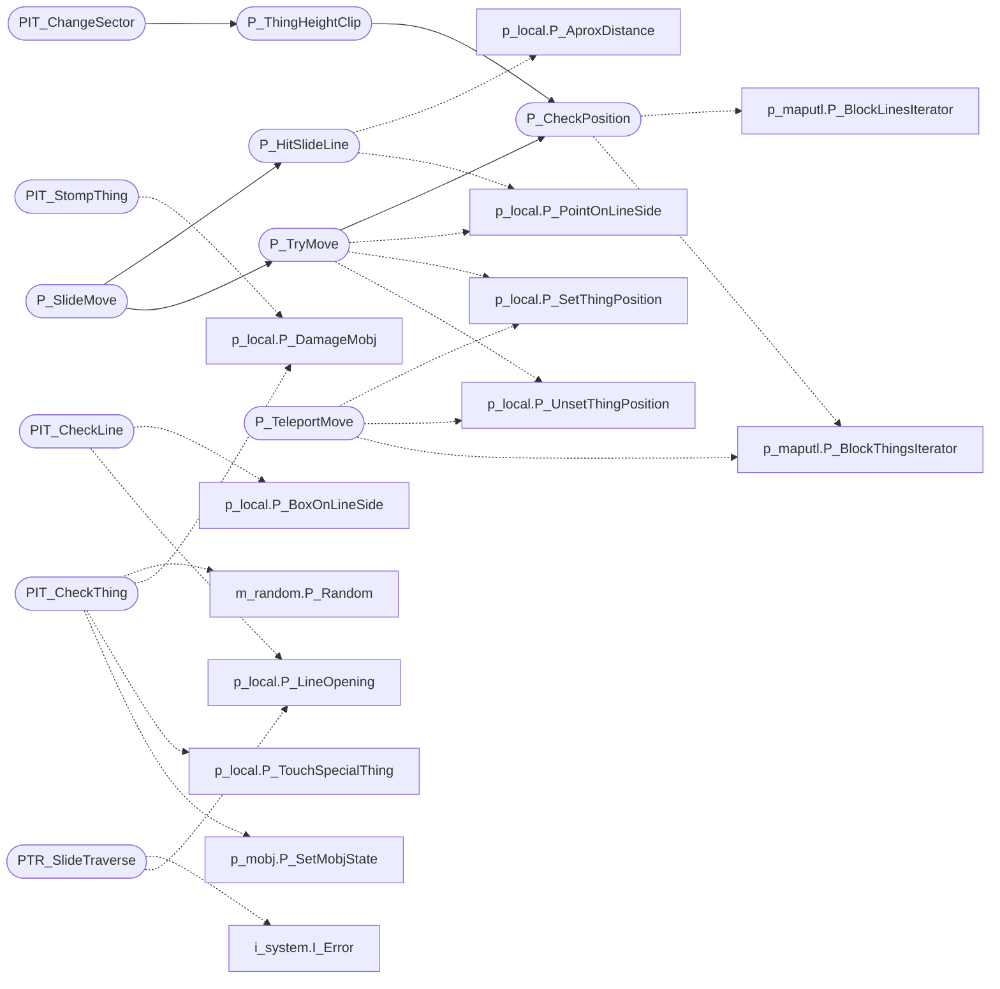

# `progs/doomgeneric/p_map.c`

> Source: [progs/doomgeneric/p_map.c:1](../../progs/doomgeneric/p_map.c#L1) | language `c` | coverage 54.5% | [API index](../index.md)

Copyright(C) 1993-1996 Id Software, Inc.

Copyright(C) 2005-2014 Simon Howard, Andrey Budko  This program is free software; you can redistribute it and/or modify it under the terms of the GNU General Public License as published by the Free Software Foundation; either version 2 of the License, or (at your option) any later version.  This program is distributed in the hope that it will be useful, but WITHOUT ANY WARRANTY; without even the implied warranty of MERCHANTABILITY or FITNESS FOR A PARTICULAR PURPOSE.  See the GNU General Public License for more details.  DESCRIPTION: Movement, collision handling. Shooting and aiming.

## Contents

- **Functions:** [`PIT_StompThing`](#pit_stompthing), [`P_TeleportMove`](#p_teleportmove), [`PIT_CheckLine`](#pit_checkline), [`PIT_CheckThing`](#pit_checkthing), [`P_CheckPosition`](#p_checkposition), [`P_TryMove`](#p_trymove), [`P_ThingHeightClip`](#p_thingheightclip), [`P_HitSlideLine`](#p_hitslideline), [`PTR_SlideTraverse`](#ptr_slidetraverse), [`P_SlideMove`](#p_slidemove), [`PTR_AimTraverse`](#ptr_aimtraverse), [`PTR_ShootTraverse`](#ptr_shoottraverse), [`P_AimLineAttack`](#p_aimlineattack), [`P_LineAttack`](#p_lineattack), [`PTR_UseTraverse`](#ptr_usetraverse), [`P_UseLines`](#p_uselines), [`PIT_RadiusAttack`](#pit_radiusattack), [`P_RadiusAttack`](#p_radiusattack), [`PIT_ChangeSector`](#pit_changesector), [`P_ChangeSector`](#p_changesector)
- **Macros:** [`DEFAULT_SPECHIT_MAGIC`](#default_spechit_magic)
- **Variables:** [`topslope`](#topslope), [`bottomslope`](#bottomslope)

## Call Graph

Solid arrows stay in this module, dashed arrows leave it.



## Functions

<a id="pit_stompthing"></a>

### `PIT_StompThing`

`function` | [progs/doomgeneric/p_map.c:97](../../progs/doomgeneric/p_map.c#L97)

```c
boolean PIT_StompThing (mobj_t* thing)
```

PIT_StompThing

**Parameters**

| Name | Type | Default | Description |
|---|---|---|---|
| `thing` | `mobj_t*` |  |  |

**Returns:** `boolean`

*Calls:* [`P_DamageMobj`](progs.doomgeneric.p_local.h.md#p_damagemobj)

---

<a id="p_teleportmove"></a>

### `P_TeleportMove`

`function` | [progs/doomgeneric/p_map.c:131](../../progs/doomgeneric/p_map.c#L131)

```c
boolean P_TeleportMove ( mobj_t* thing, fixed_t x, fixed_t y )
```

**Parameters**

| Name | Type | Default | Description |
|---|---|---|---|
| `thing` | `mobj_t*` |  |  |
| `x` | `fixed_t` |  |  |
| `y` | `fixed_t` |  |  |

**Returns:** `boolean`

*Calls:* [`P_SetThingPosition`](progs.doomgeneric.p_local.h.md#p_setthingposition), [`P_UnsetThingPosition`](progs.doomgeneric.p_local.h.md#p_unsetthingposition), [`P_BlockThingsIterator`](progs.doomgeneric.p_maputl.c.md#p_blockthingsiterator)

*Called by:* [`A_SpawnFly`](progs.doomgeneric.p_enemy.c.md#a_spawnfly), [`EV_Teleport`](progs.doomgeneric.p_telept.c.md#ev_teleport)

---

<a id="pit_checkline"></a>

### `PIT_CheckLine`

`function` | [progs/doomgeneric/p_map.c:206](../../progs/doomgeneric/p_map.c#L206)

```c
boolean PIT_CheckLine (line_t* ld)
```

PIT_CheckLine Adjusts tmfloorz and tmceilingz as lines are contacted

**Parameters**

| Name | Type | Default | Description |
|---|---|---|---|
| `ld` | `line_t*` |  |  |

**Returns:** `boolean`

*Calls:* [`P_BoxOnLineSide`](progs.doomgeneric.p_local.h.md#p_boxonlineside), [`P_LineOpening`](progs.doomgeneric.p_local.h.md#p_lineopening)

---

<a id="pit_checkthing"></a>

### `PIT_CheckThing`

`function` | [progs/doomgeneric/p_map.c:275](../../progs/doomgeneric/p_map.c#L275)

```c
boolean PIT_CheckThing (mobj_t* thing)
```

PIT_CheckThing

**Parameters**

| Name | Type | Default | Description |
|---|---|---|---|
| `thing` | `mobj_t*` |  |  |

**Returns:** `boolean`

*Calls:* [`P_Random`](progs.doomgeneric.m_random.h.md#p_random), [`P_DamageMobj`](progs.doomgeneric.p_local.h.md#p_damagemobj), [`P_TouchSpecialThing`](progs.doomgeneric.p_local.h.md#p_touchspecialthing), [`P_SetMobjState`](progs.doomgeneric.p_mobj.c.md#p_setmobjstate)

---

<a id="p_checkposition"></a>

### `P_CheckPosition`

`function` | [progs/doomgeneric/p_map.c:402](../../progs/doomgeneric/p_map.c#L402)

```c
boolean P_CheckPosition ( mobj_t* thing, fixed_t x, fixed_t y )
```

**Parameters**

| Name | Type | Default | Description |
|---|---|---|---|
| `thing` | `mobj_t*` |  |  |
| `x` | `fixed_t` |  |  |
| `y` | `fixed_t` |  |  |

**Returns:** `boolean`

*Calls:* [`P_BlockLinesIterator`](progs.doomgeneric.p_maputl.c.md#p_blocklinesiterator), [`P_BlockThingsIterator`](progs.doomgeneric.p_maputl.c.md#p_blockthingsiterator)

*Called by:* [`G_CheckSpot`](progs.doomgeneric.g_game.c.md#g_checkspot), [`PIT_VileCheck`](progs.doomgeneric.p_enemy.c.md#pit_vilecheck), [`P_ThingHeightClip`](#p_thingheightclip), [`P_TryMove`](#p_trymove), [`P_NightmareRespawn`](progs.doomgeneric.p_mobj.c.md#p_nightmarerespawn)

---

<a id="p_trymove"></a>

### `P_TryMove`

`function` | [progs/doomgeneric/p_map.c:478](../../progs/doomgeneric/p_map.c#L478)

```c
boolean P_TryMove ( mobj_t* thing, fixed_t x, fixed_t y )
```

**Parameters**

| Name | Type | Default | Description |
|---|---|---|---|
| `thing` | `mobj_t*` |  |  |
| `x` | `fixed_t` |  |  |
| `y` | `fixed_t` |  |  |

**Returns:** `boolean`

*Calls:* [`P_PointOnLineSide`](progs.doomgeneric.p_local.h.md#p_pointonlineside), [`P_SetThingPosition`](progs.doomgeneric.p_local.h.md#p_setthingposition), [`P_UnsetThingPosition`](progs.doomgeneric.p_local.h.md#p_unsetthingposition), [`P_CheckPosition`](#p_checkposition)

*Called by:* [`A_PainShootSkull`](progs.doomgeneric.p_enemy.c.md#a_painshootskull), [`P_Move`](progs.doomgeneric.p_enemy.c.md#p_move), [`P_SlideMove`](#p_slidemove), [`P_CheckMissileSpawn`](progs.doomgeneric.p_mobj.c.md#p_checkmissilespawn), [`P_XYMovement`](progs.doomgeneric.p_mobj.c.md#p_xymovement)

---

<a id="p_thingheightclip"></a>

### `P_ThingHeightClip`

`function` | [progs/doomgeneric/p_map.c:557](../../progs/doomgeneric/p_map.c#L557)

```c
boolean P_ThingHeightClip (mobj_t* thing)
```

P_ThingHeightClip Takes a valid thing and adjusts the thing->floorz, thing->ceilingz, and possibly thing->z.

This is called for all nearby monsters whenever a sector changes height. If the thing doesn't fit, the z will be set to the lowest value and false will be returned.

**Parameters**

| Name | Type | Default | Description |
|---|---|---|---|
| `thing` | `mobj_t*` |  |  |

**Returns:** `boolean`

*Calls:* [`P_CheckPosition`](#p_checkposition)

*Called by:* [`PIT_ChangeSector`](#pit_changesector)

---

<a id="p_hitslideline"></a>

### `P_HitSlideLine`

`function` | [progs/doomgeneric/p_map.c:611](../../progs/doomgeneric/p_map.c#L611)

```c
void P_HitSlideLine (line_t* ld)
```

P_HitSlideLine Adjusts the xmove / ymove so that the next move will slide along the wall.

**Parameters**

| Name | Type | Default | Description |
|---|---|---|---|
| `ld` | `line_t*` |  |  |

*Calls:* [`P_AproxDistance`](progs.doomgeneric.p_local.h.md#p_aproxdistance), [`P_PointOnLineSide`](progs.doomgeneric.p_local.h.md#p_pointonlineside)

*Called by:* [`P_SlideMove`](#p_slidemove)

---

<a id="ptr_slidetraverse"></a>

### `PTR_SlideTraverse`

`function` | [progs/doomgeneric/p_map.c:663](../../progs/doomgeneric/p_map.c#L663)

```c
boolean PTR_SlideTraverse (intercept_t* in)
```

PTR_SlideTraverse

**Parameters**

| Name | Type | Default | Description |
|---|---|---|---|
| `in` | `intercept_t*` |  |  |

**Returns:** `boolean`

*Calls:* [`I_Error`](progs.doomgeneric.i_system.h.md#i_error), [`P_LineOpening`](progs.doomgeneric.p_local.h.md#p_lineopening), [`P_PointOnLineSide`](progs.doomgeneric.p_local.h.md#p_pointonlineside)

---

<a id="p_slidemove"></a>

### `P_SlideMove`

`function` | [progs/doomgeneric/p_map.c:722](../../progs/doomgeneric/p_map.c#L722)

```c
void P_SlideMove (mobj_t* mo)
```

P_SlideMove The momx / momy move is bad, so try to slide along a wall.

Find the first line hit, move flush to it, and slide along it

This is a kludgy mess.

**Parameters**

| Name | Type | Default | Description |
|---|---|---|---|
| `mo` | `mobj_t*` |  |  |

*Calls:* [`P_HitSlideLine`](#p_hitslideline), [`P_TryMove`](#p_trymove), [`P_PathTraverse`](progs.doomgeneric.p_maputl.c.md#p_pathtraverse)

---

<a id="ptr_aimtraverse"></a>

### `PTR_AimTraverse`

`function` | [progs/doomgeneric/p_map.c:843](../../progs/doomgeneric/p_map.c#L843)

```c
boolean PTR_AimTraverse (intercept_t* in)
```

**Parameters**

| Name | Type | Default | Description |
|---|---|---|---|
| `in` | `intercept_t*` |  |  |

**Returns:** `boolean`

*Calls:* [`P_LineOpening`](progs.doomgeneric.p_local.h.md#p_lineopening)

---

<a id="ptr_shoottraverse"></a>

### `PTR_ShootTraverse`

`function` | [progs/doomgeneric/p_map.c:928](../../progs/doomgeneric/p_map.c#L928)

```c
boolean PTR_ShootTraverse (intercept_t* in)
```

PTR_ShootTraverse

**Parameters**

| Name | Type | Default | Description |
|---|---|---|---|
| `in` | `intercept_t*` |  |  |

**Returns:** `boolean`

*Calls:* [`P_DamageMobj`](progs.doomgeneric.p_local.h.md#p_damagemobj), [`P_LineOpening`](progs.doomgeneric.p_local.h.md#p_lineopening), [`P_SpawnBlood`](progs.doomgeneric.p_local.h.md#p_spawnblood), [`P_SpawnPuff`](progs.doomgeneric.p_local.h.md#p_spawnpuff)

---

<a id="p_aimlineattack"></a>

### `P_AimLineAttack`

`function` | [progs/doomgeneric/p_map.c:1068](../../progs/doomgeneric/p_map.c#L1068)

```c
fixed_t P_AimLineAttack ( mobj_t* t1, angle_t angle, fixed_t distance )
```

**Parameters**

| Name | Type | Default | Description |
|---|---|---|---|
| `t1` | `mobj_t*` |  |  |
| `angle` | `angle_t` |  |  |
| `distance` | `fixed_t` |  |  |

**Returns:** `fixed_t`

*Calls:* [`P_SubstNullMobj`](progs.doomgeneric.p_local.h.md#p_substnullmobj), [`P_PathTraverse`](progs.doomgeneric.p_maputl.c.md#p_pathtraverse)

---

<a id="p_lineattack"></a>

### `P_LineAttack`

`function` | [progs/doomgeneric/p_map.c:1110](../../progs/doomgeneric/p_map.c#L1110)

```c
P_LineAttack ( mobj_t* t1, angle_t angle, fixed_t distance, fixed_t slope, int damage )
```

**Parameters**

| Name | Type | Default | Description |
|---|---|---|---|
| `t1` | `mobj_t*` |  |  |
| `angle` | `angle_t` |  |  |
| `distance` | `fixed_t` |  |  |
| `slope` | `fixed_t` |  |  |
| `damage` | `int` |  |  |

*Calls:* [`P_PathTraverse`](progs.doomgeneric.p_maputl.c.md#p_pathtraverse)

---

<a id="ptr_usetraverse"></a>

### `PTR_UseTraverse`

`function` | [progs/doomgeneric/p_map.c:1142](../../progs/doomgeneric/p_map.c#L1142)

```c
boolean PTR_UseTraverse (intercept_t* in)
```

**Parameters**

| Name | Type | Default | Description |
|---|---|---|---|
| `in` | `intercept_t*` |  |  |

**Returns:** `boolean`

*Calls:* [`P_LineOpening`](progs.doomgeneric.p_local.h.md#p_lineopening), [`P_PointOnLineSide`](progs.doomgeneric.p_local.h.md#p_pointonlineside), [`P_UseSpecialLine`](progs.doomgeneric.p_switch.c.md#p_usespecialline), [`S_StartSound`](progs.doomgeneric.s_sound.h.md#s_startsound)

---

<a id="p_uselines"></a>

### `P_UseLines`

`function` | [progs/doomgeneric/p_map.c:1177](../../progs/doomgeneric/p_map.c#L1177)

```c
void P_UseLines (player_t* player)
```

P_UseLines Looks for special lines in front of the player to activate.

**Parameters**

| Name | Type | Default | Description |
|---|---|---|---|
| `player` | `player_t*` |  |  |

*Calls:* [`P_PathTraverse`](progs.doomgeneric.p_maputl.c.md#p_pathtraverse)

---

<a id="pit_radiusattack"></a>

### `PIT_RadiusAttack`

`function` | [progs/doomgeneric/p_map.c:1211](../../progs/doomgeneric/p_map.c#L1211)

```c
boolean PIT_RadiusAttack (mobj_t* thing)
```

PIT_RadiusAttack "bombsource" is the creature that caused the explosion at "bombspot".

**Parameters**

| Name | Type | Default | Description |
|---|---|---|---|
| `thing` | `mobj_t*` |  |  |

**Returns:** `boolean`

*Calls:* [`P_DamageMobj`](progs.doomgeneric.p_local.h.md#p_damagemobj), [`P_CheckSight`](progs.doomgeneric.p_sight.c.md#p_checksight)

---

<a id="p_radiusattack"></a>

### `P_RadiusAttack`

`function` | [progs/doomgeneric/p_map.c:1253](../../progs/doomgeneric/p_map.c#L1253)

```c
void P_RadiusAttack ( mobj_t* spot, mobj_t* source, int damage )
```

**Parameters**

| Name | Type | Default | Description |
|---|---|---|---|
| `spot` | `mobj_t*` |  |  |
| `source` | `mobj_t*` |  |  |
| `damage` | `int` |  |  |

*Calls:* [`P_BlockThingsIterator`](progs.doomgeneric.p_maputl.c.md#p_blockthingsiterator)

---

<a id="pit_changesector"></a>

### `PIT_ChangeSector`

`function` | [progs/doomgeneric/p_map.c:1304](../../progs/doomgeneric/p_map.c#L1304)

```c
boolean PIT_ChangeSector (mobj_t* thing)
```

PIT_ChangeSector

**Parameters**

| Name | Type | Default | Description |
|---|---|---|---|
| `thing` | `mobj_t*` |  |  |

**Returns:** `boolean`

*Calls:* [`P_Random`](progs.doomgeneric.m_random.h.md#p_random), [`P_DamageMobj`](progs.doomgeneric.p_local.h.md#p_damagemobj), [`P_RemoveMobj`](progs.doomgeneric.p_local.h.md#p_removemobj), [`P_SpawnMobj`](progs.doomgeneric.p_local.h.md#p_spawnmobj), [`P_ThingHeightClip`](#p_thingheightclip), [`P_SetMobjState`](progs.doomgeneric.p_mobj.c.md#p_setmobjstate)

---

<a id="p_changesector"></a>

### `P_ChangeSector`

`function` | [progs/doomgeneric/p_map.c:1368](../../progs/doomgeneric/p_map.c#L1368)

```c
boolean P_ChangeSector ( sector_t* sector, boolean crunch )
```

**Parameters**

| Name | Type | Default | Description |
|---|---|---|---|
| `sector` | `sector_t*` |  |  |
| `crunch` | `boolean` |  |  |

**Returns:** `boolean`

*Calls:* [`P_BlockThingsIterator`](progs.doomgeneric.p_maputl.c.md#p_blockthingsiterator)

*Called by:* [`T_MovePlane`](progs.doomgeneric.p_floor.c.md#t_moveplane)

---

## Macros

<a id="default_spechit_magic"></a>

### `DEFAULT_SPECHIT_MAGIC`

`macro` | [progs/doomgeneric/p_map.c:50](../../progs/doomgeneric/p_map.c#L50)

```c
#define DEFAULT_SPECHIT_MAGIC
```

---

## Variables

<a id="topslope"></a>

### `topslope`

`variable` `extern` | [progs/doomgeneric/p_map.c:834](../../progs/doomgeneric/p_map.c#L834)

```c
extern fixed_t topslope;
```

slopes to top and bottom of target

---

<a id="bottomslope"></a>

### `bottomslope`

`variable` `extern` | [progs/doomgeneric/p_map.c:835](../../progs/doomgeneric/p_map.c#L835)

```c
extern fixed_t bottomslope;
```

---
